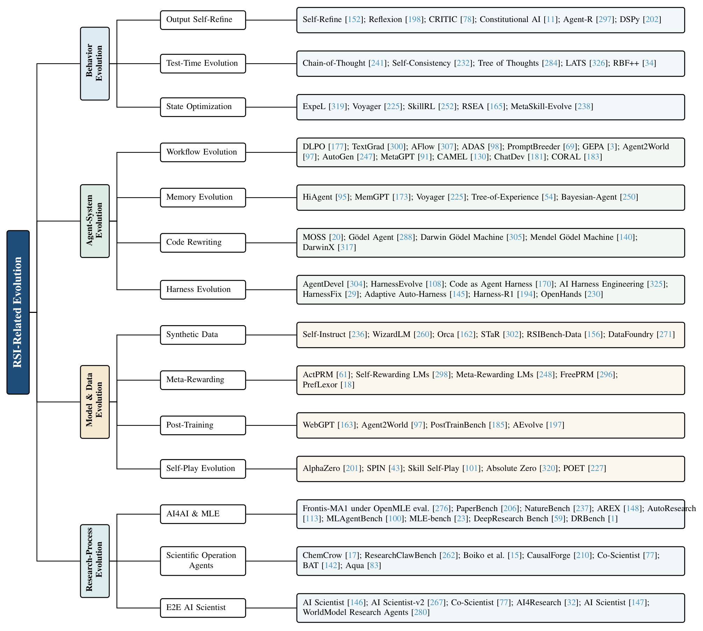

# 递归自我改进（RSI）

[English overview](../README.md)

## 项目概览

递归自我改进（Recursive Self-Improvement，RSI）关注一项经过验证、被接受的改动，如何作为后续改进轮的起点，并实际参与下一次改进。一次任务内的输出修订、后续任务对改动的复用，以及后续改进轮对改动的依赖，各自需要不同的证据。要进一步主张「递归进步」，还要验证继承的改动能否让后续改进过程产生质量更高的后继版本。参见 [综述 §3 与 Fig. 3](https://lee1003-lee.github.io/Awesome-RSI-Research/assets/rsi-survey.pdf#page=5)。

本项目从 RSI 的历史、操作定义和**提议 → 反馈 → 优化**三阶段入手，把综述的公式和符号放回具体案例，再按四类改动对象拆解代表论文。每篇主线论文从问题定义、实验设置、输入输出与约束出发，追踪候选如何生成、怎样验收、哪些结果会进入下一轮，并讨论现有对照能支持什么结论。贯穿材料的比较问题是，在任务、预算和评价口径一致时，能否把后续收益归因于被继承的改动？

- **基础与综述** · `RSI-Foundations.md` 介绍历史、三阶段形式化、最小 RSI 和递归进步的判据、分类、应用与开放问题。[中文](RSI-Foundations.md) · [English](../RSI-Foundations.md)
- **代表论文拆解** · `Representative-Paper-Analyses.md` 对照论文原图解读方法与实验，并附完整文献索引。[中文](Representative-Papers/Representative-Paper-Analyses.md) · [English](../Representative-Papers/Representative-Paper-Analyses.md)

## 分类与代表论文

分类依据是论文**主要改动的对象**。同一类里的方法可以提供强度不同的证据，因此给论文定位时，先看它改的是哪种对象，再查改动是否留存、在哪里被使用。综述 Fig. 5 展开四类及其分支，Fig. 6 按改动范围、反馈方式、积累路径和证据标准比较四类方法。[作者分类页面](https://lee1003-lee.github.io/Awesome-RSI-Research/#taxonomy) · [综述 §5](https://lee1003-lee.github.io/Awesome-RSI-Research/assets/rsi-survey.pdf#page=16)

### 行为进化 · Behavior Evolution

主要改动是当前任务中的答案、推理路径或动作序列。对照同题修订与解题过程中对中间状态的搜索。见 `Representative-Paper-Analyses.md` §1。[Awesome · Behavior Evolution](https://github.com/Lee1003-lee/Awesome-RSI-Research/blob/main/README.md#behavior-evolution)

- 同一个模型点评初稿并修订。[Self-Refine: Iterative Refinement with Self-Feedback](https://arxiv.org/abs/2303.17651)
- 在输出最终答案之前展开、评价和筛选部分解。[Tree of Thoughts: Deliberate Problem Solving with Large Language Models](https://arxiv.org/abs/2305.10601)

### 代理系统进化 · Agent-System Evolution

主要改动是可跨任务重复运行的代理设施，例如工作流、记忆、工具接口或代理代码。见 `Representative-Paper-Analyses.md` §2。[Awesome · Agent-System Evolution](https://github.com/Lee1003-lee/Awesome-RSI-Research/blob/main/README.md#agent-system-evolution)

- 生成、评估并归档代理的新版本，供后续选择。[Darwin Gödel Machine: Open-Ended Evolution of Self-Improving Agents](https://arxiv.org/abs/2505.22954)
- 在以代码表示的工作流空间中搜索可复用流程。[AFlow: Automating Agentic Workflow Generation](https://arxiv.org/abs/2410.10762)
- 将任务程序和产生修改的程序放在同一个可编辑系统中。配套 `Hyperagents.md`。[Hyperagents](https://arxiv.org/abs/2603.19461v2) · [中文](Representative-Papers/Hyperagents.md) · [English](../Representative-Papers/Hyperagents.md) · [作者代码](https://github.com/facebookresearch/HyperAgents)

### 模型与数据进化 · Model and Data Evolution

主要改动是训练样本、奖励或模型参数。重点追踪当前版本生成了什么训练信号，以及哪个版本接手下一轮。见 `Representative-Paper-Analyses.md` §3。[Awesome · Model and Data Evolution](https://github.com/Lee1003-lee/Awesome-RSI-Research/blob/main/README.md#model--data-evolution)

- 生成解题理由，用已知答案筛选样本，再训练下一轮的数据生成者。[STaR: Bootstrapping Reasoning With Reasoning](https://arxiv.org/abs/2203.14465)
- 用当前棋手自博弈产生训练数据，获准采用的新棋手继续生成数据。[Mastering the game of Go without human knowledge（AlphaGo Zero）](https://discovery.ucl.ac.uk/id/eprint/10045895/)
- 从交互轨迹提炼技能，使技能库与执行策略在训练中共同更新。配套 `SkillRL.md`。[SkillRL: Evolving Agents via Recursive Skill-Augmented Reinforcement Learning](https://arxiv.org/abs/2602.08234v2) · [中文](Representative-Papers/SkillRL.md) · [English](../Representative-Papers/SkillRL.md) · [作者代码](https://github.com/aiming-lab/SkillRL)

### 研究过程进化 · Research-Process Evolution

主要改动是研究过程中的计划、实验方案、评价或证据使用方式。重点追踪一次实验的结果如何影响下一项研究决定。见 `Representative-Paper-Analyses.md` §4。[Awesome · Research-Process Evolution](https://github.com/Lee1003-lee/Awesome-RSI-Research/blob/main/README.md#research-process-evolution)

- 将研究想法转换成可执行实验，并依据结果修订计划。[The AI Scientist: Towards Fully Automated Open-Ended Scientific Discovery](https://arxiv.org/abs/2408.06292v3)
- 以机器学习工程任务为场景，用试验成绩与经验记录引导下一次方案搜索。[Frontis-MA1: Training an AI4AI Model towards Recursive Self-Improvement in Machine Learning Engineering](https://arxiv.org/abs/2607.28568v1)

## 原文与配套材料

- **综述原文与扩展阅读** · 综述提供操作定义、分类和评价框架，作者维护的 Awesome 列表可用于继续查找各方向的论文与基准。[Towards AI That Improves Itself: A Survey of Recursive Self-Improvement](https://lee1003-lee.github.io/Awesome-RSI-Research/assets/rsi-survey.pdf) · [Awesome RSI Research](https://github.com/Lee1003-lee/Awesome-RSI-Research)
- **分类图与证据图** · `Figures/` 存放综述原图和代表论文图表。[Fig. 3 操作定义](../Figures/fig03_definition.png) · [Fig. 5 分类树](../Figures/fig05_taxonomy_tree.png) · [Fig. 6 分类比较](../Figures/fig06_taxonomy_map.png) · [Fig. 7 证据阶梯](../Figures/fig07_evidence_ladder.png) · [全部插图](../Figures/)
- **实验基准** · 软件工程代理用真实项目问题与测试衡量任务完成情况，机器学习工程代理则用规定资源下的实验任务衡量表现。[SWE-bench: Can Language Models Resolve Real-World GitHub Issues?](https://arxiv.org/abs/2310.06770) · [MLE-bench: Evaluating Machine Learning Agents on Machine Learning Engineering](https://arxiv.org/abs/2410.07095)
