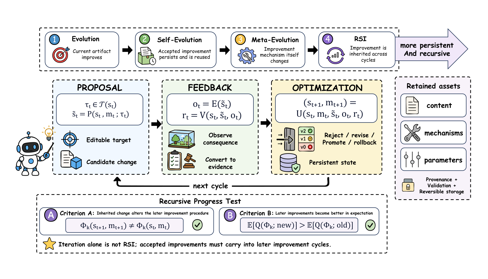
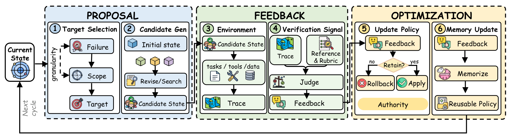
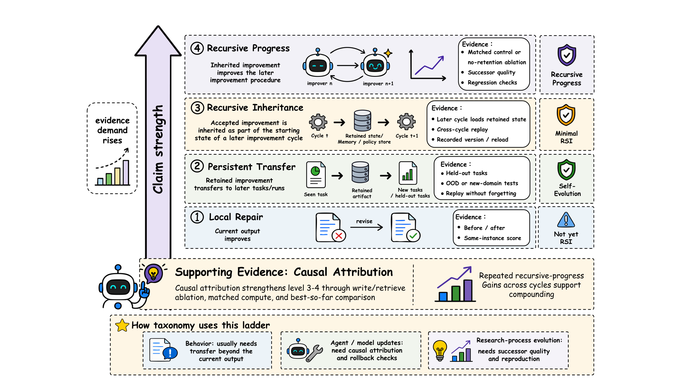
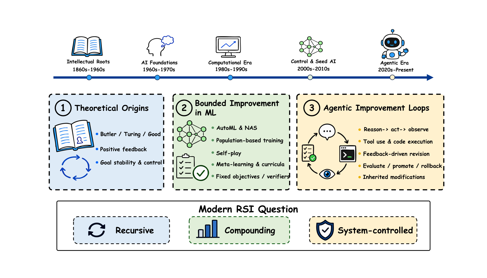
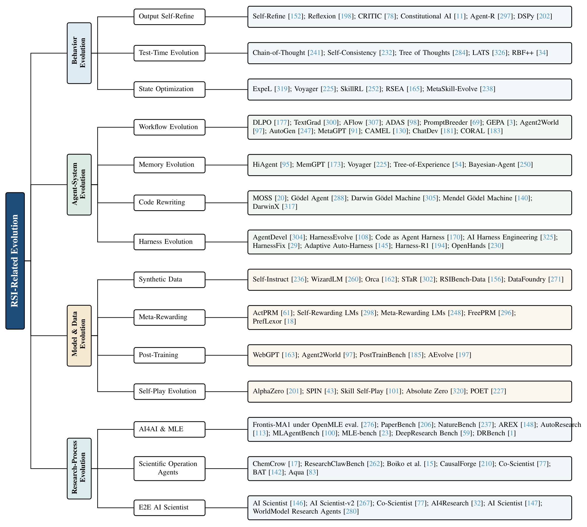
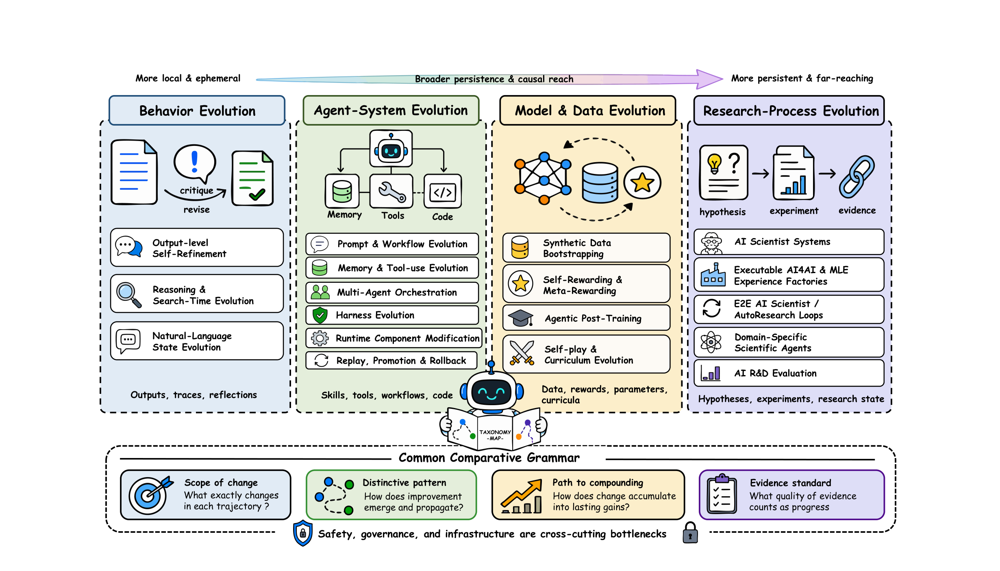
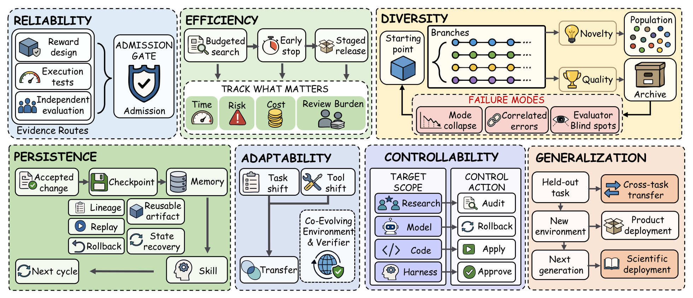

# Recursive Self-Improvement in AI

**递归自我改进（Recursive Self-Improvement，RSI）** 的最小条件是，一轮中有证据支持的改进被接受并保留，后来的改进轮以它为起点并实际依赖它。想看一次改进怎样运行，读 §2.1–2.3 的式 (2)–(4)。想看「递归」在哪里发生，读 §2.4 的式 (1)。想看如何检验后轮更会改，直接读 §3.2 的式 (5)–(7)。

编号沿用 Li、Chen 等人的综述。额外用于判断和计算的式子标为补充记号。各式下面都可以就地查符号和 24 点例子的代入值，例中的数值用于演示计算。 [综述 PDF](https://lee1003-lee.github.io/Awesome-RSI-Research/assets/rsi-survey.pdf) · [代表论文精读](Representative-Papers/Representative-Paper-Analyses.md) · [作者项目页](https://lee1003-lee.github.io/Awesome-RSI-Research/) · [Awesome RSI Research](https://github.com/Lee1003-lee/Awesome-RSI-Research)

## 1. 先确定什么在执行，什么在更新

### 1.1 一道题、一次解题尝试和一轮改进

设 $x$ 是**一道任务的输入**，$y$ 是系统为它交出的**结果**。24 点示例中，$x=(4,9,10,13)$ 是四张牌，$y=(10-4)\times(13-9)$ 是一个算式。算式只用加、减、乘、除和括号。独立评分器同时检查算值为 24、四张牌各使用一次。一道题里可以先写一个算式，再根据反馈重写。此处将第 $i$ 次尝试的结果记成 $y_i$，下标 $i$ 只数本题的步骤。下标通常指明「哪一步、哪一轮或哪一个对象」。

**一轮改进**要处理另一个对象。它接收一份当前解题流程，产生一份候选流程，用一批题运行并比较，最后决定保存哪份流程。综述用 $t$ 数改进轮，$t+1$ 是紧接着的一轮。一次改进轮可运行许多题，每题又可有几个步骤 $i$。执行一题得到答复和执行记录。改进轮结束时才决定是否换工作流。后文的 AlphaGo Zero 也有多层时间。一手棋里的搜索、完整的一局、训练并验收新版棋手，各有自己的计数。 [综述 §3.1–3.2，PDF 第 5–6 页](https://lee1003-lee.github.io/Awesome-RSI-Research/assets/rsi-survey.pdf#page=5)

### 1.2 一轮开始时有哪些东西？

| 记号 | 在第 $t$ 轮开始时是什么 | 24 点求解示例 |
| --- | --- | --- |
| $s_t$ | **本轮开始时作为起点的系统状态**。先声明系统边界，它可以包括提示、工具代码或权重。 | 写算式、选算式和验算的工作流。例中固定底座模型。 |
| $m_t$ | **可跨轮读取的记忆和版本记录**。保存日志、被验收的证据或可调用经验，供后续选择。 | 旧工作流的测题成绩、失败题目和对应版本。 |
| $S_t=(s_t,m_t)$ | **补充记号**，把系统和记忆合称本轮的起始状态。括号中的两项作为一对交接。 | 重载当前流程和它对应的记录。 |

被验证的改进可能写进系统 $s_t$，也可能只改可重用记忆 $m_t$。将底座模型算作系统的一部分，并不表示实验允许更新其权重。**现行版（incumbent）**是选定用于此次比较的版本。分支搜索里，生成候选的父版、库内最高分版和实际上线的版本可以不同，所以论文要注明当次以谁为参照。

下文用同一个示例。**旧流程**每题看两份算式，取第一份值为 24 的算式。**新候选**按相同顺序看这两份算式，取第一份既等于 24 又符合用牌规则的算式。找不到满足各自规则的候选时交卷失败。两版均由同一个**独立评分器**按完整规则评价。在 20 道验收题中，旧版答对 14 道。这里的输入、预算和数字为该示例构造。实践中还需声明改动范围、评价指标、样本、停止条件和允许的回归。 [综述 §3.1、§3.3，PDF 第 5–8 页](https://lee1003-lee.github.io/Awesome-RSI-Research/assets/rsi-survey.pdf#page=5)

## 2. 按 Fig. 3 走完一轮，再把结果交给下一轮

*Li 等，Fig. 3，PDF 第 5 页。先看中间蓝、绿、黄三框，分别是提议、反馈、更新。更新结束后的回箭头是跨轮继承。底部 A、B 两框是后续改进过程的两个检验，在本文第 3 节展开。* [综述原图](https://lee1003-lee.github.io/Awesome-RSI-Research/assets/rsi-survey.pdf#page=5)

### 2.1 式 (2) · Proposal（提议）怎么从旧版得到候选？

以 24 点求解代理为例。该代理正在用一套旧流程解题，本轮允许改提示或验算规则。提议阶段先决定**改哪里**，再写出一整份能拿去试跑的候选流程。

$$
\tau_t\in\mathcal T(s_t),\qquad
\tilde s_t=P(s_t,m_t;\tau_t).
\tag{2}
$$

| 符号 | 在这条式子里指什么 | 第 0 轮代入什么 |
| --- | --- | --- |
| $t$ | 改进流程的轮次。这一轮会用多道题来试验。 | $t=0$，从旧流程开始的第一轮。 |
| $s_t$ | 本轮开始时正在使用的系统。 | $s_0$ 是旧求解流程，从两份算式中取首个值为 24 的。 |
| $m_t$ | 开始时能读到的历史记录。 | $m_0$ 中有旧版交卷重复用牌的记录。 |
| $\mathcal T(s_t)$ | 在这个系统上允许编辑的对象集合。$\mathcal T$ 读作可改范围，括号里的 $s_t$ 指明范围针对哪个系统。 | 可改范围包含提示与验算规则。 |
| $\tau_t,\ \in$ | $\tau_t$（tau）是本轮选中的对象。$\in$ 读「属于」。 | $\tau_0$ 选「验算规则」，属于允许范围。 |
| $P$ | 写候选的提议机制。式中的分号把起始状态、记录与所选目标隔开。 | $P$ 根据重复用牌的记录，写入逐张验算。 |
| $\tilde s_t$ | 本轮刚生成、还待验收的候选。波浪号标记「候选」。 | $\tilde s_0$ 是加入用牌规则的新流程。 |

**连起来读。** 左边限定本轮能改哪里。右边把旧版和记录交给 $P$，要求在选定位置改写，输出候选。例中仍保留每题两份候选的预算。第 0 轮的直接产物是**一套待测流程**，能拿它去跑许多道题。 [综述 §3.2，式 (2)，PDF 第 6 页](https://lee1003-lee.github.io/Awesome-RSI-Research/assets/rsi-survey.pdf#page=6)

### 2.2 式 (3) · Feedback（反馈）如何把试跑变成证据？

比较两个 24 点工作流。旧版只检查算值，新候选还检查每张牌是否恰用一次。两版接收同样的两份算式，验收时用同一批题和同一个独立评分器。

$$
o_t=E(\tilde s_t),\qquad
r_t=V(s_t,\tilde s_t,o_t).
\tag{3}
$$

| 符号 | 在这条式子里指什么 | 第 0 轮代入什么 |
| --- | --- | --- |
| $t,\ s_t,\ \tilde s_t$ | $t$ 数改进轮，$s_t$ 是旧的对照版，$\tilde s_t$ 是要试跑的新候选。 | $t=0$，对照旧流程 $s_0$，试跑新候选 $\tilde s_0$。 |
| $E$ | 执行过程或环境，负责运行候选。在本式中，题集和调用上限由实验约定。 | 用同一批 20 道题运行求解流程。 |
| $o_t$ | 执行时实际发生的事。$o$ 在这里表示观测。 | $o_0$ 有候选算式、最后交卷、拒绝原因和调用数。 |
| $V$ | 将运行观测变成验证证据的评分过程。它可以使用同协议下留存的旧版运行结果。 | 对两版的交卷都检查算值和用牌规则，再比较答对题数。 |
| $r_t$ | 按评分规则形成的证据。可以是一项分差，也可以附带通过情况、成本和回归记录。 | $r_0=17/20-14/20=0.15$。 |

**逐式读。** 先把候选交给 $E$，得到「它实际交了什么」。再由 $V$ 根据对照和标准判断「这些结果说明它进步了多少」。

**代入一道题。** 四张牌是 $4,9,10,13$。两版先看到 $10+10+13-9=24$，再看到 $(10-4)\times(13-9)=24$。旧版交第一份。新候选记录「重复使用 10、漏用 4」，交第二份。以上是运行观测。外部 $V$ 给第一份判错，给第二份判对。累计 20 道题，旧版答对 14 道，新候选答对 17 道，所以正确率**增加 15 个百分点**。 [综述 §3.2，式 (3)，PDF 第 6 页](https://lee1003-lee.github.io/Awesome-RSI-Research/assets/rsi-survey.pdf#page=6)

### 2.3 式 (4) · Optimization（更新）验收后，下一轮拿到什么？

一套新 24 点流程在相同的 20 道题上由 14 道答对提高到 17 道，仍遵守每题最多两份候选的约束。这一节要决定是否采用新流程，以及把哪些证据和记录交给下一轮。

$$
(s_{t+1},m_{t+1})=U(s_t,m_t,\tilde s_t,o_t,r_t).
\tag{4}
$$

| 符号 | 在这条式子里指什么 | 第 0 轮代入什么 |
| --- | --- | --- |
| $t,\ t+1$ | 本轮与紧接着的一轮。左边的两项都在本轮结束时写出。 | 第 0 轮结束，交给第 1 轮。 |
| $s_t,\ m_t$ | 本轮开始时的系统与历史记录。 | 旧流程 $s_0$ 与当时的错题、版本记录 $m_0$。 |
| $\tilde s_t$ | 本轮待验收的系统。 | 增加用牌检查的新流程 $\tilde s_0$。 |
| $o_t,\ r_t$ | $o_t$ 是运行记录，$r_t$ 是据此得出的验证证据。 | 记录显示守住两份候选的限制。相比旧版多答对 3 道。 |
| $U$ | 更新策略，依据已有证据决定采用、继续试验、拒绝或回滚。 | 约定至少多答对 2 道并守住生成上限才采用。 |
| $s_{t+1}$ | 供下一轮使用的系统。 | 门槛通过，$s_1=\tilde s_0$，本轮候选成为下一轮的正式版本。 |
| $m_{t+1}$ | 供下一轮读取的记录。括号 $(s_{t+1},m_{t+1})$ 表示一起交付系统和记录。 | $m_1$ 加入候选拒绝原因、旧版成绩、验收依据和新版位置。 |

**逐式读。** 右侧五项给 $U$ 提供决定的依据，左侧两项是决定后真正留下的东西。拒绝候选时也可以追加失败记录。

**代入反例。** 如果新版本只答对 15 道，只比旧版多 1 道，未过 2 道的门槛。第 1 轮会沿用旧版，即 $s_1=s_0$。仍可在 $m_1$ 中记下拒绝原因。这就是评分 $V$ 与更新 $U$ 的分工。 [综述 §3.2，式 (4)，PDF 第 6 页](https://lee1003-lee.github.io/Awesome-RSI-Research/assets/rsi-survey.pdf#page=6)

*Li 等，Fig. 4，PDF 第 8 页。图里的 v0、v1、v2 是版本号。跟着 ① 到 ⑥ 看各步交换什么。* [综述原图](https://lee1003-lee.github.io/Awesome-RSI-Research/assets/rsi-survey.pdf#page=8)

| 图中阶段 | 谁读什么，交出什么 | 24 点求解代理对应项 |
| --- | --- | --- |
| Proposal（提议） | ① 从现状挑目标 $\tau_t$。② $P$ 写候选 $\tilde s_t$。 | 发现重复用牌，产生带逐牌验算的新流程。 |
| Feedback（反馈） | ③ $E$ 运行候选，留下记录 $o_t$。④ $V$ 将记录与对照变成证据 $r_t$。 | 先实跑 20 题，再按统一标准评分。 |
| Optimization（更新） | ⑤ $U$ 决定用哪个版本。⑥ 保存后续能读取的系统 $s_{t+1}$ 和记录 $m_{t+1}$。 | 采用新流程，记下接受原因和候选失败明细。 |

图中的保留资产也可以是技能、代理代码或训练权重，资产进入下一轮时要能追到版本、接受依据与实际用途。 [综述 §3.1、§4，PDF 第 6、8–16 页](https://lee1003-lee.github.io/Awesome-RSI-Research/assets/rsi-survey.pdf#page=8)

### 2.4 式 (1) · 后一轮从哪个版本起步？

设一套新的 24 点求解代理流程已通过验收。它增加了用牌检查，同时留下「哪份候选为什么被拒绝」的记录。下一轮想改生成提示，可以把已采用的流程和这些记录一起交给提议机制。

$$
\tau_{t+1}\in\mathcal T(s_{t+1}),\qquad
\tilde s_{t+1}=P(s_{t+1},m_{t+1};\tau_{t+1}).
\tag{1}
$$

| 符号 | 在这条式子里指什么 | 第 1 轮代入什么 |
| --- | --- | --- |
| $t,\ t+1$ | $t$ 是已完成写回的那一轮，$t+1$ 是现在开始的新一轮。 | 改验算器在第 0 轮，改生成提示在第 1 轮。 |
| $s_{t+1}$ | 上一轮写回、现在实际使用的系统。 | $s_1$ 是已采用的新验算流程。用第 0 轮的符号写，就是 $s_1=\tilde s_0$。 |
| $m_{t+1}$ | 上一轮写回、现在能读取的记录。 | $m_1$ 带有「重复使用 10、漏用 4」等候选拒绝原因。 |
| $\mathcal T(s_{t+1})$ | 新版系统上可以编辑的对象集合。 | 仍可改生成提示和验算规则。 |
| $\tau_{t+1},\ \in$ | 新一轮选中的目标及其属于允许范围的条件。 | $\tau_1$ 选「第二次生成用的提示」。 |
| $P$ | 读当前流程、记录和目标后写新候选的机制。 | 根据逐牌拒绝原因改提示。 |
| $\tilde s_{t+1}$ | 现在才提出的候选，波浪号表示尚待新一轮验收。 | $\tilde s_1$ 是用正式版 $s_1$ 再改生成提示得到的流程。 |

**逐式读。** 左式选出新目标，右式用已经继承的系统和记录写出另一个候选。两条式子里的下标都指新一轮。$s_{t+1}$ 是**进来时拿到的版本**，$\tilde s_{t+1}$ 是**这一轮新交出的试稿**。

**代入一次交接。** 第 1 轮读到上次保存的逐牌拒绝记录，于是在提示里加入「交卷前将用过的数字和输入逐张对照」。依赖体现在候选的实际改动中。即使这份提示随后被拒绝，前一轮的记录已经参与了本轮改进。如果该代理只是用新流程做新题，能证明的是任务复用。 [综述 §3.1，式 (1)，PDF 第 6 页](https://lee1003-lee.github.io/Awesome-RSI-Research/assets/rsi-survey.pdf#page=6)

#### 最小 RSI · 怎样用一条记录判定「递归」？

按综述的操作定义，先找一项有证据且被采用的改进，再追踪一个后来真正依赖这项改进的改进轮。下面的判定式使用**补充记号**。

$$
\exists\,t,k,I_t:\quad k>t
\ \land\ A_t(I_t)=1
\ \land\ L^{\mathrm{cycle}}_{t\to k}(I_t)=1.
$$

| 符号 | 含义 | 24 点例子 |
| --- | --- | --- |
| $t,\ k,\ k>t$ | $t$ 数原改动发生的轮，$k$ 数后来接手的改进轮。$k>t$ 表示接手确实发生在之后。 | $t=0,k=1$。有档案分支时也可能过几轮才用。 |
| $I_t$ | 指明具体追踪的那项改动。 | $I_0$ 是给代理的验算器加上用牌规则。 |
| $A_t(I_t)$ | 有相对对照版变好的证据，且该改动被接受并可从版本或记录中重新加载。 | 同批题多答对 3 道，达到预定门槛，验算器被写回，因此 $A_0(I_0)=1$。 |
| $L^{\mathrm{cycle}}_{t\to k}(I_t)$ | 上标 $\mathrm{cycle}$ 指改进循环。轮 $k$ 从含有这项改动的状态起步，并在提议、反馈或更新时实际依赖它。 | 第 1 轮确实读取新验算器的记录来改提示，因此 $L^{\mathrm{cycle}}_{0\to1}(I_0)=1$。 |
| $\exists,\ \land,\ =1$ | 分别读「至少存在一个」「并且」「该条件成立」。有证据表明条件未满足时记 0。证据不足时记待核实。 | 找到上述一组 $t,k,I_t$ 就满足这条最小判据。 |

**整式读法。** 至少存在一次前后轮的交接，这次交接既有原改动的验收证据，又有后续改进的使用证据。若要单独记录新题执行时的复用，可写 $L^{\mathrm{task}}_{t\to j}(I_t)=1$。这里 $\mathrm{task}$ 指执行任务，$j$ 是后来的第 $j$ 项任务。一次普通解题调用和一次继续改流程的调用各有一份证据。Darwin Gödel Machine（DGM）的谱系图可用来定位入档版本何时实际生成了后继。 [综述 §3.1、§3.3，PDF 第 5–8 页](https://lee1003-lee.github.io/Awesome-RSI-Research/assets/rsi-survey.pdf#page=5) · [DGM Fig. 3](https://arxiv.org/pdf/2505.22954v3#page=7)

## 3. 四个概念与改进者收益

### 3.1 Fig. 3 顶栏。演化、自进化、元进化与 RSI 有何关系？

观察同一类 24 点求解代理时，可以先问「这次改变作用于哪里」，再问「保留后用它做了什么」。一个系统可以满足其中多个判定条件。

| 原文概念 | 定义与式子读法 | 24 点例子 |
| --- | --- | --- |
| **演化（Evolution）** | 一道题内的当前结果变好，变化只服务本题。$q_x(y_{i+1})>q_x(y_i)$ 读作「对任务 $x$，后一次结果的分数较高」。$i$ 是本题的尝试序号，$y_i,y_{i+1}$ 是先后两稿，$q_x$ 是这道题的评分。 | 评分只取对 1、错 0。把重复使用 10 的错式换成合法式，分数从 0 到 1。本次修订留在这题里。 |
| **自进化（Self-Evolution）** | 有证据的改进被接受、保存，并实际用于后续任务。 | 新的用牌检查获批保留，代理用它解另一道题。 |
| **元进化（Meta-Evolution）** | 经检验并接受的改动触及后续的提议、验证、选版或应用机制。 | 改验收机制 $U$，在整体正确率门槛外，要求「重复用牌错误数不得增加」。新机制也经检验后被采纳。 |
| **最小 RSI（Minimal RSI）** | 有证据的改进被接受、保存，并被后来的**改进轮**用作起点、实际依赖。 | 下一轮用经接受的验算器留下的拒绝原因改提示。本轮继续修流程，已经用到了前轮的产物。 |

**在同一个系统里怎么区分。** 让提议器读取已保留的拒绝原因来修提示，可建立最小 RSI 的证据，即使其提议程序的实现固定。若观察到验收规则被修改并采纳，可以讨论元进化。要再判断这项机制改动是否产生了递归继承，查后来的改进过程有没有真正采用它。 [综述 §3.1，PDF 第 5–6 页](https://lee1003-lee.github.io/Awesome-RSI-Research/assets/rsi-survey.pdf#page=5) · [综述 Table 1，PDF 第 17 页](https://lee1003-lee.github.io/Awesome-RSI-Research/assets/rsi-survey.pdf#page=17)

### 3.2 式 (5)–(7) · 怎样知道后轮更会改？

这里讨论的是**改进者**，即提出、运行、验证和选取新版的整套过程。要支持**递归进步（recursive progress）**，先确认一项有证据的改进实际进入了后轮，再查它改变了哪个改进环节，以及这次改变是否提高了后继的质量。 [Fig. 3 中的 A、B 判据](../Figures/fig03_definition.png)

#### 式 (5) · 一轮的改进过程由什么构成？

$$
\Phi_k=(P_k,E_k,V_k,U_k,B_k).
\tag{5}
$$

| 符号 | 在这条式子里指什么 | 以第 1 轮改 24 点提示为例 |
| --- | --- | --- |
| $k$ | 现在研究的较晚改进轮次。 | $k=1$，准备修改生成提示。 |
| $\Phi_k$ | $\Phi$（phi）表示整套过程，右边括号列出这一轮的五项组件。 | $\Phi_1$ 包含写提示、试跑、打分、选版和资源分配。 |
| $P_k$ | 提议或搜索机制。 | 写出两份候选提示。 |
| $E_k$ | 执行环境或任务接口。 | 用候选提示试跑 24 点题，记录交卷。 |
| $V_k$ | 给运行结果形成验证证据的规则。 | 按合法且等于 24 的标准逐题打分。 |
| $U_k$ | 依据证据执行选版和写回的规则。 | 通过预定质量与成本门槛后接纳候选。 |
| $B_k$ | 此轮怎样分配可用资源。 | 例如给写提示 2 次调用，给试跑 4 次调用。 |

**整式读法。** “第 $k$ 轮怎样改”由这五项共同决定。举例中的 6 次是本轮调用上限，2 次加 4 次是式中 $B_k$ 对这笔预算的分法。一次验证还能用程序执行，成本口径要在两组之间一致。 [综述 §3.2，式 (5)，PDF 第 7 页](https://lee1003-lee.github.io/Awesome-RSI-Research/assets/rsi-survey.pdf#page=7)

#### 式 (6) · 判据 A。继承有没有改变后轮的改法？

比较同一轮的两次运行。两次都改同一份 24 点工作流的生成提示。实验组能使用已采纳的新验算器及其结构化记录，对照组沿用旧验算配置和原始日志。

$$
\Phi_k(s_{t+1},m_{t+1})\ne\Phi_k(s_t,m_t).
\tag{6}
$$

| 符号 | 在这条式子里指什么 | 代入两组状态 |
| --- | --- | --- |
| $t,\ k$ | $t$ 是产生并接受改动的轮，$k$ 是随后被研究的改进轮。要求 $k>t$。 | $t=0,k=1$。左右比较的都叫第 1 轮。 |
| $s_{t+1},m_{t+1}$ | 改动后写回的系统与记忆。 | $s_1$ 提供可调用的新验算器，$m_1$ 提供它记录的逐候选拒绝原因。 |
| $s_t,m_t$ | 作为对照的旧系统与旧记录。 | $s_0$ 用旧验算规则，$m_0$ 保留原有运行记录。 |
| $\Phi_k(\,\cdot\,,\,\cdot\,)$ | 将给定系统与记录交给第 $k$ 轮的改进过程。括号里的两项是本轮拿到的状态。 | 比较两种条件下提议、执行、验证、更新或分配资源实际怎样做。 |
| $\ne$ | 存在可观察、与继承相关的过程差异。 | 比如提议器在新条件下读取了两类用牌错误的记录，因而修改了提示的检查步骤。 |

**代入观察。** 假设实验组日志显示，提议器由候选拒绝明细发现「漏用数字」在最终答对的题里也出现过，于是新增逐张核对。对照组只根据原记录调整算值检查。用相同待改底稿、任务、预算及配对的随机条件重复，可以查这项过程差异是否稳定来自继承。判据 A 检查到的是**改进过程的行为**。质量由接下来的判据 B 检查。 [综述 §3.2，式 (6)，PDF 第 7 页](https://lee1003-lee.github.io/Awesome-RSI-Research/assets/rsi-survey.pdf#page=7)

#### 式 (7) · 判据 B。改进者做出来的后继是否更好？

两组都要交出一份新工作流。每对运行共享一个待改底稿、任务、运行环境和预算，只切换能否继承上轮验收通过的验算器及其记录。每组交出的后继在同一套独立留出题上评分。

$$
\mathbb E[Q(\Phi_k;s_{t+1},m_{t+1})]>
\mathbb E[Q(\Phi_k;s_t,m_t)].
\tag{7}
$$

| 符号 | 在这条式子里指什么 | 24 点对照的使用方式 |
| --- | --- | --- |
| $t,\ k$ | $t$ 是初次验收的轮，$k$ 是被考查的后轮，满足 $k>t$。 | 第 0 轮收到并接纳验算器，第 1 轮继续改流程。 |
| $(s_{t+1},m_{t+1})$ | 已写回的新系统与记忆，图中的 new。 | 给改进者新验算器与逐候选拒绝原因。 |
| $(s_t,m_t)$ | 改动前的系统与记忆，图中的 old。 | 给改进者旧验算配置与原有记录。 |
| $\Phi_k$ | 第 $k$ 轮的整套改进过程，负责产出后继。 | 这次用来修生成提示并选出可用的新流程。 |
| $Q(\Phi_k;s,m)$ | 用状态 $s$ 和记录 $m$ 跑完这轮后，给它**产出的后继**评的分。分号后写收到哪份状态。$Q$ 可同时计能力、成本和旧能力退化。 | 用 100 道未参与选版的题，数后继答对多少道。 |
| $\mathbb E[\cdot],\ >$ | $\mathbb E$ 是共同任务分布和匹配条件下的理论平均值，可用重复运行的平均分估计。$>$ 要求左组期望更高。普通字母 $E$ 表示执行。 | 每对运行用同一底稿和相同资源。两组都用同一套独立评分。 |

**代入两对示例结果。** 第 1 对从同一份 60 分底稿起步，新组后继得 70 分，旧组后继得 65 分。再用另一份 75 分底稿做一对，新组得 81 分，旧组得 80 分。先逐对算得 $70-65=5$ 和 $81-80=1$，两对平均是 **3 分**。这只是用有限样本估计括号中得分的平均差。式 (3) 里 14 道与 17 道测的是两份当前工作流。这里 65、70、80、81 分都来自改进者**重新交出的后继**。

这个对照切换了验算器和记录，这两对的 3 分是对联合效果的示例估计。若要估计拒绝记录单独的贡献，两组可以使用相同验算器和原始日志，只切换是否向改进者提供逐候选拒绝摘要。实际实验还需用更多配对比较波动、迁移与回归。跨多轮、任务或环境反复看到改进者收益，给持续累积（compounding）提供证据。要说明加速还须检查单位资源带来的新增收益是否随轮次上升。 [综述 §3.1–3.3，式 (7)，PDF 第 6–8 页](https://lee1003-lee.github.io/Awesome-RSI-Research/assets/rsi-survey.pdf#page=7)

### 3.3 Fig. 7。找到每一级所需的证据

*Li 等，Fig. 7，PDF 第 20 页。由同题前后比较，走到跨任务复用、后续改进轮依赖，再用匹配对照检查改进者收益。* [综述原图](https://lee1003-lee.github.io/Awesome-RSI-Research/assets/rsi-survey.pdf#page=20)

1. **局部修订。** 在同一个输入 $x$ 上比较修订前后的结果。
2. **持久迁移。** 查验收和保存，并查后续任务实际调用，在未见题上评价效果。
3. **递归继承。** 在后续改进轮的提议、反馈或更新记录中，指出哪一步实际依赖了哪个已接受状态。Darwin Gödel Machine（DGM）的谱系图中，得分较低的子节点也可能进档案，是否有证据支持它是改进，要查该节点的比较依据。
4. **递归进步。** 在匹配条件下只改变被继承的因素，比较后继质量，再查回归和独立迁移。判据 A 查继承是否改变了后轮改进过程的行为，判据 B 查后继质量是否提高。判断元进化还要按 §3.1 核对被接受的改动是否触及改进机制本身。 [综述 §3.3、Table 1 与 Fig. 7](https://lee1003-lee.github.io/Awesome-RSI-Research/assets/rsi-survey.pdf#page=17)

**§3.3 的实验最小记录。** 保存旧版、新版、可改范围、版本号和接受证据。用冻结旧版、关闭继承或同资源的祖先做反事实对照。冻结回放题查旧能力，可适应的题集找新失败，延迟启用的独立留出题测迁移。报告重复次数、汇总方式和波动区间。缺少接受证据、实际依赖或可重载版本时，最小 RSI 的判定需要相应收窄。收益只在原验收器或额外资源下出现时，式 (7) 仍需要新的对照。 [综述 §3.3，PDF 第 7–8 页](https://lee1003-lee.github.io/Awesome-RSI-Research/assets/rsi-survey.pdf#page=7)

## 4. 由来。怎样从一个思想实验走到可测试的系统

*Li 等，原文 Fig. 2，p. 3。先看下方三段，再把上方时间轴当作背景。* [原图所在页](https://lee1003-lee.github.io/Awesome-RSI-Research/assets/rsi-survey.pdf#page=3)

**思想起源。** Butler 在 1863 年想象机器形成能够演化的谱系。Turing 在 1950 年讨论让机器通过教育和经验形成能力。Good 在 1960 年代提出更具体的论证，设计机器本身也是智力活动。如果一台机器设计出了更强的后继，而后继也更会设计机器，下一代的改进过程就可能加强。这是**正反馈**，即一次结果反过来增强产生后续结果的能力。后来的讨论还问，从可自我改进的初始系统起步时，它的目标与控制能否保持稳定。综述的参考文献 [76] 将 Good 的章节著录为 1966，其他档案也有 1965 的记录。 [Butler 1863](https://paperspast.natlib.govt.nz/newspapers/CHP18630613.2.4) · [Turing 1950](https://doi.org/10.1093/mind/LIX.236.433) · [Good 的章节](https://doi.org/10.1016/S0065-2458(08)60418-0) · [综述 §2.1](https://lee1003-lee.github.io/Awesome-RSI-Research/assets/rsi-survey.pdf#page=4)

**有界的机器学习。** 自动机器学习（AutoML）与神经架构搜索（NAS）在预定的空间里选择模型、配置或网络结构。基于种群的训练（PBT）同时训练多个版本，再选一部分继续训练并改变配置。元学习把「能更快适应新任务」作为学习目标。**自博弈**尤其适合讲继承。AlphaGo Zero 让当前棋手分别执黑和执白，用所产生的棋局与真实胜负训练下一版。通过与旧棋手的对局检验后，新棋手接手生产后续数据。这是一个能运行、能追版本的实例。围棋规则、验证标准及训练流程仍是人预先给定，因此在明确的任务与可改范围内进行，称为**有界**。 [综述 §2.2、§5.3.4](https://lee1003-lee.github.io/Awesome-RSI-Research/assets/rsi-survey.pdf#page=4) · [AlphaGo Zero 原论文](https://doi.org/10.1038/nature24270)

**代理参与改进。** ReAct 把模型的推理同工具行动及外部观察接在一起。Reflexion 让代理把失败归纳成可供后续尝试读取的文字。能行动和看结果以后，可编辑对象扩展到指令、工具、代码甚至实验方案。DGM 可以修改自己以后使用的程序，The AI Scientist 可以根据实验结果重新规划试验。在这个阶段，原文关心的已是能实测的问题。一次改动由谁提出，如何验证，批准后怎样保存，后面是否从它继续。 [综述 §2.3，pp. 4–5](https://lee1003-lee.github.io/Awesome-RSI-Research/assets/rsi-survey.pdf#page=4)

Good 的强主张与上述实验条件要区分。把每轮使用的资源视为相同。若收益依次为 2、1、0.5，再持续减半，每轮的收益仍为正，累计上限是 4。已经观察到递归继承、观察到某几次改进者收益、长期收益会加速，是三个强度不同的主张。对现实系统还需要量资源与任务范围。 [综述 §2.1、§3.2、§6.2](https://lee1003-lee.github.io/Awesome-RSI-Research/assets/rsi-survey.pdf#page=4)

## 5. 综述第 5 节。按主要改动对象分类

### 5.1 为什么分成这四类？

分类依据是**论文主要改变的对象**。综述把它记作 $\tau_t$，其中 $t$ 数改进轮。比如一棵搜索树的节点可以是某一道题的部分解，也可以是对许多题重复使用的工作流。先看节点存的是什么，再看论文最后交付的是什么，就能区分这两种研究。

四类都可用提议、反馈、更新来读。提议 $P$ 写出候选，运行 $E$ 产生日志，验证 $V$ 形成证据，更新 $U$ 决定如何选定和保存。综述每类都考察目标范围（Target Scope）、反馈方式（Feedback Pattern）与优化循环（Optimization Loops），对应能选什么对象、怎样观察和评价、如何使用结果。 [综述 §5 导读，PDF 第 16 页](https://lee1003-lee.github.io/Awesome-RSI-Research/assets/rsi-survey.pdf#page=16)

下表是**形式化写法**。箭头表示从一个状态生成、筛选或更新得到另一个状态。$t+1$ 指下一轮改进，$i+1$ 指本题的下一步。

| 类别及其变化 | 就地解释式中的符号 | 代入一个例子 |
| --- | --- | --- |
| **行为进化**（Behavior Evolution） $y_{t,i}\to y_{t,i+1}$ | $y_{t,i}$ 是第 $t$ 轮中同一任务的第 $i$ 份答案或部分轨迹。只研究任务内流程时写 $y_i\to y_{i+1}$。 | Self-Refine 读初稿及点评，交出同一任务的下一稿。 |
| **代理系统进化**（Agent-System Evolution） $h_t\to\tilde h_t\to h_{t+1}$ | $h_t$ 是可被重复运行的代理设施，包括提示、工具或流程。$\tilde h_t$ 是候选设施。通过更新规则后，$h_{t+1}$ 才写成新版。 | 新增「逐张核对」的求解工作流先试跑，再决定下轮使用新版还是旧版。 |
| **模型与数据进化**（Model & Data Evolution） $(D_t,\rho_t,\theta_t)\to(D_{t+1},\rho_{t+1},\theta_{t+1})$ | $D$ 是训练数据，$\rho$ 是训练奖励规则，$\theta$ 是模型参数。一轮可只更新其中一部分。 | STaR（Self-Taught Reasoner）更换样本与生成者的权重，继续用标准答案筛选。 |
| **研究过程进化**（Research-Process Evolution） $W_t^{\mathrm{research}}\to W_{t+1}^{\mathrm{research}}$ | $W$ 是工作区，上标 $\mathrm{research}$ 标记研究状态，包含计划、证据和实验记录。 | The AI Scientist 看完试验曲线后留下结果，再修订下一项对照实验的计划。 |

**用两个问题给论文定位。** ① 上表中它主要改哪一类对象？② 有什么证据表明改动被接受、保存，并用于后面的任务或改进？Self-Refine 改的是当前答案，得分支持局部演化。Darwin Gödel Machine（DGM）改代理代码，可沿版本谱系找接手记录，再检查该改动是否有相对对照的改进证据。Voyager 在 Fig. 5 同时出现于行为的状态优化和代理的记忆进化，因为可从一次轨迹提炼技能，也可把技能接入持久技能库。 [综述 §5、Table 1](https://lee1003-lee.github.io/Awesome-RSI-Research/assets/rsi-survey.pdf#page=16)

### 5.2 Fig. 5 是分类树，Fig. 6 是比较图

*Li 等，Fig. 5，PDF 第 18 页。沿「左侧对象 → 中间方向 → 右侧文献或基准」读。右侧既有执行改进的系统，也有测量改进的基准。* [综述原图](https://lee1003-lee.github.io/Awesome-RSI-Research/assets/rsi-survey.pdf#page=18)

| 四类对象 | 图中十四个方向 | 这些方向如何组织 |
| --- | --- | --- |
| **行为** | ① 输出自修订　② 测试时进化　③ 状态优化 | ① 改一份完整答案。② 生成、估值和保留中间分支。③ 从运行轨迹提炼反馈、经验或技能，再交给行为决策。 |
| **代理系统** | ④ 工作流进化　⑤ 记忆进化　⑥ 代码重写　⑦ Harness 进化 | ④ 改提示与调用关系。⑤ 改经验读写与复用。⑥ 用可执行程序承载变化。⑦ 改运行、验收、发布、回滚等配套设施。 |
| **模型与数据** | ⑧ 合成数据　⑨ 元奖励　⑩ 后训练　⑪ 自博弈进化 | ⑧ 改学习样本。⑨ 改谁打分、凭什么打分。⑩ 将示范、偏好或奖励写入权重。⑪ 让当前策略产生后续经验，形成课程与学习的循环。 |
| **研究过程** | ⑫ AI4AI 与机器学习工程（MLE）　⑬ 科学操作代理　⑭ 端到端 AI Scientist | ⑫ 测可执行的 AI 训练或工程实验。⑬ 做其中可以单独核验的一步，如证明检查。⑭ 连起选题、实验、分析、评审与后续决策。 |

这里的 **harness** 是围绕基础模型的运行设施，如工具接口、上下文管理、停止或重试、测试和版本管理。**AI4AI** 是以 AI 辅助研究或构建 AI，**MLE** 是其中可执行、可衡量的一类机器学习工程任务。Fig. 5 的研究过程分支按图顺序列 AI4AI 与 MLE 在前，正文先讲科学操作代理。可按不同顺序介绍，类别相同。 [综述 Fig. 5 与 §5.1–5.4](https://lee1003-lee.github.io/Awesome-RSI-Research/assets/rsi-survey.pdf#page=18)

*Li 等，Fig. 6，PDF 第 19 页。上方箭头表示通常牵涉的持久范围和因果影响面。下方的共同问题是改动范围、反馈如何产生和传播、积累路径与证据标准。* [综述原图](https://lee1003-lee.github.io/Awesome-RSI-Research/assets/rsi-survey.pdf#page=19)

例如树状思考（Tree of Thoughts，ToT）的树节点是一道 24 点题的部分解，包含已做的运算和剩余数字。AFlow 的树节点是一份可对多道题运行的完整工作流。两者都扩展、评价和选择节点。ToT 的提议生成下一步运算，按部分解的估值保留解题路径。AFlow 的提议改一份工作流，在验证题上运行后按分数记录并选择可重用流程。Fig. 6 的横向顺序提示影响范围通常扩大。要判断证据强度，先查有没有经接受的改动被后轮实际使用，再查同等资源下它是否改变了改法、提高了后继质量。这三件事分别对应式 (1)、(6)、(7)。 [ToT Fig. 2](https://proceedings.neurips.cc/paper_files/paper/2023/file/271db9922b8d1f4dd7aaef84ed5ac703-Paper-Conference.pdf#page=5) · [AFlow Fig. 3](https://proceedings.iclr.cc/paper_files/paper/2025/file/5492ecbce4439401798dcd2c90be94cd-Paper-Conference.pdf#page=5)

### 5.3 四类代表论文与对照

| 类别 | 代表论文与图 | 对照论文与图 | 对照问题 |
| --- | --- | --- | --- |
| **行为** | **Self-Refine**（配套 §1.1），Fig. 1、2。第 $i$ 版草稿 $y_i$ 得到针对它的点评 $f_i$，再修改同一题的草稿。 | **Tree of Thoughts**（配套 §1.2），Fig. 2。扩展并筛选同题的部分解。 | $P$ 修什么？$U$ 的输出会不会离开本题？ |
| **代理系统** | **DGM**（配套 §2.2），Fig. 1、3。当前父代理改自己的程序，符合条件的子代理可入库并被后轮选中。 | **AFlow**（配套 §2.1），Fig. 3、6。大模型优化器搜索以代码表示的工作流。 | DGM 改自己的代码时谁拿笔？AFlow 的外部优化器又改的是谁的工作流？ |
| **模型与数据** | **STaR**（Self-Taught Reasoner，配套 §3.1），Fig. 1、2。模型造理由，标准答案筛，训练模型再造下一批数据。 | **AlphaGo Zero**（配套 §3.2），Fig. 1、3。棋手自博弈产数据，接受后的棋手接着产数据。综述在同一方向列 AlphaZero。 | 单个样本的输入和监督信号是什么？哪个参数版本在后轮工作？ |
| **研究过程** | **The AI Scientist**（配套 §4.1），Fig. 1 与附录 D.7。将假设变成实验，依据结果改计划。 | **Frontis-MA1 / OpenMLE-Evo**（配套 §4.2），Fig. 9、16。试验成绩与经验卡参与下次 MLE 方案搜索。 | $E$ 执行了什么？$V$ 验收了什么？哪条实验记录实际进入下一轮？ |

各篇的公式、案例和原文入口见[代表论文精读](Representative-Papers/Representative-Paper-Analyses.md)。

## 6. 应用场景、任务、数据与实验 setting

**Setting** 是实验怎样设定。先把任务写完整。以 24 点为例，输入 $x$ 是四张牌，输出 $y$ 是算式。成功标准是只用四则运算和括号，使用每张牌恰一次，结果等于 24。接着用下式记每个实验组用什么模型、数据、评价标准和资源。它是**补充记号**。

$$
\mathcal S=(M_{\mathrm{base}},\mathcal D_{\mathrm{train}},
            \mathcal D_{\mathrm{search}},\mathcal D_{\mathrm{test}},
            E,V,B_{\mathrm{cap}},\mathcal T).
$$

| 符号 | 在实验里控制或记录什么 | 24 点例子 |
| --- | --- | --- |
| $\mathcal S$ | 一个实验组的设置清单。括号里按顺序列出各项。 | 为旧流程和新流程分别填，也用于核对两组有意设置的差异。 |
| $M_{\mathrm{base}}$ | 各角色的底座模型或初始检查点。$\mathrm{base}$ 表示底座。 | 两版用同一模型生成算式。 |
| $\mathcal D_{\mathrm{train}}$ | 更新权重用的训练数据。花体 $\mathcal D$ 指数据，$\mathrm{train}$ 标明训练用途。 | 这个例子不微调模型，训练数据项为空。 |
| $\mathcal D_{\mathrm{search}}$ | 搜索、反馈或选版能访问的资料。$\mathrm{search}$ 包括候选验收。 | 用于决定采用哪版的 20 道题。 |
| $\mathcal D_{\mathrm{test}}$ | 留到独立评价时才用的数据。$\mathrm{test}$ 标明正式测试。 | 评估后继使用的另一套 100 道题。 |
| $E$ | 执行环境或运行方式。 | 按相同顺序让两份流程处理候选算式。 |
| $V$ | 评价规则，把记录变成可比较的证据。 | 每道题检查是否用牌合规、等于 24，再数正确题。 |
| $B_{\mathrm{cap}}$ | 可用资源的上限。$\mathrm{cap}$ 表示上限。 | 每题最多生成两份候选。若总预算还有分配规则，可另记为 $B_k$，其中 $k$ 是改进轮。 |
| $\mathcal T$ | 允许改什么。 | 允许改生成提示和选择规则。 |

**怎么用。** 旧版和新版可以按这张表对齐底座、题目、执行预算和评分条件，差异落在声明的验算规则上。用来挑新版的 20 道题属于搜索和验收数据。用于回答后继能否迁移的 100 道题要独立保留。若同一批数据参与了多种环节，就列出它实际承担的每种用途。花体 $\mathcal S$ 是这张条件表，大写 $S_t=(s_t,m_t)$ 则是运行到第 $t$ 轮时带进来的实际系统和历史记录。

### 6.1 八篇论文实际测什么？

| 应用与方法 | 任务输入 → 输出 | 数据、环境及 setting | 先读的指标 |
| --- | --- | --- | --- |
| **自查优化，Self-Refine** | 原程序或数学题 → 修订的程序或答案 | PIE 代码优化、GSM8K 数学推理等七类任务。基础模型固定，比较直接生成与最多四轮修订。 | 程序功能正确前提下的优化比例、数学正确率，两行使用各自指标。 [原文 §3、附录 Q–R](https://proceedings.neurips.cc/paper_files/paper/2023/file/91edff07232fb1b55a505a9e9f6c0ff3-Paper-Conference.pdf#page=5) |
| **测试时推理搜索，ToT** | 四个数 → 用完四个数的 24 点算式 | 4nums 按人解题时间排序的第 901–1000 题，GPT-4，主设置每层最多保留 5 个状态。 | 合法且等于 24 的比例，节点访问数另计。 [原文 §4.1](https://proceedings.neurips.cc/paper_files/paper/2023/file/271db9922b8d1f4dd7aaef84ed5ac703-Paper-Conference.pdf#page=5) |
| **软件工程代理，DGM** | 用户仓库与任务说明 → 下游补丁。代理自身代码与诊断 → 子代理 | SWE-bench 使用真实软件库任务，Polyglot 检查多语言代码编辑。每项主搜索 80 个候选轮，基础模型冻结，按 10、60、200 道或 10、50 道分阶段核查。 | 任务通过率，下游子集与 Polyglot 全量补测分报。 [DGM §4](https://arxiv.org/pdf/2505.22954v3#page=5) |
| **自动设计流程，AFlow** | 小学数学题、问答题或编程题 → 对应答案或程序。搜索输出是一套完整流程 | GSM8K、MATH 等六项。验证与测试约 1:4，主要对比中 Claude 3.5 Sonnet 改流程、GPT-4o-mini 执行，最多 20 轮。 | 数学求解率、用精确率和召回率衡量词元重合的问答 F1、代码在一次提交机会下的通过率 pass@1。三种指标共同汇总时要说明组成。 [原文 §5.1、Table 1](https://proceedings.iclr.cc/paper_files/paper/2025/file/5492ecbce4439401798dcd2c90be94cd-Paper-Conference.pdf#page=8) |
| **带理由的常识或数学推理，STaR** | 有末答案的题 → 筛出的「题、理由、答案」与一个更新的生成模型 | CommonsenseQA（CQA）9,741 训练、1,221 开发、1,285 保留测试。另有 GSM8K、算术。GPT-J 6B，CQA 用十条带理由示范。 | CQA 表报开发集正确率与训练题覆盖率，各自的分母不同。 [原文 §4、Table 1](https://proceedings.nips.cc/paper_files/paper/2022/file/639a9a172c044fbb64175b5fad42e9a5-Paper-Conference.pdf#page=7) |
| **有规则的自博弈，AlphaGo Zero** | 围棋局面 → 落子。整局记录 → 新网络 | 围棋规则给终局结果，自博弈生成训练数据。候选与现任 400 局，胜率超过 55% 才接手生成数据。KGS 和 GoKifu 分别用于监督对照与职业棋谱评价。 | 棋力 Elo、预测职业落子准确率和胜负预测误差各回答一个问题。 [接受稿 Fig. 3](https://discovery.ucl.ac.uk/id/eprint/10045895/1/agz_unformatted_nature.pdf#page=7) · [Methods](https://discovery.ucl.ac.uk/id/eprint/10045895/1/agz_unformatted_nature.pdf#page=24) |
| **自动做机器学习实验，The AI Scientist** | 模板与已有想法 → 研究假设、实验程序、数值、图和手稿 | 扩散、语言模型、grokking 三类小规模模板。grokking 基线是四种合成任务、每种三个随机种子。 | 模板成稿统计和自动评审衡量流程，曲线与可复现实验衡量具体发现。 [原文 §3、§6.3](https://arxiv.org/pdf/2408.06292v3#page=16) |
| **机器学习工程程序搜索，Frontis-MA1 / OpenMLE** | 任务说明、数据与沙箱 → 可执行训练程序、预测提交与复用记录 | MLE-Bench Lite 22 项，主 OpenMLE-Evo 比较每设置三次运行，每题 12 小时，RTX 4090 限 12 GB 显存。另在 10 项 NatureBench Lite 测迁移。 | Medal Average 是取得任一奖牌的任务比例均值。原始运行分、有效提交率和改进效率另报。 [作者实验协议](https://github.com/FrontisAI/OpenRSI/blob/main/docs/results.md) |

### 6.2 从一张任务表判断它测的是哪一环

- **MLE-bench 是基准。** 它把 75 场 Kaggle 竞赛转化为可运行工程任务。提交物是预测结果，按独立评估数据评分并对照奖牌线。Frontis-MA1 是模型，OpenMLE-Evo 是组织搜索的运行框架，研究现成框架与改进过程时要区分各自角色。 [MLE-bench 原论文](https://arxiv.org/abs/2410.07095) · [Frontis-MA1 原文](https://arxiv.org/abs/2607.28568v1)
- **RSIBench-Data 测数据研究。** 给研究代理一个**独立的固定目标模型**、数据权限与训练评测接口，让它根据反馈迭代数据配方，最终交一个模型检查点。在四个研究代理、六项基准的设计里，成绩随任务变化。这个设置能测新的数据配方对固定模型有没有用。要测产生配方的研究者是否更会改，还须让改进后的研究者接过后续工作，在相同资源下和旧研究者作对照。 [RSIBench-Data §3–5](https://arxiv.org/html/2607.25886v1#S3)
- **PostTrainBench 与 Agent² RL-Bench 测后训练。** 前者有四个底座乘七种任务的全协议。后者看代理能否串起交互轨迹、训练与模型评测。读综述 Table 2／3 时，先问一行是否单次运行、用了什么模型和预算、测的是后继模型还是改进者。 [综述 Table 2](https://lee1003-lee.github.io/Awesome-RSI-Research/assets/rsi-survey.pdf#page=26) · [综述 Table 3](https://lee1003-lee.github.io/Awesome-RSI-Research/assets/rsi-survey.pdf#page=28)

## 7. 研究现状与尚未解决的实验问题

综述的 Table 2–4 汇总了截至 **2026 年 9 月 3 日**可用的对照。下表用同一组定义判断这些结果。另用一篇综述统计截点之后的公开实验追踪近期证据。资料于 **2026 年 11 月 19 日**核对。判断都落在注明的系统、任务和预算内。 [综述 Table 2–4 与 §7](https://lee1003-lee.github.io/Awesome-RSI-Research/assets/rsi-survey.pdf#page=26)

### 7.1 各方向做到哪一步，还缺怎样的实验？

| 方向 | 已有进展与证据 | 还缺一个怎样的对照 |
| --- | --- | --- |
| **行为与推理** | Self-Refine 在 PIE 代码优化上用 GPT-4 从 27.3% 到 36.0%，在 GSM8K 数学推理上是 92.9% 到 93.1%。ToT 能在 24 点中搜索比单条推理更有希望的分支。Voyager 演示可执行技能跨任务复用。 | 让同一模型、同一初稿拥有同等调用与文本预算，比较独立重试、模型自评和执行验证，各报「错变对」与「对变错」。若主张跨轮，还应移除某次写入的技能，看后轮获得新技能的能力怎样变。 [Self-Refine Table 1](https://proceedings.neurips.cc/paper_files/paper/2023/file/91edff07232fb1b55a505a9e9f6c0ff3-Paper-Conference.pdf#page=5) · [Voyager Table 2](https://arxiv.org/pdf/2305.16291v2#page=8) |
| **代理设施** | AFlow 让流程搜索自动化。DGM 有可重载的谱系和固定改进者消融，SWE-bench 搜索实验由 20.0% 到 50.0%。完整搜索与消融的调用成本也不同。 | 固定底稿、候选数量和总预算，只切换旧／新改进者或移除一项继承改动，比较二者交出的后继。搜索只用开发任务，后继统一在独立题和旧能力回放上评估。 [DGM Fig. 2–3](https://arxiv.org/pdf/2505.22954v3#page=7) · [成本 Appendix E.1](https://arxiv.org/pdf/2505.22954v3#page=32) |
| **模型与数据** | STaR、自博弈把当前模型接入训练数据生成。RSIBench-Data 开始固定目标模型和训练服务，对数据研究者做可比实验。其 24 个设置中有 58.33% 的设置在首次有效尝试之后找到了选择集上更高分的方案。 | 用同一目标模型、相同题目池、保留样本量和训练预算，交换旧／新数据生成者。另用独立核查评估数据覆盖、解释错误和迁移。把收益分给数据质量、样本量和训练步数。 [RSIBench-Data §4–5](https://arxiv.org/html/2607.25886v1#S4) · [综述 Table 2–3](https://lee1003-lee.github.io/Awesome-RSI-Research/assets/rsi-survey.pdf#page=26) |
| **研究过程** | The AI Scientist 贯通小模型实验到写作，并在运行内按结果改计划。Frontis-MA1 / OpenMLE 将经验实际交给后续程序搜索，固定框架换模型后 MLE-Bench Lite 奖牌率 39.39%→60.61%。 | 写下某条证据怎样改变下一项假设或对照。屏蔽该证据、换入真实但无关的同长度记录做对照，同预算比较新的研究选择与可复现结果。还需在别的数据或任务族重做。 [The AI Scientist §3、§6](https://arxiv.org/pdf/2408.06292v3#page=4) · [Frontis-MA1 §6.2–6.5](https://arxiv.org/pdf/2607.28568v1#page=17) |

**用 AIDE² 校准当前进展。** 这篇 2026 年 9 月预印本把内层研究代理的代码作为改动对象。主运行由固定的人工设计代理带外层改写。八天中接受了七次改进，选择指标从 0.703 到 0.778。每次新现行版成为下一次被修改的代码。将主运行在第 47 步接受的代理记作 $a_{47}$，人工设计的基线代理记作 $a_{\mathrm{human}}$。在改进者对照中，两组待编辑的内层底稿都是 $a_{47}$。外层改写者一组用 $a_{47}$，另一组用 $a_{\mathrm{human}}$。两组各三个随机种子（确定随机过程起点的设置），各跑 50 步。两组最终平均分依次为 0.780 和 0.782。作者认为这组结果仍不足以判断哪一个外层改进者更有效。主运行追到了已采用的代码成为后轮底稿，对应式 (1) 的继承。两组比较则检验式 (7) 所问的后继质量差，结果尚不确定。论文在四项额外基准评估了主运行中选出的代理的迁移。这个结果回答最终代理的能力。 [主运行及额外基准，AIDE² §3.2–3.3](https://arxiv.org/html/2609.26457v1#S3.SS2) · [改进者对照，§3.6、Fig. 7](https://arxiv.org/html/2609.26457v1#S3.SS6)

### 7.2 Fig. 8 的七个空白怎样落实到实验？

*Li 等，Fig. 8，PDF 第 30 页。用「能否可信地接受、以后实际使用、换条件后仍有益」把七项接成同一个实验问题。* [综述原图](https://lee1003-lee.github.io/Awesome-RSI-Research/assets/rsi-survey.pdf#page=30)

| 原文维度 | 当前常见缺口 | 可直接落到 setting 的验证 |
| --- | --- | --- |
| **可靠性（Reliability）** | 单一评判信号可能放行错误，错误还会进入记忆或训练数据。 | 把搜索评判与独立评判分开，报两者分歧及盲测通过率。 |
| **效率（Efficiency）** | 多几轮、多工具会提高分数，也会提高总投入。 | 报告等预算得分曲线，并分别报搜索调用、执行时间、人审和部署每题成本。 |
| **多样性（Diversity）** | 一批候选可能语句多样、失败模式却一样。 | 给定同候选数，比较不同机制覆盖和失败类型覆盖，保留低分但有希望的分支做回放。 |
| **持久性（Persistence）** | 保存的记录可能从未再用，也可能挤掉曾经有效的经验。 | 用关闭写入、关闭读取与等长度替代记录，记录版本及实际依赖，对旧任务做回归检查。 |
| **适应性（Adaptability）** | 环境或评分规则随轮次变动，前后分数越来越难比。 | 维护冻结回放集、用于找新问题的动态集和延迟开启的留出集，分别报告。 |
| **可控性（Controllability）** | 提议组件的权限和验证门槛可能随改动扩散。 | 列明当前系统可改的部件与发布审批，再比对旧版、候选和回滚版的恢复结果。 |
| **泛化性（Generalization）** | 搜索集上找到的窍门未必适用于新任务，或未必对再下一代有帮助。 | 保留独立任务族、环境和评判者。先测后继的任务质量，再交换改进者测它产生后代的质量。 |

**证据与研究空白。** 公开工作已经能在给定任务、权限和反馈下做出可评测的候选，部分研究追到了确实复用的后继。更难复现的是同资源下的改进者收益，以及它在多个改进轮和独立环境持续出现。可把这两项分别写成式 (7) 的一次匹配检验和一串跨轮检验。 [综述 §6–7](https://lee1003-lee.github.io/Awesome-RSI-Research/assets/rsi-survey.pdf#page=29)

### 7.3 综述三张结果表如何读

- **Table 2** 的后训练分数混合不同协议，能在同一块内比较。PostTrainBench 的加权汇总与三任务、多种子的实验要分开陈述。 [原表](https://lee1003-lee.github.io/Awesome-RSI-Research/assets/rsi-survey.pdf#page=26)
- **Table 3** 适合查「任务、设定与审计状态」。同一行标的指标可能是测试正确率、奖牌率或算法得分。Frontis-MA1 的 71.21% 一行用的是 Evo-Max，和只换模型的对照有不同干预。 [原表](https://lee1003-lee.github.io/Awesome-RSI-Research/assets/rsi-survey.pdf#page=28)
- **Table 4** 里 PAST-Bench 对比关闭与开启跨会话持久记忆，S3Gym 比较两种经验复用的整段曲线，BAITBENCH 量偏离任务以提高奖励的发生率。方向、分母和基线都要追到原表脚注。 [原表](https://lee1003-lee.github.io/Awesome-RSI-Research/assets/rsi-survey.pdf#page=32)

## 8. 用公式检查案例

### 例题一。三个系统都保存了新版，谁递归了？

三个求解代理都验收了新版 v1，且它相对初始版 v0 提高了表现。v2 是以后从 v1 提出的候选。甲以后用 v1 解题，结果更好。乙也这样解题，随后载入 v1，基于该指令及其失败记录提议 v2，做完比较后拒绝 v2。丙把 v1 保存起来，每次试验却仍用 v0 作为改写和比较的起点。

**解。** 甲给出了持久复用与新题获益的证据。乙还给出了最小 RSI 的过程证据，因为新一轮改进实际依赖已接受的 v1。拒绝 v2 只说明第二轮没有采纳新候选。丙的日志只说明保存 v1，每次试验都重启，因此在所声明的改进边界中不能用它主张递归继承。

### 例题二。改验证器一定是元进化吗？

甲改了验算一道题的工具，工具只把「值算错」送回本题的模型。乙改了选择新指令时用的验证器，随后的候选都由它验收。怎样分类？若乙降低及格线，能否仅凭更多候选通过就说改进能力提高了？

**解。** 先查工具反馈给谁。甲改的是任务执行，若成为后续都用的模块，可以归入代理系统进化。乙改的是后续怎样验收候选，该变化有有效的改进证据并被接受时，可以归为元进化。若只是调低及格线，首先应报告改进机制发生了变化。能否被接受为改进，要由未随之变宽的标准判断。要支持递归进步，需要用相同任务与独立判据对照后继产物。

### 例题三。怎样估计改进者带来的分差？

比较两种改进者时，一次**配对**是两次共享相同待改工作流、任务和预算的运行。给其中一组已继承的改动，另一组用旧配置。各自完成改进后，用同一套未参与选版的题给两个后继评分。下面是估计平均差的**补充公式**。

$$
\widehat{\Delta}_{\mathrm{imp}}
=\frac{1}{n}\sum_{i=1}^{n}
\left[Q_{\mathrm{held}}(Y_i^{+})-Q_{\mathrm{held}}(Y_i^{-})\right].
$$

| 符号 | 含义 | 代入两对示例结果 |
| --- | --- | --- |
| $i,\ n$ | $i$ 数成对运行，从 1 到 $n$。$n$ 是总配对数。 | 共两对，$n=2$。第 1 对用 60 分的共同底稿，第 2 对用 75 分的共同底稿。 |
| $Y_i^+,\ Y_i^-$ | 本对交出的两份后继工作流。$+$ 标注有继承，$-$ 标注旧配置。 | 第 1 对得到 70 分和 65 分的两份后继，第 2 对得到 81 分和 80 分。 |
| $Q_{\mathrm{held}}$ | 给后继评分的函数。$\mathrm{held}$ 指独立留出题。 | 例如在另外 100 道 24 点题上，每答对一道得 1 分。 |
| $\sum_{i=1}^{n},\ 1/n$ | 先把每对的两个得分相减，再将所有分差相加，除以配对数。 | 第一对差 $70-65=5$，第二对差 $81-80=1$。 |
| $\widehat{\Delta}_{\mathrm{imp}}$ | $\Delta$ 表示差，帽子表示从有限运行估出来，$\mathrm{imp}$ 指改进者。 | $\widehat{\Delta}_{\mathrm{imp}}=(5+1)/2=3$ 分。 |

**怎么算、能说什么。** 同一对中两个后继共享起点，5 分和 1 分都可以读作各自起点上的后继分差。只拿 65 和 81 比会把起点与改法混在一起。要用这个差支持式 (7)，还要说明改进者确实继承了什么、它改变了哪个环节，并用多个随机种子报告波动、独立迁移和回归。若各轮只画历史最好成绩，曲线本身无法区分继承效果与试得更多。 [综述 §3.3、Fig. 7](https://lee1003-lee.github.io/Awesome-RSI-Research/assets/rsi-survey.pdf#page=7)

### 判定边界

- **普通训练为什么不直接叫 RSI？** 每一步梯度更新当然会使用上一组权重。要把某个学习过程作为最小 RSI 研究，仍需说明系统边界、改进循环的单位、哪些候选被比较接受，和后续循环如何依赖已改进的状态。AlphaGo Zero 有明确的棋手验收与接手产数据，可以在策略循环层举例。整套训练流程是否更会改，另要测后继质量。
- **下一轮能发生在同一道大任务里吗？** 可以。边界取一个长研究任务时，子阶段可以是独立的改进轮。需要指出哪次修改有证据、后来从哪份状态继续。跨任务复用与长期稳定仍需单独测试。AREX 是适合做这个区分的例子。
- **为什么「固定基础模型」还会有系统改进？** 试验还可只改工作流、工具或记忆。基础模型与智能体是不同边界。若同底座、同资源的对照显示新代理更有效，可以把主张限定在智能体层。
- **一个系统可以占几类？** 可以。Voyager 在 Fig. 5 出现在状态优化和记忆进化附近，一项代码技能既是轨迹的提炼，也是以后工作的可执行组件。主类通常按论文主要修改和测量的对象决定。 [综述 §3.1 与 Table 1](https://lee1003-lee.github.io/Awesome-RSI-Research/assets/rsi-survey.pdf#page=17)

## 9. 阅读路径与原文位置

读论文时做三遍。第一遍区分两条线。任务由输入 $x$ 产生输出 $y$，一轮改进由当时的系统和记录 $S_t$ 变为下一轮的系统和记录 $S_{t+1}$。第二遍跟一个原文案例，把每条箭头上的输入输出补全。第三遍用结果表答「在什么任务和资源下，哪两组对照得到这个差值」。需要比较不同解释时，提出能够区分这些解释的对照。 [Keshav, *How to Read a Paper*](https://cs.uwaterloo.ca/~Brecht/courses/856/readings/how-to-read/keshav-paper-reading.pdf)

| 回原论文查什么 | 位置 |
| --- | --- |
| 范围与理论由来 | §1–2，PDF 第 1–5 页，[Fig. 1 全景](../Figures/fig01_overview.png)、Fig. 2 |
| 操作定义、证据 | §3，PDF 第 5–8 页，Fig. 3、式 (1)–(7) |
| 三阶段六组件 | §4，PDF 第 8–16 页，Fig. 4 |
| 四类十四分支、应用 | §5，PDF 第 16–29 页，Fig. 5–7、Table 1–3 |
| 研究空白与进一步对照 | §6–7，PDF 第 29–34 页，Fig. 8、Table 4 |
