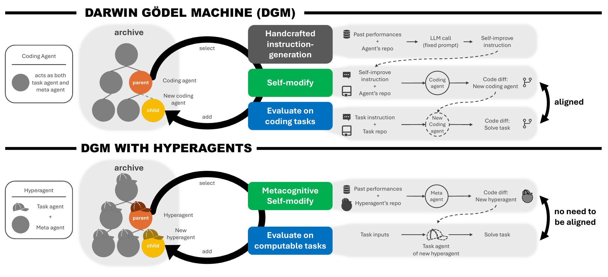
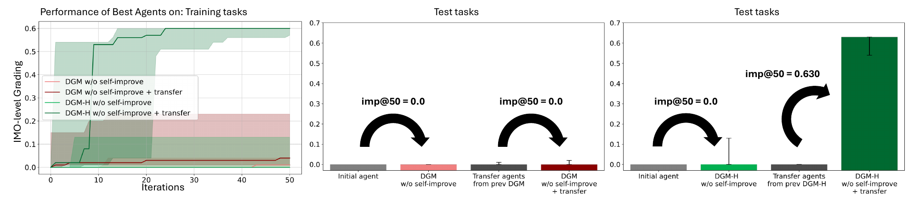

# Hyperagents 的可编辑改进机制

**Hyperagents**。Jenny Zhang 等，2026 年 3 月首版。 [论文 v2](https://arxiv.org/abs/2603.19461v2) · [公开实现](https://github.com/facebookresearch/HyperAgents)

Hyperagents 研究完成任务的程序与产生下一次修改的程序能否共同演化。基础语言模型保持冻结，更新作用于代理代码和持久记录。研究通过任务表现、固定修改者的消融及跨任务迁移来检验这种机制。

## 任务程序与修改程序

### DGM 的固定改进流程

Hyperagents Fig. 1 上半部分给出了 DGM（Darwin Gödel Machine，达尔文—哥德尔机）的操作流程。上方灰色模块根据历史表现和代码库生成下一轮修改要求，但这套指令生成机制由人固定。中间一行，编码智能体执行修改，输出新的智能体代码。运行新代理的编码任务，产出任务代码后按测试评价。外层还会保存历史版本，并从中继续选择父代。这里有一个便利：完成任务和修改自己都需要编码，更好的编辑和调试能力可能同时改善两种能力。这就是为什么编码任务的改进可能同时帮助完成任务和修改自己。但换成审稿任务后，会预测论文接收结果，并不必然意味着更会分析日志或设计下一次代码实验。Hyperagents 要解决的就是这种任务能力与改进能力的分离。

- [Hyperagents Fig. 1、§1–3](https://arxiv.org/pdf/2603.19461v2#page=4)
- [DGM](https://arxiv.org/abs/2505.22954)

### 可编辑的任务程序与修改程序

Fig. 1 下半部分给出 Hyperagents 的修改和执行流程。一个 hyperagent 包含任务程序 A（task agent，任务智能体）和修改程序 M（meta agent，元智能体）。修改程序 M 读取历史训练反馈与整个 hyperagent 的代码，产生新的程序差异。这些修改可以作用于 A，也可以作用于 M 自己。新版本中的 A 完成任务并测量表现。外层会保存历史版本和父子关系，之后执行子代中的新 M，继续产生修改。经验因而通过代码和外部记忆跨代继承，不需要维持一个永远不结束的聊天会话。Archive（历史版本档案库）还允许中间版本暂时退步，之后再利用新增工具取得收益。基础模型、评估器和正文中的父代选择仍然固定。当前主要评估 A 的分数，M 的长期价值需要通过后代间接体现。

- [Hyperagents §3、A.3、A.5](https://arxiv.org/pdf/2603.19461v2#page=4)
- [主循环实现](https://github.com/facebookresearch/HyperAgents/blob/59a68f672dfb92c74aeb7e61535d776fb36e172d/generate_loop.py)

令 $`H_t=(A_t,M_t)`$ 表示第 $`t`$ 轮选中的父代。$`A_t`$ 执行任务，$`M_t`$ 读取代理代码与历史反馈 $`\ell_t`$，产生代码差分 $`\Delta_t`$。应用差分得到后继 $`\tilde H_t`$。

```math
\Delta_t=M_t(\operatorname{Code}(H_t),\ell_t),\qquad\tilde H_t=\operatorname{Apply}(H_t,\Delta_t).
```



*图源为 Hyperagents Fig. 1，按 [CC BY 4.0](https://creativecommons.org/licenses/by/4.0/) 发布。* [原论文](https://arxiv.org/pdf/2603.19461v2#page=4)

## 实验任务与评价信号

四个任务使用不同的反馈。编码通过固定测试评价补丁。审稿只预测接收或拒绝，与历史录用结果比较，没有直接评价长篇评审质量。公开构造脚本让各划分一半接收、一半拒绝，所以标签校准可能影响效果。机器人输出的是奖励函数，后面还需要训练控制器。IMO（International Mathematical Olympiad，国际数学奥林匹克）数学评分提供题目、候选证明、参考答案与评分指南，输出零、一、六、七四档，主要判断关键论证完成到什么程度。审稿和数学评分都使用一百条训练、一百条验证和一百条测试数据。这些数据主要为程序搜索提供反馈，实验没有给基础 LLM（Large Language Model，大语言模型）更新权重。

- [Hyperagents §4.2、C](https://arxiv.org/pdf/2603.19461v2#page=30)
- [审稿划分脚本](https://github.com/facebookresearch/HyperAgents/blob/59a68f672dfb92c74aeb7e61535d776fb36e172d/domains/paper_review/curate_subsets.py)

## 跨轮改进的运行记录

### 工程改进如何出现在演化轨迹中

Fig. 8 记录了一次机器人奖励设计的演化。左边是机器人奖励设计的版本树，右边是同一次运行的表现。深色线连接最终最佳版本的祖先，浅蓝色是 archive 平均分，蓝色是历史最佳分。较早阶段，程序先改善评估分析和领域处理，之后补充环境属性文档，再加入更明确的代码例子和奖励参数建议。这些修改针对的是实际接口问题，例如模型引用了不存在的状态属性，或者奖励项尺度不合适。深色祖先路径也有下降，说明最终有效路径并不要求每一步立即涨分。这是一条运行中的定性轨迹，可以说明工程改进怎样积累，但不能单凭标注确定每项修改各贡献了多少分。

- [Hyperagents E.2、Fig. 8](https://arxiv.org/pdf/2603.19461v2#page=52)

### 机器人案例：站高与跳跃

Fig. 6 展示了两种奖励设计对应的控制行为。左边直接奖励躯干高度，机器人容易学会站得更高。右边的生成奖励可以形成跳跃，叠加的姿态表示运动过程中的不同阶段。这里有两层优化。外层 M 修改奖励设计程序 A，A 为当前任务生成 Python 奖励函数。评估器再用这份 reward（训练奖励），通过 PPO（Proximal Policy Optimization，近端策略优化）训练控制器，最后用固定的任务 fitness（适应度或任务评分）评价控制行为。PPO 属于强化学习（RL，Reinforcement Learning），被更新的是机器人控制策略，LLM 仍然冻结。训练任务要求走路和速度跟踪，测试任务要求提高躯干高度。测试时要为新目标生成新奖励并训练新策略，所以迁移的是设计奖励的程序。这个案例说明，奖励塑形和代码有效性都可能影响最后结果，不能只把它看成一次普通的文本生成。

- [Hyperagents C.3、Fig. 6](https://arxiv.org/pdf/2603.19461v2#page=35)
- [机器人评估器](https://github.com/facebookresearch/HyperAgents/blob/59a68f672dfb92c74aeb7e61535d776fb36e172d/domains/genesis/evaluator.py)

### Meta agent 产生的实际改进记录

附录 E.3.6 的改进记录显示，第六十六代准确率降到百分之五十二，接收预测却达到百分之九十四。记录给出对原因的判断，例如提示表达变得过于宽松、边界规则不清楚。后继方案加入更明确的拒绝条件、阈值和边界处理。它说明 M 能把一个总分展开成具体失败模式，并把下一轮修改方案保存下来。这里的根因分析仍然是程序提出的假设，需要后续评估验证。这个例子也暴露了任务分布的影响：作者的审稿数据做了标签平衡，提示校准可能贡献一部分收益。论文展示了这些工程行为，但没有对记忆、分析和调度逐项做独立消融。

- [Hyperagents E.3.6](https://arxiv.org/pdf/2603.19461v2#page=57)

### 持久记忆保存了什么

附录 E.3.7 提供了 memory.json 的片段。第一项比较了历史较好版本的表现，第二项记录第六十六代的退步，第三项保存之后计划如何修正。它保存了数值，也保存了对现象的解释和下一步计划。这样新的修改会话可以利用旧经验。但这些文字判断仍然是待检验假设，记忆文件的存在本身也不能证明独立性能收益。论文的迁移组件消融检验的是整个 M，没有把持久记忆单独隔离出来。

- [Hyperagents E.3.7](https://arxiv.org/pdf/2603.19461v2#page=58)

## 对照实验与跨域迁移

### 任务性能与组件消融

Fig. 2 右侧比较审稿与机器人任务的测试表现。蓝色代表完整 DGM-H（DGM-Hyperagents，本文完整方法），紫色是 DGM-custom（人工为目标领域定制改进机制的 DGM 基线）。完整方法的中位数分别是零点七一和零点三七二。黄色和绿色对应移除 archive、固定初始 M 的消融，表现较低，支持两个组件的作用。图例中的 w/o 是 without 的缩写，表示去掉某一组件；其中 w/o self-improve 指固定 M，任务程序 A 仍可以被改进。比较时有三个边界。第一，原始 DGM 的固定指令面向编码域，在非编码域失败有一定预期，因此紫色的人工适配方案是更强参照。第二，完整方法高于 DGM-custom，但差异未达到统计显著，图中的误差条提示运行间波动。第三，初始审稿程序的零分主要包括格式失败，不能解释成基础模型完全不会审稿。机器人分数是 fitness，也不能写成成功率。结果来自五次运行的中位数，误差条是 95% bootstrap 置信区间（CI，Confidence Interval）。bootstrap 指有放回重采样，这里的区间用于描述中位数估计的不确定性。

- [Hyperagents §5.1、Fig. 2](https://arxiv.org/pdf/2603.19461v2#page=8)

### 改进机制能否迁移到数学评分

作者接着检查，源域得到的修改程序能否用于新领域。Fig. 3 分别给出 DGM 与 DGM-H 的迁移测试。源域是审稿和奖励设计，目标域是数学评分。迁移以后固定 M，让它最多生成五十个新的任务程序，根据目标域验证集选择候选，再计算相对起点的测试分数增益，也就是 imp@50（improvement at 50，50 轮内的性能增益）。右侧完整迁移条件的增益达到零点六三，没有迁移的固定初始 M 基本没有改善。左侧 DGM 迁移对照没有得到类似收益。这支持改进流程在这个跨域设置下可以复用。但这里已经支付过源域搜索成本，目标域也进行了五十次适配，并非迁移过来的任务程序直接就有百分之六十三的评分能力。

- [Hyperagents §5.2、Fig. 3、D.3](https://arxiv.org/pdf/2603.19461v2#page=10)



*图源为 Hyperagents Fig. 3。* [原论文](https://arxiv.org/pdf/2603.19461v2#page=10)

### 迁移组件消融

Table 4 对迁移内容做组件消融。作者分别迁移任务程序 A、修改程序 M、两者，或者都不迁移。每一组固定自己的起始 M，在目标域生成五十个版本。表中报告的中位数为没有迁移为零，只迁移 A 为零点一，只迁移 M 为零点六二，两者都迁移为零点六三。只带 M 就恢复了几乎全部收益，而且右侧区间显示，这个条件比只带 A 更稳定。因此，这个实验支持可迁移信息主要保存在如何产生修改的程序中。它仍然只隔离了 M 这个整体，无法区分记忆、反馈分析、预算调度或者更多调用各自贡献多少。原表还列出了五次运行的实际增益，可以看出只带 A 的收益波动较大。

- [Hyperagents D.5、Table 4](https://arxiv.org/pdf/2603.19461v2#page=39)

### 评分程序具体改善了哪些判断

Fig. 10 的混淆矩阵给出强评分基线和后继在不同评分档的表现。左边是 ProofAutoGrader，即人工设计的固定证明评分基线，右边是本文自动发现的改进版 BetterGrader。行是真实类别，列是预测类别，对角线是正确判断。四个类别分别是 Correct（完全正确，7 分）、Almost（接近正确，6 分）、Partial（取得实质性部分进展，1 分）和 Incorrect（错误或无有效关键进展，0 分）。中间两个评分档的变化较明显。Almost 类别的正确识别从十三增加到四十三，Partial 从四十七增加到七十二，说明程序减少了把中间状态直接判为全对或全错的情况。与此同时，Correct 的正确数从二百七十五降到二百五十七，存在一定取舍。完整基准准确率从零点五六一提高到零点六零一，而归一化平均绝对误差（MAE，Mean Absolute Error）只从零点一七八降到零点一七五。MAE 衡量预测分数与真实分数相差多少，数值越低越好。因此，主要证据指向评分边界和判断流程的改善，不能把它直接外推成通用数学能力的全面增强。完整基准结果也需要与独立测试结果分开理解。

- [Hyperagents §5.3、E.4、Fig. 10](https://arxiv.org/pdf/2603.19461v2#page=59)

### 持续优化与强基线初始化

Fig. 4 给出持续两百轮后的训练轨迹与测试结果。橙色的迁移初始化中位数为零点六四，蓝色普通初始化为零点六一，两者差异没有显著。绿色条件还使用了 ProofAutoGrader 作为较强的任务程序起点，测试达到零点七。这表明系统可以继续优化已有方案，但图中并没有建立无界或者持续加速的结论。正文还报告，在完整数学基准上，强基线准确率从零点五六一提高到零点六零一。

- [Hyperagents §5.3、Fig. 4](https://arxiv.org/pdf/2603.19461v2#page=13)

## 研究贡献与可检验的问题

这篇工作的实证贡献，是把改进程序本身作为可以保存、修改和迁移的工程对象。原图中的轨迹和记录说明，实际变化包括接口修复、环境文档、决策规则，以及评估分析和经验保存。迁移组件实验进一步支持，修改程序整体可以携带有用经验。该设置依赖基础模型已有的代码生成能力。强编码模型已经知道怎样编写解析器、日志和分析脚本，训练反馈帮助系统选择哪些实现适合当前任务。但资源投入仍然很大，附录估计联合领域单次一百轮约消耗八千三百六十万 token（词元，模型处理文本的基本计数单位），PPO 计算还没有折入其中。候选还可以改变调用次数，所以同样轮数不代表同样成本。后续可以从接口可靠的强初始程序开始，匹配 token 和 GPU（Graphics Processing Unit，图形处理器）计算预算，再分别移除记忆与评估分析，并测试更多新领域。当前结果支持有限任务中的可复用改进机制，持续加速仍然需要更强证据。

- [Hyperagents §5–7、D.2、F](https://arxiv.org/pdf/2603.19461v2#page=37)

## 术语和指标

| 缩写或记号 | 英文全称或含义 | 中文解释与本文中的作用 |
| --- | --- | --- |
| **DGM** | **Darwin Gödel Machine** | **达尔文—哥德尔机**。通过反复修改、评估智能体代码，并保留历史版本来搜索改进。本文比较的原始 DGM 使用人工编写、固定不变的改进指令生成机制。 |
| **DGM-H** | **DGM-Hyperagents** | 本文提出的完整方法。在 DGM 的搜索流程中使用 hyperagent，使任务程序与产生修改的程序都可以被修改。H 对应 Hyperagents。 |
| **DGM-custom** | DGM 的 customized（定制）版本 | 作者为目标领域人工定制改进指令生成机制的 DGM 基线。custom 是实验变体标记，不是另一个算法缩写。 |
| **A** | task agent，任务智能体 | 本文中任务程序的记号。负责完成当前目标任务，例如预测论文录用结果，或生成机器人奖励函数。 |
| **M** | meta agent，元智能体 | 本文中修改程序的记号。根据代码、历史表现与反馈产生修改，可以修改 A，也可以修改自身。 |
| **LLM** | **Large Language Model** | **大语言模型**。本实验中基础 LLM 的权重冻结；程序通过调用模型完成分析、生成代码等操作。 |
| **RL** | **Reinforcement Learning** | **强化学习**。根据环境反馈优化策略的方法类别。本文机器人实验中的 RL 用于训练控制策略。 |
| **PPO** | **Proximal Policy Optimization** | **近端策略优化**，一种强化学习算法。评估器使用生成的奖励函数训练机器人控制策略；被 PPO 更新的是控制策略参数。 |
| **IMO** | **International Mathematical Olympiad** | **国际数学奥林匹克**。IMO-GradingBench 是本文采用的奥数证明评分基准，任务是评价给定证明。 |
| **GPU** | **Graphics Processing Unit** | **图形处理器**。讨论计算预算时，模型调用的 token 消耗与机器人策略训练的 GPU 计算需要分别考虑。 |
| **CI** | **Confidence Interval** | **置信区间**。论文报告 95% bootstrap CI，用于描述多次运行所得中位数估计的不确定性。 |
| **MAE** | **Mean Absolute Error** | **平均绝对误差**，即预测分数与真实分数之差的绝对值再取平均。本文还报告其归一化版本，数值越低表示评分误差越小。 |
| **imp@50** | improvement at 50，50 轮内的性能增益 | 在本次迁移实验中固定 M，生成 50 个任务程序，经验证集选出候选，再报告它相对起始程序的测试性能增益。0.630 表示增益，不能直接解释为 63% 的测试准确率。 |
| **w/o** | **without** | **去掉、不使用**，出现在原论文图例中。`w/o self-improve` 指固定 M，A 仍可被改进；`w/o open-ended exploration` 指移除保存历史候选的 Archive。 |

另外几个会影响讲图理解的术语：

- **Hyperagent**：把任务程序 A 与修改程序 M 组合在一起的可编辑程序，是本文方法中的基本演化对象。
- **Archive（历史版本档案库）**：保存多个智能体版本及其表现、父子关系，供后续选择父代、继续产生新分支。
- **reward（训练奖励）**：PPO 训练控制策略时优化的信号，机器人任务中的这份奖励函数由程序生成。
- **fitness（适应度或任务评分）**：外层评估器评价控制行为的固定指标。它与训练 reward 的作用不同，0.372 这样的 fitness 数值也不能直接写成成功率。
- **bootstrap（自助重采样）**：对已有结果进行有放回抽样，估计统计量波动的方法；本文用它构造中位数的置信区间。
- **token（词元）**：模型处理文本的基本计数单位。一个汉字或英文单词对应多少 token，取决于所用模型的分词方式。

原文依据：[Hyperagents §3–5、附录 B–E](https://arxiv.org/pdf/2603.19461v2)；[DGM 原论文](https://arxiv.org/abs/2505.22954)。
