# RSI 代表论文精读。原图、公式与实际 setting

本篇按行为、代理系统、模型与数据、研究过程四类改动对象组织论文，每类用代表论文与对照论文说明方法。读任一篇时可从该节的问题与设置开始，公式旁有符号表和代入例。四篇主线是 **Self-Refine、Darwin Gödel Machine（DGM）、STaR（Self-Taught Reasoner）、The AI Scientist**，四篇对照是 **ToT、AFlow、AlphaGo Zero、Frontis-MA1 / OpenMLE-Evo**。原论文公式的出处随段标注，按论文流程写出的补充公式另标。跨改进轮沿用综述的 $`t`$。每一节在用到时交代下标数的是步骤、题目还是候选。 [RSI 基础文档](../RSI-Foundations.md)

读一篇先找当前任务的输入输出，再看改进轮改的是哪种状态。综述的 $`P`$ 生成候选，$`E`$ 执行，$`V`$ 形成验证证据，$`U`$ 决定保留与更新。沿图追到这四件事，才好区分一次任务内的调整和下一轮的继承。实验条件（setting）交代模型、数据、预算和对照。读结果时，按 RSI 基础文档 §6 区分训练用数据、搜索与选版的数据、独立评估的数据，并记录论文确实报告了其中哪一种分数。文中的替代设计用于检验不同解释。 [综述 Fig. 3、Fig. 5 与 Table 1](https://lee1003-lee.github.io/Awesome-RSI-Research/assets/rsi-survey.pdf#page=5)

相关研究文档包括 [SkillRL](SkillRL.md) 和 [Hyperagents](Hyperagents.md)。完整论文题名与原文链接见[文献索引](#论文题名与原文)。

## 1. 行为进化。从修一份答案到留下可用经验

### 1.1 Self-Refine。点评能不能让同一个模型交出更好的答案？

#### 问题定义与 setting

**研究问题**是，固定基础模型，让它交出初稿后读自己的点评再修改，最终输出的质量会不会提高？改动对象是**本题的答案**。论文用代码、数学、对话等七类任务观察这一方式何时有用。任务输入与成功标准随任务而变。代码优化用 PIE（Performance-Improving Code Edits），看程序保持功能正确后能否更快。数学推理用 GSM8K，看最终解是否正确。开放式生成还可能用人或模型的偏好。初稿是主要参照，同一模型承担生成、点评和修改，主实验最多四轮点评与修改。这个设置排除了「换了能力更强的模型」的解释，比较时仍要考虑额外调用和上下文。 [原文 §2–3 与 Algorithm 1](https://proceedings.neurips.cc/paper_files/paper/2023/file/91edff07232fb1b55a505a9e9f6c0ff3-Paper-Conference.pdf#page=3)

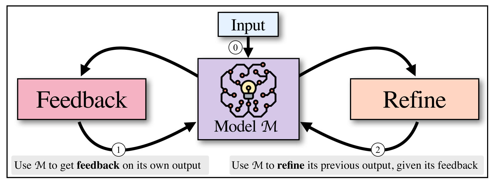

*原文 Fig. 1，PDF p. 2。中央的 $`M`$ 是同一个模型，左右两个环是给它的不同任务。* [原图所在页](https://proceedings.neurips.cc/paper_files/paper/2023/file/91edff07232fb1b55a505a9e9f6c0ff3-Paper-Conference.pdf#page=2)

#### Fig. 1 的公式。一次任务里三个调用分别读什么？

给定一道题，固定同一个模型。图中的 ⓪ 写初稿，① 对当前稿给点评，② 依据点评修订。下面沿用 Self-Refine 式 (1)、(2)、(4) 的写法，用 $`i`$ 计同题的修订次数。原文以 $`t`$ 数这个次数。

```math
\begin{aligned}
y_0 &= M(p_{\mathrm{gen}}\Vert x),\\[0pt]
f_i &= M(p_{\mathrm{fb}}\Vert x\Vert y_i),\\[0pt]
y_{i+1} &= M(p_{\mathrm{refine}}\Vert x\Vert y_0\Vert f_0
                   \Vert\cdots\Vert y_i\Vert f_i).
\end{aligned}
```

| 符号 | 含义 | 在原文 Fig. 2 的代码案例中 |
| --- | --- | --- |
| $`x`$ | 始终不变的任务输入。 | 求 1 到一个非负整数的和。 |
| $`M`$ | 承担三种角色的同一个固定模型。$`M(\text{输入})`$ 表示用该输入调用模型，并取返回文本。 | 用生成、点评或修订提示给同一模型布置不同任务。 |
| $`i,\ y_0,\ y_i,\ y_{i+1}`$ | $`i`$ 数完成了几次修订。$`y_0`$ 是初稿，$`y_i`$ 是当前稿，$`y_{i+1}`$ 是依据当前点评得到的下一稿。 | 初稿用循环求和，修订稿用求和公式。 |
| $`f_i`$ | 针对第 $`i`$ 稿的点评，图中写作 $`fb`$。 | $`f_0`$ 指出循环随输入增长，并建议闭式求和。 |
| $`p_{\mathrm{gen}},\ p_{\mathrm{fb}},\ p_{\mathrm{refine}}`$ | 三份提示依次用于初稿生成、点评和修订。 | 分别要求给出解法、定位低效步骤、按建议重写。 |
| $`\Vert,\ \cdots`$ | $`\Vert`$ 表示按顺序拼接文本，省略号表示接上中间各稿与对应点评。 | 首次修订只拼初稿 $`y_0`$ 和点评 $`f_0`$，之后历史变长。 |

**逐行代入。** 第一行读任务和生成提示，得到用循环求和的 $`y_0`$。第二行令 $`i=0`$，读这份循环代码得到点评 $`f_0`$。第三行把原题、初稿和点评交给修订调用，得到公式版 $`y_1`$。若还要继续，第二行会点评 $`y_1`$。原文式 (3) 只放当前稿和当前点评，式 (4) 将历史拼入输入。

流程用 $`\mathrm{stop}(f_i,i)`$ 根据当前点评和次数决定何时返回末稿。一次完整的点评再修订通常添加两次调用，最后还可能有一次停止判断使用的点评。图中的反馈是给本题的改稿依据，论文另用程序测试或评审衡量交付结果。这里形成的答案和历史服务同一道题，证据归到**局部演化**。 [Self-Refine §2、式 (1)–(4) 与 Fig. 2](https://proceedings.neurips.cc/paper_files/paper/2023/file/91edff07232fb1b55a505a9e9f6c0ff3-Paper-Conference.pdf#page=3)

#### Case。点评提供了什么新信息？

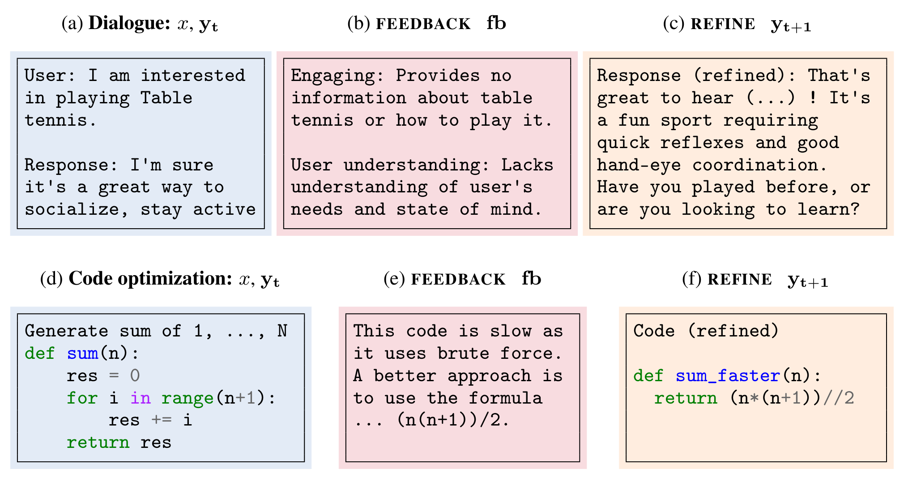

*原文 Fig. 2，PDF p. 3。上排是对话，下排是代码。两排都按初稿、点评、修订从左向右读。* [原图所在页](https://proceedings.neurips.cc/paper_files/paper/2023/file/91edff07232fb1b55a505a9e9f6c0ff3-Paper-Conference.pdf#page=3)

看下排 (d)–(f)。**问题**是求从 1 到非负整数 $`n`$ 的和。**初稿**逐项累加，例如 $`n=5`$ 会走循环得到 15。**点评**先指出重复累加使操作次数随 $`n`$ 增长，再给出可执行的修改方向，即改用求和公式。**修订**把它变成 $`n(n+1)/2`$，代入 5 仍是 15。这里应该分开检查输入边界、结果正确性和速度，公式短只能说明实现变了。原图展示的是这条点评如何导致修改，整批任务上的优化比例来自后面的测试。上排提供另一种反馈。同一句对话答复可以没有事实错误，却没有回应用户的具体兴趣，因此点评可以指出应该补充哪些内容。 [原文 Fig. 2、§3.2 与 Appendix Q](https://proceedings.neurips.cc/paper_files/paper/2023/file/91edff07232fb1b55a505a9e9f6c0ff3-Paper-Conference.pdf#page=3)

**为什么这样设计。** 先点评，使修订者得到错误位置和修改方向，适合「错误可定位、修改可执行」的任务。若模型找不出错误，反复改写就可能重复错误，也可能破坏原来正确的部分。可以把运行测试的失败信息送给点评者，用独立工具检查算式，或者用同样预算生成数份候选，再由独立验证器选。后一种办法不要求诊断准确，但需要可靠的候选选择。停止同样是一项设计，数学或程序任务可以看到通过验证后停止，开放任务可能只能依靠点评或事先设定的上限。 [原文 §4 与 Appendix K、Q](https://proceedings.neurips.cc/paper_files/paper/2023/file/91edff07232fb1b55a505a9e9f6c0ff3-Paper-Conference.pdf#page=6) · [CRITIC 原论文](https://arxiv.org/abs/2305.11738)

#### 证据。分数变好是因为点评，还是只是多尝试？

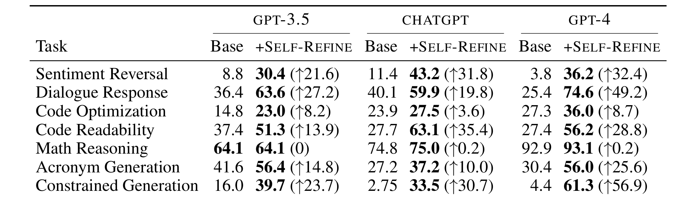

*原文 Table 1，PDF p. 5。先在同一模型下读 Base 与 +Self-Refine，再看该行采用的指标。* [原表所在页](https://proceedings.neurips.cc/paper_files/paper/2023/file/91edff07232fb1b55a505a9e9f6c0ff3-Paper-Conference.pdf#page=5)

以 GPT-4 那组列为例，代码优化从 **27.3% 到 36.0%**，增加 8.7 个百分点。数学求解率从 **92.9% 到 93.1%**，只增加 0.2 个百分点。对话、缩略词等有偏好评估，不能把每行的数字都当作答题正确率。论文的 §4、Table 2 还用 ChatGPT 比较同为代码优化的**具体点评、泛泛点评、无点评但仍可修改**，三种设定的优化比例为 27.5、26.0、24.8。这个对照比对初稿比较更接近「反馈内容有没有用」，不过仍不能把不同提示下的文本量、调用费用和评估差异视为完全一样。 [结果 Table 1](https://proceedings.neurips.cc/paper_files/paper/2023/file/91edff07232fb1b55a505a9e9f6c0ff3-Paper-Conference.pdf#page=5) · [反馈对照 Table 2 与 §4](https://proceedings.neurips.cc/paper_files/paper/2023/file/91edff07232fb1b55a505a9e9f6c0ff3-Paper-Conference.pdf#page=6)

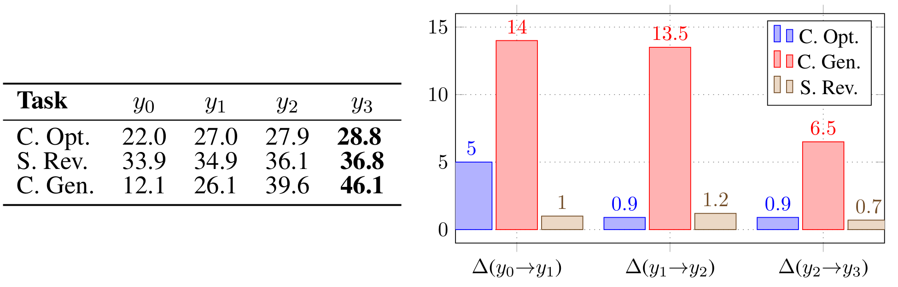

*原文 Fig. 4，PDF 第 7 页。左表列为初稿 $`y_0`$ 到第三次修订 $`y_3`$ 的得分。图中画到第三次，主实验的流程上限为四轮。右侧 $`\Delta(y_i\to y_{i+1})`$ 是后一稿的分数减前一稿的分数。三个缩写依次是代码优化（C. Opt.）、约束生成（C. Gen.）、情感反转（S. Rev.）。每一项取三种模型的平均。* [原图所在页](https://proceedings.neurips.cc/paper_files/paper/2023/file/91edff07232fb1b55a505a9e9f6c0ff3-Paper-Conference.pdf#page=7)

读右图时别把柱子当最终分数。代码优化的 22.0、27.0、27.9、28.8 对应三次增量 5.0、0.9、0.9。约束生成前两次都有大幅收益，第三次仍有增量。它支持「轮数的收益视任务而定」。不能从平均值判断每题都变好。更扎实的评估可用同一批初稿，按同样调用和输入输出成本比较重采样与点评修订，并报告多少题从错变对、多少从对变错，以及停止在何处最划算。**对 RSI 入门的启发**是把生成、找错、修订和验收分开测。这里的反馈只推进本题，因此主要支持局部进化。 [原文 §4、Fig. 4](https://proceedings.neurips.cc/paper_files/paper/2023/file/91edff07232fb1b55a505a9e9f6c0ff3-Paper-Conference.pdf#page=7) · [综述 Table 1](https://lee1003-lee.github.io/Awesome-RSI-Research/assets/rsi-survey.pdf#page=17)

### 1.2 Tree of Thoughts。把比较移到解题中间

Self-Refine 拿到一份完整答案后再修。ToT 要问，**如果第一步选错会让后面很难挽回，能否先保留几个中间方案？** 任务输入是四个数，输出合规的 24 点算式。原实验从按人类解题时间排序的题库选第 901–1000 题，以 100 道较难题评估。一个 **thought** 是一次将两个数合并成一个数的操作，含运算及剩余数。四个数经三次合并得到一个数，任务规则和 GPT-4 权重都固定。 [原文 §4.1](https://proceedings.neurips.cc/paper_files/paper/2023/file/271db9922b8d1f4dd7aaef84ed5ac703-Paper-Conference.pdf#page=5)

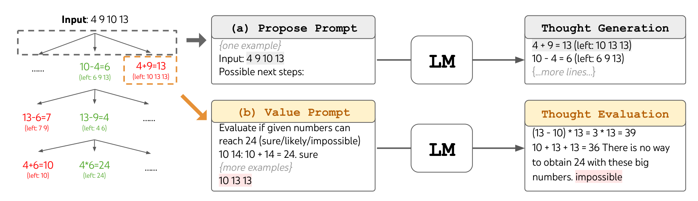

*原文 Fig. 2，PDF p. 5。左边是部分解的树，右上生成下一步，右下评价该部分解还有没有希望。* [原图所在页](https://proceedings.neurips.cc/paper_files/paper/2023/file/271db9922b8d1f4dd7aaef84ed5ac703-Paper-Conference.pdf#page=5)

#### Fig. 2 的公式。候选如何从上一层扩展出来？

在同一道 24 点题内，每次取两个数做一次四则运算，得到一个数，再把它放回剩余数字。搜索树上的节点记录已做过的运算。下式按 ToT Algorithm 1 写出一层怎样生成和筛选。

```math
\mathcal F'_{i+1}
=\{[s,z]:s\in\mathcal F_i,\ z\in G(p_\theta,s,K)\},
\qquad
\mathcal F_{i+1}
=\operatorname{Top}_{b}\bigl(\mathcal F'_{i+1};V_{i+1}\bigr).
```

| 符号 | 含义 |
| --- | --- |
| $`i,\ x,\ z_{1:i},\ s`$ | $`i`$ 是已做的运算次数，$`x`$ 是四个输入数，$`z_{1:i}`$ 是从第 1 步到第 $`i`$ 步的运算历史，$`s=[x,z_{1:i}]`$ 是由两者组成的一个节点。 |
| $`\mathcal F_i`$ | 第 $`i`$ 层保留下来的节点集合。第 0 层只有原题。 |
| $`p_\theta,\ G(p_\theta,s,K)`$ | $`p_\theta`$ 是固定参数 $`\theta`$ 的语言模型。$`G`$ 用它为节点 $`s`$ 提议后续运算，$`K`$ 是每节点的候选数上限，原文记作 $`k`$。 |
| $`z,\ [s,z]`$ | $`z`$ 是一项新提出的运算，把它接到父节点 $`s`$ 后得到子节点 $`[s,z]`$。 |
| $`\mathcal F'_{i+1}`$ | 新一层全部尚待筛选的候选。撇号标记「筛选前」。花括号的冒号后列出扩展条件，$`\in`$ 读作「属于」。 |
| $`V_{i+1},\ \operatorname{Top}_{b},\ \mathcal F_{i+1}`$ | $`V_{i+1}`$ 给这一层的各个节点估计可解性。$`\operatorname{Top}_b`$ 按该估值最多留下 $`b`$ 个。$`\mathcal F_{i+1}`$ 是留下的节点集合。 |

**代入第一层。** 输入 $`x=(4,9,10,13)`$，第 0 层只有这道题。$`G`$ 可以提出图中的两种运算，一项是 $`10-4=6`$（剩 $`6,9,13`$），另一项是 $`4+9=13`$（剩 $`10,13,13`$）。两者先进入 $`\mathcal F'_1`$。若只留一项（$`b=1`$）且估值把第一项排在前面，它就进入 $`\mathcal F_1`$。从它接着做 $`13-9=4`$，再算 $`6\times4=24`$，能逐层还原合规解。这里的筛选是示例代入，原文主实验每层至多留 5 个状态，对各候选估值三次。

左式对应图右上的扩展提示，右式对应右下的估值与左侧的筛选。中间用估值安排搜索，最终答案另查等于 24 且每张牌恰用一次。这与RSI 基础文档中比较两套工作流的验收用同一输入，ToT 在此节交付的是该题的解。 [ToT Algorithm 1、Fig. 2 与 §4.1](https://proceedings.neurips.cc/paper_files/paper/2023/file/271db9922b8d1f4dd7aaef84ed5ac703-Paper-Conference.pdf#page=5)

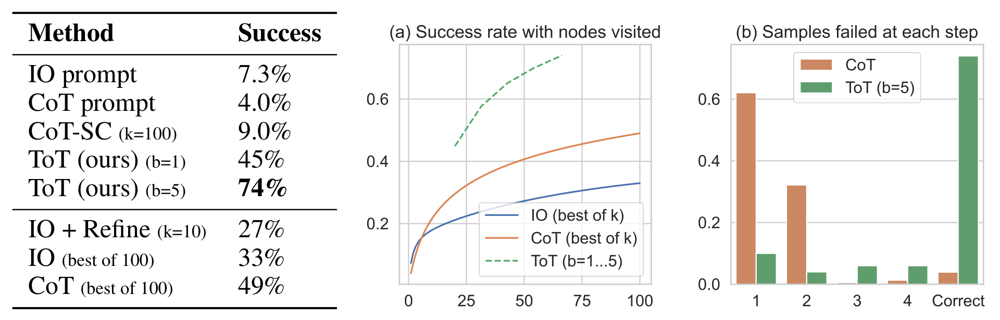

*原文 Table 2、Fig. 3，PDF p. 6。表里的 $`k`$ 是采样数或修订上限，按行含义不同。图 (a) 横轴是节点数，计算花费还取决于每个节点的调用方式。图 (b) 把失败分到出现问题的步骤。* [原图所在页](https://proceedings.neurips.cc/paper_files/paper/2023/file/271db9922b8d1f4dd7aaef84ed5ac703-Paper-Conference.pdf#page=6)

CoT（Chain of Thought，推理链）让模型一次写出一条完整解题过程，平均成功率 4.0%，对 100 条推理链输出作多数投票时为 9.0%，有正确性信号的直接生成再修订 27%，ToT 的 $`b=1`$ 与 $`b=5`$ 分别为 45% 与 74%。CoT 的 best of 100 是理想选择口径。测试题中有 49% 能在每题的 100 份样本里找到至少一份正确解。实际交卷仍需有办法识别那一份。回到组件，24 点还能穷举合法运算，以精确检查取代模型估值。这是区分「问题可搜索」和「要语言模型来搜索」的直接备选。原设置下树用于当前题，比较结论归到局部进化。 [原文 Table 2 与 Fig. 3、Appendix C](https://proceedings.neurips.cc/paper_files/paper/2023/file/271db9922b8d1f4dd7aaef84ed5ac703-Paper-Conference.pdf#page=6)

### 1.3 补读 Voyager。过程失败用来修程序，成功程序用来组合技能

**研究问题**是，在 Minecraft 的开放探索中，代理能否自主决定学什么，并把一项成功行为保存下来，供以后解决更复杂的目标？**输入**有背包、位置、周围环境、目标与探索进度。**输出**是调用游戏接口的 JavaScript 程序、由此执行的行动，以及通过检查后保存的技能。它使用冻结的基础模型与高层游戏动作接口，研究重心是任务、反馈和技能组合。高层接口封装了逐步控制，使研究可以聚焦这些问题。 [原文 §2–3.1](https://arxiv.org/pdf/2305.16291v2#page=3)

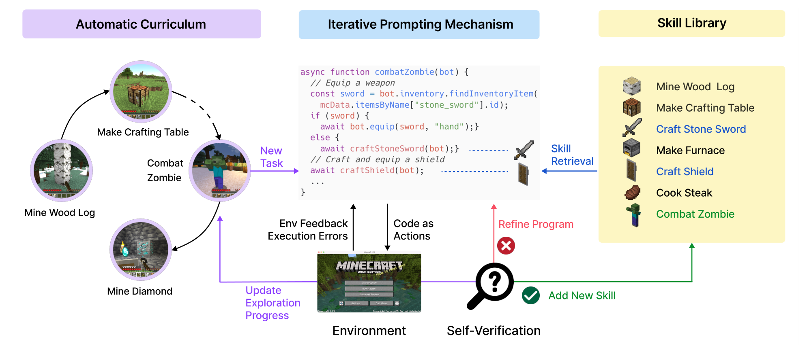

*原文 Fig. 2，PDF p. 2。紫色部分选新目标，蓝色部分生成可运行行动，黄色部分保存技能。红色失败路径回当前程序修订，绿色成功路径才通往入库。* [原图所在页](https://arxiv.org/pdf/2305.16291v2#page=2)

课程器按经验和进展决定尝试什么。代码生成读现有技能与环境状态。程序运行后，环境反馈可报告缺少材料。Fig. 5 左图里，尝试做木棍时缺两块木板，所以改下一稿时需要先解决材料。解释器也能报程序错误，Fig. 5 右图的动作调用了游戏里不存在的物品名，修改时要换成有效物品。最后另一次 GPT-4 调用读取任务和当前状态来查成功。Fig. 6 里，目标是做望远镜，库存有铜锭但没有紫水晶碎片，检查器返回失败并建议去找碎片。前两种信息跟随程序运行产生，第三种提供进入技能库前的验收。原设置四轮生成仍卡住就换目标，避免一个过难的目标耗光探索。纯随机课程可覆盖更多方向，但可能先要求无法完成的目标。固定课程便于比较，但不容易跟上不同地图里的实际进度。 [反馈案例 Fig. 5](https://arxiv.org/pdf/2305.16291v2#page=5) · [验收案例 Fig. 6 与四轮上限](https://arxiv.org/pdf/2305.16291v2#page=6)

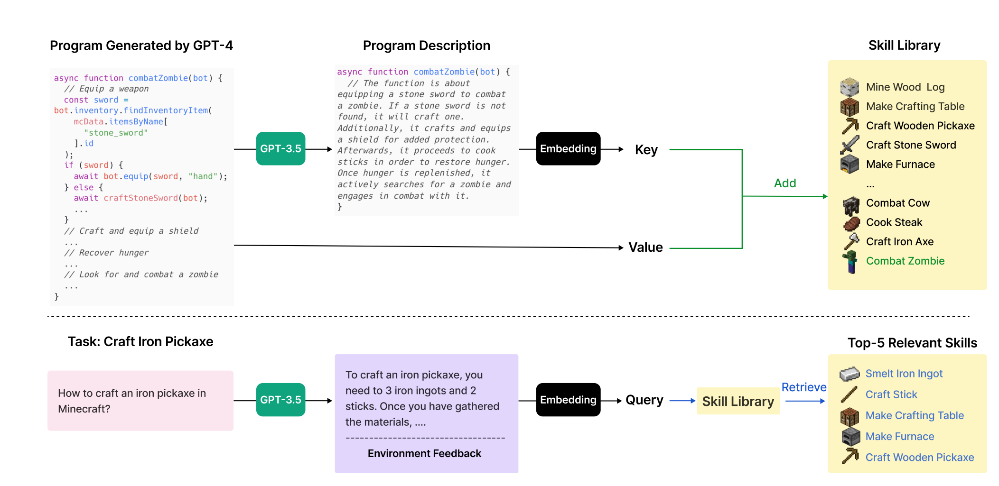

*原文 Fig. 4，PDF p. 4。上半图是怎样记，下半图是怎样读。Key 把技能描述变成可比较相似度的向量，Value 保存实际可执行的程序。* [原图所在页](https://arxiv.org/pdf/2305.16291v2#page=4)

上方示例将一个已完成的游戏动作程序保存，并由 GPT-3.5 给出描述。下方给出新任务「制作铁镐」。系统把关于做法的问答和环境反馈变成查询，检索出熔铁锭、做木棍、做工作台、做熔炉、做木镐这五个相关技能，再提供给代码生成。图展示了**哪些经验进入了新任务的输入**，并未单凭检索证明所有技能都被调用或都有效。文本反思易携带，代码技能可直接执行和组合，两种选择对环境接口依赖不同。 [原文 Fig. 4、§2.2](https://arxiv.org/pdf/2305.16291v2#page=4)

**检索和写库。** 对每个探索目标，先把旧库查到的程序交给生成器，再看新程序是否通过目标验收。以下是 Fig. 4 的形式化写法。

```math
R_i=\operatorname{Retrieve}(\mathcal K_i,x_i,o_i),\qquad
\mathcal K_{i+1}=\mathcal K_i\cup\{(c_i,\mathrm{desc}(c_i))\}
\quad\text{（程序通过验收时）}.
```

| 符号 | 含义 | 制作铁镐的例子 |
| --- | --- | --- |
| $`i,\ x_i,\ o_i`$ | $`i`$ 数探索目标，$`x_i`$ 是当前目标，$`o_i`$ 是检索时已有的环境观测或反馈。 | 目标是铁镐，输入包括当前库存或前次失败。 |
| $`\mathcal K_i,\ R_i`$ | $`\mathcal K_i`$ 是本目标开始时的技能库，$`R_i`$ 是查出来供生成器参考的技能。 | 查到熔铁锭、做木棍与制作工具相关的程序。 |
| $`\operatorname{Retrieve}`$ | 用任务及当前反馈查询技能库，返回候选技能。 | 比较查询和各技能描述的向量相似度。 |
| $`c_i,\ \mathrm{desc}(c_i)`$ | 对目标新写的代码及供检索使用的文字描述。 | 编写铁镐程序，若通过验收再保存其做法和代码。 |
| $`\mathcal K_{i+1},\ \cup`$ | 新库由原有条目与获准加入的条目合并。 | 旧库继续存在，通过验收时新增铁镐技能。 |

**逐步读。** 左式用已经收到的信息查库，右式发生在新程序执行且通过验收后。如果铁镐程序实际调用了熔炉技能并通过检查，技能库里的旧程序就参与了形成一个新技能。只记录检索时，能确认的是该旧程序进入生成器输入。 [Voyager Fig. 2、4 与 §2](https://arxiv.org/pdf/2305.16291v2#page=4)

作者在新世界清空物品后测未见任务，钻石镐在 50 轮提示上限内为完整方法 3/3、去技能库 2/3，完整方法报告 19 ± 3 次迭代。这是对技能复用的证据，样本与环境范围要保留。想证明旧技能让代理更会**习得下一项技能**，可在同预算下比较关读取、只读不写、读写均开，量产生的后继技能能否真跑且在新任务中有效。 [原文 Table 2 与 §3.3–3.4](https://arxiv.org/pdf/2305.16291v2#page=8)

## 2. 代理系统进化。改代理以后怎样工作

Self-Refine 一次运行交出一份修改好的答案。现在把问题向外推一层。如果每道数学题都要决定用一次生成、采样投票还是运行代码检查，能否先学到一套可重复执行的做题流程？这种流程只是代理系统的一部分。**代理系统**在这里指模型与它调用的工具、提示和控制程序合在一起形成的执行系统。AFlow 搜索可复用的流程，DGM 则让改过的代理有机会接过下一轮改代码的工作。

### 2.1 AFlow。怎样找到一套可以反复解题的工作流？

#### 问题定义与 setting

给定一类题、评分方法和一个基础执行模型，怎样自动找到一段**工作流**，也就是规定模型调用工具和传递结果的可执行程序？工作流的输入是一道题，输出是该题的答案。搜索器的输入是初始工作流、可用操作、验证题和评分方法，输出是在验证题上选出的工作流。作者将数据按验证与测试约 1:4 划分。验证题给搜索提供分数，测试题用来评估最终流程。主要对比使用 Claude 3.5 Sonnet 写工作流，GPT-4o-mini 执行，AFlow 搜索设为 20 轮。这样可以把「谁负责设计流程」和「流程部署时用哪个模型」分开考察。 [AFlow §3.1、§5.1](https://proceedings.iclr.cc/paper_files/paper/2025/file/5492ecbce4439401798dcd2c90be94cd-Paper-Conference.pdf#page=8)

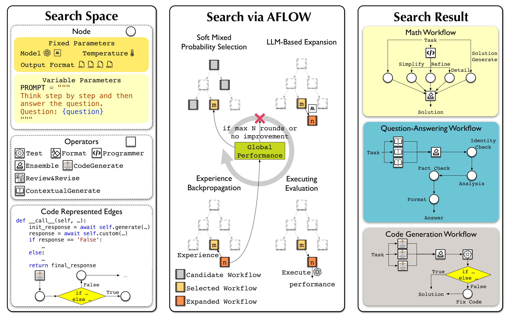

*图源。AFlow 正式版 Fig. 3，PDF 第 5 页。* [查看原图和图注](https://proceedings.iclr.cc/paper_files/paper/2025/file/5492ecbce4439401798dcd2c90be94cd-Paper-Conference.pdf#page=5)

#### 读图。图区分三个层次

1. **左侧定义能改什么。** 工作流中的节点可以发起一次模型调用。节点提示可调整，执行模型、温度和输出格式等按设定固定。图里的 Operator 是现成的可调用部件，例如执行程序、格式化输出。边由代码表示，规定上一步的哪份结果在什么条件下交给哪个部件。预置部件使优化器从能运行的程序出发。完全开放代码空间容纳的写法更多，也会遇到更多无效候选。
2. **中间说明每轮怎么改。** 从已有流程中选一个父版本。选择同时给高分版本与均匀探索留出机会。优化模型读取父版本及已有经验，写出改动。在验证题上实际运行候选，记录分数和本次改动的经验，后续扩展时可以再读。树的节点是候选工作流。树的边表示「由哪份流程改出哪份流程」，与左侧工作流内部的数据传递是两种边。
3. **右侧是部署结果。** 同一个选出的流程可以处理许多新题。要问系统在实际使用中值不值得用，要同时看搜索开发花费和部署时每题花费。只搜索提示是更省成本的参照。还可让同一模型在相同调用预算内用人工流程解题，比较自动找到的结构是否额外有益。 [原文 Fig. 3、§4、§5.4](https://proceedings.iclr.cc/paper_files/paper/2025/file/5492ecbce4439401798dcd2c90be94cd-Paper-Conference.pdf#page=5)

#### Fig. 3 的公式。先定义工作流，再谈搜索

AFlow 要交付一套可重复执行的工作流，例如让模型解题，再用另一个节点核查。工作流写成 $`W=(N,E_W)`$，$`N`$ 是流程内部的步骤集合，$`E_W`$ 是规定运行顺序、分支和交接数据的连接，脚标 $`W`$ 表示流程的连接。原图把连接写作 $`E`$。其中 $`N(M,\tau,P,F)`$ 表示单个模型节点的模型、采样温度、提示和输出格式。图中间的 “max N rounds” 数允许的搜索轮次。搜索树的一个节点存一整份工作流。

```math
W^\ast\in\arg\max_{W\in\mathcal W}G(W,D_V),\qquad
\tilde W_t=P_{\mathrm{LLM}}(W_t,m_t;\text{提示或连边}).
```

| 符号 | 含义 | 数学工作流示例 |
| --- | --- | --- |
| $`W,\ \mathcal W,\ W\in\mathcal W`$ | $`W`$ 是一份工作流，$`\mathcal W`$ 是可按模板、操作库和编辑规则写成的全部流程。$`\in`$ 读「属于」。 | 允许改提示和连边，可以有直接求解、带复核等方案。 |
| $`D_V,\ G(W,D_V)`$ | $`D_V`$ 是用来搜索和选版的验证题，$`V`$ 在下标中表示 validation。$`G`$ 是这份流程在这些题上的表现。 | 同一组 20 道题上数答对多少道。 |
| $`\arg\max,\ W^\ast`$ | $`\arg\max`$ 返回使分数最高的流程集合。$`W^\ast`$ 是其中一份全空间最优流程，星号表示理论目标。 | 需要知道所有许用流程的表现才能确定它。 |
| $`t,\ W_t,\ m_t`$ | $`t`$ 数扩展轮，$`W_t`$ 是该轮抽到的父流程，$`m_t`$ 是已有搜索与试验记录。 | 抽到直接求解版，记录显示它漏查计算。 |
| $`P_{\mathrm{LLM}},\ \tilde W_t`$ | 前者由大语言模型提出改动，分号后是可编辑部位。后者是这一轮新提出、还要运行的候选。 | 给求解后面接一个复核节点。 |

**左式给目标，右式给一次扩展。** 假设直接求解版在 20 道验证题上答对 12 道，带复核版答对 15 道。试过的只有这两份时，实际交付版 $`\widehat W`$ 是后者。帽子表示从有限搜索中选出的版本。搜索结果给出了两份流程中谁得分高，理论目标 $`W^\ast`$ 涉及整个搜索空间。

在原实验中，约 20% 用来划分验证区，其余作测试。搜索在验证区再选较有区分度的题，候选验证运行五次。最终交付版另在测试题上评，以便分别观察选版得分和交付后的表现。 [AFlow §3.1、§4 与 Algorithm 1](https://proceedings.iclr.cc/paper_files/paper/2025/file/5492ecbce4439401798dcd2c90be94cd-Paper-Conference.pdf#page=6)

#### 式 (3)。哪些流程有机会成为下一轮父版本？

AFlow 每次先从初始流程和若干高分流程中选一个已有版本，接着在其上继续编辑。式 (3) 给出这次选父版本的概率。

```math
\Pr(i)=\lambda\frac1n+
(1-\lambda)\frac{\exp[\alpha(q_i-q_{\max})]}
{\sum_{j=1}^{n}\exp[\alpha(q_j-q_{\max})]}.
```

| 符号 | 含义 |
| --- | --- |
| $`n,\ i,\ j`$ | $`n`$ 是可选流程数，$`i`$ 是要算抽中概率的版本编号，$`j`$ 在分母中遍历这些版本。 |
| $`q_i,\ q_j,\ q_{\max}`$ | $`q_i,q_j`$ 是相应流程的验证得分，$`q_{\max}`$ 是本次候选中的最高分。原文分数写作 $`s_i`$ 等。 |
| $`\lambda,\ \alpha`$ | $`\lambda`$ 是均匀抽取的权重，$`1-\lambda`$ 是按分数抽取的权重，$`\alpha`$ 控制按分数抽取时对分差的敏感程度。 |
| $`\exp,\ \sum_{j=1}^{n}`$ | 指数函数把分差变为正权重。分母对 $`n`$ 个权重求和，把它们换算成总和为 1 的概率。 |
| $`\Pr(i)`$ | 抽中流程 $`i`$ 继续扩展的概率。 |

**代入两个版本。** 用论文的 $`\lambda=0.2,\alpha=0.4`$，设两个验证得分为 0.8 和 0.6。第一项各给 $`0.2/2=0.1`$。第二项中两者的指数权重是 $`1`$ 和 $`\exp(-0.08)`$。乘以 $`0.8`$ 再加上均匀项后，抽中概率约为 **0.516 和 0.484**。分数较高的版本更容易接手，另一个仍有机会。减去共同的最高分便于计算，权重之间的比例相同。Fig. 6 的边说明哪次扩展实际用了哪个父版本。 [AFlow 式 (3) 与 Fig. 6](https://proceedings.iclr.cc/paper_files/paper/2025/file/5492ecbce4439401798dcd2c90be94cd-Paper-Conference.pdf#page=7)

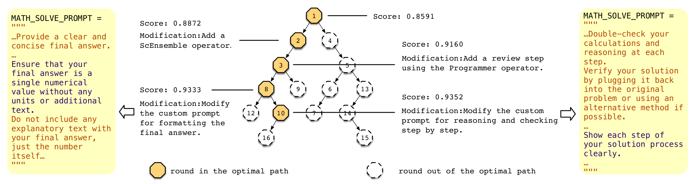

*图源。AFlow 正式版 Fig. 6，PDF 第 10 页。* [查看原图和图注](https://proceedings.iclr.cc/paper_files/paper/2025/file/5492ecbce4439401798dcd2c90be94cd-Paper-Conference.pdf#page=10)

#### Case。GSM8K 上，搜索器是怎样把一段数学解题程序改出来的？

从 Fig. 6 的深色路径读 $`1\to2\to3\to8\to10`$。第 1 轮是初始流程，图中分数 0.8591。第 2 轮加 `ScEnsemble`，用多份候选解来选答案，图中 0.8872。第 3 轮接 `Programmer` 做复查，图中 0.9160。第 8 轮改最终输出提示，要求交一个可抽取的数值，图中 0.9333。第 10 轮再要求逐步检查推理、尝试代回验证，图中 0.9352。节点号跳过 4 到 7，说明这期间也扩展了别的分支。看左右两段提示，左边改变答案的交付格式，右边改变检查过程。这两类改动都可能提高同一个分数。要确定第 8 轮多算对了几题，可以对相同原始输出换一种更稳健的数字抽取方法，再盲比两个版本的解题正确率。 [原文 Fig. 6 与 Appendix D](https://proceedings.iclr.cc/paper_files/paper/2025/file/5492ecbce4439401798dcd2c90be94cd-Paper-Conference.pdf#page=10)

Fig. 6 是 GSM8K 上一次搜索的选版分数。Table 1 把各基准各自选出的流程放到相应的留出测试题上评价，再汇总六项指标。AFlow 为 80.3，推理链采样投票基线为 76.0，执行都用 GPT-4o-mini，三次取平均。这个均值混合了数学求解率、衡量问答输出与标准答案重合的 F1，以及代码在一次提交机会下的通过率（pass@1）。换执行模型的 Table 2 还显示流程迁移有好有坏。**这个例子建立了可复用流程的改进。** 搜索器本身用预先设置的算法选择和生成候选。要单独问「后继搜索器会不会更好地改工作流」，需要把新旧搜索器置于同一初始流程和预算下，比较各自产生的后继在独立题上的表现。 [主对比 Table 1](https://proceedings.iclr.cc/paper_files/paper/2025/file/5492ecbce4439401798dcd2c90be94cd-Paper-Conference.pdf#page=8) · [迁移对照 Table 2](https://proceedings.iclr.cc/paper_files/paper/2025/file/5492ecbce4439401798dcd2c90be94cd-Paper-Conference.pdf#page=9)

### 2.2 Darwin Gödel Machine。改过的编码代理能否接手再改一次？

#### 问题定义与 setting

假设一个编码代理会修改代码，但查看和编辑文件的方式低效。人可以重写这些工具。如果把代理自己的程序也交给它修改，**改出来的版本能否完成更多下游任务，并作为执行者继续修改自己？** 在 DGM 中，一个代理版本由它的代码与固定基础模型组成。读图前先把仓库和补丁分清。 [DGM v3 §3–4](https://arxiv.org/pdf/2505.22954v3#page=4)

| 层次 | 输入 | 输出 | 评价 |
| --- | --- | --- | --- |
| **解下游任务** | 用户项目仓库、任务说明、可用测试和工具 | 应用于用户项目的补丁 | 任务测试判定是否解决 |
| **生成下一个代理** | 父代理自己的仓库、由独立诊断模型根据评测日志提出的改进要求 | 修改代理代码的补丁，以及应用后可运行的子代理 | 先看是否能运行和编辑，再按相应阶段测下游任务 |
| **选择下一轮起点** | 旧版本组成的档案、它们已有的分数与可用后继数量 | 下一轮执行自改的父版本 | 由预定规则选择，偏向表现较好、尚未充分探索的版本 |

实验允许代理改自己的提示、工具、重试和工作流。档案管理、父版本选择规则、任务测试及基础模型参数由实验固定。SWE-bench 测在真实项目仓库里解决软件问题，Polyglot 测多种编程语言中的代码任务。自改用 Claude 3.5 Sonnet (New)，下游评估在 SWE-bench 用同款模型，在 Polyglot 用 o3-mini。两项主运行各生成 80 个候选，每个候选计一轮。SWE-bench 同时进行两个候选轮，Polyglot 同时进行四个。用固定模型让结果能够指向代理代码与运行流程的变化。用真实任务执行补丁，让版本有可比较的结果。下游成绩同时被用作判断产生后继潜力的代理指标，这个假设还需要单独审查。 [原文 §3、§4.1–4.2、Appendix D](https://arxiv.org/pdf/2505.22954v3#page=4)

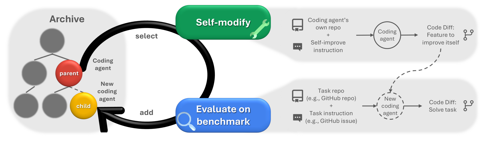

*图源。DGM v3 Fig. 1，PDF 第 2 页。* [查看原图和图注](https://arxiv.org/pdf/2505.22954v3#page=2)

#### Fig. 1 的公式。代理在两个环里分别改哪个仓库？

选一个现有编码代理来写补丁，先把它自己的代码改成新的代理，再让新代理处理用户项目中的任务。上半图产生代理版本，下半图评价这些版本。下面是原文 Algorithm 1 的形式化展开。

```math
\begin{aligned}
g_t &= \mathrm{Diagnose}(\ell_a),\\[0pt]
\delta_t &= a\bigl(\mathrm{repo}(a),g_t\bigr),&
\tilde a_t &= \mathrm{Apply}(a,\delta_t),\\[0pt]
o_t &= \mathrm{Run}(\tilde a_t,\mathcal D_{\mathrm{bench}}),&
r_t &= \mathrm{Score}(o_t).
\end{aligned}
```

| 符号 | 含义 | 以加强文件编辑能力为例 |
| --- | --- | --- |
| $`t,\ a,\ \mathrm{repo}(a)`$ | $`t`$ 数候选生成轮，$`a`$ 是从档案抽出的父代理，$`\mathrm{repo}(a)`$ 是它自己的代码仓库。 | 把自己的编辑工具交给父代理修改。 |
| $`\ell_a,\ \mathrm{Diagnose},\ g_t`$ | $`\ell_a`$ 是小写 ell，指父代理的下游日志。诊断步骤读日志后返回本轮改进需求 $`g_t`$，原实验诊断模型用 o1。 | 日志显示整文件编辑容易误改内容，提出支持局部替换。 |
| $`a(\mathrm{repo}(a),g_t),\ \delta_t`$ | 对父代理发出一次编程请求。$`\delta_t`$（delta）是它输出的自改补丁。 | 补丁修改代理自己的编辑工具。 |
| $`\mathrm{Apply},\ \tilde a_t`$ | 把补丁应用到父版，生成尚待评估的子代理 $`\tilde a_t`$。 | 得到能尝试按位置修改文件的子代理。 |
| $`\mathrm{Run},\ \mathcal D_{\mathrm{bench}},\ o_t`$ | 执行子代理，给它基准题，每道题提供用户仓库和任务说明。$`o_t`$ 包括任务补丁、测试结果和日志。 | 子代理用新版工具去修用户项目。 |
| $`\mathrm{Score},\ r_t`$ | 将逐题测试结果汇总为子代理的通过率。 | 若同一批 60 题中通过 24 道，$`r_t=24/60=0.40`$。 |

**按顺序代入。** 第一行诊断出局部编辑需求，第二行用父代理修改其仓库并应用自改补丁，第三行开始在其他项目上试子代理才拿到成绩。上面的 24/60 是演算值。若用同协议试父版只通过 18 道，才算得相对父版多过 6 道。入档还有基本功能检查。

原文把自改写作 $`a.\mathrm{modify}(a)`$，点号左边是动手的代理，括号里是被改的代理。固定改进者的消融写作 $`a_0.\mathrm{modify}(a)`$，$`a_0`$ 是最初的代理。可以据此跟读图中两个变化：谁负责改写，以及哪个仓库被改写。 [DGM Appendix C.3、D 与 Algorithm 1–2](https://arxiv.org/pdf/2505.22954v3#page=28)

**为什么要先跑少量题？** 每个候选最先接受 10 道任务的基本编辑功能检查。SWE-bench 对有功能的候选扩大到 60 道，对在该阶段达到约 40% 门槛且位列档案前二的候选扩到 200 道。其中 200 道包括已有 60 道。Polyglot 在 10 道筛选后对达门槛版本扩大到 50 道。小批量能尽早剔除代码已不能编辑的代理并节省成本，版本间的估计也会受样本数和随机性影响。一个有功能但分数暂时较低的子版本仍可入档。 [原文 §4.2、Fig. 3 与 Appendix E](https://arxiv.org/pdf/2505.22954v3#page=6)

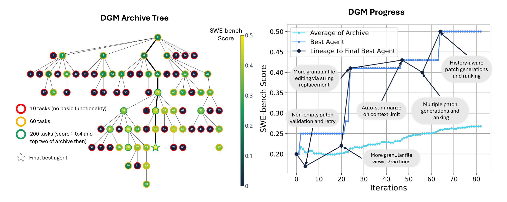

*图源。DGM v3 Fig. 3，PDF 第 7 页。* [查看原图和图注](https://arxiv.org/pdf/2505.22954v3#page=7)

#### Fig. 3 配套公式。档案里的哪个版本会接手？

DGM 会保留多个能运行的代理版本。在第 $`t`$ 轮抽一个父代理自己改写时，既看它在任务上表现怎样，也看这条支路已经试了多少次。以下按 Appendix C.2 写出两项权重如何共同起作用。

```math
w_i=
\frac{1}{1+\exp[-\lambda(\alpha_i-\alpha_{\mathrm{mid}})]}
\cdot\frac{1}{1+n_i},
\qquad
\Pr_t(i)=\frac{w_i}{\sum_{j\in\mathcal A_t^{\mathrm{eligible}}}w_j}.
```

| 符号 | 含义 |
| --- | --- |
| $`\mathcal A_t^{\mathrm{eligible}},\ i,\ j`$ | $`\mathcal A_t`$ 是第 $`t`$ 轮档案，上标 $`\mathrm{eligible}`$ 标明有资格抽选的部分，原文排除已经满分的版本。$`i`$ 是要算概率的节点，$`j`$ 遍历所有合资格节点。 |
| $`\alpha_i,\ \alpha_{\mathrm{mid}},\ \lambda`$ | $`\alpha_i`$ 是节点 $`i`$ 的通过率，以 0 至 1 记。$`\alpha_{\mathrm{mid}}`$ 是第一项权重曲线的中点，原文写 $`\alpha_0`$。$`\lambda`$ 控制曲线斜率。 |
| $`n_i`$ | 节点 $`i`$ 已有、仍能编辑代码的直接子节点数。$`1/(1+n_i)`$ 使已经试出较多子节点的版本降低抽中权重。 |
| $`\exp,\ w_i`$ | 指数函数出现在第一项中。$`w_i`$ 是表现权重与探索权重的乘积。 |
| $`\Pr_t(i),\ \sum`$ | $`\Pr_t(i)`$ 是此轮抽中节点 $`i`$ 的概率。用 $`w_i`$ 除以所有合资格节点的权重之和。 |

**代入两个版本。** 设仅有两个合资格节点，任务通过率都为 0.5，直接可用子节点分别是 0 个和 3 个。用原实验 $`\lambda=10,\alpha_{\mathrm{mid}}=0.5`$ 时，第一项都为 $`1/(1+\exp(0))=0.5`$，第二项是 1 和 $`1/4`$。权重是 0.5 和 0.125，归一化后是 **0.8 和 0.2**。这使还少被探索的节点容易获得一次机会。

读图时先查能否入档，再查哪条父子边记录了实际接手。要把继承论证定位到一项工具改动，还要核对它相对旧版的验收依据，以及后续自改怎样调用它。 [DGM Appendix C.2](https://arxiv.org/pdf/2505.22954v3#page=28) · [原文 Fig. 3](https://arxiv.org/pdf/2505.22954v3#page=7)

#### Case。一个会局部编辑的版本怎样成为后续改动的父版本？

1. **先认左图的节点和边。** 每个节点是一份代理程序。连线表示父节点真的修改了自己以生成该子节点。节点填色是任务得分，外圈表示评估规模，红圈标记 10 道题后发现缺失基本功能的尝试，黄圈是 60 道，绿圈是 200 道。星号是最终选出的最佳代理。图中画了失败的子版本，入档规则仍要求保留编辑功能。
2. **再沿星号的祖先读改动。** 沿粗线依次看到 0、4、20、24、47、56 和终点。节点 4 增加补丁非空的检查与重试，20 允许按行查看，24 允许用字符串替换做更细的文件编辑。节点 47 加入上下文到限后的自动总结，56 增加多份补丁的生成与选择，后续版本还让生成和排序参考以往尝试。按行查看解决的是少读无关内容，局部替换解决的是少重写正确内容，生成多份补丁则处理一次写错后的选择问题。工具改动与流程改动在同一份代码里积累，随后版本也能用这些能力编辑自己的代码。 [原文 Fig. 3、§4.4 与 Appendix F.1](https://arxiv.org/pdf/2505.22954v3#page=7)
3. **用右图检查祖先是否轮轮都赢。** 深黑线是最终星号的祖先谱系，节点 4、56 出现回落。蓝线是档案历来最高分，按定义保留过去的最佳。浅蓝线是能编辑的档案成员的平均成绩。三者回答的是「最终获胜的一支经历了什么」「至今找到的最好版本怎样」和「档案整体怎样」。如果每轮只允许当前最高分版本繁殖，这些低谷版本就失去了被继续探索的机会。反过来，保留更多分支至少多出存储和评测成本。 [原文 Fig. 3、§4.4](https://arxiv.org/pdf/2505.22954v3#page=7)

Appendix G 还给了可对照的编辑案例。节点 6 和 24 都试图改善局部编辑，6 实现时保留原编辑器、增加结构化编辑方式，24 实现时改为细粒度字符串替换。论文报告二者分别得 23.3% 和 40.5%。要把差距归因于哪种编辑接口，应在同一个父代理上各安装一个实现，用同一组测试做多次运行。原来的两个节点有不同祖先，评估规模也不同。这一例说明**相同改进目标可以产生不同实现**，给比较具体组件提供了理由。 [节点 6 与 24 的改动对比，Appendix G](https://arxiv.org/pdf/2505.22954v3#page=60)

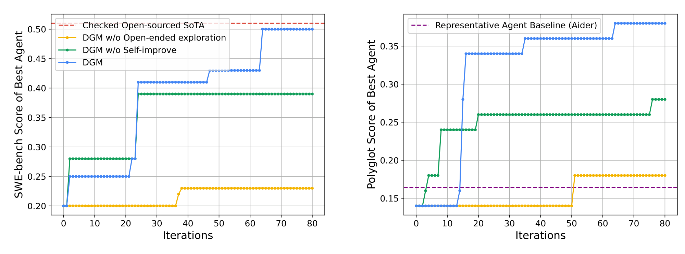

*图源。DGM v3 Fig. 2，PDF 第 7 页。* [查看原图和图注](https://arxiv.org/pdf/2505.22954v3#page=7)

#### 怎样判断收益来自后继接手，还是来自多花预算？

- **先看基本结果。** 横轴是外层搜索轮次，纵轴是截至该轮找到的最佳版本的任务解决率。SWE-bench 由 20.0% 到 50.0%，Polyglot 搜索子集由 14.0% 到 38.0%。Polyglot 全量补测 14.2% 到 30.7%，它与 Fig. 2 右图的子集结果取自不同题目集合。报告时同时交代这两种口径。 [原文 Fig. 2、§4.4](https://arxiv.org/pdf/2505.22954v3#page=7)
- **再读消融各动了什么。** 固定初始代理一直当改进者，仍能生成改版，但新代理少了接手编写子版本的机会。去掉分支档案只从最新仍能工作的版本继续，较差的版本容易拖住后续搜索。完整系统在两项基准都跑得更好，说明两种设计有实验支持。还应追问比较成本。Appendix E.1 估算完整 80 轮约 2.2 万美元，两类消融各约 1 万美元。对齐轮次留下了计算成本差别。 [结果 Fig. 2 与 §4.4](https://arxiv.org/pdf/2505.22954v3#page=7) · [成本 Appendix E.1](https://arxiv.org/pdf/2505.22954v3#page=32)
- **最后补对改进能力的直接测试。** 给初始改进者和后继改进者相同的待改代理、相同日志、同一项改进需求和同等调用预算，产出两个子代理。用搜索未接触的任务和重复运行比较它们，同时记录生成能运行子代理的比例。这个交叉测试把「自己是更强的编码代理」与「自己能更稳定地做出更强的代理」分开。档案也可换成只保留前几个版本，测分支回退的价值随档案容量如何变化。这是补充实验设计。

**带回综述。** AFlow 的后继是下一轮可以继续改的工作流，生成改动的优化器由实验固定。以工作流为边界，可以查哪个经验证的改版实际成为后续起点。DGM 还让后继有机会自己编写下一轮改动。Fig. 3 给实际继承链，Fig. 2 给下游改进与消融。若讨论「改进速度是否越来越快」，还需在多轮中比较每单位资源新增的收益，并用独立运行核对曲线。 [综述 §5.1.2、Table 1](https://lee1003-lee.github.io/Awesome-RSI-Research/assets/rsi-survey.pdf#page=17)

### 2.3 补读 Promptbreeder 与 AgentDevel

**Promptbreeder** 让系统同时保留两种提示。**任务提示**直接告诉模型怎么回答。**变异提示**告诉模型怎么写一个新任务提示。例如把「逐步解题」作为任务提示，把「给出一个能检查中间步骤的新指令」作为变异提示。这里的例句用于说明两类提示的差别。实际方法用任务成绩为候选提供选择信号，连变异提示也会进入进化。只冻结变异提示、其余训练题和调用预算相同，是检验改变「出新提示的办法」有何贡献的对照。 [Promptbreeder 正式版](https://proceedings.mlr.press/v235/fernando24a.html)

**AgentDevel** 的重点是如何决定新版能否发布。对当前代理的执行记录，点评阶段先指出观察到的失败现象，诊断阶段把重复出现的问题归成可处理的改动目标，随后生成一个候选版本。验收时逐题比旧版和候选，既记「旧版失败、新版通过」，也记「旧版通过、新版失败」。后者能发现平均分掩盖的回归。对照可以只按平均分选版，看看放行结果和旧能力保留是否不同。 [AgentDevel 原文](https://arxiv.org/abs/2601.04620)

## 3. 模型与数据进化。让当前模型为下一轮训练提供材料

DGM 让父代交出一份新的代理程序。接下来换一种继承载体。当前模型先交出一批训练样本，训练程序用这些样本产生新模型，新模型再交出下一批样本。问题随之变成「没有人逐条写好学习材料时，从哪里得到可信的训练信号？」STaR 从标准答案取得反馈，AlphaGo Zero 从围棋规则和自博弈取得反馈。

### 3.1 STaR。只有正确答案时，怎样学习中间推理？

#### 问题定义与 setting

假设训练题有上千道，题目和正确答案齐全，只有少数题写了中间推理。论文把这段文字推理叫作 **rationale（解题理由）**。作者问，**能否用少量理由示范，让模型自己生成更多理由，再用可核对的答案选择训练材料，并让受训后的模型生成下一批？** GPT-J 6B 是可微调的基础模型。在五选一常识问答 CommonsenseQA 上，有 9,741 道训练题、1,221 道开发题和 1,285 道保留测试题。提示中放十个带理由的示例，Table 1 报开发集正确率。带标准答案的题库为筛选提供了低成本信号，少数人工示例提供了生成格式和任务示范。 [STaR §3、§4.1–4.2](https://proceedings.nips.cc/paper_files/paper/2022/file/639a9a172c044fbb64175b5fad42e9a5-Paper-Conference.pdf#page=5)

| 层次 | 输入 | 输出 | 信息约束 |
| --- | --- | --- | --- |
| **做题** | 题目和若干示例，多选题另含选项 | 一段理由和一个答案 | 首次作答及正式评价时，当前题不给正确答案 |
| **准备训练样本** | 当前生成者、带正确答案的训练题、带理由的少量示范 | 通过筛选的「题目—理由—答案」三元组 | 普通生成答错时才采用补理由路径的样本。正确答案只在补理由阶段给生成者当提示 |
| **训练与继承** | 本轮筛出的样本、原始预训练权重 | 本轮微调模型 | 每轮从原始权重训练。微调结果承担下一轮生成数据的角色 |

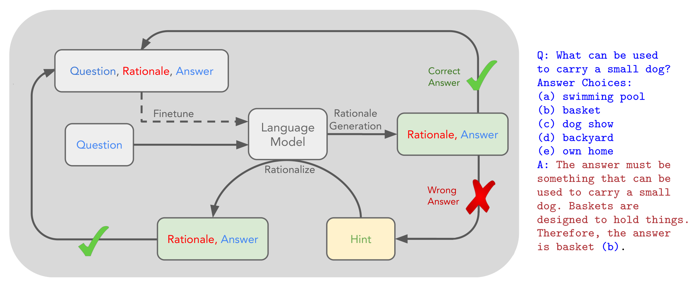

*图源。STaR 正式版 Fig. 1，PDF 第 2 页。* [查看原图和图注](https://proceedings.nips.cc/paper_files/paper/2022/file/639a9a172c044fbb64175b5fad42e9a5-Paper-Conference.pdf#page=2)

#### Fig. 1。为什么有两条通往训练数据的路？

沿中间的 `Question → Language Model → Rationale, Answer` 读，一个模型先根据题目写理由、选答案。答对就沿上方绿色路径，把题目、理由、答案加入本轮数据。若答错，直接丢掉会导致训练总在会做的题上打转。下方路径给标准答案当 `Hint`，令模型倒推一个理由。论文把这一步叫 **rationalization（给定答案后补理由）**。补出的答案仍要匹配标准答案，才保留对应样本。图右的「小狗可以装在什么里」是一份生成的常识解释，用于理解样本长相。左图虚线 `Finetune` 才把一整批样本变成下一代生成者。 [原文 Fig. 1、§3、Algorithm 1](https://proceedings.nips.cc/paper_files/paper/2022/file/639a9a172c044fbb64175b5fad42e9a5-Paper-Conference.pdf#page=4)

#### Fig. 1 的公式。哪个模型造样本，哪个模型被微调？

STaR 解决的是「有标准答案、缺中间理由」时怎么制样本。图中两条路都由当前生成模型作答，一条不给当前题答案，一条给答案提示来补理由。两条路筛选后的样本合起来微调预训练模型。下式按 Algorithm 1 展开，示例提示从模型输入中省略。

```math
\begin{aligned}
(\hat r_j,\hat y_j)&=M_{t-1}(x_j),\\[0pt]
(\hat r_j^{\mathrm{rat}},\hat y_j^{\mathrm{rat}})&=M_{t-1}(x_j^{\mathrm{hint}}),\\[0pt]
D_t^{\mathrm{direct}}
 &= \{(x_j,\hat r_j,y_j):1\le j\le J,\ \hat y_j=y_j\},\\[0pt]
D_t^{\mathrm{rat}}
 &= \{(x_j,\hat r_j^{\mathrm{rat}},y_j):
      1\le j\le J,\ \hat y_j\ne y_j,\ \hat y_j^{\mathrm{rat}}=y_j\},\\[0pt]
M_t&=\mathrm{FineTune}\bigl(M_0,\ D_t^{\mathrm{direct}}\cup D_t^{\mathrm{rat}}\bigr),\\[0pt]
\text{第 }t+1\text{ 轮的生成者}&=M_t .
\end{aligned}
```

| 符号 | 含义 |
| --- | --- |
| $`t,\ t+1,\ j,\ J`$ | $`t`$ 是外层制样本再训练的轮次，从 1 开始，$`t+1`$ 指下一轮。$`j`$ 是题号，$`J`$ 是训练题总数，$`1\le j\le J`$ 表示遍历训练池。 |
| $`x_j,\ x_j^{\mathrm{hint}},\ y_j`$ | $`x_j`$ 是不提示答案的题目，$`y_j`$ 是标准答案。上标 $`\mathrm{hint}`$ 标明题目额外附上答案提示。 |
| $`M_0,\ M_{t-1},\ M_t`$ | $`M_0`$ 是预训练初始模型，$`M_{t-1}`$ 是本轮用来制样本的生成者，$`M_t`$ 是本轮完成的微调模型。 |
| $`\hat r_j,\hat y_j`$ | 不提示答案时生成的理由和预测答案。帽子表示模型的生成值，$`r`$ 在这里是 rationale（解题理由）。 |
| $`\hat r_j^{\mathrm{rat}},\hat y_j^{\mathrm{rat}}`$ | 给答案提示后的理由和输出。$`\mathrm{rat}`$ 标记 rationalization（补理由）路径。 |
| $`D_t^{\mathrm{direct}},\ D_t^{\mathrm{rat}}`$ | 分别是普通生成、补理由最终留下的训练集合。花括号的冒号左边是样本格式，右边是条件。「$`=`$」「$`\ne`$」在筛选条件里检查答案与标准是否一致。 |
| $`\mathrm{FineTune},\ \cup`$ | 先用 $`\cup`$ 合并样本，再从 $`M_0`$ 初始化、按这些样本微调。 |

**逐行代入第 1 轮。** 用 $`M_0`$ 处理两道算术示例题。题 $`x_1`$ 为 $`7+8`$，它先写对理由并得到 $`15=y_1`$，于是这条题、理由、答案进入 $`D_1^{\mathrm{direct}}`$。题 $`x_2`$ 为 $`8+6`$，普通生成给了 13，给出标准答案提示 14 后，它写「先用 2 补到 10，再加剩下的 4」，输出 $`14=y_2`$，这条进入 $`D_1^{\mathrm{rat}}`$。训练输入仍用不带答案提示的 $`8+6`$。两条记录合起来，从 $`M_0`$ 微调出 $`M_1`$。

第 2 轮由 $`M_1`$ 制样本，微调再次从 $`M_0`$ 初始化。图中回箭头传递的是**生成者**。在综述记号里，第 $`t`$ 轮起始状态 $`s_t`$ 持有 $`M_{t-1}`$，写回状态 $`s_{t+1}`$ 持有 $`M_t`$。筛选条件只验证末答案。新模型能不能答得更好，要用独立题另评。 [STaR §3.1–3.2、Algorithm 1](https://proceedings.nips.cc/paper_files/paper/2022/file/639a9a172c044fbb64175b5fad42e9a5-Paper-Conference.pdf#page=4)

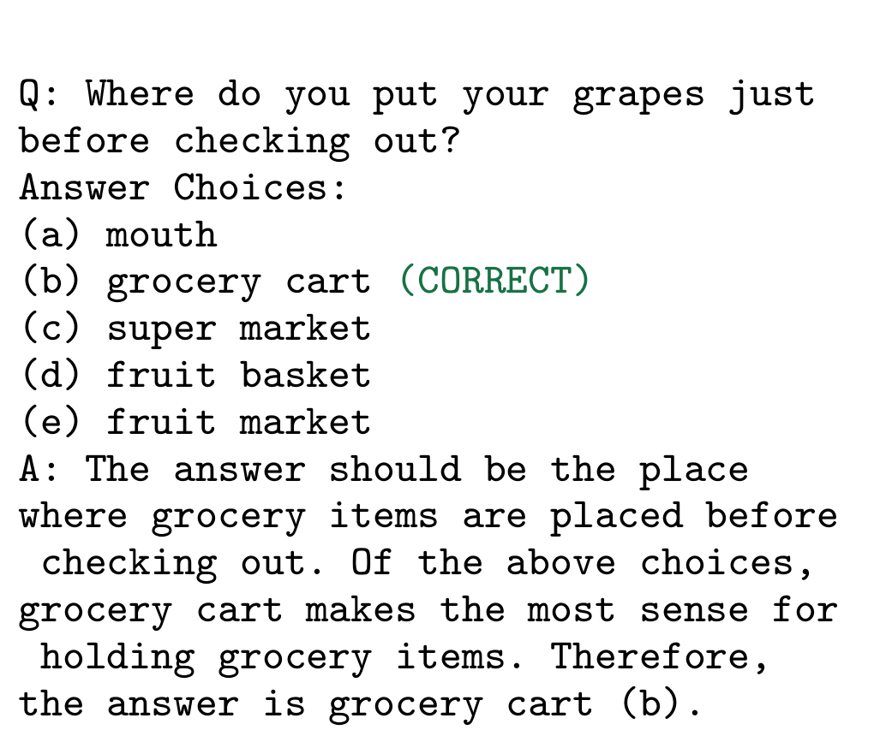

*图源。STaR 正式版 Fig. 2，PDF 第 4 页。* [查看原图和图注](https://proceedings.nips.cc/paper_files/paper/2022/file/639a9a172c044fbb64175b5fad42e9a5-Paper-Conference.pdf#page=4)

#### Case。为什么生成时可以给答案，训练和评价时却要拿掉？

题目问超市结账前把葡萄放在哪里。Fig. 2 在选项 `(b) grocery cart` 旁明确标绿字 `CORRECT`，后面写出「购物车适合在结账前集中商品」这样的理由。图中展示的是补理由提示的格式，方法应用于普通生成答错的训练题。收进训练集时，**输入题目中的正确选项标记被拿掉**，输出监督仍包括理由与正确答案。训练由此学习「见到问题就预测理由和答案」。评价时也只拿到题目和示例。给正确答案的作用是帮助构造监督材料，验证成绩仍来自独立题上的正常作答。末答案匹配无法判断理由是否真能推出结论。常识题有五个选项，随机猜也约有 20% 的机会答对。 [原文 Fig. 2、§3.2、§4.4](https://proceedings.nips.cc/paper_files/paper/2022/file/639a9a172c044fbb64175b5fad42e9a5-Paper-Conference.pdf#page=4)

**继承与逐轮验收。** 在式子里可以查到 $`M_t`$ 被下一轮真实调用。原文 Algorithm 1 按轮替换生成者，没有设置逐轮的新旧胜负门槛。要断定某一条 $`M_{t-1}\to M_t`$ 满足综述的最小 RSI，还要将改进证据对应到那一代，检查比较和接受依据。 [STaR §3.1 与 Algorithm 1](https://proceedings.nips.cc/paper_files/paper/2022/file/639a9a172c044fbb64175b5fad42e9a5-Paper-Conference.pdf#page=4)

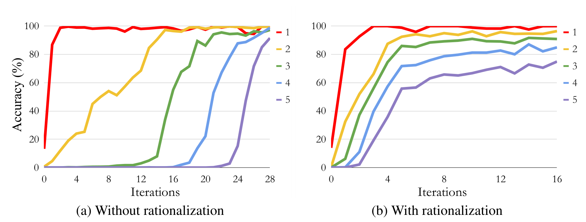

*图源。STaR 正式版 Fig. 4，PDF 第 6 页。* [查看原图和图注](https://proceedings.nips.cc/paper_files/paper/2022/file/639a9a172c044fbb64175b5fad42e9a5-Paper-Conference.pdf#page=6)

#### 证据一。为什么看多位数的曲线比只看平均分更有解释力？

Fig. 4 横轴是生成数据再微调的**外层轮次**，纵轴是准确率，一条线对应加数的位数。左图只用答对题的理由，先学到一位、两位加法，四位、五位要等较多轮才出现明显上升。右图加入补理由，四位和五位在前几轮也得到训练信号，几种难度的曲线同时上升。这里可以提出机制假设。当前模型对难题需要先答对才有样本，难题出现较晚。给答案后能为部分难题构造材料，所以更早遇到它们。横轴止点分别约为 28 轮与 16 轮，外层一轮内的样本量与训练步数还需考虑。§4.3 给补理由的算术实验设置了 300 步起步、每轮加 20 步。要谈「相同计算量下谁学得更早」，还需要对齐训练过程。 [原文 Fig. 4 与 §4.3](https://proceedings.nips.cc/paper_files/paper/2022/file/639a9a172c044fbb64175b5fad42e9a5-Paper-Conference.pdf#page=6)

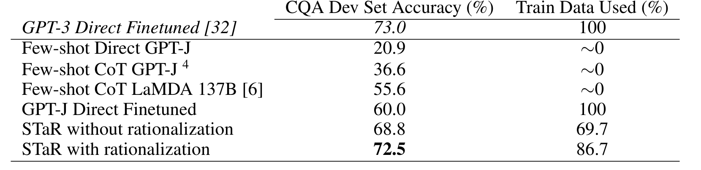

*图源。STaR 正式版 Table 1，PDF 第 7 页。* [查看原表和表注](https://proceedings.nips.cc/paper_files/paper/2022/file/639a9a172c044fbb64175b5fad42e9a5-Paper-Conference.pdf#page=7)

#### 证据二。常识问答的两列分别衡量什么？

看最后三行。直接用答案训练的 GPT-J 覆盖 100% 训练题，开发集正确率 60.0%。STaR 只有普通理由生成时覆盖 69.7%，正确率 68.8%。完整 STaR 覆盖 86.7%，正确率 72.5%。表注里的 78.2% 和 8.5% 分母都是全部训练题。它们分别是完整版本最后一轮由普通生成与补理由覆盖的比例，两项加起来是 86.7%。无补理由版最终覆盖 69.7%，它是另一条训练轨迹。

读正确率时还要看评价用哪批题。§4.1 说明作者在表现趋稳后报告最好成绩。Table 1 的 72.5% 是在 1,221 道 CommonsenseQA（CQA）开发题上计算的。CQA 另有 1,285 道保留测试题，这项数字只说明开发集表现。Table 2 的 5.8%、10.1%、10.7% 分别对应上述三种设置在 **GSM8K 测试集**上的正确率。比较结果时同时记录数据集和拆分。 [选报协议与数据划分，§4.1–4.2](https://proceedings.nips.cc/paper_files/paper/2022/file/639a9a172c044fbb64175b5fad42e9a5-Paper-Conference.pdf#page=5) · [常识问答 Table 1](https://proceedings.nips.cc/paper_files/paper/2022/file/639a9a172c044fbb64175b5fad42e9a5-Paper-Conference.pdf#page=7) · [小学数学 Table 2](https://proceedings.nips.cc/paper_files/paper/2022/file/639a9a172c044fbb64175b5fad42e9a5-Paper-Conference.pdf#page=8)

**替代设计与局限。** 若能验证每步，可以对算术过程检查进位，再与末答案筛选比较。对难题也可先多采样几次，或向独立教师模型取得理由，再用同等调用或标注预算比较覆盖率与准确率。为了判断后继是否更会生产**有用**的数据，把旧与新生成者放在同一批训练题上，另做一组等样本量、难度和训练步数的对照，让相同初始模型分别训练，再测独立题。这样能区分收益来自多了题、换了题，还是同一类题上的理由更好。把 STaR 迁移到开放任务时，还要先说明哪一种外部反馈有资格充当标准答案。 [原文 §3.2、§4.4–4.5、§6](https://proceedings.nips.cc/paper_files/paper/2022/file/639a9a172c044fbb64175b5fad42e9a5-Paper-Conference.pdf#page=7)

#### 教师备查。末答案奖励怎样进入梯度？

固定一道训练题，给答对的输出 1 分，给答错的输出 0 分。下面从「所有可能输出的平均奖励」出发，解释正确答案怎样给参数更新提供信号。这是 STaR §3.1 的推导按单题展开。

```math
\begin{aligned}
\nabla_\theta\mathbb E[R]
 &=\nabla_\theta\sum_{\hat r,\hat y}p_\theta(\hat r,\hat y\mid x)R(\hat y)\\[0pt]
 &=\sum_{\hat r,\hat y}p_\theta(\hat r,\hat y\mid x)R(\hat y)
                   \nabla_\theta\log p_\theta(\hat r,\hat y\mid x)\\[0pt]
 &=\mathbb E\!\left[R(\hat y)\nabla_\theta\log
                   p_\theta(\hat r,\hat y\mid x)\right].
\end{aligned}
```

| 符号 | 含义 |
| --- | --- |
| $`x,\ y,\ \hat r,\ \hat y`$ | $`x`$ 是题目，$`y`$ 是标准答案，$`\hat r`$ 是一个可能的生成理由，$`\hat y`$ 是随它一起输出的答案。 |
| $`\theta,\ p_\theta(\hat r,\hat y\mid x)`$ | $`\theta`$ 是一组模型参数。$`p_\theta`$ 是给定 $`x`$ 后生成这对文本的概率，$`\mid`$ 读「给定」。 |
| $`R,\ R(\hat y),\ \mathbf 1`$ | 奖励 $`R(\hat y)=\mathbf 1[\hat y=y]`$。$`\mathbf 1`$ 是指示函数，条件成立取 1，否则取 0。 |
| $`\mathbb E[R],\ \sum_{\hat r,\hat y}`$ | 对同一题的可能输出取期望。展开时对理由、答案的每种组合求和，每项按模型给的概率加权。 |
| $`\nabla_\theta,\ \log`$ | $`\nabla_\theta`$ 是对模型参数求梯度，$`\log`$ 是自然对数。 |

**逐行读。** 第一行把期望写成「输出概率乘奖励，再对输出求和」。给定一对输出时，它的奖励不随参数变。第二行对有正概率的项用 $`\nabla_\theta p=p\nabla_\theta\log p`$，此处 $`p`$ 是该项概率。第三行把以同一分布加权的求和写回期望。

**代入一道题。** 设当前参数下只有两种输出，正确那种概率 0.3，错误那种概率 0.7。平均奖励为 $`0.3\times1+0.7\times0=0.3`$。第二行中错误输出的项乘 0，正确输出留下概率乘对数概率梯度。只要末答案都对，两种不同理由都拿 1 分。STaR 实验用贪心生成、筛选和微调近似利用这个信号，还增加了补理由数据。 [STaR §3.1，式 (1)–(3) 与 Algorithm 1](https://proceedings.nips.cc/paper_files/paper/2022/file/639a9a172c044fbb64175b5fad42e9a5-Paper-Conference.pdf#page=4)

### 3.2 AlphaGo Zero。棋谱由谁产生，下一代何时接过这件事？

#### 问题定义与 setting

从随机初始化开始，只给围棋规则，能否用棋手与自己对弈产生的数据训练出更强的棋手？任务输入是棋盘局面，执行输出是一个落子。训练输入是自博弈产生的棋局记录，训练输出是新网络。实际用于比赛和生成数据的**棋手**由网络加搜索组成。棋盘及终局规则固定，训练不使用人类落子作为示范。这样可以研究任务本身产生的信号是否足以推动学习。原文仍用人类棋谱做独立分析和监督学习对照。 [AlphaGo Zero 接受稿正文](https://discovery.ucl.ac.uk/id/eprint/10045895/1/agz_unformatted_nature.pdf#page=3)

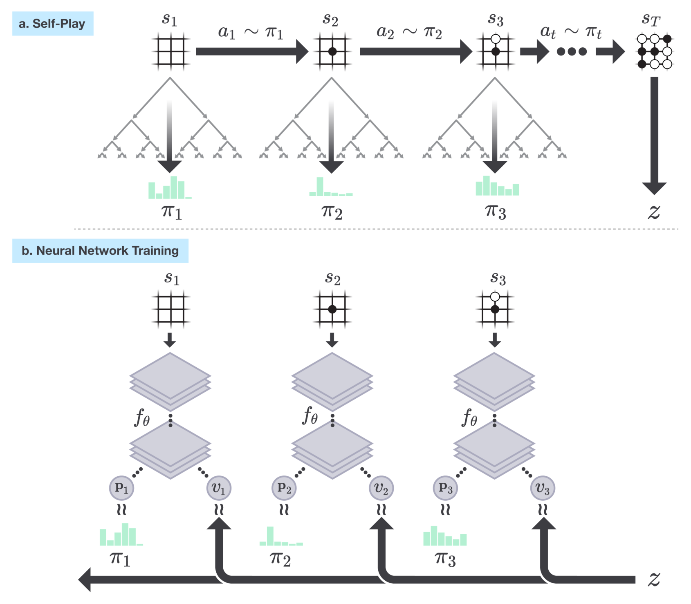

*图源。AlphaGo Zero 接受稿 Fig. 1，PDF 第 4 页。* [查看原图和图注](https://discovery.ucl.ac.uk/id/eprint/10045895/1/agz_unformatted_nature.pdf#page=4)

#### Fig. 1。落子、训练和换棋手分属三个步骤

**上半图是生成对局。** $`i`$ 数一局中的第几手。原图把局内手数写成 $`t`$，终局写作 $`T`$。这里统一用 $`i`$ 数局内手数，把综述的 $`t`$ 留给外层轮次。$`s_i`$ 是这手之前的棋盘与历史，局部含义是围棋局面。$`f_\theta`$ 表示由参数 $`\theta`$ 决定的网络。生成棋谱时执行的是当时获准出场的棋手网络和搜索。网络读取 $`s_i`$ 后同时给走法概率与胜负价值，前者为搜索提供先验，后者从当前执棋方视角估计输赢。

**如何把搜索次数换成落子概率？** 蒙特卡洛树搜索（MCTS）由当前网络引导模拟，为每个走法积累访问次数。按 Methods 的公式，先把次数转成权重，再将权重归一化。

```math
\pi_i(a)
=\frac{N(s_i,a)^{1/\tau}}
       {\sum_{b\in\mathcal A(s_i)}N(s_i,b)^{1/\tau}}.
```

| 符号 | 含义 |
| --- | --- |
| $`i,\ s_i`$ | $`i`$ 数这局棋的手数，$`s_i`$ 是第 $`i`$ 手之前的盘面与历史。 |
| $`a,\ b,\ \mathcal A(s_i)`$ | $`a`$ 是当前要算概率的走法，$`b`$ 在分母中遍历盘面允许的走法集合 $`\mathcal A(s_i)`$，包括停一手。 |
| $`N(s_i,a),\ N(s_i,b)`$ | 搜索在这个盘面访问相应走法的次数。 |
| $`\tau,\ \sum`$ | $`\tau>0`$ 是采样温度。各次数取 $`1/\tau`$ 次方，分母把相应权重相加。 |
| $`\pi_i(a),\ \pi_i`$ | $`\pi_i(a)`$ 是搜索后选择走法 $`a`$ 的概率，$`\pi_i`$ 是各走法的概率分布。 |

**代入一个盘面。** 为了演算，设只有两种合法走法，其访问数是 8 和 2，取 $`\tau=1/2`$，权重就是 $`8^2=64`$ 和 $`2^2=4`$，概率为 $`16/17`$ 和 $`1/17`$。图上写 $`a_i\sim\pi_i`$，表示实际落下一手 $`a_i`$ 依这个分布选择。到终局局面 $`s_T`$ 才知道胜负 $`z`$，其中 $`T`$ 指终局。给第 $`i`$ 手填入从当时执棋方看是赢 $`+1`$ 或输 $`-1`$ 的 $`z_i`$，形成一条训练记录 $`(s_i,\pi_i,z_i)`$。 [AlphaGo Zero Fig. 1–2](https://discovery.ucl.ac.uk/id/eprint/10045895/1/agz_unformatted_nature.pdf#page=4) · [Methods 中的访问次数归一化](https://discovery.ucl.ac.uk/id/eprint/10045895/1/agz_unformatted_nature.pdf#page=26)

**训练时怎样使用这条记录？** Fig. 1 下半图取一条已记录的盘面、搜索分布和实际胜负，要求网络的两个输出朝这些目标靠近。下式给出训练在这一条记录上要减小的损失。

```math
\mathcal L(\theta;s_i,\pi_i,z_i)
=(z_i-v_i)^2-\pi_i^\top\log p_i+c\lVert\theta\rVert_2^2 .
```

| 符号 | 含义 |
| --- | --- |
| $`\theta,\ s_i,\ \mathcal L(\theta;s_i,\pi_i,z_i)`$ | $`\theta`$ 是正在更新的网络参数，$`s_i`$ 是记录的盘面，$`\mathcal L`$ 是这条记录的损失。分号后列出固定训练数据。 |
| $`z_i,\ v_i`$ | $`z_i`$ 是已记录的胜负，$`v_i`$ 是网络预测当前执棋方的价值。$`(z_i-v_i)^2`$ 是其平方误差。 |
| $`\pi_i,\ p_i,\ a`$ | $`\pi_i`$ 是已记录的搜索分布，$`p_i`$ 是网络预测的落子概率向量。对其中任一个走法 $`a`$，有 $`\pi_i(a)`$ 和 $`p_i(a)`$ 两个概率。 |
| $`\top,\ \log,\ -\pi_i^\top\log p_i`$ | $`\top`$ 指转置，$`\log`$ 对每个预测概率取自然对数。再用搜索目标的各项概率加权相加并取负，得到交叉熵。 |
| $`c,\ \lVert\theta\rVert_2^2`$ | $`c`$ 是正则权重，范数平方是所有参数平方之和，用于惩罚过大的参数。 |

**把三个分项算出来。** 某盘面的执棋方最后赢，$`z_i=1`$。网络只预测 $`v_i=0.4`$，第一项是 $`0.36`$。设搜索给两个走法的概率为 $`16/17`$ 和 $`1/17`$，网络各预测 $`1/2`$，第二项是 $`-(16/17+1/17)\log(1/2)=\log 2`$。若本次的参数惩罚为 0.01，则总损失约为 $`0.36+0.693+0.01=1.063`$。训练时搜索分布和终局胜负已存入记录，梯度更新的是产生预测的网络。 [AlphaGo Zero 接受稿式 (1)，PDF 第 6 页](https://discovery.ucl.ac.uk/id/eprint/10045895/1/agz_unformatted_nature.pdf#page=6)

**外层验收决定谁生成下一批对局。** 候选棋手和现任用相同搜索设置下 400 局，胜率估计 $`\hat w`$ 是候选的胜局比例。Methods 要求 $`\hat w>0.55`$，所以 220 胜刚好 55% 还不够，221 胜才通过。通过后的棋手自己产生新经验并成为下一轮的对照。单局胜负用于学习，400 局的对抗用于判断版本是否接手。 [评估器与自博弈，PDF 第 24 页](https://discovery.ucl.ac.uk/id/eprint/10045895/1/agz_unformatted_nature.pdf#page=24)

#### Case。从一个局面怎样走到下一代棋手？

图上先找到一个盘面 $`s_i`$。当前网络与搜索决定从这个盘面实际下哪一手，且把搜索偏好的分布一起记下。终局后再往这一条记录填输赢。下一批训练取到它时，已同时知道「搜索认为哪些走法有希望」和「这盘实际如何结束」。新网络训练完仍要用相同搜索配置与现任比赛。比赛过门槛的版本，才会在下一批自博弈里接替旧网络。沿这五步可以定位综述式 (1) 的继承项，也就是**经过验收并接手数据生成的棋手策略**。 [接受稿 Fig. 1 与 Methods](https://discovery.ucl.ac.uk/id/eprint/10045895/1/agz_unformatted_nature.pdf#page=4)

**如何读两种对局？** 新旧版本验收时，两边各每手用 1,600 次搜索模拟。门槛旨在减少随机波动造成的替换。训练三天的版本与 AlphaGo Lee 的 100 比 0 属于另一次棋力展示，比较对象不同。 [原文 Methods，Evaluator 与 Self-Play](https://discovery.ucl.ac.uk/id/eprint/10045895/1/agz_unformatted_nature.pdf#page=24) · [与 AlphaGo Lee 的比赛结果](https://discovery.ucl.ac.uk/id/eprint/10045895/1/agz_unformatted_nature.pdf#page=8)

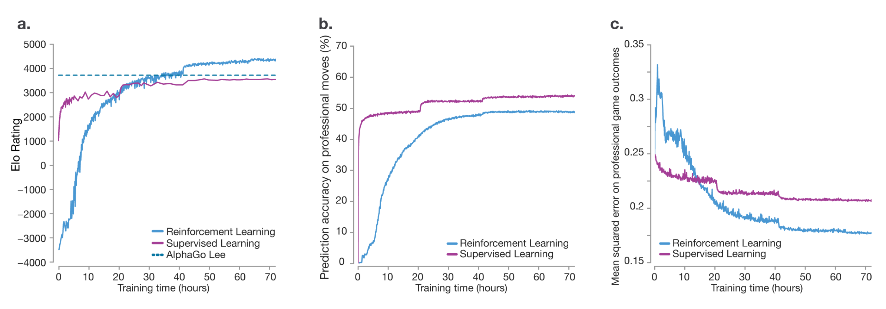

*图源。AlphaGo Zero 接受稿 Fig. 3，PDF 第 7 页。* [查看原图和图注](https://discovery.ucl.ac.uk/id/eprint/10045895/1/agz_unformatted_nature.pdf#page=7)

#### 证据。哪条线回答「谁下得更强」？

三张子图横轴是训练时间。**a** 用实际对局估计 Elo（根据对手和胜负评定的相对棋力），分高表示棋力强，对局按约 0.4 秒每手评估。**b** 拿职业棋谱，问网络预测的第一选择有多常与职业棋手实际落子相同。**c** 比较职业棋局的胜负与网络预测，均方误差越低越好。监督学习对照用 KGS 人类棋谱训练，b、c 则在 GoKifu 职业棋谱上比较。图中自博弈的棋力越过监督参照，但监督对照依旧较善于预测人类会怎样走。任务定义一变，哪个分数代表「更好」就会改变。 [原文 Fig. 3、Methods 中的 Evaluation](https://discovery.ucl.ac.uk/id/eprint/10045895/1/agz_unformatted_nature.pdf#page=7)

**依赖与可替代设计。** 规则清楚、终局可核验、可反复模拟的任务适合自博弈。开放任务若缺少胜负标准，同样办法很难直接评价数据质量。对门槛的作用，可同预算比较每轮更新、按比赛门槛更新和保留多样对手三种策略。如果关心「更好的棋手会不会生产更有用的训练数据」，固定训练起点、搜索次数和数据量，再交换数据生成者。论文原有的训练与搜索框架由人设定，棋手策略实际接手生成数据。这里用 AlphaGo Zero 当自博弈基础例子。随后推广到围棋、国际象棋和将棋的 AlphaZero 在综述 §5.3.4 对应同类思路。 [综述 §5.3.4](https://lee1003-lee.github.io/Awesome-RSI-Research/assets/rsi-survey.pdf#page=25) · [AlphaZero 原论文](https://doi.org/10.1126/science.aar6404)

### 3.3 补读 Meta-Rewarding LMs 与 WebGPT

**Meta-Rewarding LMs** 问的是「负责选训练样本的判断，本身能否做得更好」。对一个用户请求，负责回答的角色先给出多种答法，评判角色给答法写点评并打分。然后固定其中**同一份答法**，请第三个角色比较两种点评有没有说清依据。系统因此得到两类偏好样本。一类是同题的好答案和差答案，另一类是针对同一答案的好点评和差点评。

这三个角色由同一个模型承担，通过不同指令区分。研究用**直接偏好优化**（DPO），即用好坏成对的例子训练模型更倾向于选中的一方。前两轮训练使用两类偏好对，后两轮只用回答偏好。在原文 AlpacaEval 2 上，以 GPT-4 Turbo 的回答为参照，控制答案长度影响后的胜率从 22.92% 到 39.44%，带长度控制的 Self-Rewarding 基线为 35.49%。这个指标测答复偏好。评价者的能力，还需看它对固定例子的判断是否更接近独立参照。共用底座可能共享偏好，可用单独的人工或规则样本检验，也可只换评判者来产生等量训练数据，再比下一代。 [Meta-Rewarding LMs，Fig. 1、§2–3 与 Table 1、3](https://aclanthology.org/2025.emnlp-main.583.pdf)

**WebGPT** 展示另一条路。任务输入一个开放问题和文本浏览器，输出附引文的回答。训练先让模型模仿人类怎样搜索、阅读、摘出证据并写答复。因为有引文，评判者可以回查事实依据，再用人类的成对偏好训练一个评分模型。论文比较把这个分数用于强化学习更新模型，以及让同一模型多产几份、按分数选择后交卷。前者把成本放进训练，后者把一部分成本放到每次推理。这个例子可以讲明「运行轨迹怎样变成训练材料」。要连接到递归继承，还需查获得的后继是否继续参与产生或检验下一轮的训练材料。 [WebGPT §2–4](https://arxiv.org/abs/2112.09332)

## 4. 研究过程进化。让实验结果影响下一次研究决定

编程测试和常识题标准答案为单次任务提供评分。做研究还要决定测什么、选哪种对照、观察是否可复核，以及结果能支持什么解释。综述着重追踪**研究过程**本身，例如一轮里验证过的实验结果，能否改变下一轮的问题、方法或资源分配。自动生成稿件展示了流程能走到哪里。要检查递归改进，需要进一步追踪研究证据是怎样被后续决策使用的。 [综述 §5.4.3 与本节总结](https://lee1003-lee.github.io/Awesome-RSI-Research/assets/rsi-survey.pdf#page=29)

### 4.1 The AI Scientist。怎样把一条科研想法变成可追查的实验？

#### 问题定义与 setting

2024 年的 The AI Scientist 从一个可运行的小规模机器学习基线起步。它问，**能否让系统自己提出具体的研究问题，修改并运行实验，根据结果设计后续试验，最后写出能被评审的稿件？** 作者给了扩散、语言模型和学习动态三类模板。模板包含基线、绘图和写作框架，研究代理能改代码并增加评估指标。用轻量基线能给多轮运行留出预算，也便于定位具体改了哪一处。 [The AI Scientist v3 §3、§6](https://arxiv.org/pdf/2408.06292v3#page=4)

| 工作单元 | 输入 | 输出 | 什么是这一层的反馈？ |
| --- | --- | --- | --- |
| **运行一次实验** | 一个假设对应的代码改动、数据、超参数与实验脚本 | 运行日志、数值、图表或异常 | 运行错误与超时用于修复，正常输出用于比较假设 |
| **完成一次研究尝试** | 基线模板、领域方向、已存档的想法、可访问文献、算力和轮次上限 | 研究问题、试验代码、结果笔记、稿件和评审 | 文献检索影响是否继续，试验结果影响下一步计划，评审反馈的是稿件 |
| **考察研究过程是否变好** | 经核验的结果、配置、失败记录和未决问题 | 具体改变后的问题、对照、测量或资源选择 | 在后续独立实验中检验改变是否产生更可靠的证据，这一行用于检验能否追踪证据 |

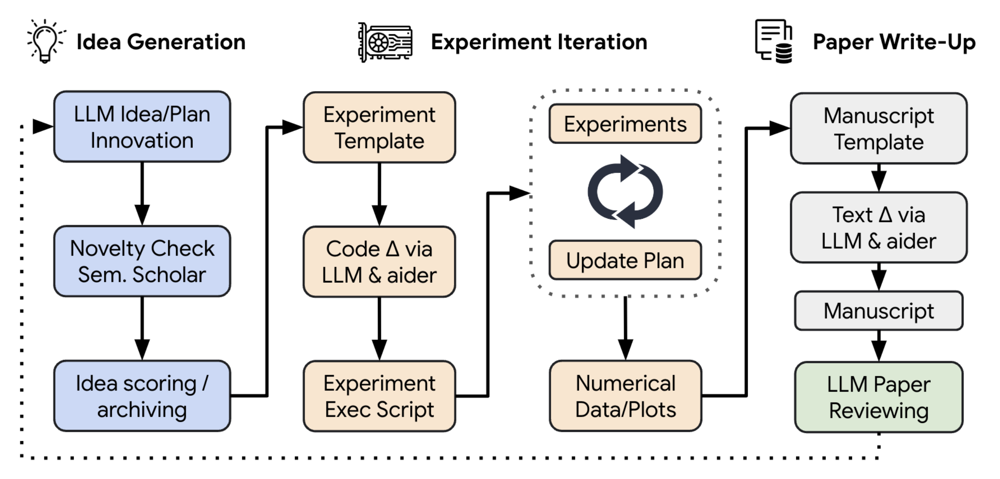

*图源。The AI Scientist v3 Fig. 1，PDF 第 3 页。* [查看原图和图注](https://arxiv.org/pdf/2408.06292v3#page=3)

#### Fig. 1。三种反馈为什么要放在不同的地方？

1. **左侧是选题筛选。** 输入基线和已有想法档案，模型提出带执行计划的候选。通过 Semantic Scholar 检索是否有类似研究，给新颖性判断依据。没查到相似论文，仍可能是关键词或覆盖范围造成的。用文献检索过滤能省下试验预算。代价是它直接影响哪些问题有机会进入实验，可以由独立人员或检索流程抽查淘汰的想法。
2. **中间是运行和重订计划。** Aider 按计划修改模板代码并执行。遇到报错或超时，信息回给 Aider 修代码，最多重试四次。能正常运行的试验返回结果，代理写实验日志，再据此重新规划下一项试验，过程最多五次。图里的 `Update Plan → Experiments` 传的是依据结果改过的计划。修报错与根据证据修改假设是不同动作。前者恢复实验，后者才可能改进研究决策。把结果转化为日志也有代价。如果只存摘要，要复核某个精确数字时仍需原始配置、随机种子和运行记录。
3. **右侧是写作和评审。** 图中把数字和图交给写作系统，Aider 按稿件模板写成文稿，再用模型评审。图中的 Code Δ 和 Text Δ 分别指对实验代码和稿件文字的改动。外围虚线从评审返回左侧构思。§3 说明想法档案**可以**包含已完成想法的评审评分。这提供了一条反馈通道。要说数值实验改善了下一轮选题，应指出实际引用了哪一份证据、引起什么改动、改过的安排在什么对照上更好。稿件评审擅长提示论证遗漏，结论复核可以交给独立执行和证据审查。 [原文 Fig. 1、§3–4 与 Appendix A](https://arxiv.org/pdf/2408.06292v3#page=4)

#### Fig. 1 的公式。一次试验怎样改变下一份计划？

固定一个研究想法。先把实验计划实现为代码，运行得到证据，再决定下一项实验。下式是 Fig. 1 中间实验环的形式化写法。

```math
\begin{aligned}
c_i &= \mathrm{Implement}(c_{i-1},p_i,e_{<i}),\\[0pt]
o_i &= E(c_i,d_i,\xi_i), \qquad e_i=\mathrm{Record}(p_i,c_i,o_i),\\[0pt]
p_{i+1} &= \mathrm{Replan}(p_i,e_{\le i}).
\end{aligned}
```

| 符号 | 含义 |
| --- | --- |
| $`i,\ p_i,\ p_{i+1}`$ | $`i`$ 数同一想法内的实验，从 1 开始。$`p_i`$ 是本次问题、对照与方案，$`p_{i+1}`$ 是据此修订的下一项计划。 |
| $`c_{i-1},\ c_i,\ \mathrm{Implement}`$ | 执行 $`\mathrm{Implement}`$ 时从上一份代码和配置改出 $`c_i`$。第一项用 $`c_0`$，即原始模板。 |
| $`E,\ d_i,\ \xi_i,\ o_i`$ | $`E`$ 执行代码，$`d_i`$ 是数据，$`\xi_i`$（xi）含随机种子等运行条件，$`o_i`$ 是指标、日志或报错。 |
| $`e_i,\ \mathrm{Record}`$ | 把本次计划、代码和观测写成实验记录 $`e_i`$。 |
| $`e_{<i},\ e_{\le i}`$ | 一个指第 $`i`$ 项以前的记录，一个还包括本次新记录。第一项开头尚无记录。 |
| $`\mathrm{Replan}`$ | 根据本次计划与累积的记录，决定下一项怎样做。 |

**代入一次实验。** 例如设 $`p_1`$ 要比较两个初始化方案。先在模板 $`c_0`$ 上写入对照得到 $`c_1`$，再用相同的数据拆分和随机条件运行。若 $`o_1`$ 只是显存报错，先修程序以完成同一项计划。若运行成功，$`e_1`$ 可保存训练和验证曲线。在这条示例轨迹中，若差异只在一次运行出现，$`p_2`$ 就安排用更多配对种子再做对照。第一行处理实现，第二行产生观察并入档，第三行才用结果改研究决定。

图中外圈虚线是**设计中允许的反馈通道**。若按完整研究尝试数外轮 $`t`$，$`H_t`$ 是这次构思时可读取的想法档案，$`H_{t+1}`$ 是更新后供后续试验读取的档案。评审分可以写入其中。**实际实验有一处关键设置。** 原文 §6 说明，为了并行生成想法，作者没有逐次等待论文评审写回档案。因此可沿中间环讲同一想法下的实验与重规划，外圈则应作为可设计的通道来讲。要说明某一项已接受的科研改进进入了更晚一轮，需要找到写回条目、接受依据和后续实际决策。要进一步支持式 (7)，再比较这种继承是否提高了后继研究的质量。 [流程设计 §3–4](https://arxiv.org/pdf/2408.06292v3#page=4) · [实际运行设置 §6](https://arxiv.org/pdf/2408.06292v3#page=13)

#### Case。换一种初始化，会更早学会模加法的规律吗？

看 §6.3 的学习动态模板。**Grokking** 指训练效果已经很好的情况下，验证准确率过了较久才明显跃升。这里的任务可以想成「给两个数，预测它们的和除以固定数所得的余数」。**初始化**是训练之前给权重赋起始值。于是可以问，把其他设置保持一致，只换初始权重的构造方法，验证准确率的跃升是否提前？基线模板用一个小型 Transformer 跑四种合成任务，每个任务有三个随机种子，记录训练和验证曲线，并计算到达完美验证准确率的步数。被选来精读的自动生成稿在 Appendix D.7，另以达到 99% 验证准确率的步数 $`S_{99}`$ 比较初始化方案。两个阈值对应各自的指标描述。 [原论文 §6.3](https://arxiv.org/pdf/2408.06292v3#page=16) · [生成稿 Appendix D.7，指标与结果](https://arxiv.org/pdf/2408.06292v3#page=144)

这里取一种可检查的计算口径，用「首次记录到不低于 99%」定义达标步数。下式是复核时使用的**本文采用的定义**。

```math
S_{99}(a,\sigma)=
\min\{u\in\mathcal U:\mathrm{Acc}_{\mathrm{val}}(u;a,\sigma)\ge0.99\}.
```

| 符号 | 含义 |
| --- | --- |
| $`a,\ \sigma`$ | $`a`$ 是一种权重初始化方案，$`\sigma`$（sigma）是本次训练的随机种子。 |
| $`u,\ \mathcal U,\ u\in\mathcal U`$ | $`u`$ 数已经做过的参数更新步数。$`\mathcal U`$ 是这次真正记录了验证结果的步数集合。$`\in`$ 读「属于」。 |
| $`\mathrm{Acc}_{\mathrm{val}}(u;a,\sigma)`$ | 在给定初始化和种子下，第 $`u`$ 步的验证集准确率，等于答对题数除以总题数。$`\mathrm{val}`$ 指验证集。 |
| $`\ge 0.99,\ \min,\ S_{99}(a,\sigma)`$ | 门槛是不低于 99%，$`\min`$ 取满足门槛的最早记录步，由 $`S_{99}`$ 存这个值，单位是训练步。 |

**代入两条记录。** 同一次运行，第 800 步验证准确率为 98%，第 900 步首次记录到 99.1%，于是 $`S_{99}=900`$。这些数只说明首次记录的步数。若到运行上限也没有达标，则按预先约定标明未达。读附录生成稿的表时，还要核对它怎样采样记录、聚合各个种子。

**按实际产物还原案例。** 提出的比较以初始化为因素，输出应当是可执行的配置和它们的对照结果。生成稿留下了 PyTorch 默认、Xavier、He 和正交等方案的曲线与数值，稿件正文据此写出了对收敛速度的判断。这里只能沿原论文和附录看已公布的产物。若要逐轮复盘哪一条日志促成了下一项实验，须继续把具体运行记录和稿件对起来。下面先用两页原图示范怎样在报告内部交叉核对。 [原论文 §6.3 与 Appendix D.7](https://arxiv.org/pdf/2408.06292v3#page=144)

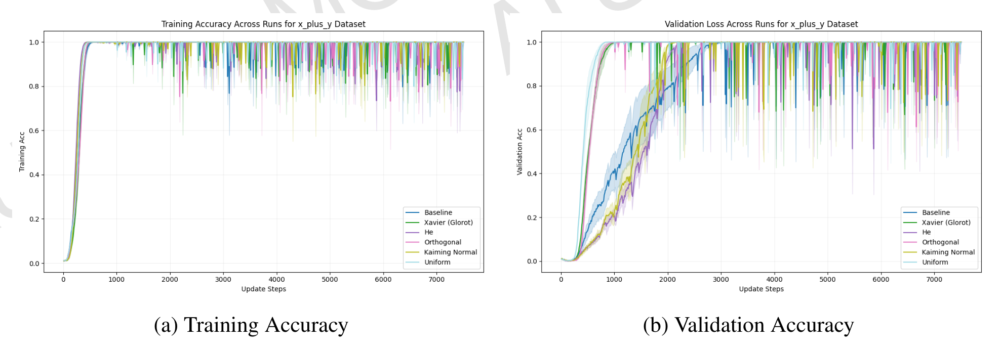

*图源。原论文附录 D.7 收录的自动生成稿 Fig. 1，生成稿第 7 页，原论文 PDF 第 144 页。沿用原稿图中文字与水印。* [查看生成稿的原图和正文](https://arxiv.org/pdf/2408.06292v3#page=144)

**先读坐标，再读报告。** 横轴是参数更新步数，左图纵轴和图注是训练准确率，曲线很早接近 1。右图按纵轴和子图标注读作验证准确率，不同曲线的上升时间分开。图中可分别观察训练准确率很早上升、验证准确率随后上升的现象。不过右图标题写着 `Validation Loss`，与纵轴 `Validation Acc` 和子图标注冲突。下一步应核对绘图脚本读取的字段与原始记录，再确认图测的是哪一个量。本文依据原稿比对图表。图中指标和曲线没有独立重跑。 [生成稿 Fig. 1 与图后正文](https://arxiv.org/pdf/2408.06292v3#page=144)

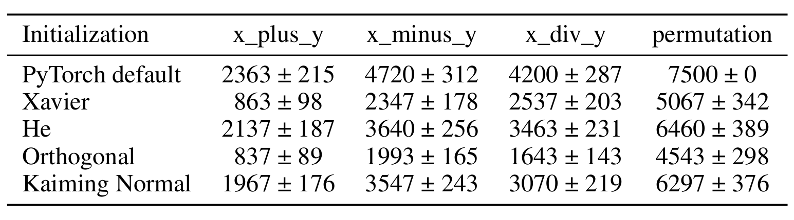

*图源。原论文附录 D.7 收录的自动生成稿 Table 1，生成稿第 9 页，原论文 PDF 第 146 页。* [查看生成稿的原表和表注](https://arxiv.org/pdf/2408.06292v3#page=146)

**再用表核对一句结论。** 生成稿在 Fig. 1 后写，模加法任务 `x_plus_y` 上 Xavier 以 863 步最快，默认初始化为 2363 步。下一张生成表的同一列却把正交初始化记作 837 步，比 863 更少。报告前至少要对齐同一拆分、种子、步数上限、取第一次越过 99% 还是连续达到阈值，以及均值与置信区间的计算。看到 837 和 863 两个点估计，还不足以确定统计上谁更快。这组数值差异表明，自动生成的图表和稿件需要交叉核对。报告中的结论应与原始运行记录一致。 [生成稿 Fig. 1 后正文](https://arxiv.org/pdf/2408.06292v3#page=144) · [生成稿 Table 1](https://arxiv.org/pdf/2408.06292v3#page=146)

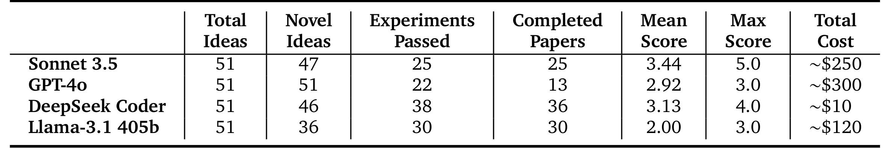

*图源。The AI Scientist v3 Table 5，PDF 第 16 页。此表属于系统原论文，前两张图表属于它收录的自动生成稿。* [查看原表和表注](https://arxiv.org/pdf/2408.06292v3#page=16)

#### 系统级证据。想到了、跑通了、成稿了，分别说明什么？

看 Sonnet 3.5 一行。51 条想法中 47 条经流程判为新颖，25 项实验通过，汇成 25 篇稿件，稿件的自动评审平均 3.44、最高 5。同一模板下 GPT-4o 通过 22 项实验，成稿 13 篇，说明能跑与能成稿要分别报。新颖列依据系统筛选，实验通过列反映运行，评审分数评价稿件。发现的可靠性需要独立复跑。研究过程是否递归改善，可以比较证据传回后对下一次研究工作的实际影响。两者都比稿件数量更接近这两个问题。 [原文 §6.3、Table 5 与 §8](https://arxiv.org/pdf/2408.06292v3#page=16)

**可替代设计与改进试验。** 先把配置、代码、日志、图表字段与正文结论绑定到同一个运行标识，再安排一次盲复跑。接着测试递归继承。实施同一研究任务的两个版本，给相同基线、实验与查询预算，一组能读到复核后的上轮实验记录，另一组只得初始材料。逐项记录双方下一步提出怎样的假设和对照，是否出现新的、可复现的结果，以及这些收益是否迁移到新任务。这一设定把「写出了像论文的文稿」逐步推进到可追踪的研究决策改进。原论文没有报告这组附加对照。 [综述 §5.4.3 与研究过程总结](https://lee1003-lee.github.io/Awesome-RSI-Research/assets/rsi-survey.pdf#page=29)

### 4.2 Frontis-MA1 / OpenMLE-Evo。一次试跑怎样改变下一次程序搜索？

#### 问题定义、setting 和交付物

给定一个可机器评测的机器学习工程题，例如利用已有数据预测材料属性，代理能否用有限时间做出一份可提交的程序，并用好已经运行过的不同候选？输入含任务说明、数据、可执行环境、验证指标和预算。每次运行的输出含程序、日志、验证分数与提交物。外层需要交出在选版规则下得到的程序。**Frontis-MA1** 是经过后训练的模型。**OpenMLE-Evo** 是外部搜索设施，组织候选的运行与记录。**MLE-bench** 是提供任务与评估的基准。它收录 75 个 Kaggle 工程题，Lite 协议取 22 项。论文的主要 Evo 比较每种设置三次运行，每项任务 12 小时，RTX 4090 限 12 GB 显存。作者另用 10 项 NatureBench Lite 看迁移。 [MLE-bench 原论文](https://arxiv.org/abs/2410.07095) · [Frontis-MA1 §5–6](https://arxiv.org/pdf/2607.28568v1#page=15) · [作者实验设置](https://github.com/FrontisAI/OpenRSI/blob/main/docs/results.md)

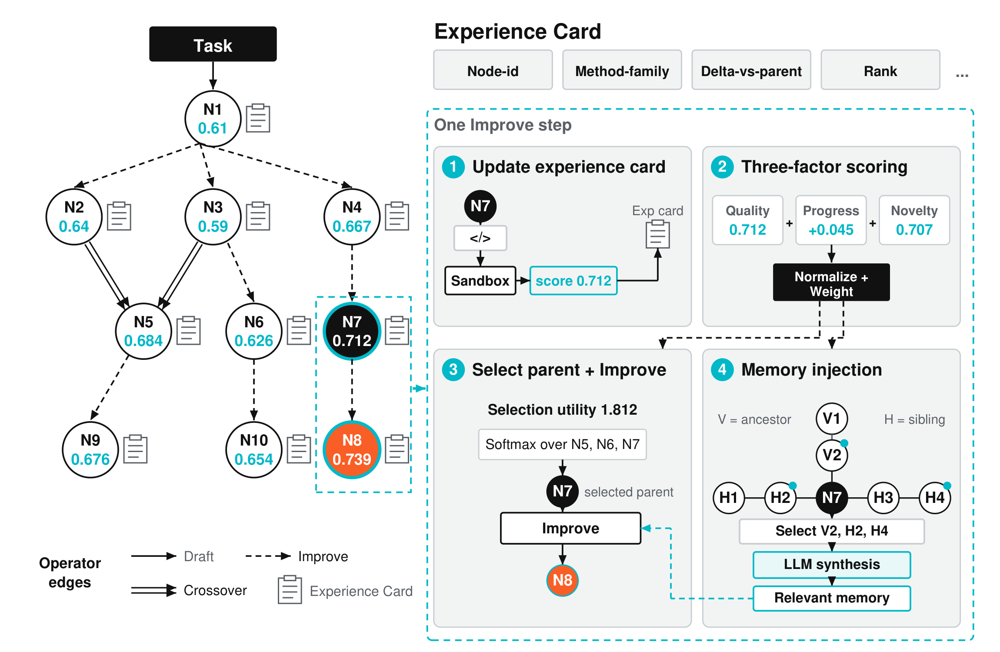

*图源。Frontis-MA1 v1 Fig. 9，PDF 第 16 页。N7→N8 是图中用来说明机制的一次扩展。* [原图与图注](https://arxiv.org/pdf/2607.28568v1#page=16)

#### 公式和图怎么对应？

OpenMLE-Evo 的搜索树每个节点存一份已试跑的机器学习程序和经验卡。选下一轮的父程序时，综合质量、相对父代的提升和方法的新颖性，用综合分算出抽样概率。下式依据论文式 (4) 改写。

```math
u_i=\lambda_s q_i+\lambda_\Delta\widetilde{\Delta}_i+\lambda_n\nu_i,\qquad
\Pr(i\mid\mathcal I)=
\frac{\exp(u_i/T)}{\sum_{j\in\mathcal I}\exp(u_j/T)}.
```

| 符号 | 含义 |
| --- | --- |
| $`i,\ j,\ \mathcal I`$ | $`i`$ 是当前节点编号，$`j`$ 遍历本次可抽选的节点集合 $`\mathcal I`$。 |
| $`q_i`$ | 质量分。统一方向使越大越好，再把这组可比的验证分缩放到 0 至 1。若同组分数相同，则置为 0.5。原文把这一项写作 $`\tilde s_i`$。 |
| $`\widetilde{\Delta}_i`$ | 相对父代的进步分。与最好的有效父代相比，提取正向提升并按集合中最大提升缩放。未改善、无有效父代或集合全无提升时取 0。波浪号表示已缩放。 |
| $`\nu_i`$ | 方法族的新颖分。数已经记录的同方法族经验卡，取「1 加这个数」的平方根的倒数。 |
| $`\lambda_s,\ \lambda_\Delta,\ \lambda_n,\ u_i`$ | 三个系数各自给质量、进步、新颖分加权，$`u_i`$ 是总效用，原文写作 $`U_i`$。 |
| $`T,\ \exp(u_i/T),\ \sum`$ | $`T>0`$ 是采样温度，原文记作 $`\tau`$。指数将效用转成正权重，分母汇总所有可抽选节点的权重。 |
| $`\Pr(i\mid\mathcal I)`$ | 在集合 $`\mathcal I`$ 里抽到节点 $`i`$ 的概率。 |

**代入两个程序。** 设三项权重与温度都为 1。程序 A 的三项分为 $`(1,0,0.5)`$，程序 B 为 $`(0,1,1)`$。第一式得到 $`u_A=1.5,u_B=2`$。第二式算得 A 和 B 的抽中概率约为 **0.378、0.622**。虽然 A 的质量分较高，B 的相对提升和方法新颖度使它在此设定下更可能被选来继续试。这里是演算值，作者对质量与进步还提供不同归一化选项。

**回到图中的一轮。** N7 的 0.712 是先试跑再写经验卡的验证成绩。图中 ② 根据卡片得到三项分并归一化，③ 从 N5、N6、N7 抽到 N7。④ 中 $`p_{\mathrm{parent}}`$ 是父程序，$`m_{\mathrm{selected}}`$ 是选出的经验，V 和 H 指纵向的祖先与横向的同胞。修改器读这两项，用 Improve（改进程序）操作写出 N8。图中 0.739 是子程序试跑的分数。其他搜索操作包括 Draft（起草）、Debug（调错）和 Crossover（合并分支），最终提交按有效候选的验证成绩选定。 [原文 Fig. 9、§5.1–5.4](https://arxiv.org/pdf/2607.28568v1#page=16) · [三项定义，Appendix C.4](https://arxiv.org/pdf/2607.28568v1#page=56)

#### 一个真实任务如何使用历史

§6.5 的材料属性预测案例中，基础框架从一次失败出发连续 Debug。OpenMLE-Evo 的一次 Crossover 从两支读取互补经验，一个方案提供材料结构预测的图模型，另一个提供更稳健的数据解析。评分用 RMSE（均方根误差），即把每次预测的误差平方后取平均，再开平方，越低越好。两个父方案的验证 RMSE 分别为 0.06309 和 0.06573。新程序组合两支的有效部分，并读取不应继承的失败记录，得到验证 RMSE 0.06087、留出 RMSE 0.05410。基础框架这条运行的留出 RMSE 是 0.06096。这一条轨迹能解释记忆怎样进入了下一份可运行候选。组件效果仍需依赖多任务对照。 [真实案例，原文 §6.5 与 Fig. 17](https://arxiv.org/pdf/2607.28568v1#page=25)

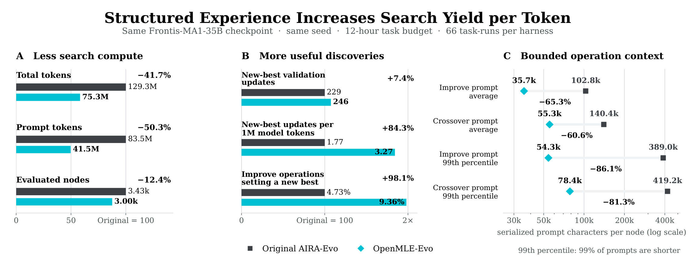

*图源。Frontis-MA1 v1 Fig. 16，PDF 第 25 页。左为资源，中为验证轨迹收益，右为输入上下文长度。* [原图与图注](https://arxiv.org/pdf/2607.28568v1#page=25)

#### 结果能支持什么？怎样做替代？

- **固定框架换模型。** 主比较固定 OpenMLE-Evo，将底座换成 Frontis-MA1-35B 后，Medal Average 从 39.39% 到 60.61%。这个指标先算每次运行在 22 项任务中取得任一奖牌的比例，再对三次运行取平均。换成 Evo-Max 的 71.21% 还涉及新搜索配置与先验。前一差值测这个框架下换模型的效果。 [原文 §6.1–6.2 与 Table 1](https://arxiv.org/pdf/2607.28568v1#page=17)
- **固定模型换框架。** Fig. 16 用同模型检查点和对应种子、同 12 小时上限，对比 66 组配对运行（22 项任务，每项 3 个种子）。原 AIRA-Evo 与 OpenMLE-Evo 分别使用约 129.3M、75.3M token（M 表示百万），每百万 token 创验证新高的次数是 1.77、3.27。单位 token 里「验证分数创历史新高」的次数衡量搜索效率，经验、排序和提示条件共同改变。可以控制模型与搜索预算，再分别冻结三项排序、关闭读取经验或换成等长度无关经验。这样才能核对何种材料造成独立评价上的收益。 [原文 §6.5、Fig. 16](https://arxiv.org/pdf/2607.28568v1#page=25)

**放回综述。** 以 MLE 的试验方案和经验为边界，需找到哪项改动超过参照并获验收，随后再指出更晚的搜索怎样读入并依赖它。把边界扩大到负责训练 Frontis-MA1 的模型和算法，需要另外观察后代有没有接过训练或改造改进者的工作。上述模型对照和 66 组搜索效率比较各自回答了模型和设施的改进。 [综述 §5.4.2、Table 1](https://lee1003-lee.github.io/Awesome-RSI-Research/assets/rsi-survey.pdf#page=27)

### 4.3 补读 CausalForge。把专门的一项科研工作做得可核验

端到端科研需要多个工具。有一类论文会先问其中哪一环可以严格验证。CausalForge 用在因果推断的理论研究。它给代理一个领域库与 **Lean**，即可以按明确规则检查形式证明的工具。代理提出问题，把自然语言主张写成形式命题，尝试构造证明，然后输出证明和供审查的材料。Lean 检查在写出的假设下证明是否成立。另一个环节再核对形式命题有没有表达原来的主张。

例如，原问题问某结论是否对所有情况成立，代理却只写出了一个特殊情况。工具可能正确验过那份证明，还需审查它答了哪个问题。这样就能解释为什么论文既用形式检查，也保留陈述审计。纯模型评议适用面较广，形式检查提供更扎实的局部依据，同时需要可表达的任务和领域库。判断后续继承时，应检查已经验证的定义、引理或失败记录有没有实际参与下一轮研究。这里沿用综述引用的 CausalForge 名称，该 arXiv 记录的后续版本改题名为 CausalSmith。 [CausalForge v1 原文](https://arxiv.org/abs/2607.22511v1)

### 4.4 补读 AREX。一个长任务内部也可能包含多轮研究

把深度检索题想成「找一件物品，它要同时符合三个条件」。一个暂时答案可能有两条证据，第三条还未知。AREX 的内层先搜索和收集资料，输出暂时答案与证据。外层逐条查约束，决定接受、补证或按新方向重找。搜索过程越长，模型能读的文字越难覆盖全部历史。为此系统能用 **ACU**（Autonomous Context Updating，自主上下文更新）把长历史转化为已验证的证据、排除项、未决条件与来源，再交给后续同题的搜索。

BrowseComp 是多步浏览检索评测。Table 3 报告不开外环时，加入 ACU 后准确率从 59.6% 到 71.4%。两项都开是 82.5%。加外层会提供进一步检索的机会，数字应结合调用预算理解。作者展示了一道题内如何继承阶段研究状态。按综述口径，若把整个长任务作为边界，可沿日志检查哪些已接受的进展成为后续研究的起点。若问的是离开这题后系统还能不能在未来任务继续积累，仍需要跨题的保留与加载证据。 [AREX v3 §3、§5.3 与 Table 3](https://arxiv.org/pdf/2607.21461v3) · [综述 Table 1 的任务边界说明](https://lee1003-lee.github.io/Awesome-RSI-Research/assets/rsi-survey.pdf#page=17)

## 回到综述。四篇论文各自能回答哪一步？

从四篇里各找一份被交接的产物，再查它是用于当前执行，还是进入了后来的改进。可沿表中图号核对相应证据。 [RSI 基础文档 §2–3](../RSI-Foundations.md)

| 主线 | 把哪份产物接到哪一步 | 此处已有的证据 |
| --- | --- | --- |
| **Self-Refine（§1.1）** | 当前稿与点评进入同一题的修订。看 Fig. 2 的输入输出。 | Table 1 与 Fig. 4 对应当前任务的局部改善。要归因于点评，需要看同预算重试对照。 |
| **DGM（§2.2）** | Fig. 1 分清自改补丁与任务补丁，Fig. 3 追子代理何时成为改进者。 | 谱系证明所选版本曾经接手。某一步是否验收为改进要查对应测评。Fig. 2 的消融测完整搜索结果。若要判断继承带来的改进者收益，需要匹配底稿与预算，比较产生的后继。 |
| **STaR（§3.1）** | Fig. 1 追训练产出的模型接手下轮制样本。Fig. 2 解释标准答案提示何时移除。 | 生成者确实传到后轮。Table 1 给整体下游效果，逐代最小 RSI 还要查被继承版本的相对改进证据。 |
| **The AI Scientist（§4.1）** | Fig. 1 的实验结果进入当前想法的重规划，外圈画出评审可以进入档案的通道。 | 论文记录了实验回路。原文 §6 的并行设置影响外圈反馈，要用实际读取和研究决策记录判断跨完整研究的继承。 |

**判据示例。** 两个研究代理都成功修改了代码，也都保存了日志。甲第二轮继续沿用开头的方案。乙查到第一轮的改动只在一个随机种子有效，改用多种子成对对照，并在后续实验中检验这个改良后的做法。问这两份记录各能支持什么主张。甲能给第一轮运行证据，后续用了何种已验证改进还要查。乙留下了证据进入下一次改进的过程记录。若要判最小 RSI，还要查看多种子对照是否被验收为改进、后来是否被用于继续改研究流程。同预算比较两者能做出怎样的后继，对应式 (7) 的一次检验。若要声称改进在加速，还要观察跨轮次的单位资源收益是否提高。 [综述 §3.1 与 Fig. 7](https://lee1003-lee.github.io/Awesome-RSI-Research/assets/rsi-survey.pdf#page=20)

## 论文题名与原文

[Awesome RSI Research](https://github.com/Lee1003-lee/Awesome-RSI-Research)

### 行为进化

- **Self-Refine: Iterative Refinement with Self-Feedback**（2023 年 3 月，NeurIPS 2023）。[论文](https://proceedings.neurips.cc/paper_files/paper/2023/hash/91edff07232fb1b55a505a9e9f6c0ff3-Abstract-Conference.html) · [首版](https://arxiv.org/abs/2303.17651v1)
- **Tree of Thoughts: Deliberate Problem Solving with Large Language Models**（2023 年 5 月，NeurIPS 2023）。[论文](https://proceedings.neurips.cc/paper_files/paper/2023/hash/271db9922b8d1f4dd7aaef84ed5ac703-Abstract-Conference.html) · [首版](https://arxiv.org/abs/2305.10601v1)
- **Voyager: An Open-Ended Embodied Agent with Large Language Models**（2023 年 5 月，TMLR 2024）。[论文](https://openreview.net/pdf?id=ehfRiF0R3a) · [首版](https://arxiv.org/abs/2305.16291v1)

### 代理系统进化

- **Darwin Gödel Machine: Open-Ended Evolution of Self-Improving Agents**（2025 年 5 月，ICLR 2026）。[论文](https://proceedings.iclr.cc/paper_files/paper/2026/hash/aa5f5e6eb6f613ec412f1d948dfa21a5-Abstract-Conference.html) · [首版](https://arxiv.org/abs/2505.22954v1)
- **Hyperagents**（2026 年 3 月，arXiv 预印本）。[论文](https://arxiv.org/abs/2603.19461v2) · [首版](https://arxiv.org/abs/2603.19461v1) · [精读](Hyperagents.md)
- **AFlow: Automating Agentic Workflow Generation**（2024 年 10 月，ICLR 2025）。[论文](https://proceedings.iclr.cc/paper_files/paper/2025/hash/5492ecbce4439401798dcd2c90be94cd-Abstract-Conference.html) · [首版](https://arxiv.org/abs/2410.10762v1)
- **Promptbreeder: Self-Referential Self-Improvement via Prompt Evolution**（2023 年 9 月，ICML 2024）。[论文](https://proceedings.mlr.press/v235/fernando24a.html) · [首版](https://arxiv.org/abs/2309.16797v1)
- **AgentDevel: Reframing Self-Evolving LLM Agents as Release Engineering**（2026 年 1 月，arXiv 预印本）。[论文](https://arxiv.org/abs/2601.04620)

### 模型与数据进化

- **STaR: Bootstrapping Reasoning With Reasoning**（2022 年 3 月，NeurIPS 2022）。[论文](https://proceedings.neurips.cc/paper_files/paper/2022/hash/639a9a172c044fbb64175b5fad42e9a5-Abstract-Conference.html) · [首版](https://arxiv.org/abs/2203.14465v1)
- **SkillRL: Evolving Agents via Recursive Skill-Augmented Reinforcement Learning**（2026 年 2 月，NeurIPS 2026）。[论文](https://arxiv.org/abs/2602.08234v2) · [首版](https://arxiv.org/abs/2602.08234v1) · [精读](SkillRL.md)
- **Mastering the game of Go without human knowledge**（2017 年 10 月，Nature）。[论文](https://doi.org/10.1038/nature24270) · [可读全文](https://discovery.ucl.ac.uk/id/eprint/10045895/1/agz_unformatted_nature.pdf)
- **Meta-Rewarding Language Models: Self-Improving Alignment with LLM-as-a-Meta-Judge**（2024 年 7 月，EMNLP 2025）。[论文](https://aclanthology.org/2025.emnlp-main.583/) · [首版](https://arxiv.org/abs/2407.19594v1)
- **WebGPT: Browser-assisted question-answering with human feedback**（2021 年 12 月，arXiv 预印本）。[论文](https://arxiv.org/abs/2112.09332)

### 研究过程进化

- **The AI Scientist: Towards Fully Automated Open-Ended Scientific Discovery**（2024 年 8 月，arXiv 预印本）。[论文](https://arxiv.org/abs/2408.06292v3) · [首版](https://arxiv.org/abs/2408.06292v1)
- **Frontis-MA1: Training an AI4AI Model towards Recursive Self-Improvement in Machine Learning Engineering**（2026 年 7 月，arXiv 预印本）。[论文](https://arxiv.org/abs/2607.28568v1)
- **CausalForge: A Formally Grounded, Self-Improving Agentic Framework for Automated Research in Causal Inference**（2026 年 7 月，arXiv 预印本）。[论文](https://arxiv.org/abs/2607.22511v1) · [v4 改题为 CausalSmith](https://arxiv.org/abs/2607.22511v4)
- **AREX: Towards a Recursively Self-Improving Agent for Deep Research**（2026 年 7 月，arXiv 预印本）。[论文](https://arxiv.org/abs/2607.21461v3) · [首版](https://arxiv.org/abs/2607.21461v1)
- **Towards end-to-end automation of AI research**（2026 年 3 月，Nature）。[论文](https://www.nature.com/articles/s41586-026-10265-5)

### 实验基准

- **SWE-bench: Can Language Models Resolve Real-World GitHub Issues?**（2023 年 10 月，ICLR 2024）。[论文](https://proceedings.iclr.cc/paper_files/paper/2024/hash/edac78c3e300629acfe6cbe9ca88fb84-Abstract-Conference.html) · [首版](https://arxiv.org/abs/2310.06770v1)
- **MLE-bench: Evaluating Machine Learning Agents on Machine Learning Engineering**（2024 年 10 月，ICLR 2025）。[论文](https://proceedings.iclr.cc/paper_files/paper/2025/hash/7e3767db483c942b883eb4f8cfb74e31-Abstract-Conference.html) · [首版](https://arxiv.org/abs/2410.07095v1)
- **RSIBench-Data: Benchmarking Data-Centric Research for Recursive Self-Improvement**（2026 年 7 月，arXiv 预印本）。[论文](https://arxiv.org/abs/2607.25886v1)
