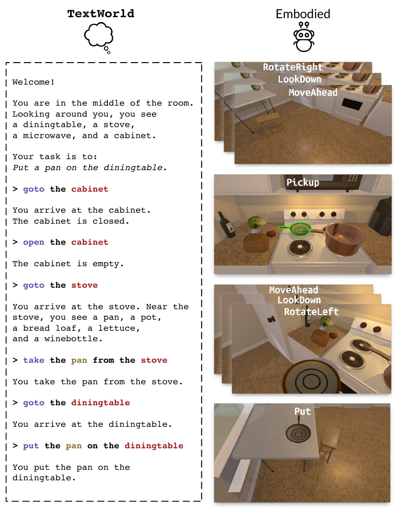
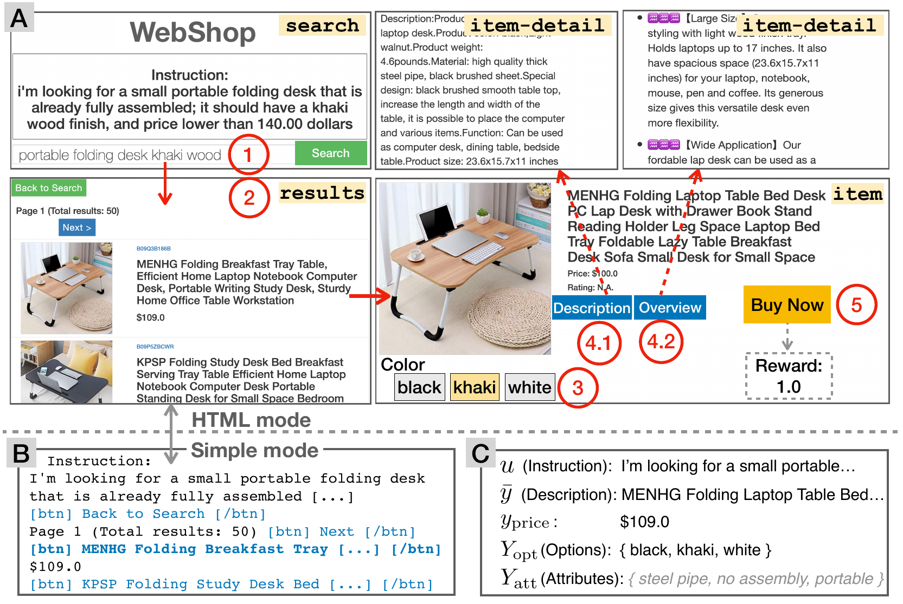
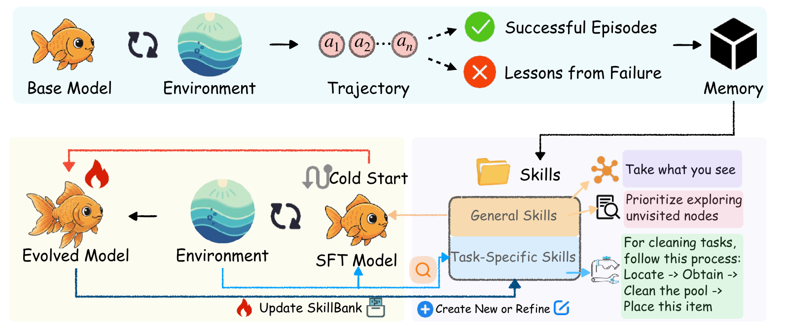
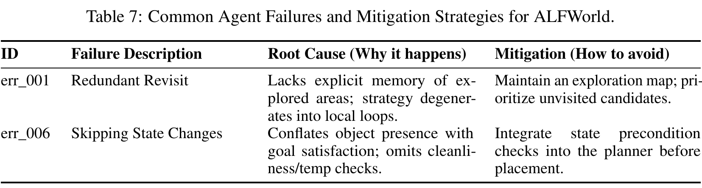
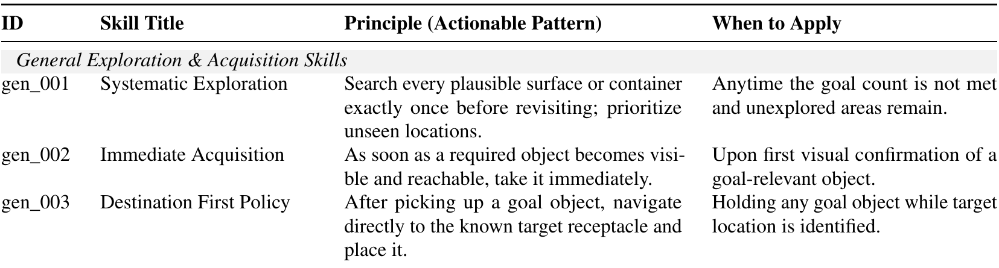
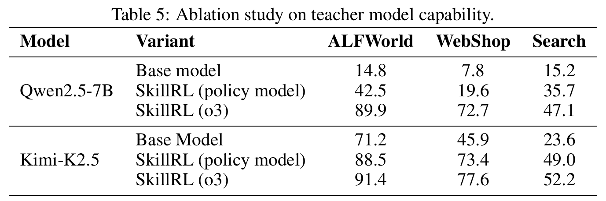

# SkillRL 的技能库与策略更新

**SkillRL: Evolving Agents via Recursive Skill-Augmented Reinforcement Learning**。Peng Xia 等，2026 年 2 月首版，NeurIPS 2026。 [论文 v2](https://arxiv.org/abs/2602.08234v2) · [公开实现](https://github.com/aiming-lab/SkillRL)

SkillRL 从交互轨迹中提炼适用范围明确的技能，再训练策略在决策时使用这些技能。系统的两个持续更新对象是模型参数和外部技能库。理解两者如何耦合，需要从任务接口和训练数据开始。

## 研究问题与相关工作

一个智能体失败之后，完整保存日志当然增加了可用信息，但下一次执行时，它还要从大量细节里识别真正有用的原则。即使我们已经替它总结出原则，较弱模型也未必能在正确状态下调用。作者因此把问题拆为经验表示、规则使用和知识更新。

论文 §1、§3

- [论文 §1](https://arxiv.org/html/2602.08234v2#S1)
- [论文 §3](https://arxiv.org/html/2602.08234v2#S3)

### 相关研究与本文的研究位置

经验抽象和工具强化学习在 SkillRL 之前都已有研究，因此不能把论文动机理解成此前只有原始日志记忆。ExpeL 已经总结自然语言经验，Search-R1 已经训练多轮搜索，GiGPO 研究多步信用分配，MemRL 讨论冻结模型时的记忆效用。SkillRL 的特点是把技能组织、示范训练和后续更新接在同一套策略训练系统中。因此组件贡献需要由对应消融来检验。

已有研究分别探索了经验总结、工具调用训练和记忆效用。SkillRL 关注这些环节如何配合：从执行经验中提炼技能，用示范训练策略使用技能，并在训练过程中根据失败继续维护技能库。

- [ExpeL](https://arxiv.org/abs/2308.10144)
- [Search-R1](https://arxiv.org/abs/2503.09516)
- [GiGPO](https://arxiv.org/abs/2505.10978)
- [MemRL](https://arxiv.org/abs/2601.03192)
- [论文 §5](https://arxiv.org/html/2602.08234v2#S5)

## 任务、交互与数据

### 一次具体轨迹与可复用的技能

ALFWorld 原论文 Fig. 1 给出了一次任务的完整观察与动作。左边是文字观察和文字动作，右边是同一任务对应的具身场景。例子要求把锅放到餐桌：智能体先检查柜子，随后在炉灶上发现锅，拿起之后走向餐桌并放下。SkillRL 主实验使用的是文本交互，因此右侧具身场景用于说明任务语义。轨迹里的柜子、炉灶和这只锅是本次执行的具体事实；跨任务的原则则可以是，目标物体一旦出现在观察中且可以拿取，就立即获取。下一次物体位置改变，原则仍可能有用，但模型必须重新探索。这就是轨迹信息、当前状态和可复用技能之间的分工。

以拿取苹果为例，一条轨迹记录本次的具体位置和动作，经验记录可以压缩这些信息，技能则要给出可跨实例使用的操作原则。物体所在位置会变，但先拿到目标再进行状态转换这样的前提可以复用。这里的 skill 是文本，不是绑定了执行程序的工具，也不是传统层次强化学习里具有独立终止条件的 option。层次化 SkillBank 指知识按通用和任务层组织，不能据此直接推导出新的层次强化学习算法。这个区别决定了后面要训练的仍然是每一步的语言策略。

本文的 Skill 是自然语言操作指导。执行模型仍要结合当前观察和历史逐步生成动作，技能本身不包含独立的可执行程序。General 与 Task-specific 的分层描述知识组织方式。

依据论文 §2 与 §3.1 构造的示例

- [论文 §2](https://arxiv.org/html/2602.08234v2#S2)
- [论文 §3](https://arxiv.org/html/2602.08234v2#S3)

图源：[ALFWorld 原论文 Fig. 1（文本与具身环境）](https://arxiv.org/abs/2010.03768)。

### 任务中的操作与约束

WebShop 原论文 Fig. 1 展示搜索、查看结果、选择颜色、核对商品详情和购买的完整交互。示例任务要求一张便携折叠桌，已经装配好、具有指定颜色，并低于预算。模型不能只凭标题相似就购买，还要进入详情页检查属性、选择所需选项，并确认最终价格。图下方也展示了面向智能体的简化文字接口。回到 SkillRL，检查必选属性和选项后重新核价这样的短规则，能够作用在明确的操作节点上。ALFWorld 的规则对应拿取和状态变化的前提；Search QA 的规则则对应查询分解、证据组合与最后回答。三类任务的接口不同，但都能反复采样并获得自动检查的结果。

为什么这个 idea 在这些任务上值得尝试？首先，接口和规则足够稳定，很多失败会反复出现。ALFWorld 在这里运行的是文本观察和文本动作，物体位置需要探索，但六类任务的操作结构重复。WebShop 是模拟购物网站，商品文本真实，但这不意味着开放网页浏览或真实支付。它要求颜色、尺寸、价格等约束共同满足，检查清单可能很有用。公开包装器把完全成功映射为十分，否则是零分，部分匹配分仅另外统计。Search 通过搜索后回答，公开默认奖励比较归一化答案与答案别名，不直接证明证据使用正确。三者都便于大量交互并自动打分，这使 outcome RL 和短规则复用同时可行。候选动作列表只是输入提示，不应理解为解码器保证所有输出合法。

这些环境的接口和规则相对稳定，任务可以重复采样，结果能够自动检查。因此，操作前提、检查清单和搜索策略可以反复使用。ALFWorld 的主实验采用文本交互，WebShop 采用模拟购物环境，结论应限定于相应设置。

论文 §4；公开环境包装器；ALFWorld / WebShop 官方项目

- [论文 §4](https://arxiv.org/html/2602.08234v2#S4)
- [ALFWorld 项目](https://alfworld.github.io/)
- [WebShop 项目](https://webshop-pnlp.github.io/)
- [源码 envs.py](https://github.com/aiming-lab/SkillRL/blob/4d984d455b9b02f0bad283cbe9ab3d66a7e5b89d/agent_system/environments/env_package/webshop/envs.py)
- [源码 utils.py](https://github.com/aiming-lab/SkillRL/blob/4d984d455b9b02f0bad283cbe9ab3d66a7e5b89d/agent_system/environments/env_package/search/third_party/skyrl_gym/envs/search/utils.py)

图源：[WebShop 原论文 Fig. 1（购物交互过程）](https://arxiv.org/abs/2207.01206)。

### 数据组织与训练样本

这里最容易误读的是样本单位。一条十五步的成功轨迹可以变成十五条监督样本，所以七千多条 SFT 数据不能直接解释为七千个独立任务。公开数据卡总计一万一千二百五十三条逐步训练对；附录给出的约七千五百和两千四百与当前发布数量略有不同，需保留版本口径。RL 又是另一层数据：策略在环境中在线生成同一任务的多条轨迹。Search 主文把 NQ 与 HotpotQA 作为 RL 训练来源，其余五个数据集标为域外。但公开 SFT 数据卡同时列出了七个来源，因此这里的域外首先针对 RL 训练来源。缺少逐样本来源清单时，我们既不能宣称完整流程零样本，也不能据此认定测试泄漏。训练脚本中的 train_data_size=16 是并行 rollout 规模，不是整个任务集只有十六条。

公开 SFT 数据共 11,253 条，单位是逐步输入输出对，一条长轨迹可以产生多个样本。该数量不等于独立任务数，且附录与当前发布数量略有不同。复现时应固定数据版本、任务划分和构造方式。

附录 D.1；SkillRL-SFT-Data 数据卡；公开训练脚本

- [论文附录 D.1](https://arxiv.org/html/2602.08234v2#A4.SS1)
- [数据卡 SkillRL-SFT-Data](https://huggingface.co/datasets/Jianwen/SkillRL-SFT-Data)
- [源码 run_alfworld_skills.sh](https://github.com/aiming-lab/SkillRL/blob/4d984d455b9b02f0bad283cbe9ab3d66a7e5b89d/examples/grpo_trainer/run_alfworld_skills.sh)

## SkillBank 的构建与检索

### SkillRL 的整体训练过程

第一段用基础策略与环境交互，成功轨迹作为可保留的示范，失败轨迹也被压缩成经验，教师进一步提炼技能。第二段是分层 SkillBank，通用原则与任务专用原则共同进入执行上下文。第三段先做技能条件下的监督微调，再开始强化学习。强化学习期间周期性检查失败，教师据此补充知识库。图里存在两种完全不同的更新：GRPO 更新策略参数，教师调用更新外部文本。二者通过下一轮 rollout 耦合，但教师和检索器并没有一起接受 GRPO 梯度。

基础模型先在环境中收集成功与失败轨迹，教师将经验归纳为分层技能库。随后通过技能条件下的 SFT 建立执行起点，再使用 GRPO 训练策略。训练期间，系统周期性分析失败并补充技能，使策略和技能库交替更新。

论文 Fig. 2

- [论文 §3](https://arxiv.org/html/2602.08234v2#S3)

*图源为 SkillRL Fig. 2。* [原论文](https://arxiv.org/html/2602.08234v2#S3)

### 初始技能的生成过程

正文把这段流程抽象成从经验蒸馏技能，但公开代码实际上有中间记忆表示。生成脚本读入 task_meta、refined_trajectory 和 strategic_guidelines 等内容，而不是无上限地吞入所有原始日志。工程上先清理轨迹，再提取规划模式与失败教训，最后跨轨迹合并。ALFWorld 的类别由任务关键词和人工定义的流程确定，提示还规定通用技能约八到十二条，每类任务技能约四到六条，每条原则只写一两句。相关函数最多提取十个模式，每个模式只看前五个动作和理由，另有采样限制。这样做既控制教师费用，也减少输出重复，但会丢失输入信息。仓库另有先用 gpt-4o 生成 Memory 再聚合的路线，我们不能认定所有脚本都用于同一组发表实验。

技能生成并非一次无约束的摘要。公开实现先形成中间记忆，再按人工定义的任务类别归纳经验，并限制输入轨迹数和输出规则数。教师的先验知识也可能参与内容形成，因此经验信息与教师知识共同影响初始技能质量。

公开代码 skill_generation/alfworld.py；SFT 数据生成目录

- [源码 alfworld.py](https://github.com/aiming-lab/SkillRL/blob/4d984d455b9b02f0bad283cbe9ab3d66a7e5b89d/skill_generation/alfworld.py)
- [源码 generate_memory_alfworld.py](https://github.com/aiming-lab/SkillRL/blob/4d984d455b9b02f0bad283cbe9ab3d66a7e5b89d/examples/sft_data_generation/skill_memory/generate_memory_alfworld.py)
- [源码 aggregate_skills.py](https://github.com/aiming-lab/SkillRL/blob/4d984d455b9b02f0bad283cbe9ab3d66a7e5b89d/examples/sft_data_generation/skill_memory/aggregate_skills.py)
加热任务的具体例子说明抽象对象：从成功轨迹中保留先拿目标再使用电器的前提，从失败轨迹中总结遗漏状态检查、重复探索等错误，再将多次出现的规律合并为短规则。示例仅用于解释数据加工粒度。

### 失败原因与纠错规则

论文附录按失败模式归纳了常见错误。第一类是重复访问：模型没有有效维护已经探索过的位置，因而不断回到同一个区域。相应建议是记录探索范围并优先选择未访问位置。第二类是跳过状态变化：模型看到目标物体已经出现，就把它误当作任务已经满足，遗漏清洗或温度条件。因此，在最终放置之前还要检查目标状态。附录 Table 7 展示了技能如何补充操作前提。不过表中的原因仍是对轨迹的解释。若要确认某个动作就是失败根因，需要在相同环境状态下修改该动作，再比较结果。文本上的合理归因与环境中的干预验证，证据强度不同。

参考内容强调反向因果归纳，这确实是读方法时值得留意的地方。给定最终目标，教师可以倒推哪些前提不可缺少，从而删除大量无关探索。不过这里的因果主要是语言模型对轨迹的解释。代码没有为每条反事实建议都在环境中改一次动作、重放后续过程并确认成功。因此，技能里写出的原因可以作为有用假设，证据强度还没有到干预式因果定位。尤其是动态更新只保留失败尾部时，真正发生在早期的错误可能已经消失。这也对应我们的主题：错误总结和严格的错误溯源仍有距离。

这种分析可以提供有用的纠错假设，但文本解释尚不足以建立严格的因果关系。要判断某个动作是否为根因，需要比较修改该动作后任务结果是否改变。

论文 §3.1；公开 Memory 提示与 SkillUpdater

- [论文 §3](https://arxiv.org/html/2602.08234v2#S3)
- [源码 skill_updater.py](https://github.com/aiming-lab/SkillRL/blob/4d984d455b9b02f0bad283cbe9ab3d66a7e5b89d/agent_system/memory/skill_updater.py)

图源：[SkillRL 附录 E Table 7（ALFWorld 失败分类）](https://arxiv.org/html/2602.08234v2)。

### SkillBank 中的真实技能

这里直接看 SkillRL 附录提供的三条真实规则。第一条要求系统探索：每个合理位置先检查一次，优先探索没有看过的区域。第二条叫立即获取，要求目标物体一旦出现在观察中并且可以拿取，就马上拿起。第三条是目标位置优先，在持有目标且知道接收位置时，直接前往并放置。请注意每一行分开写了原则和适用条件，因此模型需要同时理解做什么、什么时候做。这里的可见在文本任务中可以理解为当前观察已经报告目标存在。when_to_apply 并没有变成程序中的强制条件，模型仍可能误判状态或同时接收到不适用的规则。因而，技能结构化使规则更容易组织，但不能自动保证每一步都正确执行。

每条技能包含标题、原则和适用条件，通常只有一两句话。分层是为了让普遍策略与类别流程共同出现，例如通用的逐步分解和加热任务的先拿物体后用电器。when_to_apply 看起来像程序条件，但在这条流程里只是自然语言描述，模型可能仍然误用。这里也有一个统计口径细节：公开初始 ALFWorld JSON 是十二条通用、三十二条任务、十一条错误提醒，合计五十五条。正文写十二条通用加四十三条任务，可能把错误提醒合在后者统计。总量相同不能证明两种分类完全一致，复现时需要对齐具体文件。

SkillBank 结合通用策略、任务流程与错误提醒。公开 ALFWorld 库有 12 条通用、32 条任务技能和 11 条错误提醒，共 55 条。正文报告 12 条通用与 43 条任务技能，分类口径仍需进一步对齐。

论文 §3.2；公开 ALFWorld 技能 JSON

- [论文 §3.2](https://arxiv.org/html/2602.08234v2#S3.2)
- [源码 claude_style_skills.json](https://github.com/aiming-lab/SkillRL/blob/4d984d455b9b02f0bad283cbe9ab3d66a7e5b89d/memory_data/alfworld/claude_style_skills.json)

图源：[SkillRL 附录 E Table 6（前三条通用技能）](https://arxiv.org/html/2602.08234v2)。

### 技能检索与提示构造

正文写的是任务 embedding 相似度加阈值和 Top-K，容易让人以为每一步都进行语义检索。所查默认 template 路径则先用关键词确定任务类别，再组合通用技能、该类任务技能和错误提醒。所有 dyn_ 新技能还会优先进入通用块，如果动态条数超过六条，实际返回可以超过 top_k。类别任务技能默认全取，所以六绝不等于总上下文里只有六条。仓库确实还提供 embedding 模式，默认模型是 Qwen3-Embedding-0.6B，但它也没有接受当前 GRPO 奖励训练。技能在 reset 时缓存，不能据此说系统每步都会按新状态重新检索。这些差异会影响提示长度、规则曝光与复现结果。

公开实现还提供 embedding 模式。默认 template 下，Top-K 不等于总技能数，技能也不会每步按最新观察重新检索。复现时应记录模式、缓存时机和更新路径。

论文 §3.2；skills_only_memory.py；env_manager.py

- [论文 §3.2](https://arxiv.org/html/2602.08234v2#S3.2)
- [源码 skills_only_memory.py](https://github.com/aiming-lab/SkillRL/blob/4d984d455b9b02f0bad283cbe9ab3d66a7e5b89d/agent_system/memory/skills_only_memory.py)
- [源码 env_manager.py](https://github.com/aiming-lab/SkillRL/blob/4d984d455b9b02f0bad283cbe9ab3d66a7e5b89d/agent_system/environments/env_manager.py)
一次具体检索可以从“加热蛋并放到台面”开始。默认 template 路径先根据任务文本识别 heat 类别，再组合通用技能、加热任务技能与错误提醒。检索得到规则后，策略仍要自己决定此刻寻找、拿取、加热还是放置。

### 技能如何参与一次动作生成

把运行时上下文展开后，模型做的仍然是一个条件语言决策：读任务、观察、历史和规则，再输出推理与动作。规则知道应当先获取物体，却不知道当前物体在哪，这需要当前观察和探索历史。对应的工程问题是训练时的提示与线上 rollout 是否一致。公开默认 SFT 过程保存的历史长度为五，部分 RL 配置为二，首次无历史模板还可能不带技能。我们不把这些配置差异说成已经证实的性能原因，但复现时要记录，否则同样的 SkillBank 在不同上下文里会有不同作用。

公开环境提示模板；论文 §3.3

- [论文 §3.3](https://arxiv.org/html/2602.08234v2#S3.3)
- [源码 env_manager.py](https://github.com/aiming-lab/SkillRL/blob/4d984d455b9b02f0bad283cbe9ab3d66a7e5b89d/agent_system/environments/env_manager.py)
- [源码 distill_alfworld.py](https://github.com/aiming-lab/SkillRL/blob/4d984d455b9b02f0bad283cbe9ab3d66a7e5b89d/examples/sft_data_generation/distillation/distill_alfworld.py)

用 $h_t$ 表示截至第 $t$ 步的交互历史，$d$ 表示任务描述，$S_g$ 表示通用技能，$S_{\mathrm{ret}}$ 表示检索到的任务技能。策略 $\pi_\theta$ 从给定上下文生成动作 $a_t$。

$$
a_t\sim\pi_\theta(\cdot\mid h_t,d,S_g,S_{\mathrm{ret}}).
$$

## 技能条件下的策略训练

### SFT 如何建立技能与动作的对应关系

这是我认为最值得讲透的工程环节。公开蒸馏脚本的一种具体做法，是先取得真实环境里的成功动作序列，再让教师为每个既定动作补写一到三句理由。教师一次读取完整轨迹和相关技能，动作标签主要保持已有成功记录，而不是完全自由生成整条新轨迹。这样的监督容易把规则和正确动作联系起来：为什么此时应该拿取，而不是先去电器。随后每一步展开成一个 instruction-output 训练对，一条长轨迹就贡献多条样本。它也让弱模型在 RL 之前掌握动作格式和基本成功行为，避免组内全部失败时相对奖励缺少区分。不过这些理由首先是事后解释，不能把写出技能引用自动当成真实因果使用。消融去掉 SFT 时同时移除了多种监督，因此后面只能说 SFT 很重要，不能将全部增益归于“会读技能”。

SFT 同时提供成功示范、格式训练和技能使用示范。去掉 SFT 的消融会同时移除这些因素，因此其全部收益不能单独归因于模型学会阅读技能。

附录 C.3；distill_alfworld.py；sharegpt_to_pairs.py

- [论文 附录 3.SS3](https://arxiv.org/html/2602.08234v2#A3.SS3)
- [源码 distill_alfworld.py](https://github.com/aiming-lab/SkillRL/blob/4d984d455b9b02f0bad283cbe9ab3d66a7e5b89d/examples/sft_data_generation/distillation/distill_alfworld.py)
- [源码 sharegpt_to_pairs.py](https://github.com/aiming-lab/SkillRL/blob/4d984d455b9b02f0bad283cbe9ab3d66a7e5b89d/examples/sft_data_generation/postprocess/sharegpt_to_pairs.py)

### 成功轨迹的终止训练

Synthetic Done 构造的是一个明确的终止监督样本。假设成功轨迹已经完成最后的放置动作，数据构造脚本再追加一个训练对，让模型看到任务完成后的状态，并在候选动作里选择 done。代码会混入其他候选动作，并随机放置 done，目的是示范目标完成后及时停止。加热蛋案例可以说明这种样本结构。相关公开脚本注释说明部分后处理逻辑由发布数据重构，因此它不一定是发表实验的唯一配方。WebShop 还涉及动作、导航、观察和候选项的规范化。我们可以学习这些数据工程思路，但文本输入输出相互一致，还需要环境重放才能进一步确认动作可执行性。

还有一些论文正文容易略过的数据工程。ALFWorld 的脚本会在成功轨迹后构造 done 样本，随机插入最多九个其他候选动作，训练模型判断该停止了。相关脚本注释说明部分逻辑由发布数据反向重构，不能认定这是原始训练运行的精确配方。WebShop 的后处理还会规范动作、补导航、对齐观察和候选项，有些时候把目标动作加入候选集。这提高文本训练对的一致性，但并不等于这些修正都通过真实环境重放验证。这些处理的独立收益仍需通过消融测量。附录的 SFT 学习率为十的负四次方、batch 十六、三轮。

这些处理让样本更接近实际交互格式，并训练模型及时停止。部分公开后处理逻辑由发布数据重构，不能直接视为发表实验的唯一配方。输入输出对齐后，仍需环境重放验证。

公开 SFT 后处理；附录 D.1

- [论文附录 D.1](https://arxiv.org/html/2602.08234v2#A4.SS1)
- [源码 ](https://github.com/aiming-lab/SkillRL/blob/4d984d455b9b02f0bad283cbe9ab3d66a7e5b89d/examples/sft_data_generation/)

### 技能条件下的 GRPO 训练

可用一组模拟执行轨迹说明 GRPO。对同一个任务采样八条执行轨迹，用 1 表示成功、0 表示失败，可说明组内相对评价。组内成功轨迹具有更高的相对结果，GRPO 利用这种差异训练策略，使相应行为更容易生成。真实训练还包括多步展开、KL 项和格式惩罚。如果八条结果全相同，仅靠任务结果就难以区分轨迹。SFT 提供较好的执行起点，技能则通过上下文改变探索分布，它们都可能让成功样本更早出现。但真正接受 GRPO 更新的是执行模型；教师生成技能，检索器选择技能，两者不直接接受同一个目标的梯度。

强化学习部分没有换成全新的算法。先用 SFT 参数初始化策略，同一任务采样八条轨迹，利用组内结果差异形成优势，再提高成功行为的概率。可以用一个简化例子理解：结果为一、零、零、一时，成功轨迹会有更高的相对优势。如果八条全失败，单靠任务结果的相对优势就难以区分动作，尽管格式惩罚和 KL 仍可能产生训练信号。技能与 SFT 可能让策略更早进入有成功样本的区域，这是机制解释，论文没有独立测完每条因果链。注意区分三个模型角色：教师负责文字技能，检索器选择输入，冻结的 SFT reference 限制 KL 漂移；rollout 的旧策略又与 reference 不同。当前 GRPO 没有把技能选择当作一个独立动作，因此不能说整个技能生命周期端到端学成了。

论文 §3.3；公开 GRPO 训练与优势计算

- [论文 §3.3](https://arxiv.org/html/2602.08234v2#S3.3)
- [源码 core_algos.py](https://github.com/aiming-lab/SkillRL/blob/4d984d455b9b02f0bad283cbe9ab3d66a7e5b89d/verl/trainer/ppo/core_algos.py)
- [源码 run_alfworld_skills.sh](https://github.com/aiming-lab/SkillRL/blob/4d984d455b9b02f0bad283cbe9ab3d66a7e5b89d/examples/grpo_trainer/run_alfworld_skills.sh)

### 强化学习的奖励与交互设置

方法的效果还依赖交互协议。环境输出候选动作，模型按 think 和 action 标签作答，再经格式检查提交给环境。论文配置有零点一的无效动作惩罚，也有零点零一的 KL 项，但不能将无效动作检查理解成完整的环境前提验证。所查 ALFWorld projection 主要检查标签和输出形式，没有覆盖所有候选动作成员检查。还有最大步数、历史截断和响应长度，它们会改变模型是否有机会完成任务。实际复现应该把这些配置与数据版本一起保存。这些设置各自对性能的影响需要逐项对照。

终局成功奖励说明任务是否完成，但不能直接指出哪一步造成失败。格式惩罚、KL 约束、历史截断和步数上限共同影响训练过程。论文未逐项消融这些配置，因而不能将某个配置直接对应到具体性能增益。

附录 D.1；公开环境 projection 与启动脚本

- [论文附录 D.1](https://arxiv.org/html/2602.08234v2#A4.SS1)
- [源码 run_alfworld_skills.sh](https://github.com/aiming-lab/SkillRL/blob/4d984d455b9b02f0bad283cbe9ab3d66a7e5b89d/examples/grpo_trainer/run_alfworld_skills.sh)
- [源码 run_webshop_skills.sh](https://github.com/aiming-lab/SkillRL/blob/4d984d455b9b02f0bad283cbe9ab3d66a7e5b89d/examples/grpo_trainer/run_webshop_skills.sh)
- [源码 ](https://github.com/aiming-lab/SkillRL/blob/4d984d455b9b02f0bad283cbe9ab3d66a7e5b89d/agent_system/environments/)

## 技能库的递归更新

### 训练期间的递归技能更新

递归更新并不是每失败一次就立即调用教师。论文设定每五步验证，类别成功率低于零点四时分析失败，每次最多加入三条，控制成本和知识库膨胀。公开默认路径更简化：失败采集并未严格只选低类别；教师真正看到的是前五条失败，每条最后五步，每个观察最多两百个字符。对长程任务来说，根因可能早在第三步发生，而末尾只剩反复失败。教师收到旧技能标题，可以减少表面重复，但没有看到完整的语义冲突检查。新条目主要追加到通用技能，不是逐条定位旧规则、编辑并环境验证。这里的结论限定到所查代码快照，不能据此断言发表实验没有其他实现。它提示我们复现必须固定版本、配置和更新路径。

失败分析和新增条数受到限制，以控制教师费用与上下文长度。所查默认代码以追加为主，尚未完成旧规则定位、修订和逐条效用验证。公开快照与论文报告需要分别理解。

论文 §3.3、附录 D.1；skill_updater.py；ray_trainer.py

- [论文 §3.3](https://arxiv.org/html/2602.08234v2#S3.3)
- [论文附录 D.1](https://arxiv.org/html/2602.08234v2#A4.SS1)
- [源码 skill_updater.py](https://github.com/aiming-lab/SkillRL/blob/4d984d455b9b02f0bad283cbe9ab3d66a7e5b89d/agent_system/memory/skill_updater.py)
- [源码 ray_trainer.py](https://github.com/aiming-lab/SkillRL/blob/4d984d455b9b02f0bad283cbe9ab3d66a7e5b89d/verl/trainer/ppo/ray_trainer.py)

### 动态更新的存储与检索实现

这是很有工程味的一页。动态技能追加在列表末尾，如果检索永远只取前六条，更新虽然发生了，策略却从未读到。因此代码对 dyn_ 条目做优先曝光，还需要维护唯一 ID 和缓存状态。这些看似普通的存储逻辑决定了闭环是否真的闭合。另一方面，优先曝光会改变静态技能的出现频率，动态技能太多时还会增加上下文，效果不完全来自新增知识本身。代码也提供使用训练失败更新的脚本。默认利用验证失败指导训练时，即使不向验证环境直接注入新技能，参数仍可能吸收这些反馈，因此独立最终测试集很重要。这里讨论评价设计，不等于指控论文存在测试污染。

SkillsOnlyMemory；SkillUpdater；训练更新版启动脚本

- [源码 skills_only_memory.py](https://github.com/aiming-lab/SkillRL/blob/4d984d455b9b02f0bad283cbe9ab3d66a7e5b89d/agent_system/memory/skills_only_memory.py)
- [源码 skill_updater.py](https://github.com/aiming-lab/SkillRL/blob/4d984d455b9b02f0bad283cbe9ab3d66a7e5b89d/agent_system/memory/skill_updater.py)
- [源码 run_alfworld_skills_train_update.sh](https://github.com/aiming-lab/SkillRL/blob/4d984d455b9b02f0bad283cbe9ab3d66a7e5b89d/examples/grpo_trainer/run_alfworld_skills_train_update.sh)
第七条规则的例子是假设情形：若始终只截取原列表前六条，新加入的尾部条目就不会曝光。当前默认实现已经通过优先返回 dyn_ 条目处理这一问题，并可能在动态条目多于 top_k 时全部返回。它解释的是缓存和曝光为何重要，并非声称默认实现仍然漏掉所有动态技能。

### ALFWorld 执行案例

论文记录了一条实际执行轨迹。任务是加热蛋并放到台面。第一步推理同时引用通用的目标分解和加热任务规则，特别强调不能先去微波炉，要先找到并拿到具体目标。到后面的步骤，模型又引用放置加热物体的规则并执行放置。案例中，技能为当步的语言决策提供操作约束。这解释了 Skill-conditioned SFT 想教什么。但这仍是作者挑选的定性案例，写出技能编号不保证模型真的依赖了规则。要确认因果作用，需要相同状态下移除、替换或打乱技能的控制实验，不能只看漂亮的 reasoning。

案例展示了规则如何出现在推理与动作之间。规则是否真正改善决策，还需要在相同状态下移除或替换技能进行比较。

论文 Fig. 6

- [论文 §4](https://arxiv.org/html/2602.08234v2#S4)
- [论文 §4.F6](https://arxiv.org/html/2602.08234v2#S4.F6)

## 实验与证据边界

### ALFWorld 与 WebShop 的主结果

进入实验。图中统一比较任务成功率，数值单位是百分数。基础 Qwen 在 ALFWorld 和 WebShop 分别只有十四点八和七点八，GRPO 已经把它们提高到七十七点六和六十六点一。SkillRL 进一步达到八十九点九和七十二点七，相比 GRPO 增加十二点三和六点六个百分点。注意这里是百分点，而不是相对提高百分之十二点三。WebShop 还报告了部分匹配 Score，GRPO 为七十九点三，SkillRL 为八十五点二，它与严格成功率不是同一指标。两类环境的结果支持组合方案的有效性，组件归因还需要检查哪一条 Skill 或哪个工程技巧独立贡献了多少。比较对象是论文列出的任务训练系统，也不能外推为通用模型能力排名。

GRPO 已显著提高基础模型的成功率。SkillRL 在其基础上进一步增加 12.3 和 6.6 个百分点，说明整套技能训练系统在这两个环境中有效。WebShop 的部分匹配得分与严格成功率是不同指标。

论文 Table 1 · 任务成功率（%），越高越好

- [论文 §4.T1](https://arxiv.org/html/2602.08234v2#S4.T1)
图中两项差值为百分点：89.9−77.6=12.3，72.7−66.1=6.6。它们是 SkillRL 整体系统相对 GRPO 的差异，不能解释为动态更新这个单独组件的贡献。

### ALFWorld 各任务类型的结果

细分任务更能解释总体提升。Cool、Pick2 和 Heat 的增益较大，涉及状态转换、先后前提或多个目标的管理。Clean 已经接近九成，新增收益很小。这和操作原则帮助多阶段规划的机制相容，但只是结果模式，不能单凭相关性证明原因。还要避免只报表现好的类别：Look 从六十六点一到七十一点四，提升有限，而且论文的 RLOO 在该项是七十八点二，高于 SkillRL。所以合适的表述是总体最好、部分复杂任务增益明显，而不是每个任务都领先。

Cool、Pick2、Heat 相对 GRPO 提高 23.0、22.8、15.3 个百分点，Clean 仅提高 0.7。这与技能帮助状态转换或多物体管理的解释一致，但结果差异尚不能证明因果机制。

论文 Table 1 · 各任务成功率（%）

- [论文 §4.T1](https://arxiv.org/html/2602.08234v2#S4.T1)
Cool 与 Pick2 的提升分别是 23.0、22.8 个百分点。任务往往涉及状态转换或多物体管理，但这种结果模式本身尚不能证明技能生效的唯一机制。

### 消融实验与组件作用

Table 3 通过移除组件比较其贡献。所谓去掉 Skill Library，这里实际用原始轨迹替换技能，不是什么上下文都不给；去分层则主要只保留任务技能。最大降幅出现在原始轨迹替换和去掉 SFT，说明抽象表示和监督起点在整个系统里很重要。固定技能库仍有八十四点四和七十点三，而动态更新再带来五点五和二点四个百分点。由此可以推断，动态更新有额外收益，但系统的大部分能力并不是只靠训练中新增技能获得。每一行都是在其他组件存在时移除一个因素，组件之间可能交互，所以降幅不能相加。SFT 同时带来成功示范、格式和教师理由，轨迹替换也改变长度与表示，因此目前还没有隔离出纯粹的 Skill-specific reasoning 或每条技能的净贡献。

原始轨迹替换技能库、去掉 SFT 均造成较大下降。固定技能库仍有 84.4 / 70.3 的成功率，动态更新再增加 5.5 / 2.4 个百分点。各行是在其余组件存在时的移除实验，下降幅度不能相加。

论文 Table 3 · 成功率（%）；pp 为百分点

- [论文 §4.T3](https://arxiv.org/html/2602.08234v2#S4.T3)
完整版本相对固定技能库增加 5.5 / 2.4 个百分点。不同消融是在其他组件存在时移除某一因素，下降幅度不能相加。

### 技能生成者与基础模型能力

附录 D.3 对“收益到底来自哪里”很有帮助。弱 Qwen 自己生成技能时确实比基础模型好，但与 o3 参与的系统还有很大差距。换成更强的 Kimi，自生成版本已经接近 o3 版本。作者称之为能力门槛，合理解释是抽象经验需要足够的任务理解能力，教师同时提供了执行策略原本缺少的知识或更高质量组织方式。因此不能把整套收益都归为完全自主自进化。也不要过度解释：这里跨模型同时改变容量、能力和训练条件，自生成对照也不是纯粹只替换一句提示，门槛究竟在哪里尚未定量测出。更关键的是，Kimi 对照是第二版新增证据，不能拿后来补充的结果去证明作者最早立项时已经知道项目一定成功。

Qwen 自生成技能的效果明显低于 o3，Kimi 自生成版本则更接近 o3。结果说明经验抽象依赖模型能力，也提示外部教师是重要信息来源。跨模型对照尚不足以定量确定统一的能力门槛。

v2 附录 D.3 Table 5（%）

- [论文附录 D.3](https://arxiv.org/html/2602.08234v2#A4.SS3)
- [论文](https://arxiv.org/html/2602.08234v1)
弱 Qwen 自生成与 o3 生成的差距明显，而较强 Kimi 的差距缩小。结果与经验抽象需要足够模型能力的解释相容，但不能定量确定统一的能力门槛。

*图源为 SkillRL 附录 Table 5。* [原论文](https://arxiv.org/pdf/2602.08234v2#page=19)

### 搜索问答的分数据集结果

搜索结果要逐数据集看。NQ 偏真实搜索问答，PopQA 关注实体流行度与长尾事实，HotpotQA、2Wiki、MuSiQue 和 Bamboogle 更强调多条证据或问题分解。最大的差值来自 Bamboogle，SkillRL 比 EvolveR 高十九点四个百分点，但 TriviaQA 持平，2Wiki 反而低一点七。不能据此声称所有域外任务都稳定提高。还有一个透明性细节：论文报告 SkillRL 平均四十七点一，但表中七项直接算术平均约四十七点五，当前未说明聚合差异，因此保留各项结果和作者报告的均值。结合 SFT 数据来源，泛化结论应限定到论文的训练与评价口径。

SkillRL 相对 EvolveR 在 Bamboogle 提高 19.4 个百分点，TriviaQA 基本持平，2Wiki 略低。收益随问题类型变化。论文报告 Avg. 为 47.1，但七项直接算术平均约 47.5，聚合口径尚未说明。

论文 Table 2 · 答案评价分数（%）；作者报告 Avg. 43.1 / 47.1

- [论文 §4.T2](https://arxiv.org/html/2602.08234v2#S4.T2)
- [数据卡 SkillRL-SFT-Data](https://huggingface.co/datasets/Jianwen/SkillRL-SFT-Data)
Bamboogle 增益明显，TriviaQA 基本持平，2Wiki 略低，说明不同问题来源的收益并不一致。域外标签和作者平均分的口径，仍按上述的限定解释。

### 技能库规模与训练过程

作者展示两个动态过程。左图技能库从五十五条增长到一百条，右图动态版本大约六十个训练步越过百分之八十，比静态版本更早。但数量增加不直接证明平均技能质量更高，论文还缺少逐条效用、冗余和冲突的系统统计。公开默认路径主要向 general 追加，与图里分类增长的详细口径也不完全对应，可能涉及版本或配置差异。收敛步数减少同样不等于计算成本按比例减少，教师调用和经验加工也有费用。这个结果支持动态更新改善训练过程，尚不足以证明整个系统成本最优。

动态版本更早获得较高的验证成功率，支持更新对训练过程有帮助。技能数量增长并不直接说明每条规则都有用，训练步数减少也不等于总费用同比下降，还需统计教师调用、更新和环境交互的成本。

论文 Fig. 3、Fig. 5

- [论文 §4.F3](https://arxiv.org/html/2602.08234v2#S4.F3)
- [论文 §4.F5](https://arxiv.org/html/2602.08234v2#S4.F5)
- [源码 ray_trainer.py](https://github.com/aiming-lab/SkillRL/blob/4d984d455b9b02f0bad283cbe9ab3d66a7e5b89d/verl/trainer/ppo/ray_trainer.py)

## 复现条件与后续研究

### 训练设置与计算资源

作者使用八张八十 G 的 H100，完整实验约三十小时墙钟，其中 RL 约二十四小时。不能把它说成三十 GPU 小时，也不能说任何复现都必须八张卡。SFT 与 RL 的学习率相差两个数量级，RL batch 六十四的实现还涉及并行与累积。公开脚本的卡数、序列长度和默认模式并非完全一致，Search 例子甚至默认只做训练前评价。因此要复现数值，还需要实际运行配置、数据版本和技能快照。

作者报告每组实验约 30 小时墙钟时间，其中 RL 约 24 小时。该数字不能解释为 30 GPU 小时，也不代表最小复现资源。公开启动命令存在卡数、长度和模式差异，实际复现需要完整运行配置。

附录 D.1；公开 examples 启动脚本

- [论文附录 D.1](https://arxiv.org/html/2602.08234v2#A4.SS1)
- [源码 ](https://github.com/aiming-lab/SkillRL/blob/4d984d455b9b02f0bad283cbe9ab3d66a7e5b89d/examples/grpo_trainer/)

### 搜索数据集与泛化评价

域外这个词要明确参照。论文根据 RL 训练的 NQ 和 HotpotQA 把其他数据源标为域外，这是一个可用的定义。但我们若要进一步声称从未在技能生成或 SFT 见过这些来源，就需要完整数据谱系。当前数据卡描述包括七个来源，尚缺逐条样本到技能、示范和最终测试的对应记录。数据来源相同也不等于题目重叠，因此不能据此认定泄漏。另一个限制是七个集合都使用相近的搜索接口，跨数据集泛化比跨新工具、跨新网页环境更窄。最终评价还取决于检索语料、返回段落、搜索轮数、答案别名和文本归一化规则。

本文的域外标签以 NQ、HotpotQA 的 RL 训练来源为参照。公开 SFT 数据卡列出全部七个来源，完整流程的零样本结论还需要逐样本来源记录。来源相同并不代表测试题重叠。

论文 Table 2；各数据集原论文；公开 SFT 数据卡

- [论文 §4.T2](https://arxiv.org/html/2602.08234v2#S4.T2)
- [数据卡 SkillRL-SFT-Data](https://huggingface.co/datasets/Jianwen/SkillRL-SFT-Data)
- [research.google](https://research.google/pubs/natural-questions-a-benchmark-for-question-answering-research/)
- [aclanthology.org](https://aclanthology.org/P17-1147/)
- [论文](https://arxiv.org/abs/2212.10511)
- [论文](https://arxiv.org/abs/1809.09600)
- [论文](https://arxiv.org/abs/2108.00573)

### 经验压缩与提示长度

论文说经验抽象能压缩十到二十倍，指的是经验片段。完整提示还有任务、观察、历史和格式说明，所以图里完整 prompt 从约一千四百五十到不足一千三百，作者报告平均减少百分之十点三。它并不是整个推理成本降低十到二十倍，更没有证明系统总成本同比下降。比较不同系统时应当列出每个模型调用、实际 token 数和环境交互次数。

经验片段、完整提示和整个系统的测量范围不同。不能把片段的压缩比例直接解释为端到端推理或训练成本下降 10–20 倍。

论文 Fig. 4 与 Context Efficiency 分析

- [论文 §4.F4](https://arxiv.org/html/2602.08234v2#S4.F4)
- [论文 §4](https://arxiv.org/html/2602.08234v2#S4)

### 研究设想的可行性分析

无法从论文知道作者私下有多大把握，但可以区分几种可见的风险降低因素。第一，任务重复结构和可验证反馈使得短规则的收益更可测。第二，o3 相对七 B 策略存在能力差距，教师既能补新信息，也能把已有信息组织得更易使用。第三，从事后消融看，静态库加 SFT 已经形成相当好的性能基础，因此项目未必完全押在递归模块上。第四，公开系统建立在现成 RL 和 SFT 框架之上，降低了基础设施风险。由此提出一个合理的立项推断：先用小样本验证成功轨迹、技能摘要和 SFT 是否有效，再扩大 rollout 并做动态更新。这只是我们建议的风险控制路径，不能写成作者真实实施记录，更不能拿第二版新增实验倒推他最初已经有保证。

从任务结构和消融结果推测，先验证静态技能与 SFT，再扩大递归训练，是可行的项目推进方式。o3 可能既提供新知识，也改进经验的组织方式。论文不能证明作者最初已经掌握全部结论，后续补充实验也不能倒推其立项过程。

任务设置、Table 3、Table 5 与公开实现；立项路线为分析

- [论文 §4.T3](https://arxiv.org/html/2602.08234v2#S4.T3)
- [论文附录 D.3](https://arxiv.org/html/2602.08234v2#A4.SS3)
- [源码 README.md](https://github.com/aiming-lab/SkillRL/blob/4d984d455b9b02f0bad283cbe9ab3d66a7e5b89d/README.md)

### 论文贡献与现有不足

我们可以肯定这篇工作把一条完整的工程链路打通了，也有消融支持技能抽象、监督起点和动态更新在当前任务上有用。但它还没有用同一个学习目标解决生成、选择、使用与淘汰。单条技能没有严格效用评估，检索没有直接接受奖励，文本失败分析也缺乏干预验证。这些缺口并不抹掉系统结果，而是帮助我们界定“自进化”的含义：外部教师维护知识，策略学习如何在这些知识条件下行动。

本文更适合被理解为外部经验提炼与内部策略训练相互配合的系统。其结论来自特定任务、教师和训练设置，进一步研究需要分离教师知识、示范质量与技能内容的作用。

论文主实验与消融；公开实现

- [论文 §4](https://arxiv.org/html/2602.08234v2#S4)
- [源码 skills_only_memory.py](https://github.com/aiming-lab/SkillRL/blob/4d984d455b9b02f0bad283cbe9ab3d66a7e5b89d/agent_system/memory/skills_only_memory.py)
- [源码 skill_updater.py](https://github.com/aiming-lab/SkillRL/blob/4d984d455b9b02f0bad283cbe9ab3d66a7e5b89d/agent_system/memory/skill_updater.py)

### 进一步验证技能贡献的实验

可先在匹配条件下检验技能文本是否改变策略决策。第一组固定同一个 SFT checkpoint，比较真实技能、打乱技能、无技能，并控制总提示预算。它能区分有用原则和单纯多一段文字。第二组保持教师和预算一致，对比只给任务的教师与同时看到真实轨迹的教师。如果两者生成的规则效果相近，系统可能主要在蒸馏教师先验；如果真实经验带来明显额外收益，经验抽象的主张就更强。第三组以总预算而非训练步数为约束，比较静态库与动态库，使用不参与更新的独立测试集和多个随机种子。对单条技能，可以从同一批环境状态、相同采样设置，做有无该条规则的配对实验，记录成功率、无效动作、步数和费用。这些对照分别对应一条工程链路。经验先被加工成原则与成功示范，策略先学会使用，再接受结果奖励，新的失败继续提供下一轮材料。

可以先固定同一个 SFT 策略和一批环境状态，对单条技能做加入与移除的配对测试，同时记录成功率、无效动作、步数和费用。再比较不同知识来源与更新方式，能够减少大规模训练前的不确定性。

实验设计

- [论文 §3](https://arxiv.org/html/2602.08234v2#S3)
- [论文 §4](https://arxiv.org/html/2602.08234v2#S4)

### 用环境反馈验证技能质量

一个可做的方向是把 SkillUpdater 从文本追加器变成有环境反馈的知识维护器。每条候选技能带上来源和适用条件，在同一批状态中进行配对测试，记录奖励、动作有效性、步数和成本，并使用多个随机种子估计不确定性。然后再决定加入、修订、合并还是删除。公式里的奖励差只是操作性定义，要解释成因果效用，还要保证任务可比、预算一致，并处理技能间交互。这个设计会增加验证费用，因此也要研究如何挑选最有信息量的任务。它与原文区别在于，技能质量由实际行为收益进一步检验，而不是只由教师判断文字是否合理。

后续研究方案

- [源码 skill_updater.py](https://github.com/aiming-lab/SkillRL/blob/4d984d455b9b02f0bad283cbe9ab3d66a7e5b89d/agent_system/memory/skill_updater.py)
- [论文 §3](https://arxiv.org/html/2602.08234v2#S3)

## 资料版本

论文版本：2602.08234v2，2026-10-07。公开代码固定到 4d984d455b9b02f0bad283cbe9ab3d66a7e5b89d，核对日期 2026-11-13。代码行为按该快照解释，不等同于发表实验的唯一运行配置。本材料没有新增训练实验。
