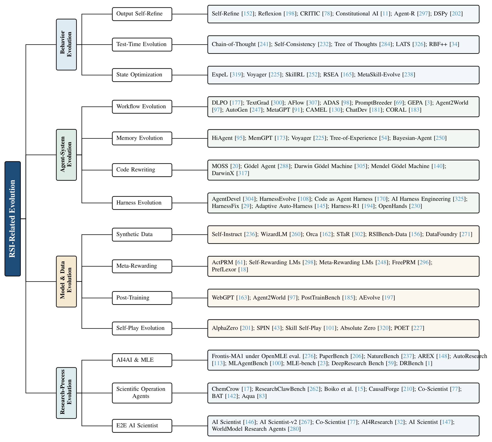

# Recursive Self-Improvement in AI

[中文版](Chinese/README.md)

## Overview

Recursive self-improvement (RSI) asks how a verified, accepted change can become the starting point of a later improvement round and actually influence that round. Revising an output within one task, reusing an accepted change on a new task, and using that change in a later improvement round each require different evidence. A stronger claim of **recursive progress** requires evidence that the inherited change helps the later process produce better successors. [Survey §3 and Fig. 3](https://lee1003-lee.github.io/Awesome-RSI-Research/assets/rsi-survey.pdf#page=5)

This project traces the origins of RSI, explains the **proposal → feedback → optimization** loop with equations and worked examples, and uses four classes of methods to show what the loop can change. The paper analyses follow each method from its problem definition, experimental setup, inputs, outputs, and constraints through candidate generation, evaluation, and the handoff to the next round. Across the cases, the central question is whether gains can be attributed to the inherited change when tasks, budgets, and evaluation criteria are held constant.

- **Foundations and survey** covers the history, operational definition, notation, criteria for minimal RSI and recursive progress, taxonomy, applications, and open questions. [RSI-Foundations.md](RSI-Foundations.md)
- **Representative paper analyses** pairs the original figures with explanations of methods and experimental comparisons. It also includes a bibliography with links to the papers. [Representative-Paper-Analyses.md](Representative-Papers/Representative-Paper-Analyses.md)

## Taxonomy and representative papers

The survey groups papers by **the main object they change**. Within each class, assess what persists, who uses it, and what the evidence supports. Fig. 5 shows the four families and their branches. Fig. 6 compares edit scope, feedback, how gains accumulate, and the evidence each claim requires. [Authors’ taxonomy page](https://lee1003-lee.github.io/Awesome-RSI-Research/#taxonomy) · [Survey §5](https://lee1003-lee.github.io/Awesome-RSI-Research/assets/rsi-survey.pdf#page=16)

### Behavior evolution

Methods in this family change an answer, reasoning path, or action sequence within the current task. The two examples compare revision of a draft with search over intermediate states. See [Representative-Paper-Analyses.md §1](Representative-Papers/Representative-Paper-Analyses.md#1-behavior-evolution-refining-answers-and-retaining-reusable-experience) · [Awesome RSI Research · Behavior Evolution](https://github.com/Lee1003-lee/Awesome-RSI-Research/blob/main/README.md#behavior-evolution)

- The same model critiques its first draft and revises it. [Self-Refine: Iterative Refinement with Self-Feedback](https://arxiv.org/abs/2303.17651)
- The model expands, evaluates, and selects partial solutions before submitting a final answer. [Tree of Thoughts: Deliberate Problem Solving with Large Language Models](https://arxiv.org/abs/2305.10601)

### Agent-system evolution

The object of change is a reusable part of the agent, such as its workflow, memory, tool interfaces, or code. See [Representative-Paper-Analyses.md §2](Representative-Papers/Representative-Paper-Analyses.md#2-agent-system-evolution-changing-how-the-agent-operates) · [Awesome RSI Research · Agent-System Evolution](https://github.com/Lee1003-lee/Awesome-RSI-Research/blob/main/README.md#agent-system-evolution)

- The loop generates, evaluates, and archives agent variants for later selection. [Darwin Gödel Machine: Open-Ended Evolution of Self-Improving Agents](https://arxiv.org/abs/2505.22954)
- Search over workflows represented as code produces a workflow that can run on new tasks. [AFlow: Automating Agentic Workflow Generation](https://arxiv.org/abs/2410.10762)
- A task program and the program that modifies it are part of the same editable system. [Hyperagents](https://arxiv.org/abs/2603.19461v2) · [Hyperagents.md](Representative-Papers/Hyperagents.md) · [Author code](https://github.com/facebookresearch/HyperAgents)

### Model and data evolution

Methods change the training examples, reward signal, or model parameters. Follow which version produces the learning signal and which version takes over in the next round. See [Representative-Paper-Analyses.md §3](Representative-Papers/Representative-Paper-Analyses.md#3-model-and-data-evolution-the-current-model-supplies-the-next-training-round) · [Awesome RSI Research · Model and Data Evolution](https://github.com/Lee1003-lee/Awesome-RSI-Research/blob/main/README.md#model--data-evolution)

- Generate rationales, filter them using known answers, and train a model to generate the next round of examples. [STaR: Bootstrapping Reasoning With Reasoning](https://arxiv.org/abs/2203.14465)
- The current player generates training data through self-play, and an accepted successor takes over data generation. [Mastering the game of Go without human knowledge (AlphaGo Zero)](https://discovery.ucl.ac.uk/id/eprint/10045895/)
- Distill interaction trajectories into reusable skills and update the policy and skill bank during training. [SkillRL: Evolving Agents via Recursive Skill-Augmented Reinforcement Learning](https://arxiv.org/abs/2602.08234v2) · [SkillRL.md](Representative-Papers/SkillRL.md) · [Author code](https://github.com/aiming-lab/SkillRL)

### Research-process evolution

Methods change research plans, experiment designs, evaluations, or how evidence informs subsequent decisions. See [Representative-Paper-Analyses.md §4](Representative-Papers/Representative-Paper-Analyses.md#4-research-process-evolution-using-experiments-to-inform-the-next-research-decision) · [Awesome RSI Research · Research-Process Evolution](https://github.com/Lee1003-lee/Awesome-RSI-Research/blob/main/README.md#research-process-evolution)

- Turn an idea into an experiment and revise the research plan in light of the results. [The AI Scientist: Towards Fully Automated Open-Ended Scientific Discovery](https://arxiv.org/abs/2408.06292v3)
- Use scores and records from prior runs to guide search in machine-learning engineering tasks. [Frontis-MA1: Training an AI4AI Model towards Recursive Self-Improvement in Machine Learning Engineering](https://arxiv.org/abs/2607.28568v1)

## Sources and supporting material

- **Survey and bibliography.** The survey develops the operational definition, taxonomy, and evaluation framework. Its companion bibliography is organized by research direction. [Towards AI That Improves Itself: A Survey of Recursive Self-Improvement](https://lee1003-lee.github.io/Awesome-RSI-Research/assets/rsi-survey.pdf) · [Awesome RSI Research](https://github.com/Lee1003-lee/Awesome-RSI-Research)
- **Figures.** The directory contains the original survey figures and figures from the representative papers. [Fig. 3 · Operational definition](Figures/fig03_definition.png) · [Fig. 5 · Taxonomy tree](Figures/fig05_taxonomy_tree.png) · [Fig. 6 · Taxonomy comparison](Figures/fig06_taxonomy_map.png) · [Fig. 7 · Evidence ladder](Figures/fig07_evidence_ladder.png) · [All figures](Figures/)
- **Benchmarks.** SWE-bench uses real repository issues and tests. MLE-bench evaluates performance on machine-learning engineering tasks under specified resource budgets. [SWE-bench: Can Language Models Resolve Real-World GitHub Issues?](https://arxiv.org/abs/2310.06770) · [MLE-bench: Evaluating Machine Learning Agents on Machine Learning Engineering](https://arxiv.org/abs/2410.07095)
