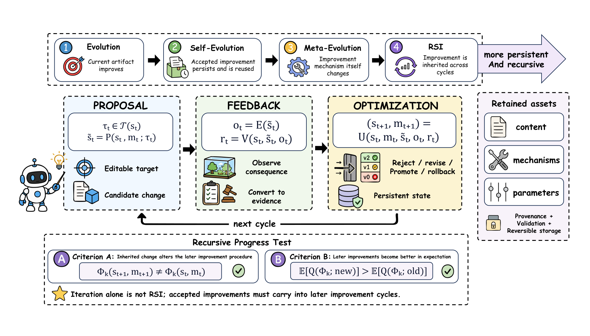
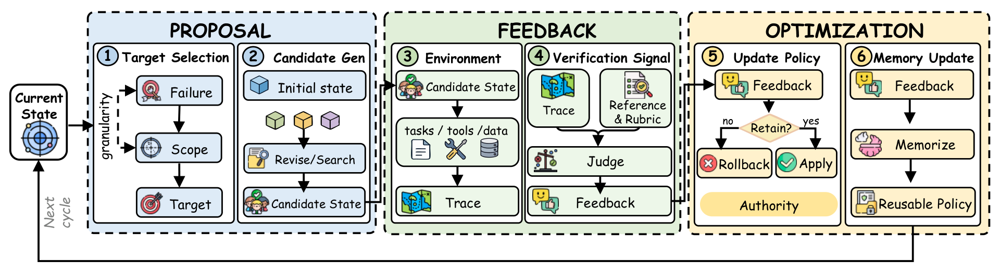
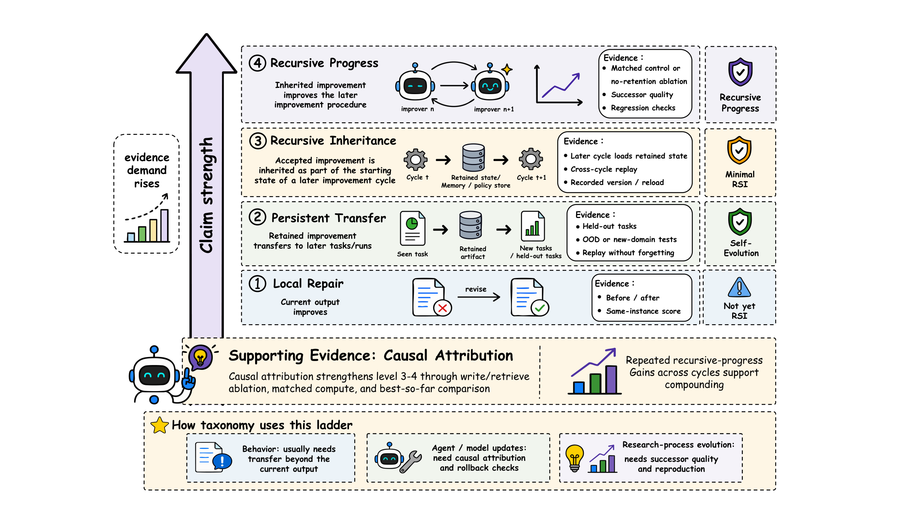
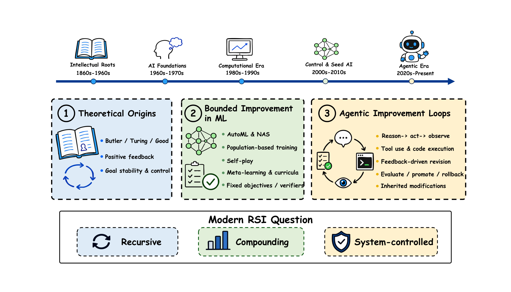
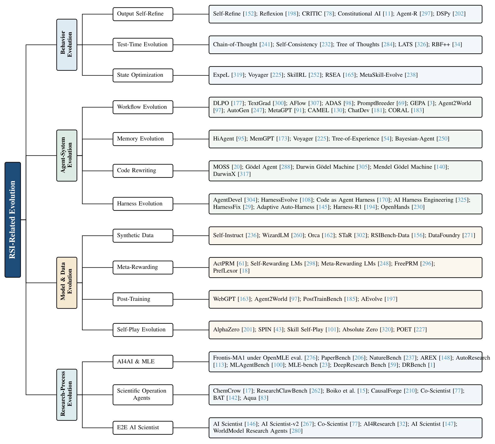
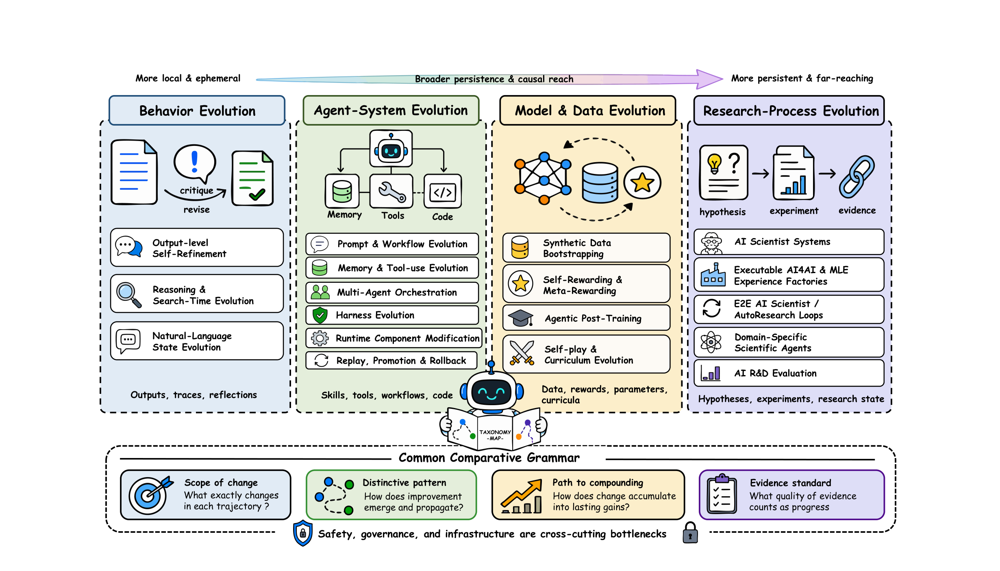
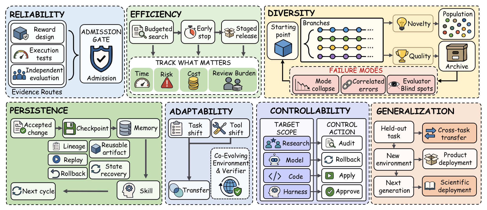

# Recursive Self-Improvement in AI

**recursive self-improvement (RSI)** requires an improvement supported by evidence to be accepted and retained, and a later improvement round to start from and actually depend on that improvement. Equations (2)–(4) in §§2.1–2.3 describe one round. Equation (1) in §2.4 explains where recursion occurs. Equations (5)–(7) in §3.2 show how to test whether the later process improves more effectively.

Equation numbers follow the survey by Li, Chen, and colleagues. Additional notation is marked as such. Each equation comes with local definitions and worked substitutions from the 24 Game. The example values are illustrative. [Survey PDF](https://lee1003-lee.github.io/Awesome-RSI-Research/assets/rsi-survey.pdf) · [Representative Paper Analyses](Representative-Papers/Representative-Paper-Analyses.md) · [Authors’ project page](https://lee1003-lee.github.io/Awesome-RSI-Research/) · [Awesome RSI Research](https://github.com/Lee1003-lee/Awesome-RSI-Research)

## 1. What executes the task, and what gets updated?

### 1.1 A task, a solution attempt, and an improvement round

Let $`x`$ be **the input to a task** and $`y`$ be **the output the system submits**. In the 24 Game example, $`x=(4,9,10,13)`$ gives four cards and $`y=(10-4)\times(13-9)`$ is an expression. The expression uses only addition, subtraction, multiplication, division, and parentheses. An independent scorer checks both that the expression evaluates to 24 and that each card appears exactly once. The system can write an expression and revise it in response to feedback within the same task. Write the result of the $`i`$th attempt as $`y_i`$. Here $`i`$ indexes steps within this task. In general, a subscript identifies a step, a round, or an object.

An **improvement round** acts on the workflow. It receives the current solution procedure, proposes a candidate procedure, runs and compares the two on a batch of tasks, and decides which procedure to retain. The survey uses $`t`$ to index improvement rounds and $`t+1`$ for the next one. A round can execute many tasks, each with its own sequence indexed by $`i`$. Executing one task produces an answer and a trace. The workflow decision occurs at the end of the improvement round. AlphaGo Zero likewise has separate time scales for search within one move, a whole game, and training and accepting a new player. [Survey §§3.1–3.2, PDF pp. 5–6](https://lee1003-lee.github.io/Awesome-RSI-Research/assets/rsi-survey.pdf#page=5)

### 1.2 What is available at the start of a round?

| Notation | What it means at the start of round $`t`$ | 24 Game example |
| --- | --- | --- |
| $`s_t`$ | **The system state used as the starting point for this round.** Define the system boundary first. It may include prompts, tool code, or weights. | The workflow writes, selects, and checks expressions. The base model stays fixed in this example. |
| $`m_t`$ | **Memory and version records available across rounds.** Logs, accepted evidence, or reusable experience can be retained for later use. | The old workflow's scores, failed tasks, and associated versions. |
| $`S_t=(s_t,m_t)`$ | **Additional notation** for the starting state. The system and memory are handed off as a pair. | Reload the current workflow and its associated records. |

A verified improvement can be incorporated into the system $`s_t`$ or into reusable memory $`m_t`$. A base model can be part of the system even when its weights are frozen. The **incumbent** is the version designated as the comparison baseline. In a branching search, the candidate's parent, the highest-scoring archived version, and the deployed version can be different. The comparison should state which one it uses.

The same worked example runs throughout this section. The **old workflow** examines two expressions per task and takes the first one that evaluates to 24. The **candidate** examines those expressions in the same order and takes the first one that also uses the cards correctly. A workflow fails the task when no expression meets its selection rule. The same **independent scorer** applies the full rules to both. The old workflow solves 14 out of 20 acceptance tasks. These inputs, budgets, and counts are illustrative. An actual study also specifies the edit scope, metric, sample, stopping condition, and permitted regressions. [Survey §§3.1 and 3.3, PDF pp. 5–8](https://lee1003-lee.github.io/Awesome-RSI-Research/assets/rsi-survey.pdf#page=5)

## 2. One round in Fig. 3 and the handoff to the next



*Li et al., Fig. 3, PDF p. 5. The blue, green, and yellow boxes show proposal, feedback, and optimization. The return arrow shows inheritance into the next round. The boxes marked A and B show the two tests discussed in Section 3.* [Original survey figure](https://lee1003-lee.github.io/Awesome-RSI-Research/assets/rsi-survey.pdf#page=5)

### 2.1 Equation (2) — Proposal: generating a candidate from the current version

The 24 Game agent starts from an existing workflow. This round permits changes to the prompt or the rules used to check expressions. Proposal first selects the part to change and then generates a complete candidate workflow that can be run.

```math
\begin{aligned}
\tau_t&\in\mathcal T(s_t),\\[0pt]
\tilde s_t&=P(s_t,m_t;\tau_t).
\end{aligned}
```

| Symbol | Meaning in this equation | Worked example in round 0 |
| --- | --- | --- |
| $`t`$ | The index of the improvement round, which uses multiple tasks to test the candidate. | $`t=0`$ is the first round, starting from the old workflow. |
| $`s_t`$ | The system in use at the start of the round. | $`s_0`$ is the old workflow, which selects the first of two expressions with value 24. |
| $`m_t`$ | The historical records available at the start. | $`m_0`$ records cases where the old version submitted an expression that reused a card. |
| $`\mathcal T(s_t)`$ | The set of editable targets in this system. $`\mathcal T`$ denotes the edit scope and $`s_t`$ identifies the system to which it applies. | The prompt and the expression-checking rules are editable. |
| $`\tau_t,\ \in`$ | $`\tau_t`$ (tau) is the chosen target. $`\in`$ means “belongs to.” | $`\tau_0`$ selects the expression-checking rules, which are within scope. |
| $`P`$ | The mechanism that proposes the candidate. The semicolon separates the starting system and records from the chosen edit target. | $`P`$ reads the card-reuse records and adds a check for each card. |
| $`\tilde s_t`$ | This round's candidate, which still awaits acceptance. The tilde marks it as a candidate. | $`\tilde s_0`$ is the new workflow with the card-use check. |

The first expression identifies an allowed edit target. The second passes the current version, its records, and the target to $`P`$, which proposes a new workflow. The two-expression limit per task is unchanged. Round 0 produces **a candidate workflow for testing** across multiple tasks. [Survey §3.2, Eq. (2), PDF p. 6](https://lee1003-lee.github.io/Awesome-RSI-Research/assets/rsi-survey.pdf#page=6)

### 2.2 Equation (3) — Feedback: turning execution into evidence

Compare two workflows for the 24 Game. The old workflow checks the expression's value. The candidate also checks that each card is used exactly once. Both receive the same two expressions and are evaluated on the same tasks by the same independent scorer.

```math
\begin{aligned}
o_t&=E(\tilde s_t),\\[0pt]
r_t&=V(s_t,\tilde s_t,o_t).
\end{aligned}
```

| Symbol | Meaning in this equation | Worked example in round 0 |
| --- | --- | --- |
| $`t,\ s_t,\ \tilde s_t`$ | $`t`$ indexes the improvement round. $`s_t`$ is the comparison version. $`\tilde s_t`$ is the candidate to execute. | At $`t=0`$, compare the old workflow $`s_0`$ with the candidate $`\tilde s_0`$. |
| $`E`$ | The execution process or environment that runs the candidate. The experiment defines the task set and the limit on calls. | Run the workflow on the same set of 20 tasks. |
| $`o_t`$ | What was observed during execution. The letter $`o`$ stands for observation. | $`o_0`$ records candidate expressions, final submissions, reasons for rejection, and call counts. |
| $`V`$ | The scoring process that turns observations into verification evidence. It can compare against previously recorded runs of the old version under the same protocol. | Check the expression value and card use for both versions, then compare the number of correctly solved tasks. |
| $`r_t`$ | Evidence produced under the scoring rule, such as a score difference, pass status, costs, or observed regressions. | $`r_0=17/20-14/20=0.15`$. |

First pass the candidate to $`E`$ to obtain the actual outputs. Then $`V`$ uses the baseline and the evaluation criteria to assess how much the candidate improved.

**Worked example.** The cards are $`4,9,10,13`$. Both workflows first see $`10+10+13-9=24`$, followed by $`(10-4)\times(13-9)=24`$. The old version submits the first expression. The candidate logs that 10 was reused and 4 was omitted, then submits the second. This is the execution trace. The external verifier $`V`$ marks the first submission incorrect and the second correct. On 20 tasks, the old version solves 14 and the candidate solves 17. The difference is **15 percentage points**. [Survey §3.2, Eq. (3), PDF p. 6](https://lee1003-lee.github.io/Awesome-RSI-Research/assets/rsi-survey.pdf#page=6)

### 2.3 Equation (4) — Optimization: what the next round inherits

The candidate solves 17 of the same 20 tasks, up from 14, and respects the limit of two expressions per task. The next decision is whether to adopt the candidate and which evidence and records to pass forward.

```math
(s_{t+1},m_{t+1})=U(s_t,m_t,\tilde s_t,o_t,r_t).
```

| Symbol | Meaning in this equation | Worked example in round 0 |
| --- | --- | --- |
| $`t,\ t+1`$ | This round and the following round. Both terms on the left are written at the end of this round. | Round 0 ends with a handoff to round 1. |
| $`s_t,\ m_t`$ | The system and historical records available at the start of the round. | The old workflow $`s_0`$ and its failure and version records $`m_0`$. |
| $`\tilde s_t`$ | The system being considered for acceptance. | The workflow $`\tilde s_0`$ adds a check for card use. |
| $`o_t,\ r_t`$ | $`o_t`$ is the execution trace. $`r_t`$ is the verification evidence derived from it. | The system stays within the two-expression limit and solves three more tasks than the old version. |
| $`U`$ | The update policy decides whether to adopt, test further, reject, or roll back a candidate based on the evidence. | Adoption requires at least two additional correct answers and adherence to the generation limit. |
| $`s_{t+1}`$ | The system the next round will use. | The candidate clears the acceptance threshold, so $`s_1=\tilde s_0`$. |
| $`m_{t+1}`$ | The records the next round can read. $`(s_{t+1},m_{t+1})`$ hands off both the system and the records. | $`m_1`$ adds reasons for rejecting expressions, the old score, the basis for accepting the candidate, and the location of the new version. |

The five inputs on the right give $`U`$ a basis for its decision. The two outputs on the left are what persists. A rejected candidate can still produce failure records worth saving.

**Counterexample.** If the candidate solves only 15 tasks, it exceeds the old version by one and misses the two-task threshold. Round 1 keeps the old system, $`s_1=s_0`$. The reason for rejection can still be saved in $`m_1`$. This illustrates the distinct roles of verification $`V`$ and optimization $`U`$. [Survey §3.2, Eq. (4), PDF p. 6](https://lee1003-lee.github.io/Awesome-RSI-Research/assets/rsi-survey.pdf#page=6)



*Li et al., Fig. 4, PDF p. 8. In the figure, v0, v1, and v2 are version numbers. Follow steps ①–⑥ to see what is exchanged.* [Original survey figure](https://lee1003-lee.github.io/Awesome-RSI-Research/assets/rsi-survey.pdf#page=8)

| Stage | Inputs and outputs | 24 Game example |
| --- | --- | --- |
| Proposal | ① Select a target $`\tau_t`$ from the current state. ② $`P`$ generates a candidate $`\tilde s_t`$. | Identify card reuse and generate a workflow that checks every card. |
| Feedback | ③ $`E`$ runs the candidate and records $`o_t`$. ④ $`V`$ compares the trace with the baseline to produce evidence $`r_t`$. | Run the 20 tasks and score both versions using the same rule. |
| Optimization | ⑤ $`U`$ selects the version to use. ⑥ Store the system $`s_{t+1}`$ and records $`m_{t+1}`$ for later rounds. | Adopt the new workflow and log the acceptance rationale and candidate failures. |

Skills, agent code, and trained weights can also be retained. When an asset is passed to the next round, record its version, why it was accepted, and how it was used. [Survey §§3.1 and 4, PDF pp. 6, 8–16](https://lee1003-lee.github.io/Awesome-RSI-Research/assets/rsi-survey.pdf#page=8)

### 2.4 Equation (1) — Which version does the later round start from?

Suppose the 24 Game workflow with card-use checks has passed acceptance. It logs which expressions it rejected and why. In the next round, the proposal mechanism can use the accepted workflow and those records to revise the generation prompt.

```math
\tau_{t+1}\in\mathcal T(s_{t+1}),\qquad
\tilde s_{t+1}=P(s_{t+1},m_{t+1};\tau_{t+1}).
```

| Symbol | Meaning in this equation | Worked example in round 1 |
| --- | --- | --- |
| $`t,\ t+1`$ | $`t`$ is the completed round whose outputs were stored. $`t+1`$ is the new round. | The verifier changed in round 0. The generation prompt changes in round 1. |
| $`s_{t+1}`$ | The system saved at the end of the preceding round and now in use. | $`s_1`$ is the accepted workflow with the new checks, so $`s_1=\tilde s_0`$. |
| $`m_{t+1}`$ | The records saved in the preceding round and now available. | $`m_1`$ contains rejection reasons such as “10 was reused” and “4 was omitted.” |
| $`\mathcal T(s_{t+1})`$ | The set of editable targets on the new version. | Both the generation prompt and the verification rules remain editable. |
| $`\tau_{t+1},\ \in`$ | The new target and the requirement that it fall within the edit scope. | $`\tau_1`$ selects the prompt used for the second generation attempt. |
| $`P`$ | It reads the current workflow, records, and target, then generates a new candidate. | Revise the prompt using the rejected expressions' card-use records. |
| $`\tilde s_{t+1}`$ | The newly proposed candidate. The tilde indicates that acceptance still lies ahead. | $`\tilde s_1`$ is a workflow derived from the accepted $`s_1`$ by revising its generation prompt. |

The first expression selects a new target. The second proposes another candidate based on the inherited system and records. Both expressions are indexed by the new round. $`s_{t+1}`$ is **the version received at the start**, and $`\tilde s_{t+1}`$ is **the new candidate**.

**Worked handoff.** Round 1 reads the rejection records and adds an instruction to compare the numbers used in an expression against the input cards before submission. The proposed edit records a concrete dependence on the prior round even if the candidate prompt is eventually rejected. Using the accepted workflow only to solve another task would establish task reuse. [Survey §3.1, Eq. (1), PDF p. 6](https://lee1003-lee.github.io/Awesome-RSI-Research/assets/rsi-survey.pdf#page=6)

#### Minimal RSI: using records to establish recursive inheritance

To apply the survey's operational definition, identify an improvement with evidence that it was accepted, then trace a later improvement round that actually depended on it. The following criterion uses **additional notation**.

```math
\exists\,t,k,I_t:\quad k>t
\ \land\ A_t(I_t)=1
\ \land\ L^{\mathrm{cycle}}_{t\to k}(I_t)=1.
```

| Symbol | Meaning | 24 Game example |
| --- | --- | --- |
| $`t,\ k,\ k>t`$ | $`t`$ indexes the original change. $`k`$ indexes the later improvement round that takes over. $`k>t`$ requires this use to occur later. | Here $`t=0,k=1`$. In a branching archive, the later use may occur several rounds afterward. |
| $`I_t`$ | The specific change being tracked. | $`I_0`$ adds card-use rules to the agent's verifier. |
| $`A_t(I_t)`$ | Evidence shows a gain over the comparison version, and the change is accepted and can be reloaded from a version or record. | The workflow solves three more tasks in the same batch, exceeding the threshold. The verifier is saved, so $`A_0(I_0)=1`$. |
| $`L^{\mathrm{cycle}}_{t\to k}(I_t)`$ | The superscript $`\mathrm{cycle}`$ refers to the improvement cycle. Round $`k`$ starts from a state containing the change and depends on it during proposal, feedback, or optimization. | Round 1 uses the new verifier's records to revise the prompt, so $`L^{\mathrm{cycle}}_{0\to1}(I_0)=1`$. |
| $`\exists,\ \land,\ =1`$ | Read as “there exists,” “and,” and “the condition holds.” Record 0 when there is evidence that a condition fails. Mark a condition as unverified when evidence is insufficient. | One tuple $`t,k,I_t`$ satisfying the three conditions meets the minimal criterion. |

The criterion asks for at least one handoff with both evidence of acceptance and evidence that a later improvement round used the change. Task reuse can be tracked separately as $`L^{\mathrm{task}}_{t\to j}(I_t)=1`$. Here $`\mathrm{task}`$ means task execution and $`j`$ indexes the $`j`$th later task. Solving another task and making another change to the workflow require separate evidence. The Darwin Gödel Machine (DGM) lineage diagram can locate when an archived version actually produced a successor. [Survey §§3.1 and 3.3, PDF pp. 5–8](https://lee1003-lee.github.io/Awesome-RSI-Research/assets/rsi-survey.pdf#page=5) · [DGM Fig. 3](https://arxiv.org/pdf/2505.22954v3#page=7)

## 3. Four concepts and gains in the improvement process

### 3.1 Fig. 3: evolution, self-evolution, meta-evolution, and RSI

For a 24 Game agent, first ask what was changed and then ask how the retained change was used. One system can meet more than one of the criteria below.

| Concept | Definition and interpretation | 24 Game example |
| --- | --- | --- |
| **Self-evolution** | An improvement supported by evidence is accepted, retained, and used in later tasks. | The workflow retains the new card-use check after acceptance and calls it on another task. |
| **Meta-evolution** | A tested, accepted change affects the mechanism used for later proposal, verification, version selection, or application. | The system modifies the acceptance rule $`U`$ to require that repeated-card errors do not increase, in addition to meeting the overall accuracy threshold. The new mechanism is tested and accepted. |
| **Minimal RSI** | An improvement supported by evidence is accepted and retained. A later **improvement round** starts from and actually depends on it. | A later round revises the prompt using rejection reasons from the accepted verifier. The latest change to the workflow depends on the earlier round's result. |
| **Evolution** | The current output improves within one task. $`q_x(y_{i+1})>q_x(y_i)`$ says that the later output scores higher on task $`x`$. The attempt index is $`i`$, the two outputs are $`y_i,y_{i+1}`$, and $`q_x`$ is the task's scoring function. | The score is 1 for a valid expression and 0 otherwise. Replacing an expression that repeats 10 with a valid one raises the score from 0 to 1. The change stays within this task. |

A proposal mechanism that uses retained rejection reasons to revise a prompt can provide evidence for minimal RSI even if the proposal code is fixed. A tested change to the acceptance rule can qualify as meta-evolution. To assess whether that change also supports recursive inheritance, check whether a later improvement round uses the altered rule. [Survey §3.1, PDF pp. 5–6](https://lee1003-lee.github.io/Awesome-RSI-Research/assets/rsi-survey.pdf#page=5) · [Survey Table 1, PDF p. 17](https://lee1003-lee.github.io/Awesome-RSI-Research/assets/rsi-survey.pdf#page=17)

### 3.2 Equations (5)–(7): does the later round improve more effectively?

Here the **improvement process** is the full procedure for proposing, executing, verifying, and selecting new versions. Evidence for **recursive progress** first establishes that an accepted improvement reached a later round, then shows which part of the process changed and whether it produced a better successor. [Criteria A and B in Fig. 3](Figures/fig03_definition.png)

#### Equation (5) — The components of an improvement round

```math
\Phi_k=(P_k,E_k,V_k,U_k,B_k).
```

| Symbol | Meaning in this equation | Revising the 24 Game prompt in round 1 |
| --- | --- | --- |
| $`k`$ | The later improvement round being studied. | $`k=1`$, when the generation prompt is revised. |
| $`\Phi_k`$ | $`\Phi`$ (phi) denotes the whole improvement process, with its five components on the right. | $`\Phi_1`$ includes writing prompts, running them, scoring, version selection, and allocating resources. |
| $`P_k`$ | Proposal or search mechanism. | Write two candidate prompts. |
| $`E_k`$ | Execution environment or task interface. | Run 24 Game tasks with the candidate prompts and record the submissions. |
| $`V_k`$ | Rule that produces verification evidence from the results. | Score each expression for legality and a value of 24. |
| $`U_k`$ | Rule that selects and saves the version based on evidence. | Accept a candidate after it meets preset quality and cost thresholds. |
| $`B_k`$ | Allocation of available resources for this round. | For example, two calls for proposal and four for trial runs. |

Together the five components describe how improvement works in round $`k`$. In the example, six calls is the overall cap, and $`B_k`$ allocates two to proposal and four to evaluation. Verification can also be performed by a program. Costs must be measured consistently across the two experimental conditions. [Survey §3.2, Eq. (5), PDF p. 7](https://lee1003-lee.github.io/Awesome-RSI-Research/assets/rsi-survey.pdf#page=7)

#### Equation (6) — Criterion A: does inheritance change the later process?

Run the same round twice to revise the same 24 Game generation prompt. The treatment can use the accepted verifier and structured records. The control uses the old verifier configuration and raw logs.

```math
\Phi_k(s_{t+1},m_{t+1})\ne\Phi_k(s_t,m_t).
```

| Symbol | Meaning in this equation | The two states being compared |
| --- | --- | --- |
| $`t,\ k`$ | $`t`$ is the round that produced and accepted the change. $`k`$ is the later round under study, with $`k>t`$. | Here $`t=0,k=1`$, and both sides compare versions of the first subsequent round. |
| $`s_{t+1},m_{t+1}`$ | The system and memory saved after the change. | $`s_1`$ provides the new callable verifier and $`m_1`$ provides rejection reasons for individual candidates. |
| $`s_t,m_t`$ | The old system and records used as the control. | $`s_0`$ uses the old check and $`m_0`$ contains the original execution records. |
| $`\Phi_k(\,\cdot\,,\,\cdot\,)`$ | Run the improvement process for round $`k`$ using the supplied system and records. | Compare how proposal, execution, verification, optimization, or resource allocation operates under the two conditions. |
| $`\ne`$ | An observable process difference associated with inheritance. | In the new condition, the proposal mechanism reads records of two kinds of card-use error and changes the checking instructions. |

**What to look for.** Suppose the treatment logs show that omission also occurred in rejected candidates on tasks that were eventually solved. The proposal mechanism adds a card-by-card check. The control only revises the numerical check using its original logs. Repeat with the same starting workflow, tasks, budget, and matched random conditions to test whether inheritance consistently produces this difference. Criterion A concerns **the behavior of the improvement process**. Criterion B concerns the quality of its output. [Survey §3.2, Eq. (6), PDF p. 7](https://lee1003-lee.github.io/Awesome-RSI-Research/assets/rsi-survey.pdf#page=7)

#### Equation (7) — Criterion B: does the later process produce better successors?

Both conditions produce a new workflow. Each paired run shares the same initial workflow, tasks, environment, and budget. Only access to the accepted verifier and its records changes. Score the successor from each condition on the same independent held-out tasks.

```math
\mathbb E[Q(\Phi_k;s_{t+1},m_{t+1})]>
\mathbb E[Q(\Phi_k;s_t,m_t)].
```

| Symbol | Meaning in this equation | Use in the 24 Game comparison |
| --- | --- | --- |
| $`t,\ k`$ | $`t`$ is the initial acceptance round and $`k`$ is the later round under study, with $`k>t`$. | Round 0 accepts the verifier. Round 1 continues changing the workflow. |
| $`(s_{t+1},m_{t+1})`$ | The saved new system and memory, labeled “new” in the figure. | Give the improvement process the new verifier and reasons for rejecting individual candidates. |
| $`(s_t,m_t)`$ | The system and memory before the change, labeled “old” in the figure. | Give the improvement process the old verifier configuration and original records. |
| $`\Phi_k`$ | The improvement process in round $`k`$, which produces a successor. | Revise the generation prompt and select a usable new workflow. |
| $`Q(\Phi_k;s,m)`$ | The score of the **successor produced** by the round given state $`s`$ and records $`m`$. The arguments after the semicolon identify what was inherited. $`Q`$ can include capability, cost, and regressions. | Count how many of 100 independent tasks the successor solves. Those tasks did not take part in selection. |
| $`\mathbb E[\cdot],\ >`$ | $`\mathbb E`$ is the theoretical mean under the common task distribution and matched conditions, which can be estimated over repeated runs. $`>`$ requires a higher mean on the left. The plain letter $`E`$ denotes execution. | Each pair uses the same starting workflow and resources, and both groups use the same independent scorer. |

**Two worked pairs.** In the first pair, both runs start from a workflow scoring 60. The new condition produces a successor scoring 70, and the old condition produces one scoring 65. The second pair starts from a workflow scoring 75 and yields 81 and 80. The paired differences are $`70-65=5`$ and $`81-80=1`$, for an average of **3 points**. This is a finite-sample estimate of the mean difference. Equation (3) compares two existing workflows on 14 and 17 solved tasks. The scores of 65, 70, 80, and 81 here measure **newly produced successors**.

The two paired runs illustrate the joint effect of replacing both the verifier and its records. To isolate the effect of rejection records, both groups could use the same verifier and raw logs, while one group additionally receives summaries of candidate rejection reasons. More paired runs are needed to assess variability, transfer, and regressions. Repeated gains across rounds, tasks, or environments support compounding. To establish acceleration, check whether the gain per unit of resource rises over rounds. [Survey §§3.1–3.3, Eq. (7), PDF pp. 6–8](https://lee1003-lee.github.io/Awesome-RSI-Research/assets/rsi-survey.pdf#page=7)

### 3.3 Fig. 7: the evidence required at each level



*Li et al., Fig. 7, PDF p. 20. The figure moves from within-task comparisons to reuse across tasks and dependence in later improvement rounds. Matched comparisons then test gains in the improvement process.* [Original survey figure](https://lee1003-lee.github.io/Awesome-RSI-Research/assets/rsi-survey.pdf#page=20)

1. **Local revision.** Compare outputs before and after revision on the same input $`x`$.
2. **Persistent transfer.** Check acceptance, storage, and actual use on later tasks. Evaluate on unseen tasks.
3. **Recursive inheritance.** Find the step in a later round's proposal, feedback, or optimization trace that depends on the accepted change. A lower-scoring node can still be archived in DGM. Check its comparison evidence before treating it as an improvement.
4. **Recursive progress.** Vary only what is inherited under matched conditions, compare successor quality, and check regression and independent transfer. Criterion A concerns the later process's behavior. Criterion B concerns the quality of its successor. To assess meta-evolution, use Section 3.1 to check if the accepted change alters the improvement mechanism itself. [Survey §3.3, Table 1, and Fig. 7](https://lee1003-lee.github.io/Awesome-RSI-Research/assets/rsi-survey.pdf#page=17)

**§3.3 The minimum record of experiments.** Saves old versions, new editions, adjustable scopes, versions and acceptances of evidence. Use the old version freezes, closes inheritances or counterfactual contrasts with the ancestors of the resource. Freezes back-checking of old issues, search for new failures in the adaptive collection, and delays the independent set-up migration. Report on the number of repetitions, aggregations, and fluctuations. The lowest RSI determination needs to be narrowed accordingly when there is no evidence to accept, actual reliance or reloadable versions. [Overview §3.3, PDF pp. 7-8](https://lee1003-lee.github.io/Awesome-RSI-Research/assets/rsi-survey.pdf#page=7)

## 4. From a thought experiment to testable systems



*Li et al., original Fig. 2, p. 3. Look at the bottom of three paragraphs and then use the upper timeline as a background.* [Original Chart Page](https://lee1003-lee.github.io/Awesome-RSI-Research/assets/rsi-survey.pdf#page=3)

**Ideas of origin.** Butler imagined in 1863 that the machine would form an evolutionary spectrum. Turing discussed in 1950 the ability of the machine to build through education and experience. Good argued more specifically in the 1960s that the design of the machine itself was intellectual activity. If a machine was designed with a stronger successor and then with a better design of the machines, the next generation would be able to improve it. **Positive feedback **Subsequent discussions also asked whether its objectives and controls could remain stable from the beginning of an initial system that could be self-improved. The general reference [76] recorded the chapter on Good as 1966, while other archives also recorded 1965. [Butler 1863](https://paperspast.natlib.govt.nz/newspapers/CHP18630613.2.4) · [Turing 1950](https://doi.org/10.1093/mind/LIX.236.433) · [Good chapter](https://doi.org/10.1016/S0065-2458(08)60418-0) · [Overview §2.1](https://lee1003-lee.github.io/Awesome-RSI-Research/assets/rsi-survey.pdf#page=4)

**There's a world of machine learning.** AutoMl selects models, configurations, or network structures in a predetermined space with AutoMl and Neurostructure Search (NAS). **A game of self-play. **AlphaGo Zero allows the current chess player to be black and white, and to train the next edition with the resulting game and the real game. After checking with the old chess player, the new chess player takes over the production of the follow-up data. This is an example of how to run and follow the version. The chess rules, certification standards, and training processes are still predefined, and are therefore carried out within the context of a clear mandate and reformable process. **There's a line.**. [Overview §2.2, §5.3.4](https://lee1003-lee.github.io/Awesome-RSI-Research/assets/rsi-survey.pdf#page=4) · [AlphaGo Zero, original paper](https://doi.org/10.1038/nature24270)

**Proxy participation in improvement.** ReAct links model reasoning to tool actions and external observations. Reflexion allows agents to summarize failures into words that can be read for subsequent attempts. When you can act and see results, the object can be edited to extend to instructions, tools, codes, and even experimental programs. DGM can modify the program that you will use later, and the AI Science can reprogram the test based on the results of the experiment. At this stage, the original concerns are questions that can be measured. [Overview §2.3, pp. 4–5](https://lee1003-lee.github.io/Awesome-RSI-Research/assets/rsi-survey.pdf#page=4)

The strong claim of Good is distinguished from the above-mentioned experimental conditions. Consider the resources used to be the same. If the benefits are reduced by two, one, one, and 0.5, and continue to be reduced by half, the cumulative ceiling is still positive. [Overview §2.1 ,  §3.2 ,  §6.2](https://lee1003-lee.github.io/Awesome-RSI-Research/assets/rsi-survey.pdf#page=4)

## 5. Survey Section 5: classification by the main object of change

### 5.1 Why these four categories?

The classification is based on **The main object of the paper change**. The overview records it as $`\tau_t`$ of which $`t`$ The nodes of a search tree, for example, can be part of a single theme or a stream of work that is repeated on many topics. See first what the nodes contain, and then what the papers end up delivering, and then distinguish between the two studies.

All four categories can be read with proposals, feedback, updates. $`P`$ Write the candidate, run. $`E`$ Generate logs, verify $`V`$ Evidence generated, updated. $`U`$ It determines how to select and save. Each category looks at the target range (Target Hope), the feedback mode (Feedback Pattern) and the Optimization Loops, for which target to select, how to observe and evaluate, and how to use the results. [Overview §5 Introduction, PDF Page 16](https://lee1003-lee.github.io/Awesome-RSI-Research/assets/rsi-survey.pdf#page=16)

Here's the table. **Formatting**. The arrow indicates that you get another state from a state generation, filtering or updating. $`t+1`$ The next round of improvements, $`i+1`$ Pointing to the next step of the subject.

| Category and changes | Signs in Local Interpretation | Add an example |
| --- | --- | --- |
| **Behavior Evolution** (Behavior Evolution) $`y_{t,i}\to y_{t,i+1}`$ | $`y_{t,i}`$ It's the first. $`t`$ The first of the same tasks on the wheel $`i`$ An answer or a partial trajectory. Only in-mission processes $`y_i\to y_{i+1}`$ . | Self-Refine reads the first draft with comments and hand over the next draft of the same task. |
| **Agent-System Evolution** (Agent-System Evolution) $`h_t\to\tilde h_t\to h_{t+1}`$ | $`h_t`$ is an agent facility that can be duplicated, including tips, tools or processes. $`\tilde h_t`$ It's a candidate facility. $`h_{t+1}`$ I'm just writing a new version. | A new "check-by-check" solution stream was added to test and then decide whether to use the new or the old version in the next round. |
| **Model and Data Evolution** (Model & Data Evolution) $`(D_t,\rho_t,\theta_t)\to(D_{t+1},\rho_{t+1},\theta_{t+1})`$ | $`D`$ It's training data. $`\rho`$ It's a training incentive rule. $`\theta`$ is the model parameter. A round can only update a part of it. | StaR (Self-Taught Reasoner) replaces the sample with the generator ' s weight and continues to be screened using standard answers. |
| **Research-Process Evolution** (Research-Process Evolution) $`W_t^{\mathrm{research}}\to W_{t+1}^{\mathrm{research}}`$ | $`W`$ It's a workspace. $`\mathrm{research}`$ State of the marking study, including plans, evidence and experimental records. | The AI Scientific left the results after reading the test curve and revised the plan for the next control experiment. |

**Two questions were used to position the paper.** 1 What type of object is it mainly modified in the above table? 2 What evidence suggests that changes are accepted, preserved and used for later tasks or improvements? Self-Refine changes are the current answer, and the score supports local evolution. Darwin Gödel Machine (DGM) changes the proxy code to look for records along the version spectra, and then check if there is evidence of relative improvement of the changes. Voyager optimizes and evolves the memory of agents at the same time as Fig. 5 because it can extract skills from one track, and it can also connect them to the permanent skills bank. [Overview §5, Table 1](https://lee1003-lee.github.io/Awesome-RSI-Research/assets/rsi-survey.pdf#page=16)

### 5.2 The taxonomy tree in Fig. 5 and the comparison map in Fig. 6



*Li et al., Fig. 5, PDF Page 18. Read it along the line "Intermediate direction of the left object  ⁇  right literature or benchmark". Right side has both systems to implement improvements and benchmarks to measure improvements.* [Original survey figure](https://lee1003-lee.github.io/Awesome-RSI-Research/assets/rsi-survey.pdf#page=18)

| Four-category objects | Fourteen directions in the figure | How are these directions organized? |
| --- | --- | --- |
| **Behaviour** | 1 Evolution 3 state optimization for output from revision 2 test | 1 Replace a full answer. 2 Generate, value and retain intermediate branches. 3 Draw feedback, experience or skills from the track of operations and then pass them to behavioural decision-making. |
| **Proxy system** | 4 Job Flow Evolution 5 Memory Evolution 6 Code Rewrite 7 Harness Evolution | 4 Change the hint to call. 5 Change the experiential reading and reusing. 6 Use executables to carry changes. 7 Re-run, acceptance, release, rollback, etc. |
| **Models and data** | 8 Synthetic Data 9 yuan reward 10 after training 11 since the game evolved | 8 Reverses the study sample. 9 Renumbers who scores and what points. 10 Inserts the demonstration, preference or reward into the weight. 11 Allows the current strategy to generate follow-up experience and to form a cycle of course and learning. |
| **Research process** | 12 AI4AI with Machine Learning Project (MLE) 13 Scientific Operating Agent 14 End-to-end AI Science | 12 Measuring executable AI training or engineering experiments. 13 Makes a step that can be independently verified, such as a test of proof. 14 Associated questions, experiments, analyses, reviews and subsequent decision-making. |

Here. **harness** is the operating facility around the base model, such as tool interfaces, context management, stop or retesting, test and version management. **AI4AI** An AI-assisted study or construction of AI,**MLE** It is a class of machine learning engineering tasks that can be performed and measurable. The branches of the Fig. 5 study process are listed in chart order as AI4AI and MLE. [Fig.5 and §5.1 –5.4](https://lee1003-lee.github.io/Awesome-RSI-Research/assets/rsi-survey.pdf#page=18)



*Li et al., Fig. 6, PDF p.19. The arrows above indicate the lasting range and causal effects that are usually involved. The common questions below are the scope of changes, how feedback is generated and disseminated, and how pathways and evidentiary standards are accumulated.* [Original survey figure](https://lee1003-lee.github.io/Awesome-RSI-Research/assets/rsi-survey.pdf#page=19)

Tree of Thoughts, ToT, for example, is a partial solution to a 24-point question, containing the calculations and residual numbers that have been done. The AFlow node is a complete workflow that can run on multi-problems. Both expand, evaluate and select nodes. ToT ' s proposal generates the next calculation and retains the path to the resolution of the problem based on a partially resolved valuation. The AFlow proposal is to rewrite a workflow by recording fractions and selecting reusable processes after running on the validation theme. Fig.6 The horizontal order of the hints usually expands. The strength of the evidence will be judged by checking whether the accepted changes were actually used by the rear wheel and, under the same resources, whether it changed the law and improved the subsequent quality. These three things correspond to (1), (6) and (7) respectively. [ToT Fig. 2](https://proceedings.neurips.cc/paper_files/paper/2023/file/271db9922b8d1f4dd7aaef84ed5ac703-Paper-Conference.pdf#page=5) · [AFlow Fig. 3](https://proceedings.iclr.cc/paper_files/paper/2025/file/5492ecbce4439401798dcd2c90be94cd-Paper-Conference.pdf#page=5)

### 5.3 Representative papers and comparison papers

| Category | Representative papers and graphs | Comparative papers and graphs | Cross-reference questions |
| --- | --- | --- | --- |
| **Behaviour** | **Self-Refine**(accompanied) §1.1 Fig. 1, 2. $`i`$ Draft version $`y_i`$ Get some comments on it. $`f_i`$ and amend the draft on the same subject. | **Tree of Thoughts**(accompanied) §1.2 ), Fig. 2. Expand and filter the parts of the same subject. | $`P`$ What do you want? $`U`$ Will the output leave the subject? |
| **Proxy system** | **DGM**(Accordingly §2.2), Fig. 1, 3. The current parental agent changes his or her own procedures, and eligible sub-agents can be placed in the vault and selected by the later wheels. | **AFlow**(accompanied §2.1), Fig. 3, 6. Large model optimisers search for working streams in code terms. | Who took the pen when the DGM changed its code? The AFlow external optimist changed the workflow? |
| **Models and data** | **STaR**(Self-Taught Reasoner, companion §3.1), Fig. 1, 2. Model reasons, standard answer screening, training model re-creates the next batch of data. | **AlphaGo Zero**(Accord to §3.2), Fig. 1, 3. Checkers produce their own game product, and accept the chess player to produce it. The summary is in the same direction as Alpha Zero. | What are the input and monitoring signals for individual samples? Which parameter version works in the back wheel? |
| **Research process** | **The AI Scientist**(According to §4.1), Fig.1 and Appendix D.7. Change assumptions into experiments and reschedule results. | **Frontis-MA1 / OpenMLE-Evo**(Accordingly §4.2, Fig.9, 16. Test achievement and experience cards will participate in the next MLE program search. | $`E`$ What did you do? $`V`$ What's the acceptance? Which lab records actually go into the next round? |

The formulae, cases and original language entrances are available.[Representative Paper Analyses](Representative-Papers/Representative-Paper-Analyses.md).

## 6. Applications, tasks, data, and experimental setups

**Setting** It's how the experiment is set. Finish the task first. Take 24 points as an example, enter $`x`$ It's four cards, out. $`y`$ Yes. The success criterion is only four operations and brackets, with each card running just once, and the result is equal to 24. And then a downhand record of what models, data, evaluation criteria and resources are used for each group. **Additional mark**.

```math
\mathcal S=(M_{\mathrm{base}},\mathcal D_{\mathrm{train}},
            \mathcal D_{\mathrm{search}},\mathcal D_{\mathrm{test}},
            E,V,B_{\mathrm{cap}},\mathcal T).
```

| Symbol | Controls or records what in the experiment. | 24 point examples |
| --- | --- | --- |
| $`\mathcal S`$ | A list of the settings of an experimental group. Lists the entries sequentially in parentheses. | The old and new processes are filled separately and are also used to reconcile the two sets of intentionally set differences. |
| $`M_{\mathrm{base}}`$ | A base model or initial check point for each role. $`\mathrm{base}`$ That's the bottom seat. | The two versions are used to generate algorithms using the same model. |
| $`\mathcal D_{\mathrm{train}}`$ | Updates training data for weights. $`\mathcal D`$ It's about data. $`\mathrm{train}`$ Indicate the purpose of the training. | This example does not fine-tune the model and the training data items are empty. |
| $`\mathcal D_{\mathrm{search}}`$ | Search, feedback or selection of accessible information. $`\mathrm{search}`$ Including candidatures for acceptance. | The 20 topics used to determine which version to use. |
| $`\mathcal D_{\mathrm{test}}`$ | Data to be used only for independent evaluation. $`\mathrm{test}`$ Indicate the official test. | Assessment of another set of 100 topics to be used subsequently. |
| $`E`$ | Implementing environment or mode of operation. | In the same order, two processes are available for candidate processing. |
| $`V`$ | Evaluation rules that turn records into comparable evidence. | Check whether cards are being used for compliance, equals 24, counting correct questions. |
| $`B_{\mathrm{cap}}`$ | Maximum available resources. $`\mathrm{cap}`$ Expressed cap. | If there are rules for allocating the total budget, it may be recorded separately. $`B_k`$ of which $`k`$ It's the wheel of improvement. |
| $`\mathcal T`$ | Allow to change anything. | Allows changes to generate tips and selection rules. |

**How does it work?** The old and new editions can match the base, title, execution budget and rating conditions with this table, and the differences fall on the rules for calculating statements. The 20 titles used to select the new editions are search and acceptance data. The 100 questions used to answer the possibility of migration are kept independently. If the same data are involved in multiple segments, each of the objects it actually uses is listed. $`\mathcal S`$ It's this list of conditions, capital case. $`S_t=(s_t,m_t)`$ is running to the first $`t`$ The actual systems and historical records that are brought in on the wheel.

### 6.1 What do the eight papers actually measure?

| Application and methodology | Task Input  ⁇  Output | Data, environment and setting | First reading indicators |
| --- | --- | --- | --- |
| **Self-check optimization, Self-Refine** | Original application or mathematical question | Seven categories of tasks, such as PIE code optimization, GSM8K mathematical reasoning, etc. The base model is fixed, with a comparison of direct generation and a maximum of four rounds of revision. | Optimized ratio, mathematical correctness, based on the correct functional premise, with each line using its own indicators. [Original §3, appendix Q-R](https://proceedings.neurips.cc/paper_files/paper/2023/file/91edff07232fb1b55a505a9e9f6c0ff3-Paper-Conference.pdf#page=5) |
| **Logic search during testing, Tot.** | Four. 24 points after four. | 4nums 901-1000 questions by human resolution time, GPS-4, with a primary set of up to 5 states per layer. | The number of node visits is also taken into account for a proportion that is legal and equal to 24. [Original language §4.1](https://proceedings.neurips.cc/paper_files/paper/2023/file/271db9922b8d1f4dd7aaef84ed5ac703-Paper-Conference.pdf#page=5) |
| **Software Engineering Agent, DGM** | User repository and job description  ⁇  Downstream patches. Proxy code and diagnostic sub-agents | SWE-bench uses real software library tasks, Polyglot checks multilingual code editing. Each master searches 80 candidate wheels, base models are frozen, and checks 10, 60, 200 or 10, 50 paths in stages. | Mission pass rate, downstream collection and Polyglot full supplemental sub-report. [DGM §4](https://arxiv.org/pdf/2505.22954v3#page=5) |
| **Automatic Design Process, AFlow** | The search output is a complete process. | GSM8K, MATH, etc.. Validation and testing is about 1:4, with Claude 3.5 Sonnet re-routing, GPT-4o-mini executed, up to 20 rounds. | Math resolution rate, question-and-answer rate using accuracy and recall rate to measure the meta-convergence of words, F1, pass rate of code under one submission opportunity pass@1. The composition of the three indicators is described when the three indicators are combined. [Original §5.1, Table 1](https://proceedings.iclr.cc/paper_files/paper/2025/file/5492ecbce4439401798dcd2c90be94cd-Paper-Conference.pdf#page=8) |
| **Common sense with reason or mathematical reasoning, StaR.** | The question with the final answer... the question, the reason, the answer and an updated generation model. | CommonenseQA (CQA) 9,741 training, 1,221 development, 1,285 retention tests. Also GSM8K, arithmetic. GPT-J 6B, CQA, with 10 reasons. | CQA tables present the development set of correctness rates and training issues coverage, with different denominators. [Original §4, Table 1](https://proceedings.nips.cc/paper_files/paper/2022/file/639a9a172c044fbb64175b5fad42e9a5-Paper-Conference.pdf#page=7) |
| **A game of rules, AlphaGo Zero.** | Chess situation & Falls. The whole game is recorded & New Network | The game rules give the final result and generate the training data from the game. Candidates and current 400 games have a success rate of more than 55% before taking over the data generation. KGS and Gokifu are used to monitor the matching and professional spectrum evaluation, respectively. | The chess Elo, predicting the Accuracy of a career failure and the negative prediction error each answer a question. [Accept draft Fig.3](https://discovery.ucl.ac.uk/id/eprint/10045895/1/agz_unformatted_nature.pdf#page=7) · [Methods](https://discovery.ucl.ac.uk/id/eprint/10045895/1/agz_unformatted_nature.pdf#page=24) |
| **Automatic machine learning experiments, The AI Science** | Templates and existing ideas Research scenarios, experimental programs, values, diagrams and manuscripts | Spreading, language models, grokking three small templates. Grokking baseline is four synthetic tasks, each of three random seeds. | Template production statistics and automatic evaluation of measurement processes, curves and reproducing experiments to measure specific findings. [Original §3 ,  §6.3](https://arxiv.org/pdf/2408.06292v3#page=16) |
| **Machine learning engineering program search, Frontis-MA1 / OpenMLE** | Mission statement, data and sandbox executable training procedures, forecast submission and reuse records | MLE-Bench Lite 22, the main OpenMLE-Evo compares to 12 hours for each setup, with RRTX 4090 limited to 12 GB. There are also 10 NatureBench Lite migrations. | Medal Average is the equal proportion of jobs that receive any medal. [Author's Experimental Agreement](https://github.com/FrontisAI/OpenRSI/blob/main/docs/results.md) |

### 6.2 Identifying which part of the loop a benchmark tests

- **MLE-bench is the baseline.** It converts 75 Kaggle competitions into operational engineering tasks. The submission is a projection, rated against independent evaluation data and against the medal line. Frontis-MA1 is the model, OpenMLE-Evo is the running framework for organizing searches, and the search for an off-the-shelf framework and the process of improvement differentiates between roles. [MLE-bench original paper](https://arxiv.org/abs/2410.07095) · [Frontis-MA1 Original](https://arxiv.org/abs/2607.28568v1)
- **RSIBench-Data Measurement Data Study.** One for the research agent. **Independent fixed target model**. Data access and training evaluation interfaces, which lead to a model check point based on feedback-overlay data formulations. In the design of the four research agents, six benchmarks, performance changes with the task. This setup measures whether the new data formulation is useful for fixed models. To measure whether the researchers producing the formula are more likely to change, it is also necessary for the improved researchers to follow up with the old researchers under the same resources. [RSIBench-Data §3–5](https://arxiv.org/html/2607.25886v1#S3)
- **Post-test training for PostTrainBnch and Agent2 RL-Bnch.** The former has four base seats and seven full protocols. The latter depends on whether the agent is able to co-exist in an interactive trajectory, training, and model evaluation. [Summary Table 2](https://lee1003-lee.github.io/Awesome-RSI-Research/assets/rsi-survey.pdf#page=26) · [Summary Table 3](https://lee1003-lee.github.io/Awesome-RSI-Research/assets/rsi-survey.pdf#page=28)

## 7. Research progress and open experimental questions

Table 2–4 of the summary **September 3, 2026 **A comparison is available. The following table uses the same set of definitions to judge these results. **November 19, 2026. **Check. Judgements fall within the system, mandate and budget indicated. [Table 2-4 and §7](https://lee1003-lee.github.io/Awesome-RSI-Research/assets/rsi-survey.pdf#page=26)

### 7.1 What is established in each area, and what tests remain?

| Orientation | Progress and evidence available | What kind of comparison is missing? |
| --- | --- | --- |
| **Conduct and reasoning** | Self-Refine uses GPT-4 for PIE code optimization from 27.3% to 36.0% and 92.9% to 93.1% for GSM8K mathematical reasoning. ToT can search for branches that are more promising than single reasoning at 24 points. Voyager demonstrates the cross-tasking of executable skills. | If you want to cross the wheels, you should also remove some writing skills and see how the ability to acquire new skills changes. [Self-Refine Table 1](https://proceedings.neurips.cc/paper_files/paper/2023/file/91edff07232fb1b55a505a9e9f6c0ff3-Paper-Conference.pdf#page=5) · [Voyager Table 2](https://arxiv.org/pdf/2305.16291v2#page=8) |
| **Proxy facilities** | AFlow automates process search. DGM has reloadable spectrometry and fixed improvements, and SWE-bench search experiments range from 20.0% to 5.0%. Full search and reduced call costs are different. | A fixed draft, number of candidates, and total budget, either toggles the old/new improvements or removes a succession change, comparing the follow-up of the two. Searches are done only with development tasks, and then are evaluated centrally on independence issues and old capabilities. [DGM Fig. 2–3](https://arxiv.org/pdf/2505.22954v3#page=7) · [Cost Appendix E.1](https://arxiv.org/pdf/2505.22954v3#page=32) |
| **Models and data** | STAR, a game that connects the current model to the training data generation. RSIBENch-Data starts with a fixed target model and training service, with comparable experiments for data researchers. Of its 24 settings, 58.33% found higher points in the selection set after the first effective attempt. | Use the same target model, the same subject pool, the retention of samples and the training budget to exchange old/new data generators. [RSIBench-Data §4–5](https://arxiv.org/html/2607.25886v1#S4) · [Table 2-3](https://lee1003-lee.github.io/Awesome-RSI-Research/assets/rsi-survey.pdf#page=26) |
| **Research process** | The AI Science model has been experimented with writing and has been reprogrammed in operation. Frontis-MA1 / OpenMLE actually gives experience to follow-up search, and MLE-BenchLite medals after the fixed frame change model are 39.39% – 60.61%. | Write down how a particular piece of evidence changes the next hypothesis or comparison. [The AI Scientist §3, §6](https://arxiv.org/pdf/2408.06292v3#page=4) · [Frontis-MA1 §6.2–6.5](https://arxiv.org/pdf/2607.28568v1#page=17) |

**Calibrate the current progress with AIDE2.** This preprint, dated September 2026, uses the code of the inner research agent as the object of change. The main operation is rewrited by a fixed manual design agent with an outer layer. Seven improvements were accepted in eight days, with indicators ranging from 0.703 to 0.778. Each new current version becomes the next modified code. Register the agent that the main operation is accepted at step 47 $`a_{47}`$ * Manually designed baseline agent recorded $`a_{\mathrm{human}}`$ . In the improvementr comparison, both sets of inner bottom scripts to be edited $`a_{47}`$. The outer rewriter group. $`a_{47}`$ The other one. $`a_{\mathrm{human}}`$ . Two groups of three random seeds (set to determine the starting point of the random process) each running 50 steps. The final averages of the two groups are 0.780 and 0.782, respectively. The author believes that this set of results is still insufficient to judge which external improvementer is more effective. The main operation tracks the code that has been used to become the end of the wheel, the counterpart (1) succession. The two sets of comparisons are tested (7) for poor subsequent quality, and the results are uncertain. The paper assessed the relocation of agents selected in the main operation in four additional benchmarks. The result answers the ultimate proxy capability. [Main operation and extra baseline, AIDE2 §3.2 -3.3](https://arxiv.org/html/2609.26457v1#S3.SS2) · [Improved comparison, §3.6, Fig.7](https://arxiv.org/html/2609.26457v1#S3.SS6)

### 7.2 Turning the seven gaps in Fig. 8 into experiments



*Li et al., Fig.8, PDF page 30. Use the words "Crediblely acceptable, actually used later, and still useful for a change of conditions" to add seven to the same experimental question.* [Original survey figure](https://lee1003-lee.github.io/Awesome-RSI-Research/assets/rsi-survey.pdf#page=30)

| Original dimension | Current Common Gap | Could not close temporary folder: %s |
| --- | --- | --- |
| **Reliability** | A single judgement signal may allow errors to be made, which may also enter memory or training data. | Disagreements and blind pass rates between the search judgement and the independent judgement. |
| **Efficiency** | Multiple rounds, multiple tools will raise scores and overall inputs. | Budgeting curves, such as reports, are reported separately for search call, execution time, review and deployment costs per subject. |
| **Diversity** | A group of candidates may have a variety of words and a pattern of failure. | The same number of candidates is given to compare the coverage of different mechanisms with the coverage of failure types and to retain low-scoring but promising branches for playback. |
| **Persistence** | Record-keeping may never be used again, or may crowd out experience that has worked. | Replaces records with such lengths as write-off, read-reading and so forth, records versions and actual reliance, and returns to old tasks. |
| **Adaptation** | Environmental or scoring rules vary from one rotation to the next, and it is becoming increasingly difficult to compare the scores. | Maintenance of the freeze set, the dynamic set for finding new issues and the set of provisions for late opening, reported separately. |
| **Controllability (Controllability)** | The limits of authority and verification of the proposed components may spread with changes. | Identify the components of the current system that can be modified and issue approvals, compared to the recovery results of the old version, the candidate and the rollback. |
| **Generalization** | The know-how found on the search collection does not necessarily apply to new missions or is not necessarily useful for the next generation. | The quality of the tasks that follow is measured first, and then the quality of the future generation is measured by the changers. |

**Evidence and research gaps.** Publicity has already been able to provide a measurable candidate with a given mandate, authority and feedback, and part of the study has been able to follow a realistic recovery. More difficult to recreate is the benefits of the same resource improvements, and their continued presence in multiple improvement wheels and independent environments. [Overview §6 - 7](https://lee1003-lee.github.io/Awesome-RSI-Research/assets/rsi-survey.pdf#page=29)

### 7.3 Reading the survey’s three results tables

- **Table 2** Post-training scores are mixed with different protocols and can be compared within the same block. [Original Table](https://lee1003-lee.github.io/Awesome-RSI-Research/assets/rsi-survey.pdf#page=26)
- **Table 3** The indicator for the same line may be a test rate, medal rate, or algorithm score. 71.21% of the Frontis-MA1 line uses Evo-Max, with different interventions compared to a model exchange. [Original Table](https://lee1003-lee.github.io/Awesome-RSI-Research/assets/rsi-survey.pdf#page=28)
- **Table 4** This compares PAST-Bench to opening the inter-conference lasting memory, S3Gym compares the two empirically repeated whole curves and BAITBENCH deviates from the task to increase the incidence of rewards. Directions, denominators and baselines are tracked to the footnotes to the table. [Original Table](https://lee1003-lee.github.io/Awesome-RSI-Research/assets/rsi-survey.pdf#page=32)

## 8. Applying the equations to worked cases

### Case 1: three systems retain a new version — which exhibits RSI?

Three solvers accept a new version, v1, that outperforms v0. A later proposal based on v1 is called v2. Solver A uses v1 on new tasks and gets better results. Solver B does the same, then reloads v1 and uses its instructions and failure records to propose v2. The comparison ends with v2 being rejected. Solver C stores v1 but starts every modification and comparison from v0.

**Answer.** A demonstrates persistent reuse and gains on new tasks. B also demonstrates minimal RSI because a later improvement round depends on the accepted v1. Rejection of v2 means that the second round did not adopt its new candidate. C's records establish that v1 was stored. Starting every round from v0 gives no evidence of recursive inheritance within the stated system boundary.

### Case 2: does changing the verifier qualify as meta-evolution?

Solver A edits a verification tool that reports arithmetic errors to the model solving the current task. Solver B edits the verifier that accepts or rejects candidate instructions in later rounds. How should we classify the changes? If B lowers the acceptance threshold, can the increase in passing candidates establish that the improvement process got better?

**Answer.** Identify who uses the verifier's feedback. A changes task execution. If the tool persists as a reusable component, it can count as agent-system evolution. B changes the mechanism for accepting later candidates. It is meta-evolution if the change is supported by evidence and accepted. Lowering the threshold establishes a change in procedure. Evaluate improvement under a fixed standard. To establish recursive progress, compare successors on the same tasks using an independent criterion.

### Case 3: how can we estimate the improvement process’s effect on scores?

One **pair** consists of two runs with the same starting workflow, tasks, and budget. One run receives the inherited change, while the other uses the old configuration. Score the resulting successors on the same tasks held out from selection. The following **supplementary equation** estimates the mean paired difference.

```math
\widehat{\Delta}_{\mathrm{imp}}
=\frac{1}{n}\sum_{i=1}^{n}
\left[Q_{\mathrm{held}}(Y_i^{+})-Q_{\mathrm{held}}(Y_i^{-})\right].
```

| Symbol | Meaning | Two worked pairs |
| --- | --- | --- |
| $`i,\ n`$ | $`i`$ indexes paired runs from 1 through $`n`$, with $`n`$ the total number of pairs. | There are two pairs, $`n=2`$. The first starts from a workflow scoring 60, the second from one scoring 75. |
| $`Y_i^+,\ Y_i^-`$ | The two successor workflows in the pair. $`+`$ is inheritance and $`-`$ uses the old configuration. | The first pair yields scores of 70 and 65, and the second yields 81 and 80. |
| $`Q_{\mathrm{held}}`$ | The function that scores each successor. $`\mathrm{held}`$ refers to independent held-out tasks. | Give one point per correctly solved task on 100 fresh 24 Game instances. |
| $`\sum_{i=1}^{n},\ 1/n`$ | Subtract the scores within each pair, sum the differences, and divide by the number of pairs. | The differences are $`70-65=5`$ and $`81-80=1`$. |
| $`\widehat{\Delta}_{\mathrm{imp}}`$ | $`\Delta`$ means a difference. The hat denotes an estimate from a finite set of runs, and $`\mathrm{imp}`$ refers to the improvement process. | $`\widehat{\Delta}_{\mathrm{imp}}=(5+1)/2=3`$ points. |

**Interpretation.** Both successors within each pair share a starting workflow. Five points and one point are the successor-score differences at their respective starting points. Comparing 65 directly with 81 mixes the effects of the starting workflow and the improvement process. To use the estimate as evidence for Eq. (7), document what was inherited and which stage it changed. Use multiple seeds to report variability, independent transfer, and regression. A running best-score curve alone cannot separate the effect of inheritance from the effect of running more trials. [Survey §3.3 and Fig. 7](https://lee1003-lee.github.io/Awesome-RSI-Research/assets/rsi-survey.pdf#page=7)

### What the criteria establish

- **Why don't you just call it RSI?** Each step of the gradient update will of course use the previous set of weights. For a learning process to be the smallest RSI study, there is still a need to describe the boundaries of the system, the units that improve the cycle, which candidates are more accepted, and how the follow-up cycle depends on the improved state. AlphaGo Zero has a clear check-and-take data that can be used on the strategic cycle layer.
- **Can the next round take place on the same big mission?** Yes. A sub-stage can be an independent change wheel when a boundary is taken for a long study. It needs to be pointed out which changes are supported and from which state they continue. Cross-mission reuse and long-term stability still need to be tested separately. AREX is a suitable example of this distinction.
- **Why is there a systematic improvement in the "fixed base model"?** Tests can also be modified only to work flow, tools, or memory. Base models and agents are different boundaries.
- **What kind of system can a system take?** You can. Voyager appears near Fig. 5 near state optimization and memory evolution, and a code skill is both a trajectory extraction and an executable component for subsequent work. The main class is usually determined by the subject whose papers are mainly modified and measured. [Overview §3.1 and Table 1](https://lee1003-lee.github.io/Awesome-RSI-Research/assets/rsi-survey.pdf#page=17)

## 9. Reading sequence and pointers to the survey

Read the paper three times. The first line is separated. Tasks are entered. $`x`$ Generate output $`y`$ , round of improvements by the systems and records at the time $`S_t`$ Changed to next round of systems and records $`S_{t+1}`$ . The second time goes to a case in the original, completes the input output of each arrow. The third time answers the result sheet, "With which tasks and resources, which two sets of comparisons get this difference." When different interpretations are needed, a comparison can be made that distinguishes these interpretations. [Keshav, *How to Read a Paper*](https://cs.uwaterloo.ca/~Brecht/courses/856/readings/how-to-read/keshav-paper-reading.pdf)

| Go back to the paper and find out what? | Location |
| --- | --- |
| Scope and theory. | §1 –2, PDF 1-5,[Fig.1 Panorama](Figures/fig01_overview.png), Fig. 2 |
| Operational definition, evidence | §3 , PDF pp. 5-8, Fig. 3, formula (1)-(7) |
| Phase three six components. | §4 Pages 8-16, Fig 4 |
| Four types of XIV branches, applications | §5 Pages 16-29, Fig. 5-7, Table 1-3 |
| Research gaps and further contrasts | §6 Pages 29-34, Fig.8, Table 4 |
