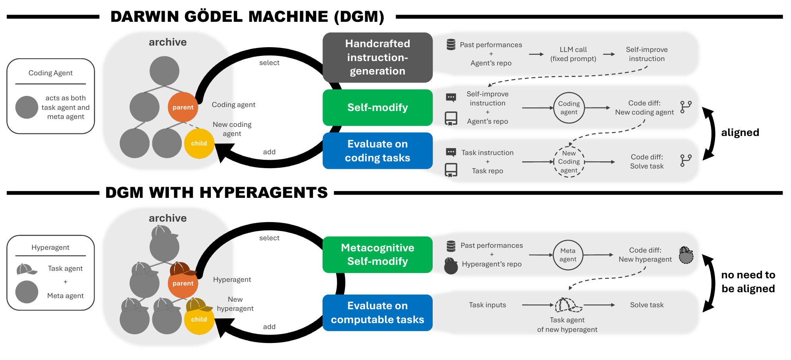
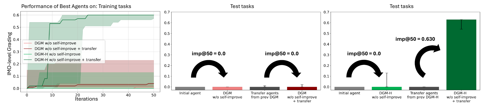

# Hyperagents: An Editable Improvement Mechanism

**Hyperagents**. Jenny Zhang and colleagues, first released in March 2026. [Paper v2](https://arxiv.org/abs/2603.19461v2) · [Public implementation](https://github.com/facebookresearch/HyperAgents)

Hyperagents asks whether the program that performs a task can co-evolve with the program that generates its next modification. The base language model stays frozen. Updates affect the agent's code and persistent records. The study evaluates the mechanism through task performance, an ablation with a fixed modifier, and transfer across tasks.

## Task programs and modification programs

### The fixed improvement process in DGM

The top half of Hyperagents Fig. 1 shows the Darwin Gödel Machine (DGM). The gray module uses the codebase and past performance to write a modification request. Its implementation is fixed by the designers. In the middle row, a coding agent implements the request and produces new agent code. The new agent attempts coding tasks, and tests evaluate its task patches. The outer loop keeps earlier versions and selects parents from the archive. Both task execution and self-modification require coding skills here, so improved editing or debugging can help both. In paper review, accurate accept/reject predictions do not guarantee better analysis of logs or better modification proposals. Hyperagents addresses this separation of task skill and improvement skill.

- [Hyperagents Fig. 1, §1–3](https://arxiv.org/pdf/2603.19461v2#page=4)
- [DGM](https://arxiv.org/abs/2505.22954)

### Editable task and modification programs

The bottom half of Fig. 1 shows the Hyperagents loop. A hyperagent has a task program A (the task agent) and a modification program M (the meta-agent). M reads past training feedback and the whole hyperagent's code, then proposes a program diff. The diff can change A or M itself. The new A attempts tasks and is evaluated. The outer loop stores versions and parent–child relationships, then can run a descendant's modified M to generate further changes. Code and external memory carry experience across generations. The archive can retain intermediate versions with lower scores, allowing later versions to benefit from new tools. The base model, evaluation function, and parent-selection rule are fixed in the main setup. The evaluation directly scores A. M's long-term value is observed through its descendants.

- [Hyperagents §3, A.3, A.5](https://arxiv.org/pdf/2603.19461v2#page=4)
- [Main loop implementation](https://github.com/facebookresearch/HyperAgents/blob/59a68f672dfb92c74aeb7e61535d776fb36e172d/generate_loop.py)

Let $H_t=(A_t,M_t)$ be the parent selected in round $t$. The task program $A_t$ executes tasks. The modification program $M_t$ reads the agent code and historical feedback $\ell_t$ and produces a code diff $\Delta_t$. Applying the diff yields the successor $\tilde H_t$.

$$
\Delta_t=M_t(\operatorname{Code}(H_t),\ell_t),\qquad\tilde H_t=\operatorname{Apply}(H_t,\Delta_t).
$$

*Source is Hyperagents Fig. 1, by [CC BY 4.0](https://creativecommons.org/licenses/by/4.0/) Release.* [Original paper](https://arxiv.org/pdf/2603.19461v2#page=4)

## Experimental tasks and evaluation signals

The four tasks use different feedback signals. Coding evaluates patches against fixed tests. Paper review predicts acceptance or rejection and compares the prediction with historical decisions. It does not directly evaluate the quality of a full review. The public construction script balances accepted and rejected papers in each split, so label calibration can affect the results. The robotics task outputs a reward function and then trains a controller. International Mathematical Olympiad (IMO) grading receives a problem, a candidate proof, a reference solution, and a rubric. It produces one of four scores (0, 1, 6, or 7), depending mainly on how much of the key argument is complete. Paper review and mathematical grading each use 100 examples for training, 100 for validation, and 100 for testing. These examples provide feedback for program search while the base large language model (LLM) remains frozen.

- [Hyperagents §4.2, C](https://arxiv.org/pdf/2603.19461v2#page=30)
- [Paper-review split construction script](https://github.com/facebookresearch/HyperAgents/blob/59a68f672dfb92c74aeb7e61535d776fb36e172d/domains/paper_review/curate_subsets.py)

## Traces of improvement across rounds

### How engineering changes appear in the evolutionary trace

Fig.8 documented an evolution of robotic incentive designs. On the left is a version of a robotic incentive design tree, and on the right is a performance of the same operation. Dark wire connects the final best version of the ancestors, light blue is an arcive average and blue is the best in history. At an earlier stage, the process improved assessment analysis and area processing, followed by the addition of environmental attributes documentation and the addition of clearer code examples and incentive parameters. These changes are directed at physical interface issues, such as the fact that the model cites non-existent status properties or that the incentive scale is not appropriate. The dark ancestor path has also declined, indicating that the ultimate effective path does not require an immediate increase in points at each step. This is a qualitative track in operation that illustrates how engineering improvements have accumulated, but it is not possible to determine the contribution of each change by marking alone.

- [Hyperagents E.2, Fig. 8](https://arxiv.org/pdf/2603.19461v2#page=52)

### Robotics case: standing tall and jumping

Fig. 6 contrasts two reward designs by their resulting control behavior. In the left example, directly rewarding torso height makes it easy to learn to stand taller. The reward design on the right leads to jumping. The superimposed poses show successive stages of movement. There are two levels of optimization. At the outer level, M modifies the reward-design program A, and A outputs a Python reward function. At the inner level, the evaluator uses that reward to train a controller with proximal policy optimization (PPO), then measures behavior with a fixed task fitness function. PPO updates the robot controller, and the base LLM stays frozen. The training tasks involve walking and velocity tracking, and the test objective is torso height. Testing generates a fresh reward for the new objective and trains a fresh policy. The transferable component is the reward-design process. The form of the reward and the validity of its code can both affect the result.

- [Hyperagents C.3, Fig. 6](https://arxiv.org/pdf/2603.19461v2#page=35)
- [Robot evaluator](https://github.com/facebookresearch/HyperAgents/blob/59a68f672dfb92c74aeb7e61535d776fb36e172d/domains/genesis/evaluator.py)

### Examples of changes made by the meta-agent

The improved records in appendix E.3.6 show that the rate of accuracy for the sixty-sixth generation fell to 52 per cent and the acceptance forecast reached 94 per cent. The record gives a judgement as to why, for example, the indication becomes too loose and the boundary rules are unclear. The successor programme included clearer terms of refusal, thresholds and boundary treatment. It shows that M can expand a total fraction into a specific failure mode and save the next round of modifications. The root cause analysis here remains a procedural assumption that needs to be validated by a follow-up evaluation. This example also reveals the impact of task distribution: authors ' revision data are labeled in balance to suggest that calibration may contribute a portion of the benefits. These engineering acts were shown in the paper, but there was no independent accommodation of memory, analysis and movement control.

- [Hyperagents E.3.6](https://arxiv.org/pdf/2603.19461v2#page=57)

### What persistent memory stores

Appendix E.3.7 provides footage of memory.json. The first compares the performance of the better version of history, the second record of the regression of the sixty-sixth generation, and the third plan to amend it after preservation. It preserves values, as well as explanations of phenomena and plans for the next step. This new revision session can take advantage of the old experience.

- [Hyperagents E.3.7](https://arxiv.org/pdf/2603.19461v2#page=58)

## Controlled experiments and cross-domain transfer

### Task performance and component ablations

Fig.2 Test performance of the right-hand comparison of manuscripts with robotic tasks. Blue represents the full DGM-H (DGM-Hyperogents, full methodology of this paper), and purple is DGM-custom (a manual DGM baseline for custom improvement mechanisms in targeted areas). The median for the complete method is 0:71 and 0:372 respectively. Yellow and green corresponds to remove arcive, fixed initial M, with lower performance, supporting the role of the two components. w/ o in the legend is an acronym without a component; Of which w/ o self-improve refers to fixed M, task program A can still be improved. There are three boundaries at the time of comparison. First, the original DGM's fixed command is directed towards the domain of encoded fields and there is some expectation of failure in the non-coded domain, so the purple manual fit-out option is a stronger reference. Second, the complete method is higher than DGM-custom, but the differences are not statistically significant, and the error bar in the figure suggests inter-operability fluctuations. Third, the zero points in the initial manuscript process consist mainly of a failure of the format and cannot be interpreted as a complete failure of the underlying model. Robot scores are fitness and they don't write success rates. The result was a median number of five runs, with a margin of error of 95 per cent of the bootstrap confidence interval (CI, Consortium Interval). Bootstrap refers to the presence of re-sampling, where the interval is used to describe the uncertainty of the median estimate.

- [Hyperagents §5.1, Fig. 2](https://arxiv.org/pdf/2603.19461v2#page=8)

### Transferring the modification mechanism to mathematical grading

The author then examines whether the modifications obtained in the source area can be used in the new field. Fig. 3 Gives DGM and DGM-H migration tests separately. The source area is the script and reward design, and the target area is the mathematical score. After migration, fix M to generate up to 50 new task programs to select candidates on the basis of the target field validation set and calculate the test fraction gain relative to the starting point, i.e. imp@50 (improvisation at 50,50 wheels). The gain on the complete right-hand migration conditions reached zero-six-three, and the fixed initial M that did not move was largely unchanged. The DGM migration comparison on the left did not yield a similar gain. This supports improvements that can be reused under this cross-domain setting. However, the cost of searching the source area has been covered and the target area has been matched 50 times, with a 63 per cent rating capacity directly available for task processes that are not migrated.

- [Hyperagents §5.2, Fig. 3, D.3](https://arxiv.org/pdf/2603.19461v2#page=10)

*The source is Hyperagents Fig.3.* [Original paper](https://arxiv.org/pdf/2603.19461v2#page=10)

### Transfer ablations

Table 4 Decomposition of moving content. Authors migrate task program A, modified program M, or neither. Each group fixes its own starting M and produces 50 versions in the target area. The median number reported in the table is zero, only one for A and one for M, both of which are zero-63. Bringing M alone restored almost all the benefits, and the right-hand zone showed that this condition was more stable than only A. Therefore, the experiment supports the ability to migrate information primarily to be stored in procedures that generate changes. It continues to be isolated only from M as a whole, unable to distinguish between memory, feedback analysis, budget movement or more calls for their respective contributions. The table also shows the actual gains of five operations, which can be seen to be more volatile with only A.

- [Hyperagents D.5, Table 4](https://arxiv.org/pdf/2603.19461v2#page=39)

### Which judgments improved in the grading program?

Fig.10 The Fusion Matrix gives a strong rating baseline and subsequent performance of different ratings. On the left is ProofAutoGrader, the artificially designed fixed certificate rating baseline, and on the right is the improved version of BetterGrader that is automatically found in this paper. Lines are real categories, columns are predictive categories, and the angle line is correctly judged. The four categories are Correct (completely correct, 7 points), Almost (approximately correct, 6 points), Partial (achieving substantive partial progress, 1 points) and Incorporated (fault or no valid key progress, 0 points). The change in the middle two ratings is more marked. The correct identification of the Almost category was increased from 13 to 43, and the Partial from 47 to 72, indicating that the process reduced the direct or total error of the intermediate state. At the same time, the correct number of Corrects fell from 275 to 257, with a certain trade-off. The full baseline accuracy rate increased from 0:561 to 061, while the average gross error in reclassification (MAE, Mean Absolute Error) decreased from 0:178 to 0:175. MAE measures the difference between the projected score and the true score, the lower the value. Thus, the main evidence points to an improvement in the rating boundary and the judgement process, which cannot be directly extrapolated into an overall enhancement of generic mathematics capabilities. Complete baseline results also need to be understood separately from independent test results.

- [Hyperagents §5.3, E.4, Fig. 10](https://arxiv.org/pdf/2603.19461v2#page=59)

### Continued optimization and initialization from a strong baseline

Fig.4 gives training tracks and test results after 200 rounds. Orange migration starts with a median of zero sixty-four, and blue with a normal initialization of zero-six, which does not differ significantly. Green conditions also use ProofAutoGrader as a stronger starting point for mission procedures, with a test of zero seven. This suggests that the system can continue to optimize existing programmes, but there is no limitless or accelerated conclusion in the figure.

- [Hyperagents §5.3, Fig. 4](https://arxiv.org/pdf/2603.19461v2#page=13)

## Contributions and testable questions

The empirical contribution of this work is to make the improvement process itself the object of the project that can be preserved, modified and relocated. The tracks and records in the original diagram show that actual changes include interface restoration, environmental documentation, decision-making rules, and assessment analysis and experience preservation. The migration component experiment is further supported, and the modification process as a whole can carry useful experience. This set-up relies on the already existing code generation capacity of the underlying model. The robust coding model already knows how to prepare the dissectors, logs and analytical scripts, and the training feedback helps the system to select what is appropriate for the current task. However, the resource input is still significant, with the appendix estimating that approximately 83.6 million token (words, basic units of model text processing) is consumed in a single 100 rounds of the joint area and that the PPO calculation has not yet been incorporated. Candidates can also change the number of calls, so the same number of rotations does not represent the same cost. The follow-up can start with a robust initial program with a reliable interface, matching token and GPU (Graphics Processing Unit, Graphic Processor) to calculate the budget, remove memory and assessment analysis and test additional new areas separately. Current results support reusable improvement mechanisms in limited missions, and more evidence is still needed for sustained acceleration.

- [Hyperagents §5–7, D.2, F](https://arxiv.org/pdf/2603.19461v2#page=37)

## Terminology and metrics

| Abbreviations or symbols | Full name or meaning in English | Chinese explanation and role in this paper |
| --- | --- | --- |
| **DGM** | **Darwin Gödel Machine** | **Darwin-Godel machine**. Search for improvements by repeatedly modifying, evaluating agent codes and retaining historical versions. The original DGM comparison in this document uses manual, fixed and modified command generation mechanisms. |
| **DGM-H** | **DGM-Hyperagents** | This is the complete method proposed. Use hyperagent in the DGM search process, so that both the task program and the process producing the changes can be modified. H corresponds to Hyperagens. |
| **DGM-custom** | DGM 's customized (customized) version | The author customises the DGM baseline for the target area to improve the command generation mechanism. Custom is an experimental variant marker, not another algorithm acronym. |
| **A** | task agent, task smart | This document is marked as a task program. You are responsible for the current target tasks, such as predicting the results of the essays, or generating a robotic incentive function. |
| **M** | Meta-agent | This text changes the program's mark. Changes can be made either by code, by historical performance and by feedback, by modifying A or by modifying itself. |
| **LLM** | **Large Language Model** | **Large-language model**. The basic LLM weight in this experiment is frozen; the process is done by calling a model, generating codes, etc. |
| **RL** | **Reinforcement Learning** | **Enhanced learning**. The method category to optimize the strategy based on environmental feedback. RL in the robotic experiment is used to train the control strategy. |
| **PPO** | **Proximal Policy Optimization** | **Close Strategy Optimisation**, an enhanced learning algorithm. The evaluator uses the generated incentive function to train robotic control strategies; PPO is updated with control policy parameters. |
| **IMO** | **International Mathematical Olympiad** | **International Mathematical Olympics**. IMO-GradingBench is the benchmark used in this paper for the scoring of the number of certificates and is tasked with evaluating the given certificates. |
| **GPU** | **Graphics Processing Unit** | **Graphic processor**. When discussing the calculation of the budget, the token consumption to be used for the model needs to be considered separately from the GPU calculation of robotic strategy training. |
| **CI** | **Confidence Interval** | **Trusted interval**. The paper reports 95% bootstrap CI, used to describe the uncertainty of the median estimate of multiple operations. |
| **MAE** | **Mean Absolute Error** | **Average absolute error**, i.e., the absolute value of the difference between the projected score and the true score is re-averaged. This paper also reports its unicoded version, the lower the value is the smaller the difference in the rating error. |
| **imp@50** | Performance at 50,50 wheels | In this migration experiment, you have fixed M, generating 50 task programs, selecting candidates from the Empirical Collection, and reporting a test performance gain relative to the start-up process. 0.630 represents gain and cannot be interpreted directly as a 63% test accuracy rate. |
| **w/o** | **without** | **Get rid of it. Don't use it.**, appears in the original thesis legend. `w/o self-improve` is a fixed M, A can still be improved; `w/o open-ended exploration` is the removal of Archive from the save history candidate. |

Several other terms affect the way the diagram understands them:

- **Hyperagent**: The editable program that combines task program A with modified program M is the basic object of evolution in this methodology.
- **Archive (historic version of archives)**: to preserve multiple agent versions and their performances, paternity, for the subsequent selection of fathers and the continued creation of new branches.
- **Reward (training incentive)**: a signal optimized by the PPO training control strategy, and this reward function in a robotic task is generated by the program.
- **Fitness (adaptation or task rating)**: The outer layer assessor evaluates the fixed indicators of control behaviour. Unlike the function of training reward, such a value cannot be written directly as a success rate.
- **Bootstrap (self-help re-sampling)**: The method of estimating statistical volume fluctuations by which the results are sampled back; this text uses it to construct the confidence interval of the median number.
- **Token.**: the basic unit of measure of the model text. A Chinese or English word corresponds to the token, depending on the way the model is divided.

Original on:[Hyperagents §3 -5, appendix B-E](https://arxiv.org/pdf/2603.19461v2); [DGM Original paper](https://arxiv.org/abs/2505.22954).
