# Representative RSI Papers: Figures, Equations, and Experimental Setups

The papers are grouped by four objects of change: behavior, agent systems, models and data, and research processes. Each group pairs a representative method with related work for comparison. Start with the problem and experimental setup, then read the notation and worked examples alongside the equations. The four main cases are **Self-Refine, Darwin Gödel Machine (DGM), STaR (Self-Taught Reasoner), and The AI Scientist**. The four comparisons are **Tree of Thoughts, AFlow, AlphaGo Zero, and Frontis-MA1 / OpenMLE-Evo**. Citations identify equations taken from the papers, and additional equations derived from the workflows are marked separately. As in the survey, $`t`$ indexes improvement rounds. Each section specifies whether other subscripts count steps, tasks, or candidates. [RSI Foundations](../RSI-Foundations.md)

Start with the inputs and outputs of the task, then identify which state the improvement round changes. In the survey, $`P`$ proposes a candidate, $`E`$ executes it, $`V`$ produces verification evidence, and $`U`$ determines what to retain and update. Trace these operations through the figure to distinguish changes inside a task from inheritance across rounds. The experimental setup gives the model, data, budget, and comparisons. When reading results, use Section 6 of RSI Foundations to distinguish data used for training, search and version selection, and independent evaluation. Identify which score the paper actually reports. The alternative designs suggested here test competing explanations. [Survey Fig. 3, Fig. 5, and Table 1](https://lee1003-lee.github.io/Awesome-RSI-Research/assets/rsi-survey.pdf#page=5)

Related analyses cover [SkillRL](SkillRL.md) and [Hyperagents](Hyperagents.md). See the [bibliography](#paper-titles-and-sources) for the full paper titles and source links.

## 1. Behavior evolution: refining answers and retaining reusable experience

### 1.1 Self-Refine: can feedback help the same model produce a better answer?

#### Problem definition and experimental setup

**Research question.** With the base model fixed, does reading its own feedback and revising its initial answer improve the final output? The object of change is the answer for the current task. The paper examines seven tasks spanning code, mathematics, and dialogue, among others. Inputs and success criteria vary by task. PIE (Performance-Improving Code Edits) tests whether a program runs faster while remaining correct. GSM8K checks the final answer. Open-ended generation can also use human or model preferences. The initial answer is the main comparison. The same model generates, critiques, and revises, with up to four feedback–revision rounds in the main experiment. Freezing the model isolates changes in the workflow, while additional calls and context still matter for the comparison. [Paper §§2–3 and Algorithm 1](https://proceedings.neurips.cc/paper_files/paper/2023/file/91edff07232fb1b55a505a9e9f6c0ff3-Paper-Conference.pdf#page=3)

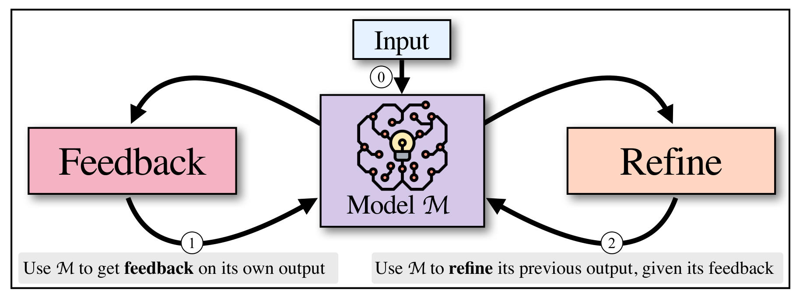

*Original Fig. 1, PDF p. 2. Central. $`M`$ It's the same model, and the right and left rings give it different tasks.* [Original Chart Page](https://proceedings.neurips.cc/paper_files/paper/2023/file/91edff07232fb1b55a505a9e9f6c0ff3-Paper-Conference.pdf#page=2)

#### Fig. 1 in equations: what each of the three calls receives

Gives a single question and fixes the same model. The 0 in the diagram writes a first draft, 1 comments on the current draft, 2 revises it by the point. The Self-Refine (1), (2), (4) is used. $`i`$ Counts the number of revisions to the same subject. $`t`$ Count this number.

```math
\begin{aligned}
y_0 &= M(p_{\mathrm{gen}}\Vert x),\\[0pt]
f_i &= M(p_{\mathrm{fb}}\Vert x\Vert y_i),\\[0pt]
y_{i+1} &= M(p_{\mathrm{refine}}\Vert x\Vert y_0\Vert f_0
                   \Vert\cdots\Vert y_i\Vert f_i).
\end{aligned}
```

| Symbol | Meaning | In the original Fig. 2 code case |
| --- | --- | --- |
| $`x`$ | Cannot change task input. | Request 1 to a non-negative integer sum. |
| $`M`$ | The same fixed model for three roles. $`M(\text{input})`$ represents the input call model and returns the text. | To assign different tasks to the same model with the creation, evaluation or revision of the reminder. |
| $`i,\ y_0,\ y_i,\ y_{i+1}`$ | $`i`$ Several revisions have been completed. $`y_0`$ It's a first draft. $`y_i`$ It's the current draft. $`y_{i+1}`$ This is the next draft based on the current points. | The first draft uses a loop search, and the revised version uses a reconciliation formula. |
| $`f_i`$ | For the first time, $`i`$ A review of the draft. It's written. $`fb`$ . | $`f_0`$ Indicates that the cycle increases with input and recommends closed search for peace. |
| $`p_{\mathrm{gen}},\ p_{\mathrm{fb}},\ p_{\mathrm{refine}}`$ | Three reminders are used in turn for the generation, evaluation and revision of the first draft. | Each requires a solution, an inefficient location, and a rewriting as suggested. |
| $`\Vert,\ \cdots`$ | $`\Vert`$ Indicates the sequential spelling of the text, and the ellipsis indicates that the intermediate drafts and the corresponding comments are taken up. | First revision only first draft $`y_0`$ And comments $`f_0`$ After that, history grew. |

**Line by Line.** First line reading task and generating hints, obtained in loop $`y_0`$ . Second row order. $`i=0`$ Read this loop code and get some comments. $`f_0`$ . In the third line, the original, first drafts and comments are sent to the revised call, and the formulae is available. $`y_1`$ . If you're going to continue, the second line will comment. $`y_1`$ . Original (3) Only current drafts and current points comments, model (4) to spell history into input.

Process $`\mathrm{stop}(f_i,i)`$ determines when to return to the final draft based on the current evaluation and frequency. A complete re-evaluation usually adds two calls, and may end with a stop-point evaluation. The feedback in the diagram is the basis for a rewriting of the subject, and the paper uses a process to test or evaluate the delivery results. **Local Evolution**. [Self-Refine §2, Mode (1)-(4) and Fig.2](https://proceedings.neurips.cc/paper_files/paper/2023/file/91edff07232fb1b55a505a9e9f6c0ff3-Paper-Conference.pdf#page=3)

#### Worked case: what information does the feedback add?

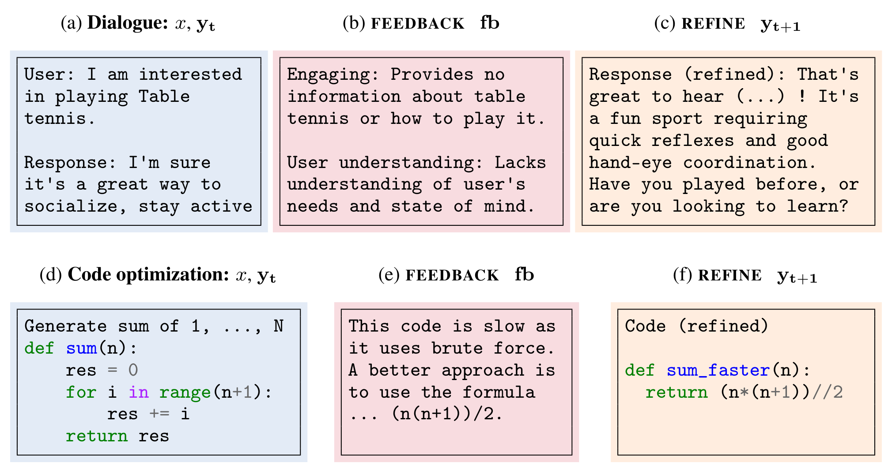

*Original Fig. 2, PDF p. 3. Up and down are the code. Both rows read from left to right by first draft, by count, by revision.* [Original Chart Page](https://proceedings.neurips.cc/paper_files/paper/2023/file/91edff07232fb1b55a505a9e9f6c0ff3-Paper-Conference.pdf#page=3)

Look down in row (d)-(f). **Problem **is sought from 1 to non-negative integer $`n`$. **First draft **Added by item, for example $`n=5`$ Will walk around the circle to get 15. **Comments **Indicates that the number of actions added to repeat add-ons increases with $`n`$, and then gives an enforceable direction to change to the formula. **Revision **Turn it into... $`n(n+1)/2`$ Inheritance 5 is still 15. Here it is important to separate the entry boundaries, the correctness and the speed of the results, and the formula is short enough to indicate that the change has been achieved. The original figure shows how this evaluation has led to the changes, and the optimal proportion of the task in the whole series has been tested later. The top line provides another feedback. The same line of dialogue answers can be free of factual errors, but not responsive to the specific interests of the user, so the stocktaking can indicate what should be added. [Original Fig. 2, §3.2 and Appendix Q](https://proceedings.neurips.cc/paper_files/paper/2023/file/91edff07232fb1b55a505a9e9f6c0ff3-Paper-Conference.pdf#page=3)

**Why is it so designed.** An initial evaluation allows the reviser to be misplaced and modified to fit the " error-placeable, modified executable" task. If the model does not find the error, repeats the error or destroys the original part. The failure information from the running test can be sent to the pointer, the algorithm can be checked with an independent tool, or the same budget can be used to generate several candidates, which can then be selected by the independent verifier. The latter approach does not require accurate diagnosis, but requires a reliable selection of candidates. Stop is also a design, mathematical or program task can be seen to be stopped by validation, and open tasks may depend only on the point evaluation or a predetermined ceiling. [Original §4 with Appendix K, Q](https://proceedings.neurips.cc/paper_files/paper/2023/file/91edff07232fb1b55a505a9e9f6c0ff3-Paper-Conference.pdf#page=6) · [CRITIC Original paper](https://arxiv.org/abs/2305.11738)

#### Evidence: the effect of feedback under a matched retry budget

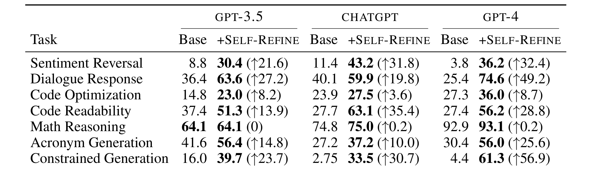

*Original Table 1, PDF p. 5. First read Base and +Self-Refine under the same model, then look at the indicators used by the line.* [Original Table Page](https://proceedings.neurips.cc/paper_files/paper/2023/file/91edff07232fb1b55a505a9e9f6c0ff3-Paper-Conference.pdf#page=5)

Use the group GPT-4 as an example, code optimized from **27.3% to 36.0%**Increase by 8.7 percentage points. Math resolution from **92.9% to 93.1%**, increasing only 0.2 percentage points. Dialogues, acronyms, etc. are assessed in preference to the correct number of questions per line. The papers §4, Table 2 and the ChatGPT are used to compare them to the same code. **Specific comments, general comments, no comments, but amendments**, with an optimised ratio of 27.5, 26.0, 24.8. This contrast is closer to "if feedback is useful" than with the first draft, but the amount of text, call costs and assessment differences under different hints cannot be considered exactly the same. [Result 1](https://proceedings.neurips.cc/paper_files/paper/2023/file/91edff07232fb1b55a505a9e9f6c0ff3-Paper-Conference.pdf#page=5) · [Table 2 versus §4](https://proceedings.neurips.cc/paper_files/paper/2023/file/91edff07232fb1b55a505a9e9f6c0ff3-Paper-Conference.pdf#page=6)

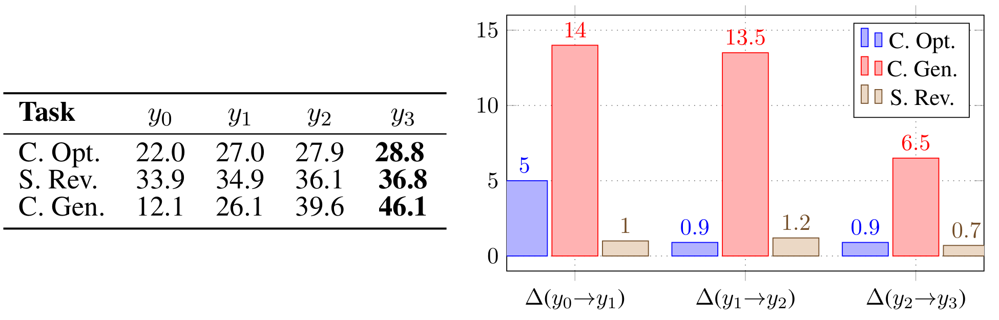

*Original Fig. 4, PDF page 7. Left table as first draft $`y_0`$ To third revision $`y_3`$ . For the third time in the drawing, the main experiment has a process cap of four rounds. $`\Delta(y_i\to y_{i+1})`$ It is the fraction of the latter draft that reduces the score of the previous one. The three abbreviations are code optimization (C. Opt.), constraint generation (C. Gen.), emotional inversion (S. Rev.). The average of each of the three models is taken.* [Original Chart Page](https://proceedings.neurips.cc/paper_files/paper/2023/file/91edff07232fb1b55a505a9e9f6c0ff3-Paper-Conference.pdf#page=7)

When reading the right chart, the column should not be considered as the final score. Code optimization 22.0, 27.0, 27.9, 28.8 corresponds to three increases of 5.0, 0.9, 0.9. The first two constraints were produced with significant gains and the third one was still increasing. It supports the "wink-to-task" approach. It does not make any difference from averages. A more solid assessment can be based on the same initials, comparing sampling and point-to-point revisions with the same use and input output costs, and reporting how many of the questions are wrong, how many are wrong, and where it is best calculated to stop. **An introduction to RSI **It is to separate the generation, error, revision and acceptance. The feedback here is only to advance the subject, so it is mainly to support local evolution. [Original §4, Fig. 4](https://proceedings.neurips.cc/paper_files/paper/2023/file/91edff07232fb1b55a505a9e9f6c0ff3-Paper-Conference.pdf#page=7) · [General Table 1](https://lee1003-lee.github.io/Awesome-RSI-Research/assets/rsi-survey.pdf#page=17)

### 1.2 Tree of Thoughts: comparing candidates before the solution is complete

Self-Refine gets a full answer and fixes it. **If the error of the first step makes it difficult to fix it later, could a few intermediate options be retained?** The task input is four digits, and the output is a 24-point formula for compliance. The original experiment selected questions 901-1000 from a collection of questions sorted according to the time of human resolution, with a 100-problem assessment. **thought** It is an operation that combines two numbers into one number, including the calculation and the remaining number. The four numbers are combined three times to one number, and the task rules and GPT-4 weights are fixed. [Original language §4.1](https://proceedings.neurips.cc/paper_files/paper/2023/file/271db9922b8d1f4dd7aaef84ed5ac703-Paper-Conference.pdf#page=5)

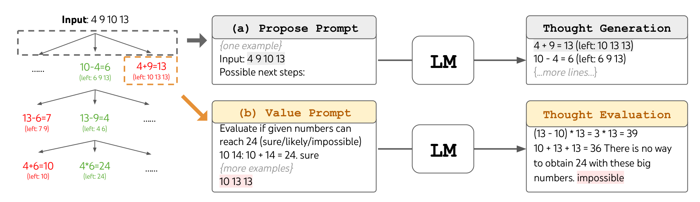

*Original Fig. 2, PDF p. 5. The left is a partially decomposed tree, the right top generates the next step, and the right bottom evaluates the part with no hope.* [Original Chart Page](https://proceedings.neurips.cc/paper_files/paper/2023/file/271db9922b8d1f4dd7aaef84ed5ac703-Paper-Conference.pdf#page=5)

#### Fig. 2 in equations: expanding candidates from the previous level

On the same 24 point, you take two counts and do four operations, get one number, and put it back in the remaining number. Search the nodes on the tree to record the calculations that have already been performed. Press TOT Algorithm 1 to write how to generate and filter the layer.

```math
\mathcal F'_{i+1}
=\{[s,z]:s\in\mathcal F_i,\ z\in G(p_\theta,s,K)\},
\qquad
\mathcal F_{i+1}
=\operatorname{Top}_{b}\bigl(\mathcal F'_{i+1};V_{i+1}\bigr).
```

| Symbol | Meaning |
| --- | --- |
| $`i,\ x,\ z_{1:i},\ s`$ | $`i`$ It's the number of operations that have been done. $`x`$ It's four input numbers. $`z_{1:i}`$ Step 1 to step 1 $`i`$ The history of the operation, $`s=[x,z_{1:i}]`$ is a node of both. |
| $`\mathcal F_i`$ | Article $`i`$ The nodes that are left in the layer are assembled. The 0th layer is the original. |
| $`p_\theta,\ G(p_\theta,s,K)`$ | $`p_\theta`$ It's a fixed parameter. $`\theta`$ is the language model. $`G`$ Use it as a node. $`s`$ It's a good idea. $`K`$ is the maximum number of candidates per node, as recorded in the original language $`k`$ . |
| $`z,\ [s,z]`$ | $`z`$ It's a new operation. Get it to the father's node. $`s`$ And then get the subpoint. $`[s,z]`$ . |
| $`\mathcal F'_{i+1}`$ | A new layer of candidates is all to be screened. $`\in`$ Read "becomes". |
| $`V_{i+1},\ \operatorname{Top}_{b},\ \mathcal F_{i+1}`$ | $`V_{i+1}`$ Estimating the solvency of the various nodes in this layer. $`\operatorname{Top}_b`$ Up to the value. $`b`$ One. $`\mathcal F_{i+1}`$ It's the nodes that remain. |

**Take the first layer.** Enter $`x=(4,9,10,13)`$, which is only available on the 0th floor. $`G`$ You can propose two kinds of calculations in the diagram, one of which is $`10-4=6`$ (remains) $`6,9,13`$ And the other is... $`4+9=13`$ (remains) $`10,13,13`$ ). Both enter first $`\mathcal F'_1`$. If only one ( $`b=1`$ And the valuation puts the first one in front, and it goes in. $`\mathcal F_1`$ . Let's do it again. $`13-9=4`$ Again. $`6\times4=24`$ , can restore compliance level by level. The screening here is an example, with a maximum of five states for each layer of the original master experiment and three valuations for each candidate.

The right-hand extension hint for the left-hand corresponding chart, the right-hand counterpart to the lower-right valuation and the left-side filter. The middle-valued search is done, and the answer is found again equal to 24 cards and is used once for each card. This is the same input as the acceptance check in the RSI base document, where ToT delivers the answer to this question. [TOT Algorithm 1, Fig. 2 and §4.1](https://proceedings.neurips.cc/paper_files/paper/2023/file/271db9922b8d1f4dd7aaef84ed5ac703-Paper-Conference.pdf#page=5)

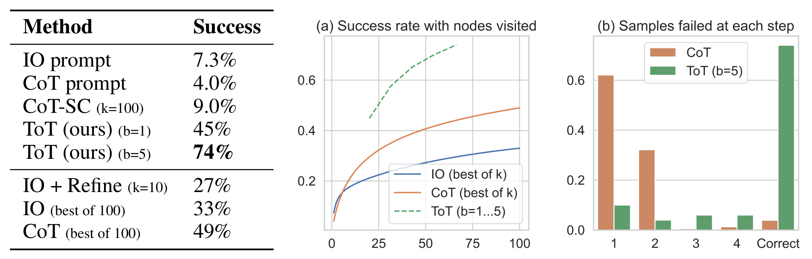

*Original Table 2, Fig 3, PDF p. 6. $`k`$ is the sample number or the revised ceiling, with different lines of meaning. Figure (a) The horizontal axis is the number of nodes, and the calculation of the cost depends on the manner in which each node is called. Figure (b) divides the failure into the step where the problem arises.* [Original Chart Page](https://proceedings.neurips.cc/paper_files/paper/2023/file/271db9922b8d1f4dd7aaef84ed5ac703-Paper-Conference.pdf#page=6)

Cot (chain of thought) allows the model to write a complete question-solving process at a time, with an average success rate of 4.0 per cent, a majority vote of 9.0 per cent for 100 chain of reasoning output, with direct transmission of correct signals re-modified 27 per cent, ToT $`b=1`$ and $`b=5`$ 45% and 74%, respectively. Cot's best of 100 is the ideal caliber. Forty-nine percent of the test questions were able to find at least one correct solution in every 100 samples. The actual delivery of the volume still needs to be able to identify it. Back to the component, 24 points could be spent on legal calculations, replacing model valuations with precise checks. This is a direct option to distinguish "problem searchable" from "problematic model search". The original set-up tree is used for the current theme, comparing the conclusions to local evolution. [Original Table 2 and Fig. 3, Appendix C](https://proceedings.neurips.cc/paper_files/paper/2023/file/271db9922b8d1f4dd7aaef84ed5ac703-Paper-Conference.pdf#page=6)

### 1.3 Voyager: using failures to repair programs and successes to compose skills

**Research issues **Yes, in the open exploration of Minecraft, can the agent decide what to learn and preserve a successful act for later solutions to the more complex objectives? **Enter **There are backpacks, locations, surroundings, targets and progress of exploration. **Output **The JavaScript program that calls the game interfaces, the actions that are executed as a result, and the skills that are saved after the check. It uses the freezing basic model to interface with the top game action to focus on tasks, feedback and skill combinations. The top interface covers progressive controls, allowing the study to focus on these issues. [Original §2 - 3.1](https://arxiv.org/pdf/2305.16291v2#page=3)

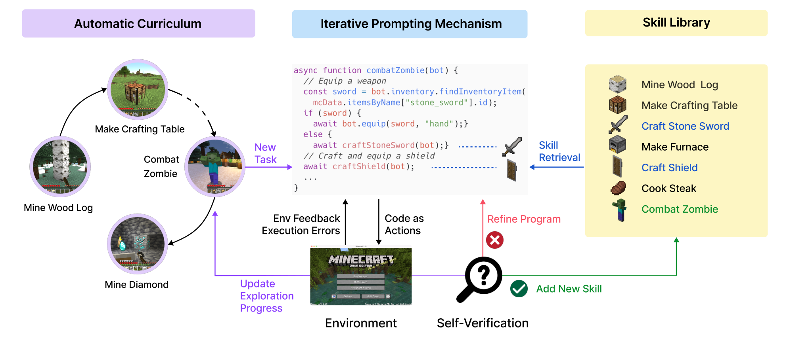

*Original Fig. 2, PDF p. 2. The purple part selects new targets, the blue part generates actionable actions, and the yellow part preserves skills. The red failed path returns to the current program and the green successful path leads to the library.* [Original Chart Page](https://arxiv.org/pdf/2305.16291v2#page=2)

The course set determines what to try according to experience and progress. Code generation reads existing skills and state of the environment. Once the process is operational, environmental feedback can report a lack of material. Fig.5 Left graph, two boards are missing when trying to make sticks, so the next draft needs to be addressed first. The interpreter can also report a program error, and the action of the Fig.5 right-map uses an item name that does not exist in the game and changes it to a valid item. Last GPT-4 call to read tasks and current status for success. Fig.6 The target was to make binoculars, stocked of bronze ingots without purple crystal fragments, and the examiner returned to fail and advised to find the fragments. The first two types of information follow the program and the third provides acceptance before entering the skills bank. The original four-round generation remained stuck and the target was replaced to avoid a difficult target draining. Pure random courses can cover more directions, but may first require unattainable objectives. Fixed courses are easy to compare but not easy to keep pace with actual progress in different maps. [Fig. 5](https://arxiv.org/pdf/2305.16291v2#page=5) · [Fig. 6 and 4 rounds ceiling](https://arxiv.org/pdf/2305.16291v2#page=6)

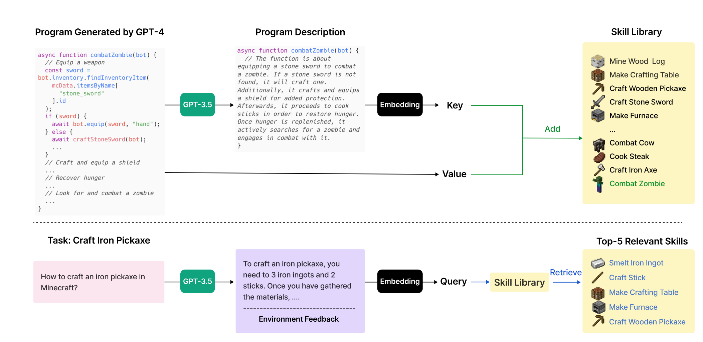

*Original Fig. 4, PDF p. 4. How the first half is written and the second half is read. Key keeps the skills description as a comparable vector, Value saves the actual executable program.* [Original Chart Page](https://arxiv.org/pdf/2305.16291v2#page=4)

The top example saves a completed game action program and is described by GPT-3.5. New tasks are given below, "Creating Iron Ribbon." The system converts questions and answers about practices and environmental feedbacks into queries, retrieves the five skills associated with molten shoals, wooden sticks, workstations, furnaces, and scavengers, and then provides them with code generation. **What's the lesson into the input of new tasks? **The search alone does not prove that all skills are called or are valid. The text reflects on the portability, code skills can be implemented and combined directly, and the two options depend on the environmental interface. [Original Fig. 4, §2.2](https://arxiv.org/pdf/2305.16291v2#page=4)

**Retrieval and writing library.** For each object of exploration, give the program found in the old library to the generator and see if the new program is accepted by the target. Here is the formting of Fig.4.

```math
R_i=\operatorname{Retrieve}(\mathcal K_i,x_i,o_i),\qquad
\mathcal K_{i+1}=\mathcal K_i\cup\{(c_i,\mathrm{desc}(c_i))\}
\quad\text{ (if the program passes acceptance)}.
```

| Symbol | Meaning | An example of making a shovel. |
| --- | --- | --- |
| $`i,\ x_i,\ o_i`$ | $`i`$ We're not going to be able to do this. $`x_i`$ This is the current goal. $`o_i`$ It is an environmental observation or feedback available at the time of retrieval. | The target is a barber, the input includes the current inventory or previous failures. |
| $`\mathcal K_i,\ R_i`$ | $`\mathcal K_i`$ This is the skills bank that begins with this goal. $`R_i`$ It's the skills that are identified for the generator. | The process of molten insomnia, wooden sticks and tools of production was identified. |
| $`\operatorname{Retrieve}`$ | Retrieval of candidate skills using task and current feedback to query the skills bank. | Comparing query and skill description vector similarities. |
| $`c_i,\ \mathrm{desc}(c_i)`$ | A description of the new code for the target and the text to be used for retrieval. | Prepare iron-clad programs, if the practices and codes are preserved through acceptance and inspection. |
| $`\mathcal K_{i+1},\ \cup`$ | The new library is merged between the original entries and those that are allowed to join. | The old bank continued to exist, with new iron-cracking skills being introduced at the time of acceptance. |

**Step by step.** The left checker of the information already received is performed on the right and after the new application has been implemented and accepted. If the iron-cracking process actually uses the furnace skills and through inspection, the old process in the skills bank is involved in forming a new skill. [Voyager Fig. 2, 4 and §2](https://arxiv.org/pdf/2305.16291v2#page=4)

The author measured the missing task after clearing items in the new world, and the diamond stubble was a complete method within the 50-wheel tip limit of 3/3, going to the skills bank of 2/3, reporting on the full methodology of 19 ± 3 times. This is evidence of the reuse of skills and the preservation of samples and environmental ranges. **I've learned a new skill.**, which can be read-only, non-write-only, and read-written as compared to the budget, and the subsequent skills generated can really run and be effective in new tasks. [Original Table 2 and §3.3 - 3.4](https://arxiv.org/pdf/2305.16291v2#page=8)

## 2. Agent-system evolution: changing how the agent operates

Self-Refine runs to hand over a modified answer at a time. Now push the question one step out. If every mathematical question is decided on whether to produce, sample a vote or run a code check, can you first learn a process that can be repeated? This process is only part of the proxy system. **Proxy system **This refers to the implementation system that the model combines with the tools, tips and controls it calls. The AFlow search for reusable processes, and the DGM gives the changed agent an opportunity to take over the next code change.

### 2.1 AFlow: searching for a reusable workflow

#### Problem definition and experimental setup

How to find an automatic paragraph for a given type of question, rating method and a basic implementation model **Workstream**, which is the executable to specify the model's call tool and to transmit the results? The input of the workflow is a question and the output is the answer to the question. The searcher's input is the initial workflow, available operation, validation question and rating method. The output is the workflow selected on the validation topic. The author divides the data according to the validation and test about 1:4. The validation question provides a score for the search, and the test is used to assess the final process. The main comparison is with Claude 3.5 Sonnet writing the workflow, GPT-4o-mini executing, AFlow searching is set at 20 wheels. This allows a separation of "who is responsible for designing the process" and "what model is used for process deployment". [AFlow §3.1, §5.1](https://proceedings.iclr.cc/paper_files/paper/2025/file/5492ecbce4439401798dcd2c90be94cd-Paper-Conference.pdf#page=8)

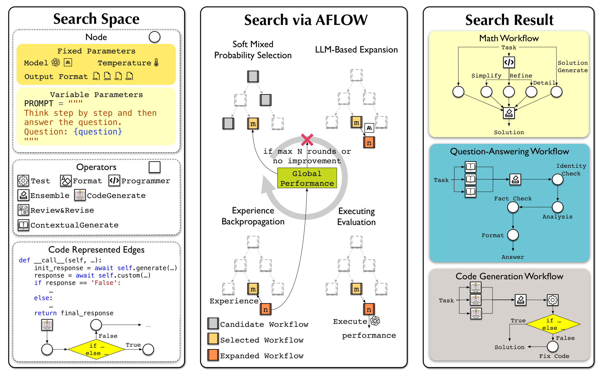

*Source. AFlow official Fig. 3, PDF p. 5.* [View original diagrams and graphs](https://proceedings.iclr.cc/paper_files/paper/2025/file/5492ecbce4439401798dcd2c90be94cd-Paper-Conference.pdf#page=5)

#### Reading the three levels in the figure

1. **What can the left definition change?** Nodes in the workflow can launch a model call. Node tips can be adjusted to perform fixed settings such as models, temperature, and output formats. Operator in the graph is a ready-made callable component, such as an executory program, formatting output. By the way, the code specifies which of the results of the previous step is given to which component. Presets allow the optimizer to start with a running program.
2. **The middle explains how each round is changed.** Select a parent version of the existing process. Select the opportunity to explore both high-scoring versions and homogeneity. Optimize the model to read the parent version and write changes. On the validation topic, you can actually run the candidate, record the score and the experience of the change, and read it back when you expand. The node of the tree is the candidate workflow. The side of the tree means "from which process to which process" and there are two sides to the data transfer within the left workflow.
3. **On the right is the deployment result.** The same selection process can handle many new questions. The question is whether the system is not worth using the median in practice, and whether the search development costs and the cost of deployment costs each. Search tips alone are a reference for more cost-saving costs. It also allows the same model to solve manual processes within the same call budget and whether it would be more useful to compare the structure automatically found. [Original Fig. 3, §4, §5.4](https://proceedings.iclr.cc/paper_files/paper/2025/file/5492ecbce4439401798dcd2c90be94cd-Paper-Conference.pdf#page=5)

#### Fig. 3 in equations: defining a workflow before defining search

AFlow is to deliver a re-executable workflow, such as a model solution, which is verified by another node. $`W=(N,E_W)`$ ,  $`N`$ It's a collection of steps within the process. $`E_W`$ It's a connection to the running order, branch and hand-over data, footer $`W`$ indicates the connection of the process. The original diagram writes the connection $`E`$ Of which... $`N(M,\tau,P,F)`$ Displays the model, sampling temperature, hint, and output formats for individual model nodes. The number of "max N rounds " in the middle of the figure allows a search round. A search tree node saves an entire workflow.

```math
W^\ast\in\arg\max_{W\in\mathcal W}G(W,D_V),\qquad
\tilde W_t=P_{\mathrm{LLM}}(W_t,m_t;\text{prompt or edge}).
```

| Symbol | Meaning | Examples of mathematical workflows |
| --- | --- | --- |
| $`W,\ \mathcal W,\ W\in\mathcal W`$ | $`W`$ It's a job stream. $`\mathcal W`$ is the entire process that can be written according to the template, operating library and editing rules. $`\in`$ Read 'belong'. | The possibility of retweets and cross-borders could be provided through direct resolution, review and other options. |
| $`D_V,\ G(W,D_V)`$ | $`D_V`$ It's a search and selection of the authentication questions. $`V`$ Shows value in subscripts. $`G`$ It's the way this process works on these topics. | The same set of 20 questions gives how many answers. |
| $`\arg\max,\ W^\ast`$ | $`\arg\max`$ Returns the process that brings up the highest scores. $`W^\ast`$ It's one of the best processes in all space, with an asterisk representing the theoretical objective. | It needs to be known about the performance of all authorized processes in order to determine it. |
| $`t,\ W_t,\ m_t`$ | $`t`$ I'm not sure if I'm going to be able to do this. $`W_t`$ It's the parent process that comes in. $`m_t`$ It is a search and test record that exists. | Draws to the direct solver, which shows it missing the calculation. |
| $`P_{\mathrm{LLM}},\ \tilde W_t`$ | The former is proposed by the large language model and is divided into editorial parts. The latter is a new and operational candidate for this round. | The solution is followed by a review node. |

**Left for target, right for extension.** Assuming that the solver answers to 12 on 20 authentication questions and 15 with a review. Only two times you try, actually deliver. $`\widehat W`$ It's the latter. The hat means a version selected from a limited search. The search results show who scores high in both processes, the theoretical target. $`W^\ast`$ It involves the entire search space.

In the original experiment, about 20% were used to divide the certification area, while the rest were tested. Searching for more differentiated questions in the certification area is done five times. The final delivery is evaluated separately on the test topic to observe the selection score and post-delivery performance separately. [AFlow §3.1, §4 and Algorithm 1](https://proceedings.iclr.cc/paper_files/paper/2025/file/5492ecbce4439401798dcd2c90be94cd-Paper-Conference.pdf#page=6)

#### Equation (3): which workflows can become parents?

Each time AFlow selects an existing version from the initial process and a number of high-scoring processes, and then continues to edit it. Mode (3) gives the probability of this parent selection.

```math
\Pr(i)=\lambda\frac1n+
(1-\lambda)\frac{\exp[\alpha(q_i-q_{\max})]}
{\sum_{j=1}^{n}\exp[\alpha(q_j-q_{\max})]}.
```

| Symbol | Meaning |
| --- | --- |
| $`n,\ i,\ j`$ | $`n`$ is the number of processes that are optional, $`i`$ It's a version number that calculates the probability of being drawn. $`j`$ They've been going through these versions in the denominators. |
| $`q_i,\ q_j,\ q_{\max}`$ | $`q_i,q_j`$ is the validation score for the corresponding process, $`q_{\max}`$ is the highest score in the current candidature. $`s_i`$ Wait. |
| $`\lambda,\ \alpha`$ | $`\lambda`$ (a) the weight of a flat draw; $`1-\lambda`$ is a fractional weight, $`\alpha`$ Controls the sensitivity to differences when extracted by fraction. |
| $`\exp,\ \sum_{j=1}^{n}`$ | The index function converts the fractional difference to a positive weight. The denominator equals $`n`$ the sum of the weights and the probability of converting them to a sum of 1. |
| $`\Pr(i)`$ | The probability of drawing the process $`i`$ to continue expansion. |

**Adds two versions.** With thesis. $`\lambda=0.2,\alpha=0.4`$ , set two tests to be split between 0.8 and 0.6. The first one is given to each. $`0.2/2=0.1`$ . The index weight for both of the second two is $`1`$ and $`\exp(-0.08)`$ multiplied. $`0.8`$ Plus even, the odds are around. **0.516 and 0.484**. The higher score version is easier to take over, and the other one still has an opportunity. The same ratio between weights is easy to calculate by subtracting the common maximum score. The edge of Fig.6 indicates which parent version was actually used for which extension. [AFlow (3) and Fig. 6](https://proceedings.iclr.cc/paper_files/paper/2025/file/5492ecbce4439401798dcd2c90be94cd-Paper-Conference.pdf#page=7)

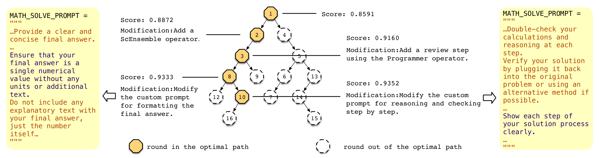

*Source. AFlow official Fig. 6, PDF p. 10.* [View original diagrams and graphs](https://proceedings.iclr.cc/paper_files/paper/2025/file/5492ecbce4439401798dcd2c90be94cd-Paper-Conference.pdf#page=10)

#### Worked case: how search produced a GSM8K problem-solving program

Read from the dark path of Fig. 6 $`1\to2\to3\to8\to10`$. Round 1 is the initial flow, with a score of 0.8591 in the figure. Round 2 plus `ScEnsemble`, with multiple candidates to select the answer, figure 0.8872. Round 3 `Programmer` For review, chart 0.9160. Round 8 replaces the final output hint with a extractable value in figure 0.9333. Round 10 again requires a step-by-step examination of the reasoning and an attempt to back-check it, figure 0.9352. Node skips 4 to 7, indicating that another branch has been expanded during this period. Look at the two hints at the right and left, change the delivery format of the answer and change the inspection process to the right. Both types of changes may raise the same score. In order to determine how many questions the 8th round is correct, it is possible to replace the same original output with a more robust digital extraction method, and then to compare blindness to the correctness of the two versions. [Original Fig.6 and Appendix D](https://proceedings.iclr.cc/paper_files/paper/2025/file/5492ecbce4439401798dcd2c90be94cd-Paper-Conference.pdf#page=10)

Fig. 6 is the selection score for the last GSM8K search. Table 1 values the processes selected by each benchmark to be evaluated on the respective set-off test. AFlow values 80.3, with a baseline of 76.0 for the chain of reasoning sample voting, and an average of three times for implementation. This mean mixes mathematical resolution, F1 for measuring question and answer output and standard answers, and the pass rate for the code under one submission (pass@1). **This example establishes improvements in reusable processes.** The searcher itself selects and generates a candidate using preset algorithms. To ask "Will a follow-up searcher better change the workflow" alone, it needs to place new and old searchers under the same initial process and budget, comparing the subsequent performance on the independence issue. [Main comparison Table 1](https://proceedings.iclr.cc/paper_files/paper/2025/file/5492ecbce4439401798dcd2c90be94cd-Paper-Conference.pdf#page=8) · [Migration Contrast Table 2](https://proceedings.iclr.cc/paper_files/paper/2025/file/5492ecbce4439401798dcd2c90be94cd-Paper-Conference.pdf#page=9)

### 2.2 Darwin Gödel Machine: can a modified coding agent take over improvement?

#### Problem definition and experimental setup

Suppose a coding agent can edit code but views and edits files inefficiently. A human could rewrite its tools. If the agent receives its own program to modify, **can the resulting version solve more downstream tasks and also take over the next round of self-modification?** In DGM, an agent version consists of its code and a fixed base model. The key distinction in the diagram is between the two repositories and the two kinds of patch. [DGM v3 §§3–4](https://arxiv.org/pdf/2505.22954v3#page=4)

| Level | Input | Output | Evaluation |
| --- | --- | --- | --- |
| **Solve a downstream task** | User project repository, task description, available tests, and tools | A patch for the user project | Task tests determine whether the issue was resolved |
| **Generate the next agent** | The parent's own repository and an improvement request written by a separate diagnostic model from evaluation logs | A patch to the agent's code and the runnable child agent produced by applying it | Check basic execution and editing first, then evaluate downstream tasks at the appropriate stage |
| **Select the next starting point** | An archive of versions, their scores, and the available successor counts | The parent that will execute self-modification in the next round | A fixed rule favors stronger versions that have been explored less |

The agent can change its prompts, tools, retries, and workflow. The experiment fixes archive management, the parent selection rule, task tests, and base-model weights. SWE-bench tests software issues in real repositories. Polyglot tests coding tasks in multiple programming languages. Self-modification uses Claude 3.5 Sonnet (New). Downstream evaluation uses the same model on SWE-bench and o3-mini on Polyglot. Each main run generates 80 candidates, with one round counted per candidate. SWE-bench runs two candidate rounds in parallel and Polyglot runs four. A fixed model makes differences easier to attribute to agent code and workflow. Running patches on actual tasks gives comparable scores. Those scores also serve as a proxy for the potential to produce good descendants, an assumption that warrants separate testing. [Paper §§3, 4.1–4.2, and Appendix D](https://arxiv.org/pdf/2505.22954v3#page=4)

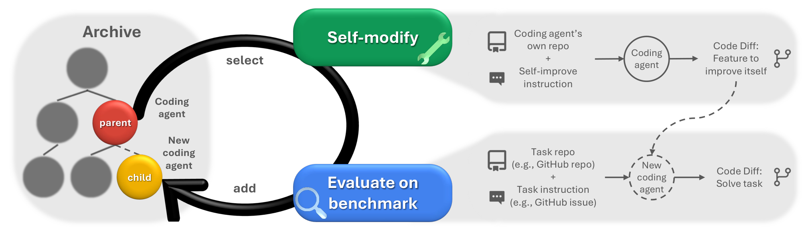

*Source. DGM v3 Fig. 1, PDF p. 2.* [View original diagrams and graphs](https://arxiv.org/pdf/2505.22954v3#page=2)

#### Fig. 1 in equations: which repository each loop changes

Select an existing coding agent to write a patch, change its own code to a new proxy, and then let the new proxy handle tasks in the user items. The first half produces proxy versions, the second half evaluates these versions. Here is the formalization of the original Algorithm 1.

```math
\begin{aligned}
g_t &= \mathrm{Diagnose}(\ell_a),\\[0pt]
\delta_t &= a\bigl(\mathrm{repo}(a),g_t\bigr),&
\tilde a_t &= \mathrm{Apply}(a,\delta_t),\\[0pt]
o_t &= \mathrm{Run}(\tilde a_t,\mathcal D_{\mathrm{bench}}),&
r_t &= \mathrm{Score}(o_t).
\end{aligned}
```

| Symbol | Meaning | To strengthen the editorial capacity of documents, for example |
| --- | --- | --- |
| $`t,\ a,\ \mathrm{repo}(a)`$ | $`t`$ The number of candidates is on the generator wheel. $`a`$ I'm a father's agent who was drawn from the file. $`\mathrm{repo}(a)`$ It's its own repository. | Leave your editing tool to the father's agent for modification. |
| $`\ell_a,\ \mathrm{Diagnose},\ g_t`$ | $`\ell_a`$ It's lower case. It's a parent's downstream log. The diagnostic step returns this round to improve the need. $`g_t`$ The original experimental diagnostic model used o1. | The log shows that the entire file editing is prone to misinterpretation and proposes to support partial replacement. |
| $`a(\mathrm{repo}(a),g_t),\ \delta_t`$ | One programming request was sent to the father ' s agent. $`\delta_t`$ (delta) is a self-remediation patch that it produces. | Patch changes its own editing tool. |
| $`\mathrm{Apply},\ \tilde a_t`$ | Apply patches to the parent and generate sub-agents to be assessed $`\tilde a_t`$ . | get a sub-agent that can try to modify the file by location. |
| $`\mathrm{Run},\ \mathcal D_{\mathrm{bench}},\ o_t`$ | Executing sub-agent, giving it a baseline theme with user warehouses and task statements for each theme. $`o_t`$ Includes task patches, test results and logs. | Sub-agents use a new version of the tool to fix user items. |
| $`\mathrm{Score},\ r_t`$ | The results of the question-by-question test are summarized as the pass rate for sub-agents. | If the same 60 issues pass 24, $`r_t=24/60=0.40`$. |

**In descending order.** The first line diagnoses local editing needs, the second line modifys its warehouse with a father's agent and applies a self-reflection patch, and the third line starts testing sub-agents on other projects to get their grades. The 24/60 above is the calculation value. If the same agreement is tested on the parent version only, there is more than six parent's version. There are basic functionality checks.

The original text has been rephrased to read $`a.\mathrm{modify}(a)`$ , point number left is the agent who did the deed, and in brackets is the agent that was changed. $`a_0.\mathrm{modify}(a)`$ ,  $`a_0`$ It's the original agent. You can follow the two changes in the diagram: who's responsible for the rewrite and which warehouse is rewrited. [DGM Appendix C.3, D and Algorithm 1-2](https://arxiv.org/pdf/2505.22954v3#page=28)

**Why do we have to start with a few questions?** Each candidate is the first to undergo a basic editorial function check for 10 jobs. SWE-bench expands the functional candidate to 60 lanes, and the candidate that reached the 40% threshold at that stage and the top two of the file to 200 lanes. 200 of these include 60 already. Polyglot expands the threshold version to 50 after the 10 lanes have been screened. Small batches remove agents whose code can no longer be edited and save costs, and estimates between versions are influenced by the number of samples and randomity. [Original §4.2, Fig. 3 and Appendix E](https://arxiv.org/pdf/2505.22954v3#page=6)

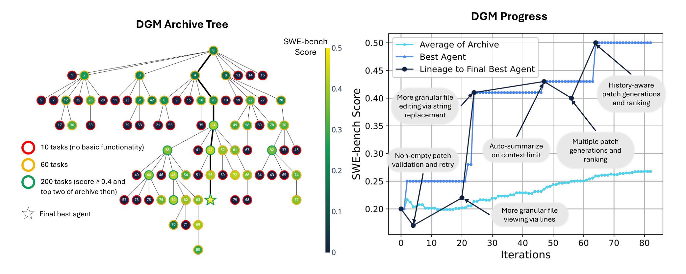

*Source. DGM v3 Fig. 3, PDF p. 7.* [View original diagrams and graphs](https://arxiv.org/pdf/2505.22954v3#page=7)

#### Fig. 3 in equations: which archived version takes over?

The DGM will keep a number of run-able proxy versions. When you rewrite $`t`$, you take a father's agent and you can see how many times it's been tried. Press Appendix C.2 to spell out how the two weights work together.

```math
w_i=
\frac{1}{1+\exp[-\lambda(\alpha_i-\alpha_{\mathrm{mid}})]}
\cdot\frac{1}{1+n_i},
\qquad
\Pr_t(i)=\frac{w_i}{\sum_{j\in\mathcal A_t^{\mathrm{eligible}}}w_j}.
```

| Symbol | Meaning |
| --- | --- |
| $`\mathcal A_t^{\mathrm{eligible}},\ i,\ j`$ | $`\mathcal A_t`$ It's the first. $`t`$ Round file, top bid. $`\mathrm{eligible}`$ Indicate those parts that are eligible for selection and the original text excludes those versions that have reached the full point. $`i`$ It's a node to calculate probability. $`j`$ Walk through all eligible nodes. |
| $`\alpha_i,\ \alpha_{\mathrm{mid}},\ \lambda`$ | $`\alpha_i`$ It's a node. $`i`$ , the rate of passage is 0 to 1. $`\alpha_{\mathrm{mid}}`$ is the midpoint of the first weighting curve, original $`\alpha_0`$ . $`\lambda`$ Controls the slope of the curve. |
| $`n_i`$ | Node $`i`$ The number of direct sub-nodes that have the code and can still edit it. $`1/(1+n_i)`$ reduces the middle weight when more subnominal versions have been tested. |
| $`\exp,\ w_i`$ | The index function appears in the first category. $`w_i`$ is the multiplier of the display weight to the exploration weight. |
| $`\Pr_t(i),\ \sum`$ | $`\Pr_t(i)`$ It's the middle of this round. $`i`$ The probability. $`w_i`$ Except the sum of the weights of all eligible nodes. |

**Adds two versions.** Sets only two eligible nodes with a mission pass rate of 0.5 and direct access to 0 and 3 subnodes, respectively. Use the original experiment $`\lambda=10,\alpha_{\mathrm{mid}}=0.5`$ When the first one is... $`1/(1+\exp(0))=0.5`$ The second is 1 and $`1/4`$ . The weights are 0.5 and 0.125, and then they're down-sized. **0.8 and 0.2 **This makes it easy to get a chance at the less explored nodes.

Read the map to see if it can be archived and which parent has actually taken over. [DGM Appendix C.2](https://arxiv.org/pdf/2505.22954v3#page=28) · [Original Fig. 3](https://arxiv.org/pdf/2505.22954v3#page=7)

#### Worked case: how a local-editing version becomes the parent of later changes

1. **The nodes and edges of the left figure are recognized first.** Each node is a proxy. The line indicates that the parent node really modified itself to generate the sub-node. The node fills the task score, the outer circle indicates the size of the assessment, the red ring marks 10, the yellow circle is 60 and the green circle is 200. The asterisk is the best agent for the final selection. A failed sub-version is drawn, and the slotting rule still requires the editing function to be preserved.
2. **And then along the ancestry of the asterisk read the changes.** See 0, 4, 20, 24, 47, 56 and endpoints sequentially along the rough lines. Node 4 Adds non-empty checking and retry of patches,20 Allows viewing by row,24 Allows replacement with string for more detailed file editing. Node 47 Adds automatic summary after context to limit,56 adds multiple patches to generation and selection, and subsequent versions allow generation and sorting to refer to previous attempts. Line-by-line resolution is less readless, partial replacement resolution is less rewrited correct content, generating multiple patches addresses the selection problem after one miswriting. Tool changes and process changes accumulate in the same code, and later versions also use these capabilities to edit their own code. [Original Fig. 3, §4.4 and Appendix F.1](https://arxiv.org/pdf/2505.22954v3#page=7)
3. **The right figure is to check whether the ancestors win the wheels.** Deep black lines are the ancestry of the final asterisk, nodes 4, 5 and 6 have come down. The Blue Line is the highest file ever, and by definition the best. The Light Blue Line is an average of members who can edit. [Original Fig. 3, §4.4](https://arxiv.org/pdf/2505.22954v3#page=7)

Appendix G also gave comparable editorial cases. Nodes 6 and 24 both tried to improve local editing,6 retained the original editor when it was achieved, added a structured editing mode,24 and replaced the fine particle size string when it was realized. The papers reported 23.3% and 40.5% respectively. To attribute the difference to which editing interfaces were used, one should be installed on the same parent agent and run multiple times with the same group of tests. The original two nodes had different ancestors, and the scale of the assessment was different. **The same improvement objectives can lead to different attainments **The rationale is given for more specific components. [Comparison of node 6 with 24 changes, Appendix G](https://arxiv.org/pdf/2505.22954v3#page=60)

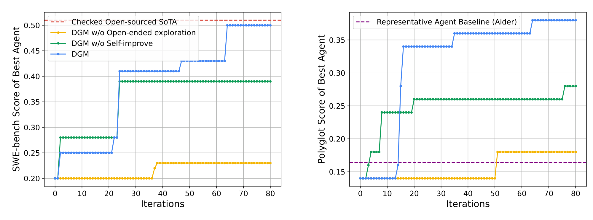

*Source. DGM v3 Fig. 2, PDF p. 7.* [View original diagrams and graphs](https://arxiv.org/pdf/2505.22954v3#page=7)

#### Isolating the effect of successor takeover at a matched budget

- **Let us look first at the basic results.** The horizontal axis is the outer layer search wheel, and the vertical axis is the best version of the job resolution rate found up to the round. SWE-bench is from 20.0 to 50.0 per cent, and the Polyglot search subset is from 14.0 to 38.0 per cent. Polyglot completes 14.2 per cent to 30.7 per cent, which is a collection of two different subjects. [Original Fig. 2, §4.4](https://arxiv.org/pdf/2505.22954v3#page=7)
- **Read again what's moving.** The fixed initial agent has been an improvementer and can still generate a revision, but the new agent has lost the opportunity to take over the preparation of the sub-version. The elimination of branch files continues only from the latest version, which is still working, and the poorer version can easily delay the follow-up search. The complete system runs better on both benchmarks, suggesting that there is experimental support for both designs. [Fig. 2 with §4.4](https://arxiv.org/pdf/2505.22954v3#page=7) · [Cost Appendix E.1](https://arxiv.org/pdf/2505.22954v3#page=32)
- **Finally, direct testing of improved capacity is supplemented.** This cross-check separates "yourself is a stronger code agent" from "yourself can make stronger agents more stablely." The file can also be replaced with only the previous versions, and the value of the branch re-entry measure will vary according to the archive capacity. This is a supplementary experimental design.

**Bring back the overview.** The AFlow follow-up is the next round of work streams that can continue to be modified, and the optimists that generate the changes are fixed by experiment. With the workflow as a boundary, it is possible to check which empirical changes actually become a follow-up starting point. The DGM also gives the successor the opportunity to prepare the next round itself. Fig.3 for the actual succession chain, Fig.2 for downstream improvements and dissipation. [Overview §5.1.2, Table 1](https://lee1003-lee.github.io/Awesome-RSI-Research/assets/rsi-survey.pdf#page=17)

### 2.3 Further reading: Promptbreeder and AgentDevel

**Promptbreeder** Allows the system to retain both hints. **Task hint **Just tell the model how to answer it. **Alterations **Telling the models how to write a new task alert. For example, using "step-by-step solution" as a mission tip, using "give a new instruction that will check the intermediate steps" as a variation hint. The example here is used to illustrate the difference between the two types of hints. The actual method is to use mission performance to provide a selection signal for candidates, and even the variation alerts evolve. Just freezing the variation hints, the remaining training questions and calling the budget are the same, and is a comparison of the contribution of changing the "new tip approach". [Promptbreeder](https://proceedings.mlr.press/v235/fernando24a.html)

**AgentDevel** The focus is on how to decide whether a new version can be released. For the performance record of the current proxy, the evaluation phase identifies the failures observed, the diagnosis phase classifies the recurring problems as manageable targets for change, and then generates a candidate version. The acceptance is done on a topic-by-topic basis compared to the old version and the candidate, both "old version failed, new version passed" and "old version passed, new version failed." The latter can detect a return that hides evenly. [AgentDevelop Original](https://arxiv.org/abs/2601.04620)

## 3. Model and data evolution: the current model supplies the next training round

DGM allows the father to hand over a new proxy. Next, a successor carrier. The current model gives up a sample of training, the training program uses it to produce a new model, and the new model gives up the next sample. The question then becomes: "Where do you get a credible training signal when no one writes a learning package by article? " STAR gets feedback from standard answers, AlphaGo Zero gets feedback from chess rules and self-playing.

### 3.1 STaR: learning intermediate reasoning from correct answers

#### Problem definition and experimental setup

Suppose a training set contains thousands of questions with correct answers and only a handful with intermediate reasoning. The paper calls this reasoning text a **rationale**. Can a model use a few rationale demonstrations to generate more rationales, filter the new examples against known answers, and then generate the next batch with the trained model? GPT-J 6B is the base model used for fine-tuning. In CommonsenseQA, a five-choice benchmark, there are 9,741 training questions, 1,221 development questions, and 1,285 held-out test questions. The prompt contains ten rationale examples. Table 1 reports development-set accuracy. Known answers provide a low-cost filtering signal, and the few human examples demonstrate the format and the task. [STaR §§3 and 4.1–4.2](https://proceedings.nips.cc/paper_files/paper/2022/file/639a9a172c044fbb64175b5fad42e9a5-Paper-Conference.pdf#page=5)

| Level | Input | Output | Information constraint |
| --- | --- | --- | --- |
| **Answer a question** | The question and a few examples, plus answer options for multiple-choice tasks | A rationale and an answer | Withhold the correct answer to the current question on the first attempt and at evaluation |
| **Prepare training examples** | The current generator, training questions with correct answers, and a few rationale demonstrations | Filtered question–rationale–answer triples | Use the rationalization route only when the ordinary attempt was incorrect. Supply the correct answer to the generator only at this stage |
| **Train and hand off** | The examples retained in this round and the original pretrained weights | The fine-tuned model for this round | Restart training from the original weights each round. The fine-tuned model generates data in the next round |

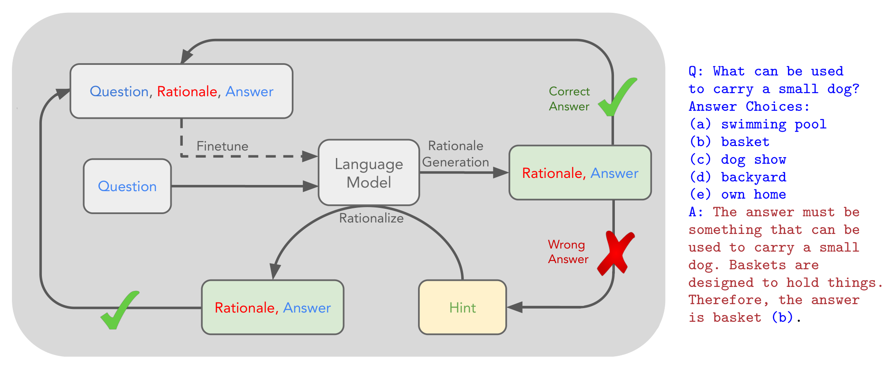

*Source. StAR official Fig. 1, PDF p. 2.* [View original diagrams and graphs](https://proceedings.nips.cc/paper_files/paper/2022/file/639a9a172c044fbb64175b5fad42e9a5-Paper-Conference.pdf#page=2)

#### Fig. 1: why are there two routes to training data?

Along the middle. `Question → Language Model → Rationale, Answer` Read, a model first writes the reason and selects the answer based on the title. Answers the right and adds the title, the reason, and the answer to the round of data. If the answer is wrong, it will cause the training to turn on the question that it will do. The lower path will give the standard answer. `Hint` And the model's being pushed backwards for a reason. The paper called this step. **Nationalization (justification for the answer)**. The answer still has to match the standard answer to keep the corresponding sample. The " what can a puppy fit in " on the right is a common sense explanation generated to understand the sample ' s face. The left dash `Finetune` turns a whole sample into the next generation. [Original Fig. 1, §3, Algorithm 1](https://proceedings.nips.cc/paper_files/paper/2022/file/639a9a172c044fbb64175b5fad42e9a5-Paper-Conference.pdf#page=4)

#### Fig. 1 in equations: which model generates data and which gets fine-tuned?

StaR solves the question of how to make a sample when " there is a standard answer, there is no intermediate reason " . Both paths in the chart are answered by the current generation model, one does not give the answer to the current question, and one gives the answer as an explanation. The sample after the screening of the two paths is combined to fine-tune the pre-training model. Press Algorithm 1 below and the example is omitted from the model input.

```math
\begin{aligned}
(\hat r_j,\hat y_j)&=M_{t-1}(x_j),\\[0pt]
(\hat r_j^{\mathrm{rat}},\hat y_j^{\mathrm{rat}})&=M_{t-1}(x_j^{\mathrm{hint}}),\\[0pt]
D_t^{\mathrm{direct}}
 &= \{(x_j,\hat r_j,y_j):1\le j\le J,\ \hat y_j=y_j\},\\[0pt]
D_t^{\mathrm{rat}}
 &= \{(x_j,\hat r_j^{\mathrm{rat}},y_j):
      1\le j\le J,\ \hat y_j\ne y_j,\ \hat y_j^{\mathrm{rat}}=y_j\},\\[0pt]
M_t&=\mathrm{FineTune}\bigl(M_0,\ D_t^{\mathrm{direct}}\cup D_t^{\mathrm{rat}}\bigr),\\[0pt]
\text{generator for round }t+1&=M_t .
\end{aligned}
```

| Symbol | Meaning |
| --- | --- |
| $`t,\ t+1,\ j,\ J`$ | $`t`$ It's the outer layer sample retraining cycle, starting with 1 $`t+1`$ Point to the next round. $`j`$ It's the title. $`J`$ It's the total number of training topics. $`1\le j\le J`$ This is a long trip to the training pool. |
| $`x_j,\ x_j^{\mathrm{hint}},\ y_j`$ | $`x_j`$ The question is not to give an answer. $`y_j`$ Standard answer. Superscript. $`\mathrm{hint}`$ Adds an answer hint to the identification title. |
| $`M_0,\ M_{t-1},\ M_t`$ | $`M_0`$ It's an initial pre-training model. $`M_{t-1}`$ He is the generator of the sample that this round uses to produce. $`M_t`$ It's a fine-tuning model completed in the current round. |
| $`\hat r_j,\hat y_j`$ | The reason and predictive answer that is generated when no answer is given. The hat represents the value of the model generated $`r`$ here is the reason for the question. |
| $`\hat r_j^{\mathrm{rat}},\hat y_j^{\mathrm{rat}}`$ | The reason and output after giving the answer. $`\mathrm{rat}`$ Marks the path of the résumation. |
| $`D_t^{\mathrm{direct}},\ D_t^{\mathrm{rat}}`$ | The colon in brackets is the sample format and the condition on the right. $`=`$ 」「 $`\ne`$ In the screening conditions, check whether the answer is consistent with the criteria. |
| $`\mathrm{FineTune},\ \cup`$ | The samples are initially merged $`\cup`$, then initialized and fine-tuned from the samples $`M_0`$. |

**Line by Line into Round 1.** With $`M_0`$ two arithmetic examples. Title $`x_1`$ Yes. $`7+8`$ It's written the right reason and got it. $`15=y_1`$ So the question, the reason, the answer, went in. $`D_1^{\mathrm{direct}}`$ . Title $`x_2`$ Yes. $`8+6`$ , normally generated to 13, gave a standard answer prompt 14 after which it wrote "Put 2 to 10 and add the remaining 4", output $`14=y_2`$ This one's in. $`D_1^{\mathrm{rat}}`$ . Training input is still free $`8+6`$. Two records together, from $`M_0`$ Fine-tune out $`M_1`$ .

Round 2 $`M_1`$ Make samples, fine tune again from $`M_0`$ Initializes. The arrows in the graph are passed on **Generator**. In the summary mark, No. $`t`$ Wheel Start Status $`s_t`$ Hold $`M_{t-1}`$ Write back to status $`s_{t+1}`$ Hold $`M_t`$ . The screening conditions only confirm the final answer. The new model can answer better, with a separate question. [STaR §3.1–3.2, Algorithm 1](https://proceedings.nips.cc/paper_files/paper/2022/file/639a9a172c044fbb64175b5fad42e9a5-Paper-Conference.pdf#page=4)

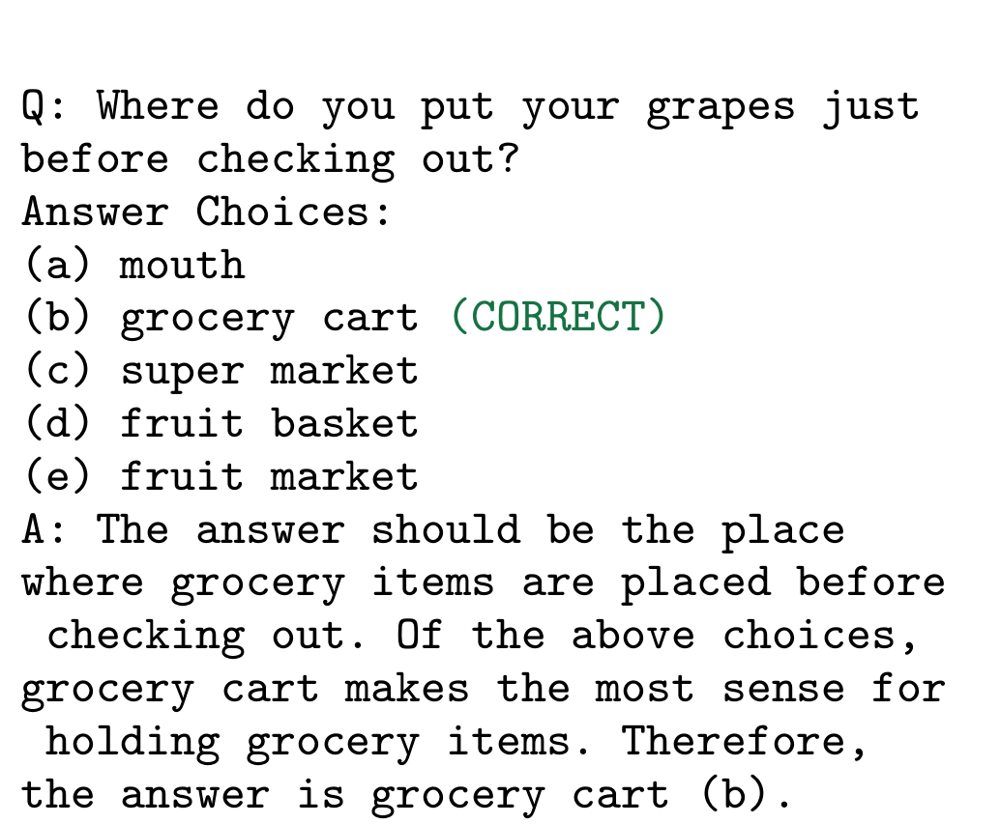

*Source. Official version of STAR Fig. 2, PDF page 4.* [View original diagrams and graphs](https://proceedings.nips.cc/paper_files/paper/2022/file/639a9a172c044fbb64175b5fad42e9a5-Paper-Conference.pdf#page=4)

#### Worked case: why the answer is supplied during rationale generation and omitted during training and evaluation

The subject is where to put the grapes before the supermarket is closed. `(b) grocery cart` Clear green labels by the side `CORRECT` When you enter a training session, you can use a new training session. **Enter the correct option tag in the title was removed**, export monitoring still includes reasons and correct answers. Training to learn to predict reasons and answers when you see the question. Evaluations also provide only questions and examples. The correct answer is to help construct the monitoring material and verify that the results are still derived from normal responses to the independence question. The final answer does not determine whether the reason actually leads to a conclusion. [Original Fig. 2, §3.2, §4.4](https://proceedings.nips.cc/paper_files/paper/2022/file/639a9a172c044fbb64175b5fad42e9a5-Paper-Conference.pdf#page=4)

**Succession and acceptance on a rotating basis.** You can find it in the pattern. $`M_t`$ The original Algorithm 1 replaces the generator by a wheel, without setting a new negative threshold for a round-by-round win. $`M_{t-1}\to M_t`$ The smallest RSI is to be satisfied with the synthesis, and the evidence is to be improved to match the generation, to examine the comparison and to accept the basis. [STAR §3.1 and Algorithm 1](https://proceedings.nips.cc/paper_files/paper/2022/file/639a9a172c044fbb64175b5fad42e9a5-Paper-Conference.pdf#page=4)

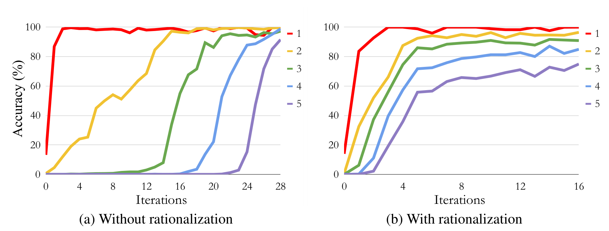

*Source. Official version of STAR Fig. 4, PDF page 6.* [View original diagrams and graphs](https://proceedings.nips.cc/paper_files/paper/2022/file/639a9a172c044fbb64175b5fad42e9a5-Paper-Conference.pdf#page=6)

#### Evidence 1: what the multi-digit learning curves reveal

Fig.4. Transverses generate data fine-tuning **Outer layer rotation**, the vertical axis is the accuracy rate and a line corresponds to the number of digits added. The left figure uses only one or two additions to the question, and four or five have to wait for more rounds before a significant increase. Four and five individuals were also trained during the previous rounds, and several difficult curves rose simultaneously. The institutional hypothesis can be presented here. The current model requires a first-come, first-served sample, and the problem comes later. The answers were given and the materials were constructed for some of the problems, so they were encountered earlier. The cross-axis endpoints are about 28 and 16 rounds, respectively, and the number of samples and training steps in the outer cycle need to be taken into account. §4.3 Arithmetic experiments to give reasons have been set at 300 steps, plus 20 steps per round. To talk about "who learns earlier under the same measure" there is also a need to align the training process. [Original Fig.4 & §4.3](https://proceedings.nips.cc/paper_files/paper/2022/file/639a9a172c044fbb64175b5fad42e9a5-Paper-Conference.pdf#page=6)

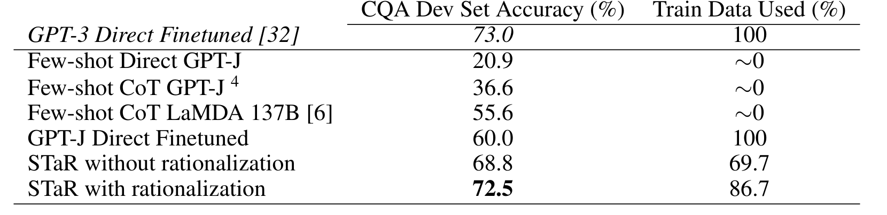

*Source. Official version of STAR Table 1, PDF page 7.* [View Tables and Notes](https://proceedings.nips.cc/paper_files/paper/2022/file/639a9a172c044fbb64175b5fad42e9a5-Paper-Conference.pdf#page=7)

#### Evidence 2: what the two commonsense QA columns measure

Look at the last three lines. The GPT-J directly trained with the answer covers 100% of the training topics and develops the set of correctness rates of 60.0%. The STAR only covers 69.7% at the time of generation of the normal reason, 68.8% at the correct rate. The complete STAR covers 86.7%, and the correct rate is 72.5%. The 78.2% and 8.5% of the denominators in the table are all training topics. They are the ratio of the final round of the complete version covered by the normal generation to the supplementary reason, respectively, and the combined rate is 86.7%. The unsupplemented version eventually covers 69.7%, which is another training trajectory.

When reading the correct rates, it is also a question of which batch to evaluate. §4.1 A description of the author's best performance after performance has stabilized. 72.5% of Table 1 is calculated on the development of 1,221 CmonsenseQA (CQA). CQA has another 1,285 retention tests, which show only development set performance. 5.8%, 10.1% and 10.7% of Table 2 correspond to each of the three sets. **GSM8K Test Set**. The results are compared to both the data set and the split. [Reporting protocol and data division, §4.1 - 4.2](https://proceedings.nips.cc/paper_files/paper/2022/file/639a9a172c044fbb64175b5fad42e9a5-Paper-Conference.pdf#page=5) · [Common Sense Questions and Answers Table 1](https://proceedings.nips.cc/paper_files/paper/2022/file/639a9a172c044fbb64175b5fad42e9a5-Paper-Conference.pdf#page=7) · [Primary Mathematics Table 2](https://proceedings.nips.cc/paper_files/paper/2022/file/639a9a172c044fbb64175b5fad42e9a5-Paper-Conference.pdf#page=8)

**Alternative design and limitations.** If you can verify each step, you can check the arithmetic process for introspection and then compare it to the last answer. **It works. **The data, which puts the old and the new producers on the same set of training topics, compares the sample size, difficulty and training steps to allow the same initial model to be trained separately and then independent. This makes it possible to distinguish whether the benefits are derived from multiple, different or better. When moving to an open mission, it is necessary to indicate which external feedback is qualified as a standard answer. [Original §3.2 ,  §4.4 –4.5,  §6](https://proceedings.nips.cc/paper_files/paper/2022/file/639a9a172c044fbb64175b5fad42e9a5-Paper-Conference.pdf#page=7)

#### Derivation: how the final-answer reward enters the gradient

Sets a training question to give 1 point to the right output and 0 points to the wrong output. Here we start with the "average reward for all possible outputs" and explain how the correct answer signals the parameter update. This is STAR. §3.1 The deduction is spread on a single subject.

```math
\begin{aligned}
\nabla_\theta\mathbb E[R]
 &=\nabla_\theta\sum_{\hat r,\hat y}p_\theta(\hat r,\hat y\mid x)R(\hat y)\\[0pt]
 &=\sum_{\hat r,\hat y}p_\theta(\hat r,\hat y\mid x)R(\hat y)
                   \nabla_\theta\log p_\theta(\hat r,\hat y\mid x)\\[0pt]
 &=\mathbb E\!\left[R(\hat y)\nabla_\theta\log
                   p_\theta(\hat r,\hat y\mid x)\right].
\end{aligned}
```

| Symbol | Meaning |
| --- | --- |
| $`x,\ y,\ \hat r,\ \hat y`$ | $`x`$ It's the subject. $`y`$ It's a standard answer. $`\hat r`$ It's a possible reason to create it. $`\hat y`$ It's the answer that comes out with it. |
| $`\theta,\ p_\theta(\hat r,\hat y\mid x)`$ | $`\theta`$ is a set of model parameters. $`p_\theta`$ It's a deal. $`x`$ And the probability of creating this text, $`\mid`$ Read "Dealed". |
| $`R,\ R(\hat y),\ \mathbf 1`$ | Awards $`R(\hat y)=\mathbf 1[\hat y=y]`$ . $`\mathbf 1`$ is the indicator function, condition is set to take one, otherwise 0 is taken. |
| $`\mathbb E[R],\ \sum_{\hat r,\hat y}`$ | Expectes the possible output of the same question. Each is weighted by the probability given by the model for the reasons and for each combination of answers. |
| $`\nabla_\theta,\ \log`$ | $`\nabla_\theta`$ is a gradient for model parameters, $`\log`$ is natural logarithm. |

**Read it line by line.** The first line reads, "Expert probability multiplied by reward, and then the output reconciled." When you give a given pair of output, the reward does not change with the parameter. The second line uses the item with a positive probability. $`\nabla_\theta p=p\nabla_\theta\log p`$ Here. $`p`$ That's the probability. The third line returns the expectations with the same distribution-weighted sum.

**Let's put it together.** Sets only two outputs under the current parameter, the correct probability of 0.3, the error probability of 0.7. The average reward is 0.7. $`0.3\times1+0.7\times0=0.3`$ . In the second line, the error output is multiplied by 0, leaving the probability multiplier gradient. As long as the answer is correct, one point is given for both reasons. The STAR experiment uses greed to generate, filter and fine-tune this signal, adding supplementary justification data. [STAR §3.1, formula (1)-(3) with Algorithm 1](https://proceedings.nips.cc/paper_files/paper/2022/file/639a9a172c044fbb64175b5fad42e9a5-Paper-Conference.pdf#page=4)

### 3.2 AlphaGo Zero: who generates games, and when does the successor take over?

#### Problem definition and experimental setup

From random initialization, only chess rules are given. Can a chess player train a stronger chess player with his own data from a game? Task input is a board situation, and the execution output is a loser. Training input is a chess log from a game, and training output is a new network. **Chessman. **It is made up of web-plus searches. The board and final rules are fixed, and training does not use human fallbacks as a model. This allows for a study of whether the message generated by the mission itself is sufficient to facilitate learning. The original text still uses the human chess spectrum for independent analysis and monitoring learning comparisons. [AlphaGo Zero Accepts the Draft Body](https://discovery.ucl.ac.uk/id/eprint/10045895/1/agz_unformatted_nature.pdf#page=3)

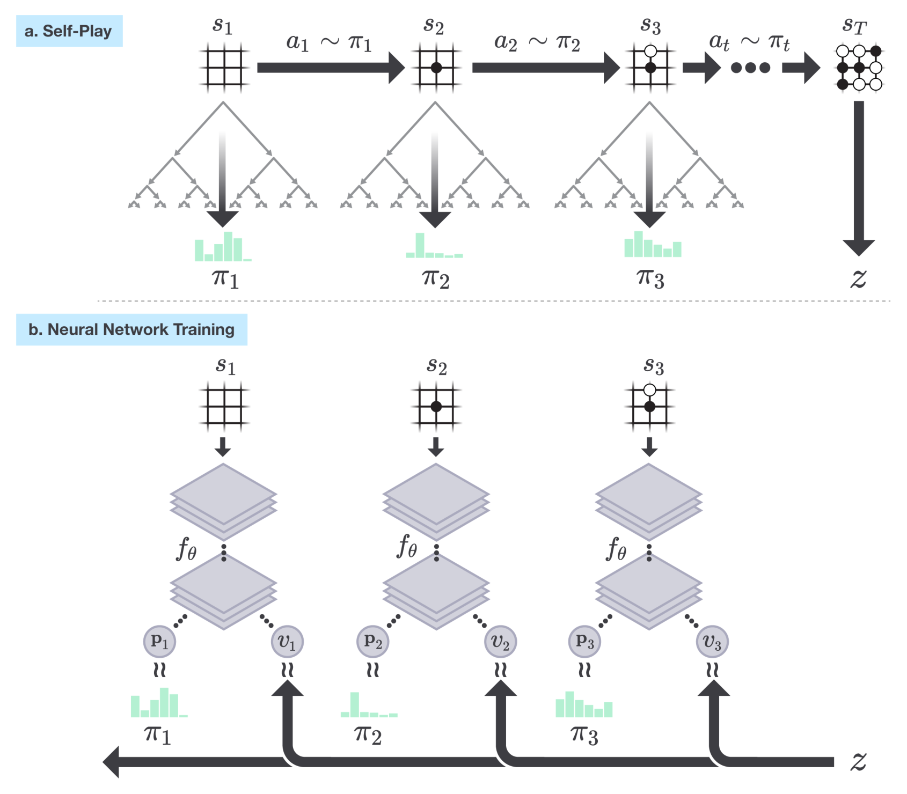

*Source. AlphaGo Zero accepts Fig. 1, PDF page 4.* [View original diagrams and graphs](https://discovery.ucl.ac.uk/id/eprint/10045895/1/agz_unformatted_nature.pdf#page=4)

#### Fig. 1: moves, training, and replacement of the self-play policy

**The first half is the creation of the match.** $`i`$ Count the first hand in a game. The original figure says the inside hand count. $`t`$ , final writing $`T`$ . Here we go. $`i`$ Number of insiders, sum up. $`t`$ Leave it to the outer layer. $`s_i`$ It's the chess board and history before this hand, and it's partly about the chess situation. $`f_\theta`$ is by parameter $`\theta`$ The network that you decided on. The chess board was created with a network of chess players and searches that were allowed to come out. $`s_i`$ The probability of a move is then given both a priori to the search and a negative value to the winner from the perspective of the current chess player.

**How do we replace the number of searches with the probability of falling?** The Monte Carlo Tree Search (MCTS) is modelled by the current network, which accumulates the number of visits per walk. In the Methods formula, the number is shifted to weight and the power is re-established.

```math
\pi_i(a)
=\frac{N(s_i,a)^{1/\tau}}
       {\sum_{b\in\mathcal A(s_i)}N(s_i,b)^{1/\tau}}.
```

| Symbol | Meaning |
| --- | --- |
| $`i,\ s_i`$ | $`i`$ The number of hands in this game. $`s_i`$ It's the first. $`i`$ Hands before the plate with history. |
| $`a,\ b,\ \mathcal A(s_i)`$ | $`a`$ It's the way to calculate the probability. $`b`$ Gather in the denominators all the moves allowed on the disc. $`\mathcal A(s_i)`$ That includes stopping. |
| $`N(s_i,a),\ N(s_i,b)`$ | Searches the number of times that this on-board access is done accordingly. |
| $`\tau,\ \sum`$ | $`\tau>0`$ It's the sampling temperature. $`1/\tau`$ Sub-divisions add the corresponding weights. |
| $`\pi_i(a),\ \pi_i`$ | $`\pi_i(a)`$ It's a search and we're going. $`a`$ Probability, $`\pi_i`$ It's a distribution of probability by method. |

**Put it on a plate.** There's only two legal ways to do it. The number of visits is 8 and 2, take. $`\tau=1/2`$ The weight is... $`8^2=64`$ and $`2^2=4`$ , Probability $`16/17`$ and $`1/17`$ . The diagram $`a_i\sim\pi_i`$ , which means you're actually going to get rid of it $`a_i`$ Select from this distribution. To the end. $`s_T`$ That's why I'm the winner. $`z`$ of which $`T`$ It's the end. Here's the first. $`i`$ The hand-filling was a win from the chess team. $`+1`$ Or lose. $`-1`$ It's... $`z_i`$ ♪ Make a record of training ♪ $`(s_i,\pi_i,z_i)`$ . [AlphaGo Zero Fig. 1–2](https://discovery.ucl.ac.uk/id/eprint/10045895/1/agz_unformatted_nature.pdf#page=4) · [Normalize the number of visits in Methods](https://discovery.ucl.ac.uk/id/eprint/10045895/1/agz_unformatted_nature.pdf#page=26)

**How do you use this record during training?** Fig.1 The second half of the map shows a recorded disk, search distribution, and actual success, requiring two of the network's output to be close to these targets. The next mode gives training to reduce the loss on this record.

```math
\mathcal L(\theta;s_i,\pi_i,z_i)
=(z_i-v_i)^2-\pi_i^\top\log p_i+c\lVert\theta\rVert_2^2 .
```

| Symbol | Meaning |
| --- | --- |
| $`\theta,\ s_i,\ \mathcal L(\theta;s_i,\pi_i,z_i)`$ | $`\theta`$ is the network parameter that is being updated. $`s_i`$ And the record of the record, $`\mathcal L`$ This is a recorded loss. |
| $`z_i,\ v_i`$ | $`z_i`$ and the recorded victory. $`v_i`$ It is the network that predicts the value of the current chess player. $`(z_i-v_i)^2`$ is its square error. |
| $`\pi_i,\ p_i,\ a`$ | $`\pi_i`$ is the recorded search distribution. $`p_i`$ It's a probabilities vector for the network. Any one of them goes. $`a`$ Yes. $`\pi_i(a)`$ and $`p_i(a)`$ Two probabilities. |
| $`\top,\ \log,\ -\pi_i^\top\log p_i`$ | $`\top`$ It's like, "I'm going to have to do it." $`\log`$ Take natural logarithms for each predicted probability. |
| $`c,\ \lVert\theta\rVert_2^2`$ | $`c`$ is the regular weight, the square of the squares is the sum of all parameters squarely and is used to punish excessively large parameters. |

**Count the three sub-items.** A board of players wins. $`z_i=1`$ . The network only predicts $`v_i=0.4`$ The first one is $`0.36`$ . Sets the probability of two moves $`16/17`$ and $`1/17`$ , network projections $`1/2`$ The second one is... $`-(16/17+1/17)\log(1/2)=\log 2`$ . If this parameter is punished by 0.01, the total loss is approximately $`0.36+0.693+0.01=1.063`$ . The search distribution and the end result of the training are recorded and the gradient is updated by the network that produces the forecast. [AlphaGo Zero Acceptable Text (1), PDF Page 6](https://discovery.ucl.ac.uk/id/eprint/10045895/1/agz_unformatted_nature.pdf#page=6)

**External acceptance determines who generates the next pair.** The candidate chess player and the incumbent use the same search settings to set 400 games, with an estimated success rate $`\hat w`$. Methods requires $`\hat w>0.55`$, so the 220 win is just 55% not enough and 221 is not passed. The player who passed the checker produces its own new experience and becomes the next round of comparison. The single win is for learning, and the 400-chamber confrontation is used to determine whether the version will be taken over. [Evaluator and self-playing, PDF page 24](https://discovery.ucl.ac.uk/id/eprint/10045895/1/agz_unformatted_nature.pdf#page=24)

#### Worked case: from a board position to the next generation of the player

We'll find a plate first. $`s_i`$ . The network and the search decide which of these plates is actually to be used, and the distribution of the search preferences is to be recorded. The final round will be followed by a winning and winning record. When the next batch of training is taken, it will be known what is considered promising and how the drive will actually end. The new network will still have to use the same search configuration and the current competition. The race will pass the threshold version before replacing the old network in the next batch. The five steps will be able to position the recapitulation (1). **Chessman strategy to receive and take over data generation**. [Acceptance of Fig. 1 and Methods](https://discovery.ucl.ac.uk/id/eprint/10045895/1/agz_unformatted_nature.pdf#page=4)

**How to read two pairs?** The threshold is designed to reduce the replacement caused by random fluctuations. The three-day version of the training is another chess display, different from AlphaGo Lee 's 100-0. [Original Methods, Evaluator and Self-Play](https://discovery.ucl.ac.uk/id/eprint/10045895/1/agz_unformatted_nature.pdf#page=24) · [The results of the competition with AlphaGo Lee](https://discovery.ucl.ac.uk/id/eprint/10045895/1/agz_unformatted_nature.pdf#page=8)

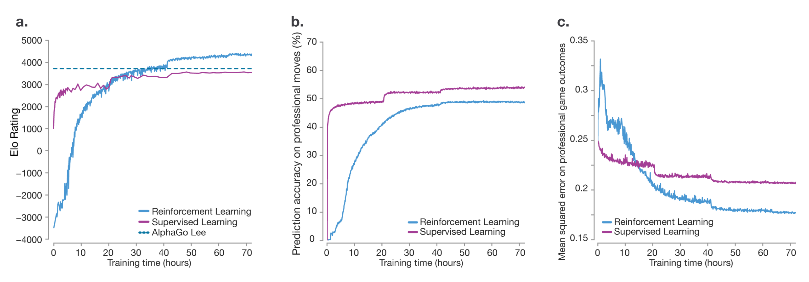

*Source. AlphaGo Zero accepts Fig. 3, PDF page 7.* [View original diagrams and graphs](https://discovery.ucl.ac.uk/id/eprint/10045895/1/agz_unformatted_nature.pdf#page=7)

#### Evidence: which comparison measures playing strength?

The three subcharts are training time. **a** Elo (relative strength based on opponent and winner) is estimated by the Bureau as being highly powerful and assessed at about 0.4 seconds per hand. **b** Take a professional chess score and ask how often the first choice predicted by the network is the same as the actual loss of a professional chess player. **c** Compares professional chess with network predictions, the difference between the margin of error is as low as possible. Supervising learning against the KGS human chess spectrum, b. c. comparing with Gokifu's professional chess spectrum. The control of self-playing moves beyond the supervisory reference, but the monitoring comparison is still better than predicting how humans are going. Which score is "better" if the definition of mission changes. [Original Fig. 3, Methods](https://discovery.ucl.ac.uk/id/eprint/10045895/1/agz_unformatted_nature.pdf#page=7)

**Dependence and alternative design.** The rules are clear, final and remixable missions fit for self-motivating. The same approach makes it difficult to assess the quality of data directly if open mandates lacked success or negative criteria. The role of the threshold could be compared to the budget in three strategies: to update each round, to update by the race threshold and to retain a diversity of rivals. If there is a concern that “better players will not produce more useful training data”, fixed training starting points, search times and data volumes will be exchanged with the data generators. The original training and search framework of the paper was set by people and the chess strategy actually took over the generation of data. Here's an example of AlphaGo Zero playing the basics. Then it was extended to chess, chess and AlphaZero, who took chess in general §5.3.4 to correspond to the same thinking. [Overview §5.3.4](https://lee1003-lee.github.io/Awesome-RSI-Research/assets/rsi-survey.pdf#page=25) · [Alpha Zero, original paper](https://doi.org/10.1126/science.aar6404)

### 3.3 Further reading: Meta-Rewarding LMs and WebGPT

**Meta-Rewarding LMs** The question is, "Can you do better by selecting a training sample? "**Same answer. **And the third character compares the two points on which there is a clear basis. So the system gets a sample of two types of preferences. One is a good and poor answer to the same question, the other is a good point and close to the same answer.

These three roles are carried out by the same model and are differentiated by different instructions. **Directly optimised**(DPO) i.e. a better or worse example training model prefers the selected party. The first two rounds of training used two sets of preferences, the latter two of which used only answers. In the original version of AlpacaEval 2, the success rate for controlling the impact of the length of the answer ranged from 22.92 per cent to 39.44 per cent, based on the GPT-4 Turbo answer, and the Self-Rewarding Baseline with the length control was 35.49 per cent. This indicator measures a preference for responses. The ability of evaluators also needs to see whether their judgement on fixed cases is closer to independent reference. Common groundings may share preferences and may be tested individually by manual or rule samples, or may be used to produce equivalent training data in exchange for a judge, which is then higher than in the next generation. [Meta-Rewarding LMs, Fig. 1,  §2 –3 and Table 1, 3](https://aclanthology.org/2025.emnlp-main.583.pdf)

**WebGPT** Shows another path. Tasks enter an open question and text browser to produce the answer with quotations. The training first allows models to imitate how humans search, read, extract evidence and write answers. Because there are quotations, the judge can check the factual basis and train a rating model using human pairs of preferences. The paper compares this score with an enhanced learning update model and allows the same model to produce several, fractional, and then to turn it in. The former puts costs into training, while the latter puts a portion of the costs into each reasoning. This example describes "how the track is turned into training material". To connect to a relative succession, it also needs to be checked whether the acquired successors continue to be involved in producing or testing the next round of training material. [WebGPT §2–4](https://arxiv.org/abs/2112.09332)

## 4. Research-process evolution: using experiments to inform the next research decision

Programming tests and common sense standard answers provide a rating for a single task. Research also determines what to measure, which to choose, whether to observe for review, and what to interpret. **Research process **Whether the results of the experiment, such as those validated in the round, can change the question, method or resource allocation for the next round. The automatic generation of the text shows where the process can go. To check the retrospective improvements, there is a need to follow up on how the evidence is used for subsequent decision-making. [Overview §5.4.3 and summary of this section](https://lee1003-lee.github.io/Awesome-RSI-Research/assets/rsi-survey.pdf#page=29)

### 4.1 The AI Scientist: turning a research idea into a traceable experiment

#### Problem definition and experimental setup

The 2024 version of The AI Scientist starts from a runnable, small-scale machine-learning baseline. Can a system formulate a concrete research question, modify and run experiments, use the results to design the next experiments, and write a manuscript for review? The authors provide templates for diffusion, language modeling, and learning dynamics. Each includes a baseline, plotting tools, and a writing framework. The research agent can modify the code and add evaluation metrics. Lightweight baselines leave room in the budget for multiple rounds and help identify what changed. [The AI Scientist v3 §§3 and 6](https://arxiv.org/pdf/2408.06292v3#page=4)

| Unit of work | Input | Output | Feedback at this level |
| --- | --- | --- | --- |
| **Run one experiment** | Code changes for a hypothesis, data, hyperparameters, and an experiment script | Logs, numerical results, plots, or errors | Errors and timeouts guide repairs. Successful runs are compared against the hypothesis |
| **Complete one research attempt** | A baseline template, research area, archived ideas, available literature, compute, and a round limit | Research question, experiment code, notes on results, manuscript, and review | Literature search informs whether to proceed. Experiment results inform the next plan. Reviews evaluate the manuscript |
| **Test whether the research process improves** | Verified results, configurations, failure records, and open questions | A specific change to the research question, controls, measurements, or resources | Test in later independent experiments whether the change produces more reliable evidence. This level checks traceability across decisions |

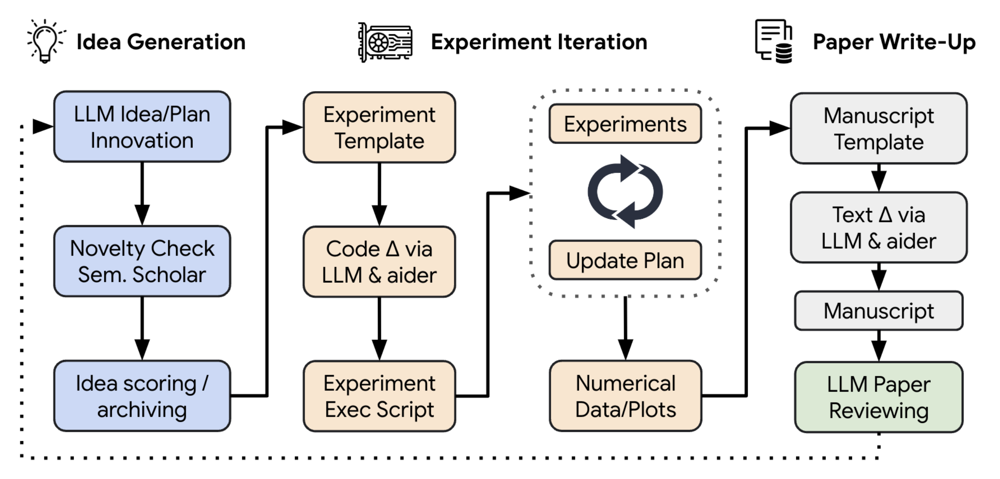

*Source. The AI Scientific v3 Fig. 1, PDF p. 3.* [View original diagrams and graphs](https://arxiv.org/pdf/2408.06292v3#page=3)

#### Fig. 1: where the three forms of feedback enter the workflow

1. **The left is the selection filter.** Enter a baseline and an existing archive of ideas, and the model offers a candidate with an implementation plan. Whether a similar study is available through the Semantic Scholar search to provide a basis for an innovative judgement. No similar papers are available, and it may still be due to keywords or coverage.
2. **The middle is running and reprogramming.** Aider changes the template code as planned and executes it. If you have a report of a mistake or timeout, the information is returned to Aider for a maximum of four retests. The results are returned from a properly run test, the proxy writes the test log, and the next one is reprogrammed accordingly. `Update Plan → Experiments` It's a modified plan based on the results. The correction of errors is a different action than the change of the assumptions based on evidence. The first is a return to the experiment, and the second is likely to improve research decision-making.
3. **On the right is writing and evaluation.** The figure and the diagram are given to the writing system, Aider writes the script according to the script template and then evaluates it using the model. The Code  ⁇  and Text  ⁇  in the diagram refer to changes to the code of the experiment and to the text of the text, respectively. The peripheral dotted line returns to the left contemplation from the evaluation. §3. **Yeah. **This provides a feedback channel. To say that the numerical experiments have improved the next round, it should be noted which evidence has actually been cited, what changes have been caused, what changes are better compared to what has been changed. The review of the text is good at pointing to the omission of arguments, and the review of conclusions can be referred to independent execution and evidence review. [Original Fig. 1, §3 –4 and Appendix A](https://arxiv.org/pdf/2408.06292v3#page=4)

#### Fig. 1 in equations: how an experiment changes the next plan

Staples a research idea. First make the experiment code, then run the evidence, and then decide on the next experiment. Next is the formalization of the Fig.1 intermediate experimental ring.

```math
\begin{aligned}
c_i &= \mathrm{Implement}(c_{i-1},p_i,e_{<i}),\\[0pt]
o_i &= E(c_i,d_i,\xi_i), \qquad e_i=\mathrm{Record}(p_i,c_i,o_i),\\[0pt]
p_{i+1} &= \mathrm{Replan}(p_i,e_{\le i}).
\end{aligned}
```

| Symbol | Meaning |
| --- | --- |
| $`i,\ p_i,\ p_{i+1}`$ | $`i`$ Count the experiments in the same idea, starting with 1. $`p_i`$ This is the question, the contrast and the programme. $`p_{i+1}`$ It is the next plan that has been revised accordingly. |
| $`c_{i-1},\ c_i,\ \mathrm{Implement}`$ | Implementation $`\mathrm{Implement}`$ Changed from previous code and configuration $`c_i`$ The first one. $`c_0`$ , that is, the original template. |
| $`E,\ d_i,\ \xi_i,\ o_i`$ | $`E`$ Execute the code, $`d_i`$ It's the data. $`\xi_i`$ (xi) with running conditions such as random seeds, $`o_i`$ It is an indicator, log or error report. |
| $`e_i,\ \mathrm{Record}`$ | Write this plan, code and observations into an experimental record. $`e_i`$ . |
| $`e_{<i},\ e_{\le i}`$ | One pointer. $`i`$ The first entry is not yet recorded. |
| $`\mathrm{Replan}`$ | On the basis of this plan and cumulative records, it is decided what to do next. |

**I'm going to put it in one of the experiments.** Set, for example, $`p_1`$ Compares the two initialization options. First, the template. $`c_0`$ A comparison of upper writing is obtained $`c_1`$ , and run with the same data split and random conditions. If $`o_1`$ It's just an error of record, and you'll have to fix the program to complete the same plan. $`e_1`$ You can save the training and validation curves. In this example track, if the difference occurs only once, $`p_2`$ Arrange for more pairings of seeds to be compared. The first line is done, the second line is put into slotting observations, and the third line is changed to a study.

The dotted line in the image is **Allowed feedback channel in the design**. If you try a number of external rounds according to the full study $`t`$ ,  $`H_t`$ This is a paper of ideas that can be read at this time. $`H_{t+1}`$ It is an updated file for subsequent experiments. **The actual experiment had a key set-up.** The original §6 explains that, in order to generate ideas in parallel, the author does not wait for the paper to be reviewed and rewritten. Therefore, experiments and reprogramming under the same idea can follow the middle loop, and the outer circle should be used as a designable channel. To explain that an accepted scientific improvement has entered a later round, there is a need to find entries, a basis for acceptance and subsequent practical decision-making. [Process Design §3 - 4](https://arxiv.org/pdf/2408.06292v3#page=4) · [Operational Settings §6](https://arxiv.org/pdf/2408.06292v3#page=13)

#### Worked case: does another initialization lead to earlier modular-addition generalization?

Look. §6.3 is the learning dynamics template. **Grokking** This means that, when training is already very effective, it takes longer to verify the accuracy rate to jump. The task here is to think of "give two numbers, predict what remains of them and divide them by a fixed number". **Initialization **It's the starting point for giving weights before training. So it's possible to ask if you want to align the other settings with the initial weight construction method, to verify whether the accuracy rate leaps forward. The baseline template uses a small Transformer to run four synthetic tasks, each with three random seeds, to record the training and validation curves, and to calculate the number of steps that have reached the perfect accuracy. The selected user-generated scripts are in Appendix D.7, and have 99% of the steps to verify the accuracy. $`S_{99}`$ Compare initialization options. The two thresholds correspond to the description of each indicator. [Original thesis §6.3](https://arxiv.org/pdf/2408.06292v3#page=16) · [Generating draft Appendix D.7, Indicators and results](https://arxiv.org/pdf/2408.06292v3#page=144)

Here you can use an detectable calculator, using the definition of steps to be achieved as " no less than 99% recorded for the first time " . The lower formula is used for review. **Definitions used in this paper**.

```math
S_{99}(a,\sigma)=
\min\{u\in\mathcal U:\mathrm{Acc}_{\mathrm{val}}(u;a,\sigma)\ge0.99\}.
```

| Symbol | Meaning |
| --- | --- |
| $`a,\ \sigma`$ | $`a`$ It's an initial weighting program. $`\sigma`$ (sigma) is a random seed for this training. |
| $`u,\ \mathcal U,\ u\in\mathcal U`$ | $`u`$ Number of steps to update the parameters that have been done. $`\mathcal U`$ It's this time that the number of steps that actually recorded the results of the validation were gathered. $`\in`$ Read 'belong'. |
| $`\mathrm{Acc}_{\mathrm{val}}(u;a,\sigma)`$ | Under the given initialization and seed, the first $`u`$ , the number of questions to be answered divided by the total number of questions. $`\mathrm{val}`$ refers to the authentication set. |
| $`\ge 0.99,\ \min,\ S_{99}(a,\sigma)`$ | The threshold is no less than 99%. $`\min`$ Take the earliest steps to meet the threshold, by $`S_{99}`$ Keep this value, it's a training step. |

**Adds two records.** The same run, the 800th step validation accuracy rate 98%, the 900th step recorded 99.1% for the first time, so $`S_{99}=900`$ . These numbers only indicate the number of steps recorded for the first time. If the operating cap is not met, the default is indicated as agreed. When you read the table in which the appendix is generated, check how it samples the records and aggregates the seeds.

**In the case of restitution according to the actual product.** The proposed comparison is based on initialization, and the output should be an implementable configuration and a comparison of its results. The resulting script leaves a curve and values for PyTorch default, Xavier, He and orthopaedic scenarios, on the basis of which the text text sets out the determination of the speed of collection. Only published products can be viewed along the original paper and the appendix. If a log-by-recycling has led to the next experiment, it is necessary to continue to match the specific logs and scripts. [Original paper §6.3 and Appendix D.7](https://arxiv.org/pdf/2408.06292v3#page=144)

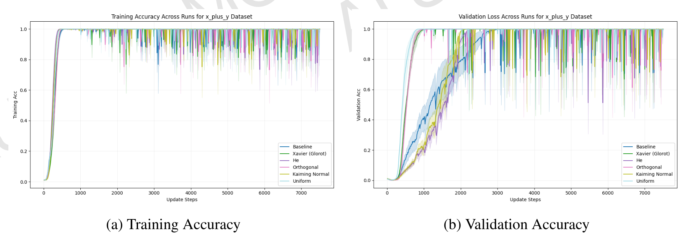

*Figure. Appendix D.7 to the original paper, auto-generated text Fig. 1, page 7 of the original paper and page 144 of the previous paper. Follow text and watermarks in the original paper.* [View the original and body of the generated script](https://arxiv.org/pdf/2408.06292v3#page=144)

**Read the coordinates first, then the report.** The horizontal axis is the number of steps to update the parameters, the left vertical axis and the graph are the training accuracy rates, the curves are very close to one earlier. The right chart is read by the vertical axis and sub-idges to verify the accuracy rates, and the periods of increase in the different curves are separated. The chart shows the early rise in the training accuracy rate and the subsequent increase in the validation accuracy rate. `Validation Loss` , with the vertical axis `Validation Acc` . The next step is to check the fields read in the drawing script against the original records, confirming which measure is the figure. This text is based on the original comparison of the graphs. The indicators and curves in the graph do not run independently. [Generate script Fig. 1 and text behind the diagram](https://arxiv.org/pdf/2408.06292v3#page=144)

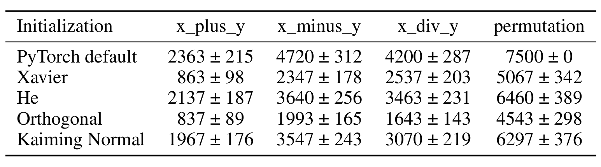

*Figure. Appendix D.7 to the original paper, Auto-generated version Table 1, page 9 of the original paper and page 146 of the previous paper.* [View the originals and notes of the generated draft](https://arxiv.org/pdf/2408.06292v3#page=146)

**A table will then be used to check the conclusions of one sentence.** The resulting script is written after Fig. 1, with Xavier having the fastest step of 863 and the default initialization of 2363 steps on the emulation task `x_plus_y`. The next column of the generation table records the initialization of the orient as 837 steps, less than 863 steps. The report should be preceded by at least the same split, seeds, step caps, first over 99 per cent or consecutively reached thresholds, and calculation between mean values and trust areas. [Generate script Fig. 1 after text](https://arxiv.org/pdf/2408.06292v3#page=144) · [Generate script Table 1](https://arxiv.org/pdf/2408.06292v3#page=146)

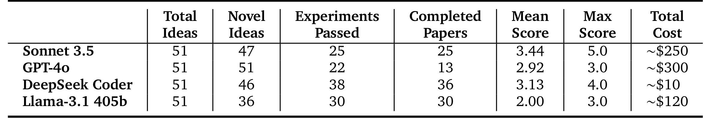

*The AI Science v3 Table 5, PDF Page 16. This table is the original system paper, and the first two charts are the automatic drafts it captures.* [View Tables and Notes](https://arxiv.org/pdf/2408.06292v3#page=16)

#### System-level evidence from ideation, execution, and manuscript drafting

Look, Sonnet 3.5 line. 51 of the ideas 47 have been identified as novel by process, 25 have been passed as 25 pieces, and the automatic evaluation of the text averages 3.44 and maximum 5. In the same template, GPT-4o has been published through 22 experiments, 13 articles indicating that it can run separately from the work. Both are screened on a system basis, and the experiments reflect the running of the column and evaluate the scores. Reliability found needs to run independently. [Original §6.3 "............totable5 and... §8](https://arxiv.org/pdf/2408.06292v3#page=16)

**Alternative design and improvement tests.** The configurations, codes, logs, graphs and conclusions are tied to the same operating markers and then arranged for a blind run. Next, it will be tested and inherited. Two versions of the same study mission will be carried out, giving the same baseline, experiment and query budget, a set of which will be able to read the last round of experimental records after the review, and a set of initial materials. Each of the parties will then record the assumptions and contrasts, whether new and rediscoverable results have emerged, and whether the proceeds will be relocated to the new task. This setting will gradually move the "written paper" to a traceable research decision improvement. The original paper does not report an additional comparison. [Overview §5.4.3 Summary of the research process](https://lee1003-lee.github.io/Awesome-RSI-Research/assets/rsi-survey.pdf#page=29)

### 4.2 Frontis-MA1 / OpenMLE-Evo: how one run changes the next program search

#### Problem definition, experimental setup, and deliverable

Gives a machine learning engineering topic that can be evaluated by machine, such as whether, using the properties of existing data predicting material, the agent can use a limited time to make a possible submission and use a different candidate that has already run. Enter a job description, data, executable environment, validation indicators, and budget. The output contains programs, logs, validation scores, and submissions for each operation. **Frontis-MA1** It's a post-training model. **OpenMLE-Evo** It's an external search facility, organizing the running and recording of candidates. **MLE-bench** This is the basis for providing tasks and assessments. It contains 75 Kaggle projects, and the Lite protocol takes 22 items. The main Evo of the paper compares each setup three times, 12 hours per task, and RTX 4090 is limited to 12 GB. The author uses another 10 NatureBnch Lite to look at the migration. [MLE-bench original paper](https://arxiv.org/abs/2410.07095) · [Frontis-MA1 §5–6](https://arxiv.org/pdf/2607.28568v1#page=15) · [Author Experiment Settings](https://github.com/FrontisAI/OpenRSI/blob/main/docs/results.md)

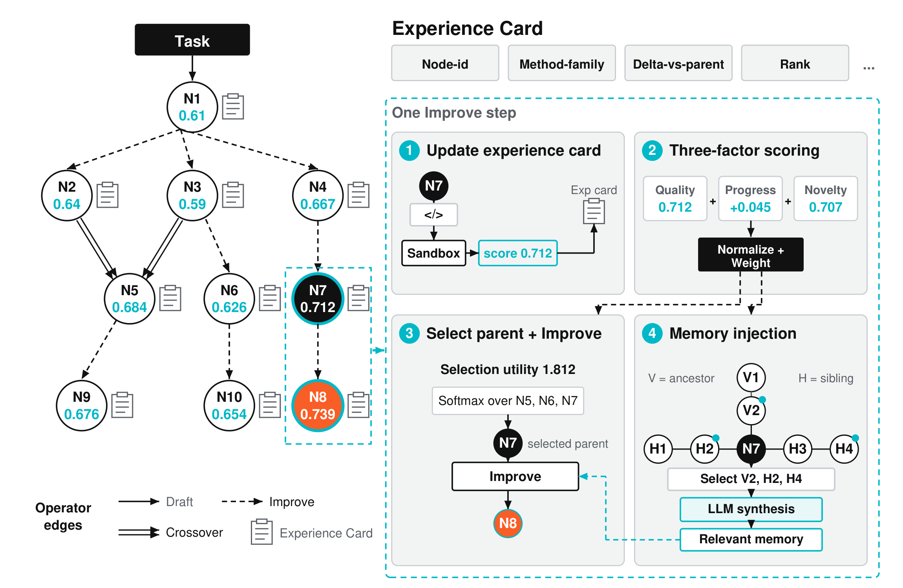

*Source. Frontis-MA1 v1 Fig. 9, PDF Page 16. N7 ⁇ N8 is an extension used to describe the mechanism.* [The original diagram and the figure](https://arxiv.org/pdf/2607.28568v1#page=16)

#### Mapping the equations to the figure

OpenMLE-Evo's search tree contains a trial machine learning program and experience card for each node. When you select the next round of parent programs, the combination quality, relative parent upgrading, and the novelity of the method are used to sort out the probability of sampling. The next version is based on the the thesis (4) rewrite.

```math
u_i=\lambda_s q_i+\lambda_\Delta\widetilde{\Delta}_i+\lambda_n\nu_i,\qquad
\Pr(i\mid\mathcal I)=
\frac{\exp(u_i/T)}{\sum_{j\in\mathcal I}\exp(u_j/T)}.
```

| Symbol | Meaning |
| --- | --- |
| $`i,\ j,\ \mathcal I`$ | $`i`$ is the current node number, $`j`$ Gathering through this selected node $`\mathcal I`$ . |
| $`q_i`$ | Quality score. The larger the greater the better, the smaller the group of comparable authentication fractions, the smaller they zoom in to 0 to 1. If the same fractions are equal, then the original one is 0.5. $`\tilde s_i`$ . |
| $`\widetilde{\Delta}_i`$ | The extraction is being scaled up to the maximum up in a pool, compared to the best effective parent. When there is no improvement, no effective parent selection, or no increase in a collection, the wave sign means that it has been scaled. |
| $`\nu_i`$ | The method community's novel scores. The number of the same method community experience cards has been recorded, and the square root of the " one plus this " is the penultimate. |
| $`\lambda_s,\ \lambda_\Delta,\ \lambda_n,\ u_i`$ | Each of the three coefficients is weighted by quality, progress, and innovation. $`u_i`$ It's a total utility. It's original. $`U_i`$ . |
| $`T,\ \exp(u_i/T),\ \sum`$ | $`T>0`$ It's sample temperature, as recorded in the original $`\tau`$ . The index converts the utility to a positive weight, the denominator of which aggregates the weights of all available extracts. |
| $`\Pr(i\mid\mathcal I)`$ | Gathering. $`\mathcal I`$ Into the node $`i`$ Probability. |

**Inserts two procedures.** Sets three weights and temperature to 1. Program A splits $`(1,0,0.5)`$, program B to $`(0,1,1)`$. Model 1 gets $`u_A=1.5,u_B=2`$. Model 2 calculates the probability of drawings of A and B is about **0.378, 0.622**. Although A has a high quality score, B ' s relative upgrading and methodological novelty makes it more likely to be selected to continue the test under this setting. Here is the calculation value, and the author offers different options for the standardization of quality and progress.

**Go back to the round in the map.** N7 of 0.712 is a test test run before writing an Empirical Card. Figure 2 Recapitulation of three fractions based on cards,3 drawn from N5, N6, N7 to N7. Medium $`p_{\mathrm{parent}}`$ It's the father's procedure. $`m_{\mathrm{selected}}`$ It's an elected experience, V and H, which refers to vertical ancestors and horizontal compatriots. The modifyr reads these two, writing N8 using the Improve (improver) operation. Figure 0.739 is the score for a sub-program test run. Other search operations include Draft (draft), Debug (correction) and Crossover (combined branch), which are eventually submitted for selection on the basis of valid candidate validation results. [Original Fig. 9, §5.1 - 5.4](https://arxiv.org/pdf/2607.28568v1#page=16) · [Three definitions, Appendix C.4](https://arxiv.org/pdf/2607.28568v1#page=56)

#### How a real task uses prior results

§6.5 In the material properties projection case, the base frame was continuously debug from a failure. One Crossover OpenMLE-Evo read from two complementary experiences, one providing graphic models of material structure projections, and the other providing more robust data interpretation. Ratings are given in RMSE (moderate root error), i.e., average the error squared for each projection, and then the lower the squared. The certification of the two parent schemes is 0.06309 and 0.06573, respectively. The new program combines two valid parts and reads a failure record that should not be inherited and is validated as RMSE 0.06087 leaving RMSE 0.05410. The base frame runs this one out of RMSE is 0.06096. This trajectory explains how memory enters the next running candidate. The component effects still depend on multitask comparisons. [True case, original §6.5 And Fig. 17](https://arxiv.org/pdf/2607.28568v1#page=25)

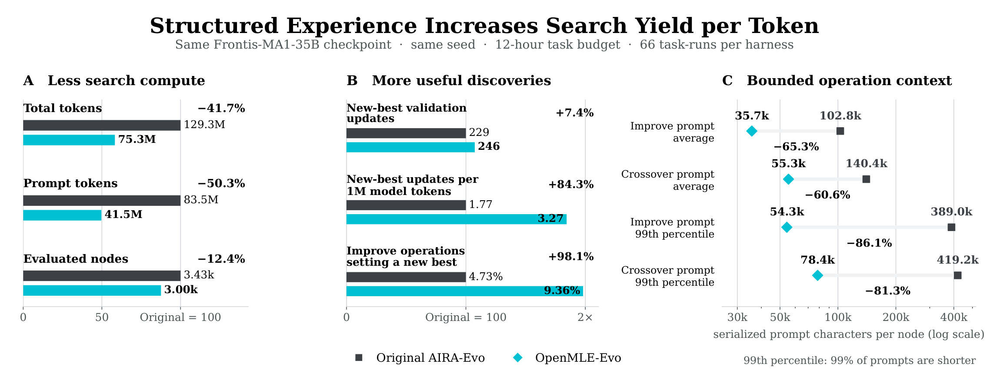

*Source. Frontis-MA1 v1 Fig. 16, PDF Page 25. Left is the resource, medium is the benefit of the trajectories, and right is the length of the context.* [The original diagram and the figure](https://arxiv.org/pdf/2607.28568v1#page=25)

#### What the results establish and how to test alternatives

- **Fixed frame change model.** The main feature is OpenMLE-Evo, which replaces the base with Frontis-MA1-35B, and the Medal Average from 39.39% to 60.61%. This indicator calculates the proportion of any medals that are won in each of the 22 missions, and then averages the three runs. For Evo-Max, 71.21%, it also involves new search configurations and a priori. [Original §6.1 - 6.2 and Table 1](https://arxiv.org/pdf/2607.28568v1#page=17)
- **Fixed model switching framework.** Fig.16 Runs with model checkpoints and corresponding torrents, with a 12-hour maximum, compared to 66 pairs (22 tasks, 3 seeds each). The original AIRA-Evo and OpenMLE-Evo used approximately 129.3M, 75.3M token (M for millions) and the number of new token tests per million token was 1.77 and 3.27 respectively. The number of times in a token "validation scores are historically high" measures the efficiency of the search, and experience, sequencing and hint conditions are changed together. The model and the search budget can be controlled and three times the length of the sorting, closing the reading experience or switching it to no experience. This would allow the verification of the material leading to the benefits of the independent evaluation. [Original §6.5, Fig.16](https://arxiv.org/pdf/2607.28568v1#page=25)

**Put it back in the summary.** Using the MLE test programme and experience as a boundary, it is necessary to find which changes exceed the reference and be accepted, and then indicate how the later search will read and rely on it. Extending the boundary to models and algorithms responsible for training Frontis-MA1 requires additional observations as to whether future generations have been trained or modified. [Overview §5.4.2, Table 1](https://lee1003-lee.github.io/Awesome-RSI-Research/assets/rsi-survey.pdf#page=27)

### 4.3 Further reading: CausalForge and verifiable work in a specialized research task

At the end of the spectrum, a variety of tools are needed. One type of paper first asks which of these rings can be strictly tested. **Lean**, i.e., the instrument of proof of form can be checked in accordance with clear rules. The agent raises the question of writing the natural language proposition as a form title, trying to construct proof, and then exporting the proof and the material for examination. Lean checks whether the proof is valid under the assumptions that have been made.

For example, the original question asked whether a conclusion was established in all cases, but the agent wrote a special case. The tool might have correctly tested the certificate and had to examine which of the questions it had to answer. This would explain why the papers were examined in form and the audit was retained. The purely model review was more widely applied, providing a more solid local basis, and required an expressable repository of tasks and areas. In deciding on subsequent succession, it would be useful to check whether the proven definition, reasoning or failure record actually involved in the next round of studies. [CausalForge v1 Original](https://arxiv.org/abs/2607.22511v1)

### 4.4 Further reading: AREX and multiple research rounds inside a long task

Think of the depth search as "Find an object, which meets three conditions at the same time." One of the answers may be two pieces of evidence, and the third one is not yet known. AREX's inner layer first searches and collects information and exports provisional answers and evidence. The outer layer is bound by a rule and decides to accept, supplement or retrace it in a new direction. The longer the search process, the more difficult it is for the model to read the entire history. **ACU**(Autonomous Text Updating, Autonomous Context Update) converts a long history into proven evidence, exclusions, unresolved conditions and sources, which are then referred to a subsequent search on the same subject.

CrowseComp is a multi-step search assessment. When the report does not open, the accuracy rate after joining the ACU ranges from 59.6 to 71.4 per cent. Both are 82.5 per cent. The extra layer provides further opportunities for retrieval, and the figures should be combined with budget understanding. The author shows how the status of the inheritance phase is being studied within a single issue. If the entire long task is considered a boundary, it is possible to check with the log which progress has been accepted as a starting point for the subsequent study. [AREX v3 §3, §5.3 and Table 3](https://arxiv.org/pdf/2607.21461v3) · [Mission boundary note for Table 1](https://lee1003-lee.github.io/Awesome-RSI-Research/assets/rsi-survey.pdf#page=17)

## What each of the four representative papers establishes

You can check the evidence along the graphs in the table. [RSI Basic Documents §2 –3](../RSI-Foundations.md)

| Main Line | Which product to take? | The evidence is here. |
| --- | --- | --- |
| **Self-Refine (§1.1)** | The current draft enters the revision of the same subject as the point evaluation. See the input output of Fig. 2. | Table 1 and Fig.4 is a partial improvement relative to the current mandate. |
| **DGM (§2.2)** | Fig.1 Distinguishing remediate patches from task patches, Fig.3 Recipe agent becomes an improvementr. | The spectrometry proves that the selected version was taken over. Whether a step is taken to improve the measurement against the evaluation. Fig.2's condensation complete search results. |
| **STaR (§3.1)** | Fig.1 Models to track training output take over the next rotation sample. | The generator does pass on to the rear wheel. Table 1 gives the whole downstream effect, with the smallest RSI in a generation, checking the relative improved evidence of the inherited version. |
| **The AI Scientist (§4.1)** | The results of the Fig.1 experiment were re-programmed into the current thinking and the outer circle drew access to the archives for the evaluation. | The paper recorded the experimental loop. §6 The parallel setting influences feedback from the outer circle, judging the succession of cross-sectional research with actual reading and research of decision-making records. |

**Example:** Both research agents have successfully modified their codes and maintained logbooks. For the second round, the starting formula continued. The first round of changes was found to be effective only in one random seed, using multiple sub-combinants for cross-references, and tested for this improved practice in subsequent experiments. Questions were raised as to what the two records could support. A provides evidence of the first round of operations, followed by what has been validated for improvement. B leaves a record of the evidence entering the next improvement. For the smallest RSI, it is also necessary to check whether multiple sub-controls are accepted as improvements and later used to continue the process of re-engineering. A test of how the two can be followed by comparison with the budget (7). To claim that improvements are accelerating, it is also important to see whether there has been an increase in unit resource returns across rotations. [Overview §3.1 and Fig. 7](https://lee1003-lee.github.io/Awesome-RSI-Research/assets/rsi-survey.pdf#page=20)

## Paper Titles and Sources

[Awesome RSI Research](https://github.com/Lee1003-lee/Awesome-RSI-Research)

### Behavior evolution

- **Self-Refine: Iterative Refinement with Self-Feedback**2023 March, Neurips 2023.[Paper](https://proceedings.neurips.cc/paper_files/paper/2023/hash/91edff07232fb1b55a505a9e9f6c0ff3-Abstract-Conference.html) · [First version](https://arxiv.org/abs/2303.17651v1)
- **Tree of Thoughts: Deliberate Problem Solving with Large Language Models **May 2023, NeurIPS 2023.[Paper](https://proceedings.neurips.cc/paper_files/paper/2023/hash/271db9922b8d1f4dd7aaef84ed5ac703-Abstract-Conference.html) · [First version](https://arxiv.org/abs/2305.10601v1)
- **Voyager: An Open-Ended Embodied Agent with Large Language Models **May 2023, TPLR 2024.[Paper](https://openreview.net/pdf?id=ehfRiF0R3a) · [First version](https://arxiv.org/abs/2305.16291v1)

### Agent-system evolution

- **Darwin Gödel Machine: Open-Ended Evolution of Self-Improving Agents **May 2025, ICLR 2026.[Paper](https://proceedings.iclr.cc/paper_files/paper/2026/hash/aa5f5e6eb6f613ec412f1d948dfa21a5-Abstract-Conference.html) · [First version](https://arxiv.org/abs/2505.22954v1)
- **Hyperagents**(March 2026, a preprint of anrXiv).[Paper](https://arxiv.org/abs/2603.19461v2) · [First version](https://arxiv.org/abs/2603.19461v1) · [Detailed analysis](Hyperagents.md)
- **AFlow: Automating Agentic Workflow Generation**(October 2024, ICLR 2025).[Paper](https://proceedings.iclr.cc/paper_files/paper/2025/hash/5492ecbce4439401798dcd2c90be94cd-Abstract-Conference.html) · [First version](https://arxiv.org/abs/2410.10762v1)
- **Promptbreeder: Self-Referential Self-Improvement via Prompt Evolution **ICML 2024, September 2023.[Paper](https://proceedings.mlr.press/v235/fernando24a.html) · [First version](https://arxiv.org/abs/2309.16797v1)
- **AgentDevel: Reframing Self-Evolving LLM Agents as Release Engineering**(January 2026, a preprint of anrXiv).[Paper](https://arxiv.org/abs/2601.04620)

### Model and data evolution

- **STaR: Bootstrapping Reasoning With Reasoning**(March 2022, NeurIPS 2022)[Paper](https://proceedings.neurips.cc/paper_files/paper/2022/hash/639a9a172c044fbb64175b5fad42e9a5-Abstract-Conference.html) · [First version](https://arxiv.org/abs/2203.14465v1)
- **SkillRL: Evolving Agents via Recursive Skill-Augmented Reinforcement Learning **February 2026, Neurips 2026.[Paper](https://arxiv.org/abs/2602.08234v2) · [First version](https://arxiv.org/abs/2602.08234v1) · [Detailed analysis](SkillRL.md)
- **Mastering the game of Go without human knowledge**(October 2017, Nature).[Paper](https://doi.org/10.1038/nature24270) · [Readable full text](https://discovery.ucl.ac.uk/id/eprint/10045895/1/agz_unformatted_nature.pdf)
- **Meta-Rewarding Language Models: Self-Improving Alignment with LLM-as-a-Meta-Judge **July 2024, EMNLP 2025.[Paper](https://aclanthology.org/2025.emnlp-main.583/) · [First version](https://arxiv.org/abs/2407.19594v1)
- **WebGPT: Browser-assisted question-answering with human feedback**(Arxiv, December 2021).[Paper](https://arxiv.org/abs/2112.09332)

### Research-process evolution

- **The AI Scientist: Towards Fully Automated Open-Ended Scientific Discovery**(ArXiv, August 2024, preprint).[Paper](https://arxiv.org/abs/2408.06292v3) · [First version](https://arxiv.org/abs/2408.06292v1)
- **Frontis-MA1: Training an AI4AI Model towards recursive self-improvement in Machine Learning Engineering**(July 2026, arXiv preprint).[Paper](https://arxiv.org/abs/2607.28568v1)
- **CausalForge: A Formally Grounded, Self-Improving Agentic Framework for Automated Research in Causal Inference**(July 2026, arXiv preprint).[Paper](https://arxiv.org/abs/2607.22511v1) · [v4 Retitled CausalSmith](https://arxiv.org/abs/2607.22511v4)
- **AREX: Towards a Recursively Self-Improving Agent for Deep Research**(July 2026, arXiv preprint).[Paper](https://arxiv.org/abs/2607.21461v3) · [First version](https://arxiv.org/abs/2607.21461v1)
- **Towards end-to-end automation of AI research**(March 2026, Nature).[Paper](https://www.nature.com/articles/s41586-026-10265-5)

### Experimental benchmarks

- **SWE-bench: Can Language Models Resolve Real-World GitHub Issues?**(October 2023, ICLR 2024)[Paper](https://proceedings.iclr.cc/paper_files/paper/2024/hash/edac78c3e300629acfe6cbe9ca88fb84-Abstract-Conference.html) · [First version](https://arxiv.org/abs/2310.06770v1)
- **MLE-bench: Evaluating Machine Learning Agents on Machine Learning Engineering**(October 2024, ICLR 2025).[Paper](https://proceedings.iclr.cc/paper_files/paper/2025/hash/7e3767db483c942b883eb4f8cfb74e31-Abstract-Conference.html) · [First version](https://arxiv.org/abs/2410.07095v1)
- **RSIBench-Data: Benchmarking Data-Centric Research for recursive self-improvement**(July 2026, arXiv preprint).[Paper](https://arxiv.org/abs/2607.25886v1)
