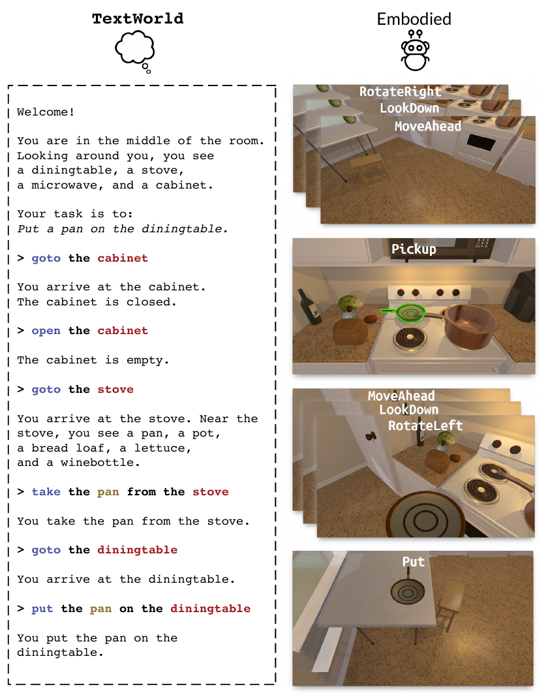
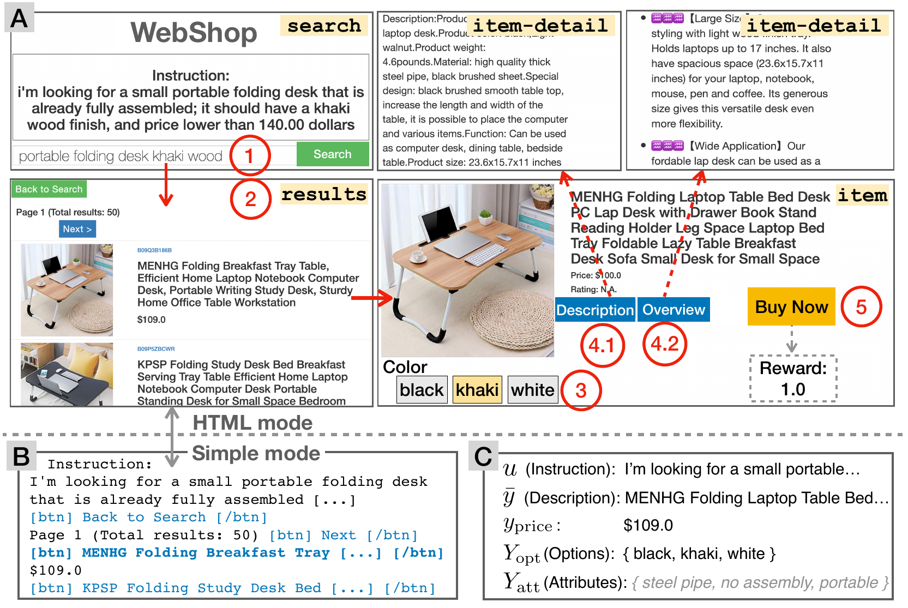
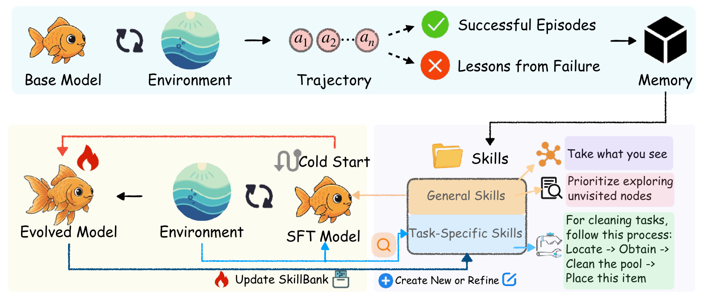
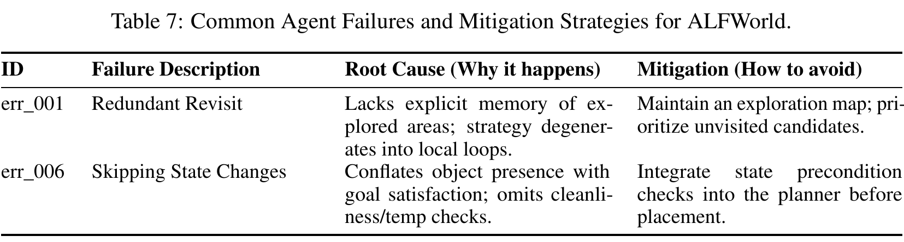
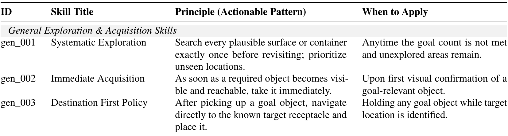
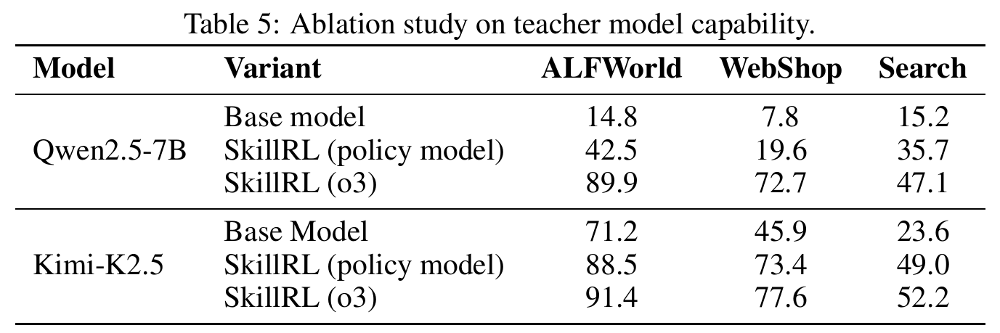

# SkillRL: The Skill Bank and Policy Updates

**SkillRL: Evolving Agents via Recursive Skill-Augmented Reinforcement Learning**. Peng Xia and colleagues, first released in February 2026, NeurIPS 2026. [Paper v2](https://arxiv.org/abs/2602.08234v2) · [Public implementation](https://github.com/aiming-lab/SkillRL)

SkillRL extracts skills with well-defined scope from interaction trajectories, then trains a policy to use those skills when selecting actions. The system updates two persistent objects: the model parameters and an external skill bank. The task interface and training data show how those updates are coupled.

## Research question and related work

A full failure log gives an agent more information, but the agent still needs to identify the useful principles in the log during its next attempt. Even with a summary, a weaker model may struggle to retrieve and apply the right principle in the right state. The authors separate the problem into representing experience, using rules, and updating knowledge.

Paper §1 ,  §3

- [Paper §1](https://arxiv.org/html/2602.08234v2#S1)
- [Paper §3](https://arxiv.org/html/2602.08234v2#S3)

### How SkillRL relates to prior work

The abstraction of experience and the enhancement of tools has been studied before SkillRL, so the motivation of the paper cannot be understood as only the original log memory. ExpeL has taken stock of the natural language experience, Search-R1 has trained multiple rounds of search, GiGPO studies multi-step credit allocation, and MemRL discusses the usefulness of freezing models. SkillRL is characterized by the integration of skills organization, demonstration training, and follow-up updates into the same strategic training system.

Research has explored lessons learned, tools for deployment, and memory utility. SkillRL focuses on how these links work together: extracting skills from implementation experiences, using skills in model training strategies, and continuing to maintain a skills base in the course of training based on failures.

- [ExpeL](https://arxiv.org/abs/2308.10144)
- [Search-R1](https://arxiv.org/abs/2503.09516)
- [GiGPO](https://arxiv.org/abs/2505.10978)
- [MemRL](https://arxiv.org/abs/2601.03192)
- [Paper §5](https://arxiv.org/html/2602.08234v2#S5)

## Tasks, interactions, and data

### A concrete trajectory and a reusable skill

ALFWorld original paper Fig.1 gives a complete view and action of a mission. On the left are text observations and text moves, and on the right are the scenes of the same task. Examples require pots to be placed at the table: the agent first inspects the cabinet and then finds the pot on the stove, picks it up and then leads to the table and drops it. The SkillRL main experiment uses text interaction, so the right-hand scene is used to explain the semantic nature of the mission. The cabinets in the tracks, the stoves and the pot are the specific facts of this implementation; The cross-mission principle may be that the target object is acquired as soon as it appears in observation and is accessible. The principle may still be useful in the next change of position of the object, but the model must be re-explored. This is the division of labour between trajectories information, current status and reusable skills.

In the case of taking apples, a track records the specific location and movement of the event, and an empirical record can compress this information, while skills give operational principles that can be used across examples. The location of the object changes, but the premise is that the object can be reused. The skill here is a text, not a tool that binds the execution process or an option with an independent termination condition in the traditional level of intensive learning.

This is a guide to natural language operations. The implementation model still has to be gradually generated in conjunction with current observations and history, and skills do not contain independent executables.

Based on the paper §2 and §3.1 Example of construction

- [Paper §2](https://arxiv.org/html/2602.08234v2#S2)
- [Paper §3](https://arxiv.org/html/2602.08234v2#S3)



Source: [ALFWorld original paper Fig.1 (text and physical environment)](https://arxiv.org/abs/2010.03768).

### Actions and constraints in the tasks

WebShop original paper Fig.1 Displays search, view results, select colours, check product details and complete interactivity of purchases. The illustrative task requires a portable folding table, which is well equipped, has a specified colour and is lower than budgeted. Models cannot be bought on the basis of a similar title, but also enter the details page to check properties, select the options required and confirm the final price. Simplified text interfaces for agents are also shown below the figure. Back to SkillRL, a short rule such as re-testing after checking the desired properties and options can function on a clear operational node. The ALFWorld rules correspond to the premise of take-over and change of status; The Search QA rules correspond to the breakdown of the query, the portfolio of evidence and the final answer. The interfaces for the three types of tasks are different, but can be repeated and automatically checked.

Why is this idea worth trying on these missions? First, interfaces and rules are sufficiently stable to allow many failures to recur. ALFWorld is running text observations and text actions here. The location of the object needs to be explored, but the operational structure of the six types of tasks is duplicated. WebShop is a simulating shopping site and the goods are authentic, but this does not mean open web page views or real payments. It requires that constraints such as colour, size, price, etc. be met together, and the checklist may be useful. The public packagings map the full success to ten, otherwise zero, and some matches are counted separately only. Search responded by searching and publicly defaulting to compare the normalized answer with the answer alias, without directly proving the correct use of the evidence. All three facilitate extensive interaction and automatic scoring, which makes it feasible to combine outcome RL and short rule reuse. The list of candidate actions is only a hint and should not be understood as a decoder to ensure that all outputs are legal.

The interfaces and rules of these environments are relatively stable, and tasks can be sampled again, and the results can be checked automatically. Therefore, operational prerequisites, checklists, and search strategies can be repeated.

Paper §4 ; open environment packagings; ALFWorld / WebShop official project

- [Paper §4](https://arxiv.org/html/2602.08234v2#S4)
- [ALFWorld Project](https://alfworld.github.io/)
- [WebShop Project](https://webshop-pnlp.github.io/)
- [Source envs.py](https://github.com/aiming-lab/SkillRL/blob/4d984d455b9b02f0bad283cbe9ab3d66a7e5b89d/agent_system/environments/env_package/webshop/envs.py)
- [Sourcetils.py](https://github.com/aiming-lab/SkillRL/blob/4d984d455b9b02f0bad283cbe9ab3d66a7e5b89d/agent_system/environments/env_package/search/third_party/skyrl_gym/envs/search/utils.py)



Source: [WebShop original paper Fig.1 (Shopping interactive process)](https://arxiv.org/abs/2207.01206).

### Data organization and training examples

The most easy reading here is the sample unit. One 15-step track of success can be turned into a 15-step monitoring sample, so more than 7,000 SFT data cannot be interpreted directly as 7,000 stand-alone missions. A total of 11,253 open data cards have been gradually trained. The appendix gives about 7,500 and 2,400 copies that are slightly different from the current number of releases and require the retention of a version of the calibre. RL is another layer of data: the strategy generates multiple tracks of the same task online in the environment. Search The main text uses NQ and HotpotQA as RL training sources, while the remaining five data sets are extraterritorial. However, the open SFT data card lists seven sources simultaneously, so the extraterritorial focus here is primarily on RL training sources. In the absence of a sample-by-species list, we can neither claim to be complete process zero nor identify test leaks on this basis. Trained scripts train_data_size=16 are parallel rollout sizes, not 16 in the entire task set.

The total number of SFT data is 11,253 in which you enter the output in step by step, and a long track produces several samples. This amount is not equal to the number of independent tasks, and the attachments are slightly different from the current number of releases.

Appendix D.1; SkillRL-SFT-Data data card; open training script

- [Appendix D.1](https://arxiv.org/html/2602.08234v2#A4.SS1)
- [Datacard SkillRL-SFT-Data](https://huggingface.co/datasets/Jianwen/SkillRL-SFT-Data)
- [Source run_alfworld_kills.sh](https://github.com/aiming-lab/SkillRL/blob/4d984d455b9b02f0bad283cbe9ab3d66a7e5b89d/examples/grpo_trainer/run_alfworld_skills.sh)

## Building and querying SkillBank

### The SkillRL training pipeline

The first, which interacts with the environment as a basic strategy, the success track, is also a reservable model, the failure track is reduced to experience, and teachers further refine their skills. The second, the stratification SkillBank, together with mission-specific principles, is in the context of implementation. The third, which is fine-tuned by supervision under skill conditions, starts to enhance learning. The teacher ' s knowledge base is supplemented by the failure of periodic checks during intensive learning. There are two entirely different updates in the graph: the GRPO update strategy parameters, and the teacher calls the external text. The next round of rollout coupling, but the teacher and searcher do not accept the GRPO gradient together.

The basic model first collects success and failure tracks in the environment, and the teacher synthesifies the experience into a stratification of skills. It then builds implementation starting points through SFTs under skill conditions, then uses the GRPO training strategy. During the training, the system ' s cyclical analysis fails and the skills are supplemented to update the strategy and skills pool.

Fig. 2

- [Paper §3](https://arxiv.org/html/2602.08234v2#S3)




*The source is SkillRL Fig. 2.* [Original paper](https://arxiv.org/html/2602.08234v2#S3)

### Generating the initial skills

The text provides an abstract version of this process as an empirical distillation technique, but the open code actually has an intermediate memory. Generate scripts to read task_meta, refined_trajectory and strategic_guidelines instead of importing all original logs without capping. The project will first clear the tracks, then extract the planning model and the lessons of failure, and eventually merge across tracks. The ALFWorld category is determined by the process of mission keywords and manual definition, and the reminder also provides for approximately eight to twelve generic skills, about four to six for each type of mission skills, and one or two sentences for each principle. The function draws a maximum of 10 modes, each looking at the first five actions and reasons, with a further sampling limit. In doing so, they control teacher costs and reduce duplication of output, but they lose input information. We can't assume that all scripts are used for the same group of publishing experiments.

A teacher’s a priori knowledge may also be involved in content formation, so that empirical information and teacher’s knowledge together influence the quality of initial skills.

Open code skill_development/alfworld.py; SFT Data Generation Directory

- [Source alfworld.py](https://github.com/aiming-lab/SkillRL/blob/4d984d455b9b02f0bad283cbe9ab3d66a7e5b89d/skill_generation/alfworld.py)
- [Source_morary_alfworld.py](https://github.com/aiming-lab/SkillRL/blob/4d984d455b9b02f0bad283cbe9ab3d66a7e5b89d/examples/sft_data_generation/skill_memory/generate_memory_alfworld.py)
- [Source aggregate_kills.py](https://github.com/aiming-lab/SkillRL/blob/4d984d455b9b02f0bad283cbe9ab3d66a7e5b89d/examples/sft_data_generation/skill_memory/aggregate_skills.py)
Specific examples of heating tasks illustrate abstract objects: retaining the premise of target first to electrical use from a success trajectory, summing up errors such as missing state checks from a failure trajectory, repeated explorations, etc., and combining the patterns that appear several times into short rules. Examples are used only to explain the particle size of data processing.

### Failure causes and corrective rules

The appendix to the paper summarizes the common errors in a failure pattern. The first category is repeated visits: the model does not effectively maintain the location that has already been explored and thus returns to the same region. The corresponding recommendation is to document the scope of exploration and to prioritize the selection of unvisited locations. The second category is skip-state change: when the model sees that the target object has appeared, it mistook it as having fulfilled the mission, missing cleaning or temperature conditions. Therefore, the target status is checked before the final placement. Appendix Table 7 shows how skills complement operational prerequisites. However, the reasons in the table remain the interpretation of the trajectory. To confirm that an action is a cause of failure, the action needs to be modified and the results compared in the same environment. Reasonable attributions on the text and verification of interventions in the environment vary in intensity of evidence.

The references emphasize inverse causality, which is indeed something to be noticed when reading methods. For the ultimate goal, teachers can reverse what is necessary to remove a lot of unexplored explorations. But the causes and consequences here are mainly the interpretation of trajectories by language models. The code does not suggest that every counterfactual suggestion is changed in the environment, that the follow-up process is repeated and that success is confirmed.

This analysis can provide useful assumptions for correcting errors, but the text interpretation is not sufficient to establish a strict causal link. To determine whether an action is root causes, a comparison is needed of whether the result of the task has changed as a result of the modification.

Paper §3.1; public Memory prompt with SkillUpdater

- [Paper §3](https://arxiv.org/html/2602.08234v2#S3)
- [Source skill_updater.py](https://github.com/aiming-lab/SkillRL/blob/4d984d455b9b02f0bad283cbe9ab3d66a7e5b89d/agent_system/memory/skill_updater.py)



Source: [SkillRL Appendix E Table 7 (ALFWorld Failed Classification)](https://arxiv.org/html/2602.08234v2).

### Examples from SkillBank

Here is a direct look at the three real rules provided by the SkyllRL appendix. The first requires systematic exploration: each reasonable location is examined first and priority is given to the exploration of unobserved areas. Article II calls for immediate access and requires that the target object be picked up as soon as it appears in observation and can be picked up. Article 3 gives priority to the target position and directs it to and places it when the target is held and the receiving location is known. Note that each line has separate principles and applicable conditions, so the model needs to understand what to do and when to do it. This can be seen in the text mandate as the current observation of the existence of a target. When_to_apply has not become a mandatory condition in the proceedings, the model may still be misjudged or at the same time accept the non-applicable rule. Thus, skills structure makes the rules easier to organize but does not automatically guarantee that each step is correctly implemented.

Each skill consists of a title, a principle and a condition for application, usually with one or two sentences. The stratum is designed to allow common strategies to emerge in conjunction with category processes, such as generic progressive decomposition and heating tasks with objects before electrical appliances. When_to_apply appears to be a program condition, but in this process it is only a natural language description, and the model may still be misused. There is also a statistical detail: ALFWorld JSON is the first 12 generic, 32 missions, 11 false reminders, totalling 55 articles. The text of 12 articles in general and 43 tasks in particular may combine false reminders with the latter. The same volume does not prove that the two classifications are fully consistent, and a specific document is required at the time of recovery.

SkillBank combines generic strategies, task flow and error alerts. The ALFWorld Library has 12 generic, 32 task skills and 11 error reminders, 55 of them. The main text reports 12 common tasks with 43 mission skills, and the classification caliber still needs to be further aligned.

dissertations §3.2; public ALFWorld skills

- [Paper §3.2](https://arxiv.org/html/2602.08234v2#S3.2)
- [Source claude_style_kills.json](https://github.com/aiming-lab/SkillRL/blob/4d984d455b9b02f0bad283cbe9ab3d66a7e5b89d/memory_data/alfworld/claude_style_skills.json)



Source: [SkillRL Appendix E Table 6 (first three general skills)](https://arxiv.org/html/2602.08234v2).

### Skill retrieval and prompt construction

The text reads mission embedding similarities plus thresholds and Top-K, which makes it easy to think that each step is semantic. The default template path is checked to define the task category using keywords and to combine generic skills, mission skills and bug alerts. All dyn_new skills will also be prioritized into the general block, and the actual return may exceed top_k if the number of dynamic bars exceeds six. The category mission skills are taken by default, so that six does not amount to only six items in the overall context. the repository does also provide embedding mode, the default model being Qwen3-Embedding-0.6B, but it does not receive the current GRPO reward training. Skills are cached when reset, and it cannot be said that the system will retrace each step of the system to its new state. These differences affect the length of the reminder, the exposure of the rules and the outcome of the recurrence.

Publicly achieves also provides embedding mode. By default, Top-K does not equal the total number of skills, nor does it retrace skills at every step of the day to the latest observations.

Paper §3.2 ; skills_only_memory.py; env_manager.py

- [Paper §3.2](https://arxiv.org/html/2602.08234v2#S3.2)
- [Source skills_only_memory.py](https://github.com/aiming-lab/SkillRL/blob/4d984d455b9b02f0bad283cbe9ab3d66a7e5b89d/agent_system/memory/skills_only_memory.py)
- [Source env_manager.py](https://github.com/aiming-lab/SkillRL/blob/4d984d455b9b02f0bad283cbe9ab3d66a7e5b89d/agent_system/environments/env_manager.py)
A specific search can start with "Heat the egg and put on the table." The default template path first identifies the header category based on the task text, then combines generic skills, heat task skills, and bug alarms. Once the search is done, the policy still has to decide whether to look for, pick up, heat or place it at the moment.

### How skills condition a single action

When the context of the operation unfolds, the model remains a conditional language decision: to read tasks, observations, history and rules, and then to output reasoning and actions. The rules know that objects should be acquired first, but do not know where the current object is, which requires current observation and exploration of history. The corresponding engineering question is whether the hint at the time of training is consistent with the linerollout. Public defaults that the SFT process saves a history length of five, that part of the RL is configured to two, and that the first history template may not be skilled. We do not describe these configuration differences as proven causes of performance, but we need to record them, otherwise the same Skillbank will function differently in different contexts.

Open Environment reminder template; papers §3.3

- [Paper §3.3](https://arxiv.org/html/2602.08234v2#S3.3)
- [Source env_manager.py](https://github.com/aiming-lab/SkillRL/blob/4d984d455b9b02f0bad283cbe9ab3d66a7e5b89d/agent_system/environments/env_manager.py)
- [Sourcedistill_alfworld.py](https://github.com/aiming-lab/SkillRL/blob/4d984d455b9b02f0bad283cbe9ab3d66a7e5b89d/examples/sft_data_generation/distillation/distill_alfworld.py)

Use $`h_t`$ as at $`t`$ The interactive history of the steps. $`d`$ This post is part of our special coverage Syria Elections 2011. $`S_g`$ It's a common skill. $`S_{\mathrm{ret}}`$ is the mission skills that are retrieved. $`\pi_\theta`$ Generate an action from the given context $`a_t`$ .

```math
a_t\sim\pi_\theta(\cdot\mid h_t,d,S_g,S_{\mathrm{ret}}).
```

## Skill-conditioned policy training

### How SFT links skills and actions

This is the engineering link that I think is most worthwhile. One specific approach to open distillation scripts is to obtain a sequence of successful actions in the real environment before teachers add one to three reasons for each given action. Teachers read complete tracks and related skills at once, and movement labels mainly maintain a record of success, rather than being completely free to generate the whole new track. Such supervision can easily link rules and correct actions: why should they be taken at this time, rather than going first to electrical appliances? Each step is followed by an instruction-output training, and a long trajectory contributes multiple samples. It also allows weak models to master movement formats and basic success behaviours before RLs, avoiding a lack of distinction between relative rewards when all of the group failures occur. These reasons, however, are first and foremost ex post facto and do not automatically refer to writing skills as real causes and consequences. SFT is removed from SFT while multiple controls are removed, so the latter can only be said to be important and cannot be attributed to “reading skills”.

SFT also provides a demonstration of success, formatting, and skills use. The removal of SFTs removes these factors simultaneously, so that the full benefit cannot be attributed to model learning to read.

Appendix C.3; disSIll_alfworld.py; sharegpt_to_pairs.py

- [Appendix 3.SS3](https://arxiv.org/html/2602.08234v2#A3.SS3)
- [Sourcedistill_alfworld.py](https://github.com/aiming-lab/SkillRL/blob/4d984d455b9b02f0bad283cbe9ab3d66a7e5b89d/examples/sft_data_generation/distillation/distill_alfworld.py)
- [Source sharept_to_pairs.py](https://github.com/aiming-lab/SkillRL/blob/4d984d455b9b02f0bad283cbe9ab3d66a7e5b89d/examples/sft_data_generation/postprocess/sharegpt_to_pairs.py)

### Training the model to stop on successful trajectories

Synthetic Done is constructed as a clear sample of end-of-supervision. Assuming that the success trajectory has completed the final placement action, the data construction script will be supplemented with a training pair that allows the model to see the post-mission status and select the donee in the candidate action. Codes are mixed with other candidate actions and randomly placed doe in order to stop the demonstration target in time for completion. This sample structure can be illustrated by the case of heating eggs. The relevant public script annotated annotated part of the reprocessing logic is reconstructed by the release of data, and therefore it is not necessarily the only formula for publishing experiments. WebShop also deals with the regularization of actions, navigation, observations and candidates. We can learn from these data engineering ideas, but text input output is consistent and requires environment replay to further confirm action enforceability.

There are also data engineering that is easily omitted from the body of the paper. The ALFWorld script will construct a dee sample after a successful trajectory, randomly insert up to nine other candidate actions, and the training model will judge that it should stop. The notes to the relevant script explain that part of the logic is re-structured in reverse by the release data, which cannot be considered to be the exact formulation of the original training operation. WebShop reprocessing will also regulate movements, supplemental navigation, alignment observations and candidates, sometimes adding target actions to the pool of candidates. This improves consistency in text training, but does not amount to amendments that are re-validated through the real environment. The independent benefits of these treatments still need to be measured through mitigation. The SFT study rate in the appendix is 10 negative four-round, battling 16 and three rounds.

These processes bring samples closer to actual interactive formats and train models to stop in a timely manner. Some public reprocessing logic is reconfigured by releasing data and cannot be considered directly as the only formula for publishing experiments.

Public SFT reprocessing; Appendix D.1

- [Appendix D.1](https://arxiv.org/html/2602.08234v2#A4.SS1)
- [Source ](https://github.com/aiming-lab/SkillRL/blob/4d984d455b9b02f0bad283cbe9ab3d66a7e5b89d/examples/sft_data_generation/)

### Skill-conditioned GRPO training

A simulated group illustrates GRPO. Sample eight trajectories for the same task and label success as 1 and failure as 0. Successful trajectories have better relative outcomes within the group, which GRPO uses to train the policy to produce the corresponding behaviors more often. Actual training includes multi-step rollouts, a KL term, and a format penalty. If all eight outcomes are identical, the task reward alone does not distinguish the trajectories. SFT gives the agent a stronger initial policy, and skill text changes exploration through the context. Both may help the policy encounter success sooner. GRPO updates the execution model. The teacher writes skills and the retriever selects skills, and neither is directly differentiated through the same objective.

RL starts from the SFT parameters. It samples eight trajectories on the same task, computes advantages from differences within the group, and increases the likelihood of successful behavior. For example, with outcomes of one, zero, zero, and one, the two successes have higher relative advantage. When all eight fail, outcome-based relative advantage cannot distinguish them, although the format penalty and KL term can still give a signal. Skill context and SFT may help the policy find successful trajectories earlier, but the paper does not independently test every causal link. The teacher generates skill text, the retriever selects inputs, and the frozen SFT reference constrains KL drift. The execution model is the policy updated by GRPO.

Paper §3.3; open GRPO training and advantage calculation

- [Paper §3.3](https://arxiv.org/html/2602.08234v2#S3.3)
- [source_algos.py](https://github.com/aiming-lab/SkillRL/blob/4d984d455b9b02f0bad283cbe9ab3d66a7e5b89d/verl/trainer/ppo/core_algos.py)
- [Source run_alfworld_kills.sh](https://github.com/aiming-lab/SkillRL/blob/4d984d455b9b02f0bad283cbe9ab3d66a7e5b89d/examples/grpo_trainer/run_alfworld_skills.sh)

### RL rewards and interaction setup

The method also depends on its interaction protocol. The environment provides candidate actions. The model responds with think and action tags, and its response is checked for format before submission. The paper specifies a 0.1 invalid-action penalty and a 0.01 KL term. Invalid-action checks are not a complete check of environment preconditions. The ALFWorld projection examined here primarily checks tags and output form and does not enforce all membership checks on candidate actions. Step limits, history truncation, and response length affect whether the model gets a chance to finish. A reproduction should save these settings with the data version. Isolate each setting through controlled experiments to estimate its effect.

The final reward for success indicates whether the task has been completed, but it is not possible to indicate directly which steps have led to the failure. Formatting punishments, KL constraints, historical cut-offs and step caps collectively affect the training process. The papers do not absorb these configurations item by item, so that a configuration cannot be directly matched to specific performance gains.

Appendix D.1; Open Environment Project and Start Script

- [Appendix D.1](https://arxiv.org/html/2602.08234v2#A4.SS1)
- [Source run_alfworld_kills.sh](https://github.com/aiming-lab/SkillRL/blob/4d984d455b9b02f0bad283cbe9ab3d66a7e5b89d/examples/grpo_trainer/run_alfworld_skills.sh)
- [Source run_webshop_kills.sh](https://github.com/aiming-lab/SkillRL/blob/4d984d455b9b02f0bad283cbe9ab3d66a7e5b89d/examples/grpo_trainer/run_webshop_skills.sh)
- [Source ](https://github.com/aiming-lab/SkillRL/blob/4d984d455b9b02f0bad283cbe9ab3d66a7e5b89d/agent_system/environments/)

## Recursive skill-bank updates

### Recursive skill updates during training

Recursive updates do not call teachers immediately every time they fail. The paper set a five-step validation, with category success rates below 0:04 failing, with a maximum of three entries at each time to control cost and knowledge base inflation. The public default path is simpler: failure collection does not strictly select only the lower categories; The teacher really sees the first five failures, each last five steps, with a maximum of 200 characters per observation. For a long-term mission, root causes may have taken place as early as the third step, with only repeated failures at the end. Teachers receive old skills titles that reduce surface duplication but do not see complete semantic conflict checks. New entries are mainly added to common skills and are not article-by-article location of old rules, editing and environmental validation. The conclusion here is limited to a snapshot of the code examined and cannot be based on the assertion that the publication of the experiment was not otherwise realized. It reminds us that we must recreate a fixed version, configuration and update path.

Failed analysis and the number of new articles are limited to control teacher costs and the length of context. The default code checked is mostly additional, and the old rules are not yet located, amended, and validated by the utility of the article.

Paper §3.3, appendix D.1; skill_updater.py; ray_training.py

- [Paper §3.3](https://arxiv.org/html/2602.08234v2#S3.3)
- [Appendix D.1](https://arxiv.org/html/2602.08234v2#A4.SS1)
- [Source skill_updater.py](https://github.com/aiming-lab/SkillRL/blob/4d984d455b9b02f0bad283cbe9ab3d66a7e5b89d/agent_system/memory/skill_updater.py)
- [Source ray_traininger.py](https://github.com/aiming-lab/SkillRL/blob/4d984d455b9b02f0bad283cbe9ab3d66a7e5b89d/verl/trainer/ppo/ray_trainer.py)

### How dynamic updates are stored and retrieved

It's an engineering page. Dynamic skills are added at the end of the list, and if the search is always for the first six articles, the update has occurred but the strategy has never been read. The code therefore gives priority to the dyn_ entry and also needs to maintain a unique ID and cache status. These seemingly ordinary storage logics determine whether the closed ring really closes. On the other hand, priority exposure changes the frequency with which static skills emerge and increases the context when more dynamic skills are available, with effects that are not entirely derived from the new knowledge itself. Codes also provide scripts that have failed to be updated using training. When defaulting to use certification failures to guide training, parameters may still absorb these feedbacks even if new skills are not directly injected into the certification environment, hence the importance of an independent final test set. This discussion of evaluation design does not amount to an allegation of test contamination in the paper.

SkillsOnlyMemory; SkillUpdater; training update start-up script

- [Source skills_only_memory.py](https://github.com/aiming-lab/SkillRL/blob/4d984d455b9b02f0bad283cbe9ab3d66a7e5b89d/agent_system/memory/skills_only_memory.py)
- [Source skill_updater.py](https://github.com/aiming-lab/SkillRL/blob/4d984d455b9b02f0bad283cbe9ab3d66a7e5b89d/agent_system/memory/skill_updater.py)
- [Source run_alfworld_kills_training_update.sh](https://github.com/aiming-lab/SkillRL/blob/4d984d455b9b02f0bad283cbe9ab3d66a7e5b89d/examples/grpo_trainer/run_alfworld_skills_train_update.sh)
The example of the Article 7 rule is a hypothetical scenario: new entries will not be exposed if only the first six items of the original list are always intercepted. The current default realization has been addressed by giving priority to dyn_ entries and may be returned in all cases when more dynamic entries than top_k. It explains the importance of the cache and exposure, not the claim that the default realization still missing all dynamic skills.

### An ALFWorld execution case

A track of actual implementation was documented. The task is to heat the eggs and put them on the table. The first step in the reasoning was to quote the generic rules for decomposition and heating tasks, with particular emphasis on not having to go to microwaves first, but to find and obtain specific targets first. At the latter step, the model refers to the rules for the placement of heated objects and implements the placement. In these cases, skills provide operational constraints for timely language decisions. That explains what Skill-conventioned SFT wants to teach. But this is still a qualitative case chosen by the authors, and writing skill numbers does not guarantee that the model really relies on the rules. To identify causal effects, control experiments that remove, replace or disrupt skills in the same state are required and cannot be viewed simply as beautiful reading.

The case shows how the rules appear between reasoning and action. Whether the rules actually improve decision-making, they also need to be compared with removal or replacement skills in the same state.

Fig.

- [Paper §4](https://arxiv.org/html/2602.08234v2#S4)
- [Paper §4 .F6](https://arxiv.org/html/2602.08234v2#S4.F6)

## Experiments and the limits of the evidence

### Main results on ALFWorld and WebShop

Get into the experiment. The comparison mission success rate is harmonized in the figure, which is expressed as a percentage. The base Qwen at ALFWorld and WebShop were only 14:8 and 7:8 respectively, and GRPO had raised them to 77:6 and 66:1. SkillRL further reached 89.9 and 72.7, an increase of 12.3 and 6.6 percentage points over GRPO. Note that this is a percentage point, not a relative increase of 12.3 percent. WebShop also reported partial matches between Scorre, GRPO for 79:30, and SkillRL for 85:22, which is not the same indicator as the strict success rate. The results of both environments support the effectiveness of the portfolio, and components are attributed to the need to check which one Skyl or which engineering techniques have contributed independently. The comparison is for task training systems listed in the papers and cannot be extrapolated to rank generic model capabilities.

GRPO has significantly improved the success rate of the basic model. SkillRL has built on it by a further 12.3 and 6.6 percentage points, indicating that the skill training package is effective in both environments.

Paper Table 1 . Mission success rate (%), as high as possible

- [Paper §4 .T1](https://arxiv.org/html/2602.08234v2#S4.T1)
Two differences in the figure are percentage points: 89.9-77.6 = 12.3, 72.7-66.1 = 6.6. They are differences in the overall system of SkillRL relative to GRPO and cannot be interpreted as a dynamic update of the contribution of this separate component.

### Results by ALFWorld task type

The breakdown of tasks explains the overall upswing. Cool, Pick2 and Heat have a larger gain, involving state change, successive premise, or multiple goal management. Clean has nearly 90%, and the added gain is small. This is compatible with the operational principles that facilitate multi-phase planning mechanisms, but only results models, which cannot be justified by relevance alone. And avoid reporting only good categories: Loook from sixty-six a.m. to seventy-four, the increase is limited, and RLO of the paper is higher than SkillRL at seventy-eight two. So it is appropriate to state the best overall, part of the complex tasks, rather than each.

Cool, Pick2, Heat has increased 23.0, 22.8, 15.3 percentage points compared to GRPO, and Clean has only increased 0.7. This is consistent with the interpretation of skill-help state conversion or multi-object management, but the difference in results does not prove the causal mechanism.

Paper Table 1 Success Rates by Mission (%)

- [Paper §4 .T1](https://arxiv.org/html/2602.08234v2#S4.T1)
Cool and Pick2 are 23.0 and 22.8 percentage points, respectively.

### Ablation studies and component roles

Table 3 compares its contribution by removing components. (a) The removal of Skill Library, where the skills are actually replaced by the original trajectory, and not by any context; The tiered approach is primarily to retain mission skills. The maximum reduction occurs in the replacement and removal of SFTs in the original trajectory, indicating the importance of abstract indications and monitoring starting points throughout the system. The fixed skills bank remains at 84.4 and 73.3, while dynamic renewal results in an additional 5.05 and 2.4 percentage points. It can be inferred that dynamic renewal has additional benefits, but most of the system ' s competencies are not acquired solely through additional skills in training. Each line removes a factor from the presence of other components, which may interact with each other, so the reduction cannot be added. SFT also brings with it a successful demonstration, format and teacher rationale, and the trajectories change length and expression, so that there is currently no net contribution of a purely Skill-Specific reading or of each skill.

The original trajectory replaces the skills bank and removes the SFT. The fixed skills bank still has a success rate of 84.4 / 70.3 and the dynamic update increases by 5.5 / 2.4 percentage points. Lines are removal experiments when the rest of the components exist, and the decline is not comparable.

Paper Table 3 . Success rate (%); pp percentage point

- [Paper §4.T3](https://arxiv.org/html/2602.08234v2#S4.T3)
The full version is increased by 5.5/2.4 percentage points relative to the fixed skill bank. The difference is that a factor is removed when the other components are present, and the decline cannot be added.

### The skill generator and base-model capability

Appendix D.3 is useful for “where exactly the proceeds come from”. Weak Qwen does produce skills better than basic models, but there is still a significant gap with the system of o3 participation. For a stronger Kimi, the self-generated version is close to version o3. The author calls the competency threshold a reasonable explanation that abstract experience requires sufficient mission understanding, while teachers provide knowledge or a higher quality of organization that is otherwise lacking in implementation strategies. Therefore, the entire set of benefits cannot be classified as fully autonomous self-evolution. Nor should it be overexplained: cross-models change capacity, capacity and training conditions at the same time, self-generated comparisons are not simply a reminder of where the threshold has not yet been quantified. More importantly, Kimi contrasts with the second version of the additional evidence and cannot add to the subsequent results to prove that the author knew that the project had been successful when it was first set up.

Qwen ' s self-generated skills are significantly less effective than o3, and Kimi ' s self generation version is closer to o3. The results indicate that experience relies in abstracto on model capabilities and suggests that external teachers are important sources of information.

v2 Appendix D.3 Table 5 (%)

- [Appendix D.3](https://arxiv.org/html/2602.08234v2#A4.SS3)
- [Paper](https://arxiv.org/html/2602.08234v1)
Weak Qwen 's self-generated gap with o3 is clear, while the stronger Kimi 's gap is smaller. Results are compatible with the abstraction of experience that requires an explanation of sufficient modelling capacity, but do not quantify a uniform capability threshold.




*The source is the SkillRL appendix Table 5.* [Original paper](https://arxiv.org/pdf/2602.08234v2#page=19)

### Search QA results by dataset

The search results are viewed by data set. NQ Q & Q Q, PopQA focused on entity prevalence and end facts, HotpotQA, 2Wiki, MuSiQue and Bamboogle put more emphasis on multiple pieces of evidence or breakdown of problems. The largest difference comes from Bamboogle, SkillRL 19:4 percentage points higher than EvolveR, but TriviaQA is flat, and 2 Wiki is 1.7 percentage points lower. It cannot be claimed that all extraterritorial mandates have steadily increased. There is also a detail on transparency: the paper report SkillRL averaged 47:1, but the seven direct arithmeticals in the table averaged about 47:55. At present, there is no indication of the differences in aggregations, thus retaining the average of the results and the author ' s report. In conjunction with SFT data sources, general conclusions should be limited to the training and evaluation calibre of the paper.

SkillRL increased by 19.4 percentage points compared to EvolveR in Bamboogle, and TriviaQA remained largely flat, with 2 Wiki slightly lower. The benefits varied according to the type of problem. The paper reported Avg. 47.1, but seven direct arithmetic averages approximately 47.5 and the polymer caliber have not been specified.

Paper Table 2 • Answer evaluation score (%); author report Avg. 43.1 / 47.1

- [Paper §4 .T2](https://arxiv.org/html/2602.08234v2#S4.T2)
- [Datacard SkillRL-SFT-Data](https://huggingface.co/datasets/Jianwen/SkillRL-SFT-Data)
Bamboogle gains are clear, TriviaQA is largely flat, and 2 Wiki is slightly lower, indicating that the benefits from different sources of problems are not uniform. Extra-territorial labels and the author’s average scores are still interpreted in terms of the above-mentioned qualification.

### Skill-bank size over training

The authors show two dynamic processes. The skills bank has grown from 55 to 100 and the dynamic version of the right has exceeded 80% by about 60 steps, earlier than the static version. But the increase does not directly demonstrate the higher quality of average skills, and the papers lack systematic statistics on utility, redundancy, and conflict. The open default path is mainly added to the general, which does not fully correspond to the detailed calibre growth in the classification in the chart, and may involve changes in versions or configurations.

The dynamic version has a higher validation success rate earlier, and support for updating helps the training process. The increase in the number of skills does not directly indicate that each rule is useful, nor does the reduction in training steps equal to a reduction in the total cost per year, but it also requires statistics on the costs of teacher deployment, updating and environmental interaction.

Papers Fig. 3, Fig. 5

- [Paper §4 .F3](https://arxiv.org/html/2602.08234v2#S4.F3)
- [Paper §4.F5](https://arxiv.org/html/2602.08234v2#S4.F5)
- [Source ray_traininger.py](https://github.com/aiming-lab/SkillRL/blob/4d984d455b9b02f0bad283cbe9ab3d66a7e5b89d/verl/trainer/ppo/ray_trainer.py)

## Reproduction conditions and follow-up research

### Training setup and compute resources

The author uses eight 80 Gs of H100, the full experiment of which is about 30 hours of wall clocks, of which RL is about 24 hours. It cannot be described as 30 GPU hours, nor can it be said that any recovery requires eight cards. SFT has two levels of learning difference from RL, while RL batt 64 also involves parallelization and accumulation. The number of cards, sequence length and default patterns in open scripts are not fully consistent, and the Search example is implicitly evaluated only before training. To restore values, it also requires actual operation configurations, data versions and skill snapshots.

The author reports approximately 30 hours of wall clocks per group of experiments, of which RL is about 24 hours. This number cannot be interpreted as 30 GPU hours, nor does it represent a minimum recovery resource. Public startup orders vary in number, length, and mode, and actual recovery requires a full operation configuration.

Appendix D.1; public examples start scripts

- [Appendix D.1](https://arxiv.org/html/2602.08234v2#A4.SS1)
- [Source ](https://github.com/aiming-lab/SkillRL/blob/4d984d455b9b02f0bad283cbe9ab3d66a7e5b89d/examples/grpo_trainer/)

### Search datasets and generalization

The term extraterritorially should be explicitly referred to. The paper identified other data sources as extraterritorial, based on NQ and HotpotQA trained by RL, which is a valid definition. But if we are to further claim that we have never seen these sources in skill generation or SFT, we need complete data spectrometry. The current data card description includes seven sources, and corresponding records are not yet available for a sample-by-sample to skills, demonstration and final testing. The same source of data does not amount to an overlap of titles, and therefore leakage cannot be considered as such. Another limitation is that all seven pools use similar search interfaces, and that trans-data-set generalization is narrower than a cross-tool, cross-new web environment. The final evaluation will also depend on search materials, return paragraphs, search wheels, answer aliases and the rules for the standardization of texts.

The extra-territorial labels in this paper refer to the RL training sources of NQ, HotpotQA. The public SFT data card lists all seven sources, and the zero sample conclusions of the complete process are recorded by sample source. The same source does not represent an overlap of test questions.

Papers Table 2; original papers by data set; public SFT data card

- [Paper §4 .T2](https://arxiv.org/html/2602.08234v2#S4.T2)
- [Datacard SkillRL-SFT-Data](https://huggingface.co/datasets/Jianwen/SkillRL-SFT-Data)
- [research.google](https://research.google/pubs/natural-questions-a-benchmark-for-question-answering-research/)
- [aclanthology.org](https://aclanthology.org/P17-1147/)
- [Paper](https://arxiv.org/abs/2212.10511)
- [Paper](https://arxiv.org/abs/1809.09600)
- [Paper](https://arxiv.org/abs/2108.00573)

### Compressing experience and measuring prompt length

The paper says that the abstract of the experience is ten to twenty times compressed, referring to the empirical footage. The complete reminder is also mission, observation, history, and formatting, so the complete picture is from about 1450 to less than 1,300, and the author reports an average reduction of 10.3%. It is not a 10- to 20-fold reduction in the overall reasoning costs, let alone a reduction in the total cost of the system. When comparing different systems, it is important to list the number of times each model is called, actually token and interacted with the environment.

Empirical snippets, complete tips, and measurements of the system as a whole vary. The compression of the snippet cannot be interpreted directly as an end-to-end reasoning or a reduction in training costs by 10-20 times.

Thesis Fig. 4 and Context Efficiency analysis

- [Paper §4.F4](https://arxiv.org/html/2602.08234v2#S4.F4)
- [Paper §4](https://arxiv.org/html/2602.08234v2#S4)

### Feasibility of the research ideas

It is not possible to know from the paper how certain the author is in private, but it is possible to distinguish between several visible risk reduction factors. First, the duplication of mandates and the validation of feedback make the benefits of the short rule more measurable. Second, there is a capacity gap in the strategy of o3 relative to seven B, where teachers can fill in both new information and make it easier to organize existing information. Third, after doing so, the static library plus SFT has formed a fairly good performance base, so the project is not necessarily fully placed on the return module. Fourth, the open system builds on the existing RL and SFT frameworks, reducing infrastructure risks. This leads to a logical inference: to verify the validity of success tracks, skill summaries and SFTs by using small samples, then to expand the rollout and make dynamic updates. This is just the risk-control path that we have suggested. It cannot be written as a true record of the author's implementation, let alone pushed back to his initial guarantee with the second edition of the new experiment.

From the structure of the mission and the outcome of the retreat, it is assumed that testing static skills and SFTs and expanding the back-to-back training is a feasible way to move the project forward. o3 It is possible to provide both new knowledge and improve the way experience is organized. The paper does not prove that the authors have all the conclusions initially in hand, and that subsequent additional experiments cannot reverse the process of creating them.

Task setup, Table 3, Table 5 and publicly achieved; routed for analysis

- [Paper §4.T3](https://arxiv.org/html/2602.08234v2#S4.T3)
- [Appendix D.3](https://arxiv.org/html/2602.08234v2#A4.SS3)
- [Source README.md](https://github.com/aiming-lab/SkillRL/blob/4d984d455b9b02f0bad283cbe9ab3d66a7e5b89d/README.md)

### Contributions and limitations

We can be sure that this work has opened a complete engineering link, and that it has been useful in the current task to absorb abstract support skills, monitor starting points, and dynamic updates. It has not yet addressed generation, selection, use, and elimination with the same learning goal.

This paper is better understood as a system where external experience is distilled and internal strategic training is integrated. The conclusions are derived from specific tasks, teachers and training settings, and further study the role of the need to separate teacher knowledge, demonstration quality and skill content.

Thesis master experiments and dissipation; publicly realized

- [Paper §4](https://arxiv.org/html/2602.08234v2#S4)
- [Source skills_only_memory.py](https://github.com/aiming-lab/SkillRL/blob/4d984d455b9b02f0bad283cbe9ab3d66a7e5b89d/agent_system/memory/skills_only_memory.py)
- [Source skill_updater.py](https://github.com/aiming-lab/SkillRL/blob/4d984d455b9b02f0bad283cbe9ab3d66a7e5b89d/agent_system/memory/skill_updater.py)

### Experiments to isolate skill contributions

The skills text can be tested for change in strategy decision-making under matching conditions. The first group, which is fixed in the same SFT checkpoint, compares real skills, disrupts skills, is unskilled, and controls the overall budget. It makes a distinction between useful principles and simple words. The second group maintains the alignment of teachers with the budget by comparing teachers with teachers who see the true trajectory at the same time as the mission. If the regulatory effects of the two are similar, the system may be mainly prior to distillation by teachers; The abstraction of experience is even stronger if real experience brings clear additional benefits. The third group, bound by the overall budget rather than the number of training steps, compares static with dynamic libraries, using independent test sets and multiple random seeds that are not involved in the update. For single-line skills, the same environmental state, the same sampling settings, the pairing of the rule, the success rate, the ineffectual action, the number of steps and costs can be recorded. These comparisons correspond to an engineering link. Experience is first processed into principles and success models, strategies are learned to use, results are rewarded, and new failures continue to provide the next round of material.

You can first fix the same SFT strategy and a group of environments, test the matching of additions and removals of individual skills, while recording success rates, ineffective actions, steps and costs. A comparison of different sources of knowledge and methods of updating can reduce uncertainty before large-scale training.

Experimental design

- [Paper §3](https://arxiv.org/html/2602.08234v2#S3)
- [Paper §4](https://arxiv.org/html/2602.08234v2#S4)

### Validating skill quality with environment feedback

One direction to do is to transform SkyllUpdater from a text supplement to a knowledge maintainer with environmental feedback. Each candidate's skills pack has the source and applicable conditions, matches are tested in the same batch, incentives, action effectiveness, number of steps and costs are recorded, and uncertainties are estimated using multiple random seeds. It was then decided whether to add, amend, merge or delete. The incentive differentials in the formula are merely operational definitions, explaining causal effects and ensuring mission comparability, budget consistency and addressing the interaction of skills. The design would increase the cost of validation and therefore would also need to look at the selection of the most informative tasks. The difference from the original is that the quality of skills is further tested by the benefits of actual behaviour rather than by the teacher alone to judge whether the text is reasonable.

Follow-up research programme

- [Source skill_updater.py](https://github.com/aiming-lab/SkillRL/blob/4d984d455b9b02f0bad283cbe9ab3d66a7e5b89d/agent_system/memory/skill_updater.py)
- [Paper §3](https://arxiv.org/html/2602.08234v2#S3)

## Source versions

The public code is fixed to 4d984d455b9b02f0bad283cbe9ab3d66a7e5b89d, reconciliation date 2026-11-13. Code behaviour is interpreted in this snapshot as not being the only operating configuration of the published experiment.
